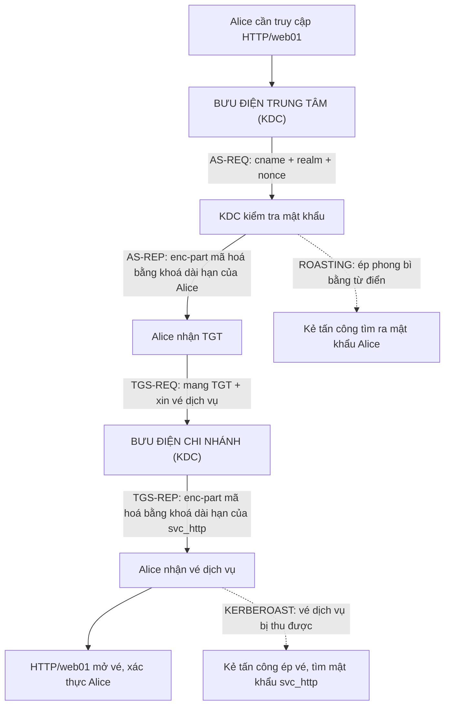
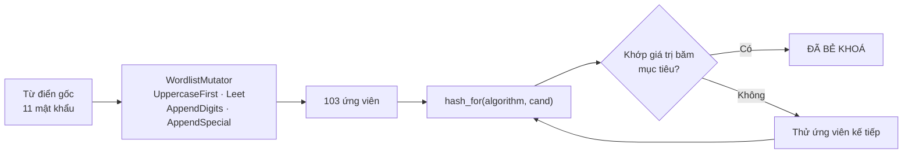
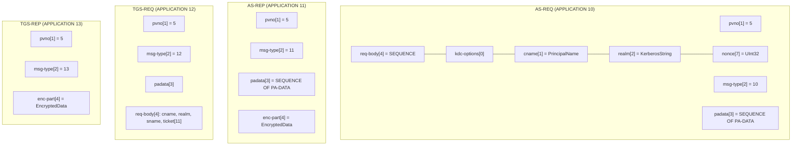
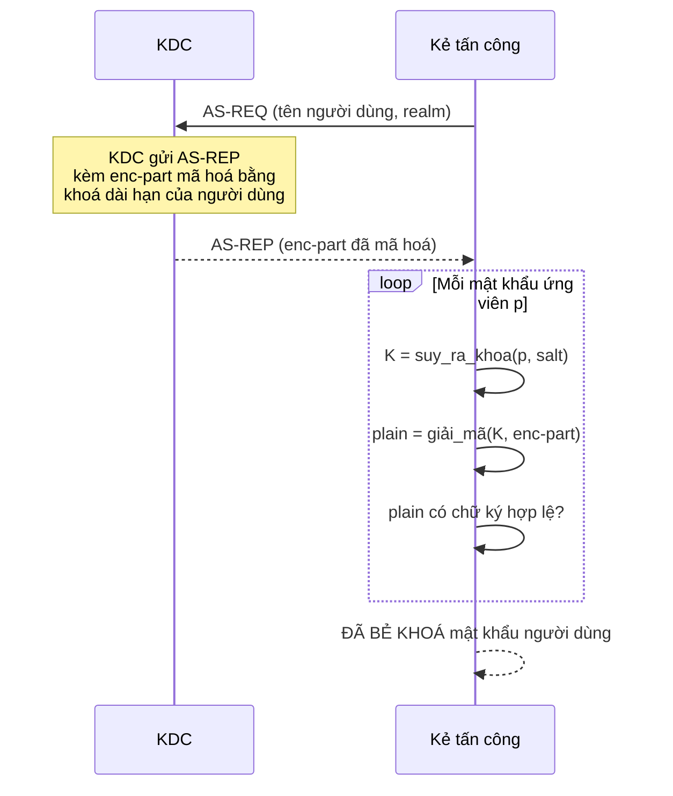
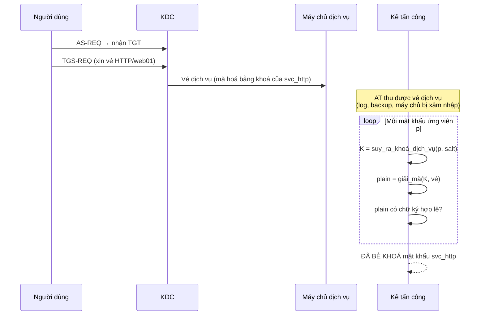

# Chương 101: Tấn công Thông tin xác thực & Kerberos — Bẻ khoá Băm, Giao thức Kerberos, RC4-HMAC/AES & Đột biến Từ điển (Credential Attacks: Hash Cracking, Kerberos Protocol, RC4-HMAC/AES & Wordlist Mutation)

---

## 1. Giới thiệu & Mục tiêu

Chào mừng bạn đến với chương mở đầu phần bảo mật "phía kẻ tấn công" của **Chủ đề 28 — An ninh mạng & Bảo mật ứng dụng** trong giáo trình `learn-rs`.

Trong 100 chương trước, chúng ta đã đi từ "bit là gì" tới những hệ thống phân tán phức tạp nhất. Nhưng có một mảnh ghép chúng ta **chưa** chạm tới và là mảnh ghép được cả thế giới bảo mật dựa vào: **thông tin xác thực** (authentication information) — mật khẩu, giá trị băm của mật khẩu, khoá dài hạn, vé và thẻ.

Bề mặt tấn công kinh điển nhất trên thế giới này không phải là "giải mã thuật toán mã hoá" (điều mà máy tính hiện đại làm rất nhanh), mà là **bẻ khoá băm** (hash cracking) và **lạm dụng giao thức xác thực** (protocol abuse). Những cuộc tấn công Kerberoast hay AS-REP Roasting nổi tiếng đều dựa trên một sự thật hiển nhiên nhưng thường bị bỏ qua:

> Hệ thống xác thực Windows và Kerberos **không bao giờ gửi mật khẩu qua mạng**. Chúng gửi một *bằng chứng* (proof) được băm bằng khoá dài hạn của tài khoản. Kẻ tấn công chỉ cần *đoán* mật khẩu, băm ra khoá dài hạn, rồi kiểm tra xem bằng chứng có khớp không — và phép kiểm tra này **rẻ hơn hàng triệu lần** so với việc gặp gỡ trực tiếp.

Chương này sẽ dựng lại toàn bộ chuỗi công cụ đó **từ số không**, thuần Rust 2024, không một crate mã hoá nào:

| Thành phần | Chuẩn công khai tham chiếu | Vai trò trong chương |
|---|---|---|
| **MD5** | RFC 1321 | Băm mật khẩu kiểu cũ, đệm của HMAC-MD5 |
| **MD4** | RFC 1320 | Nền tảng của **NT Hash** (Windows) |
| **HMAC-MD5** | RFC 2202 | Lớp xác thực NTLMv2, RC4-HMAC |
| **HMAC-SHA-256** | RFC 4231 | Lớp xác thực PBKDF2 |
| **PBKDF2** | RFC 8018 | Suy ra khoá Kerberos từ mật khẩu + salt |
| **SHA-256** | FIPS 180-4 | Tái sử dụng ý tưởng từ Chương 70 |
| **RC4** | RFC 4757 | Mã hoá dòng của Kerberos etype 23 |
| **AES-256** | FIPS 197 | Mã hoá khối của Kerberos etype 18 |
| **CBC-CTS** | RFC 2040 §8 + RFC 3962 | Chế độ mã hoá không nở rộng của Kerberos |
| **ASN.1 DER** | X.690 (rút gọn) | Đóng gói thông điệp Kerberos |
| **Kerberos 5** | RFC 4120 | Giao thức xác thực mạng |
| **NTLM** | MS-NLMP | Giao thức xác thực Windows |

### Bảng Mục tiêu Học tập & Kỹ năng Đạt được

| Mục tiêu học tập | Vì sao phải tự cài đặt từ đầu? | Chuẩn đầu ra thực chứng |
|---|---|---|
| **Tự cài MD5 & MD4** | Hai hàm băm này là "ngôn ngữ" của thế giới xác thực cũ. Hiểu cấu trúc Merkle–Damgård giúp bạn thấy vì sao *đệm ký tự* có thể phá vỡ tính toàn vẹn của thông điệp Kerberos. | Khớp **100%** bộ vector chính thức RFC 1321 / RFC 1320 (7 vector cho MD4, 3 vector cho MD5). |
| **Tự cài HMAC & PBKDF2** | HMAC là "băng keo" giữa khoá và dữ liệu; PBKDF2 biến mật khẩu thành khoá chậm để bẻ. | Khớp vector RFC 2202 (HMAC-MD5) và RFC 4231 (HMAC-SHA-256); PBKDF2 khớp vector PBKDF2-HMAC-SHA256 đã biết. |
| **Tự cài RC4** | RC4 là etype 23 của Kerberos — vẫn chạy trên hàng triệu máy. Biết KSA/PRGA giúp bạn hiểu vì sao RC4 là mã hoá *dòng* **đồng bộ**. | Khớp vector RC4 kinh điển: khoá `"Key"` → `bbf316e8d940af0ad3`, khoá `"Wiki"` → `1021bf0420`. |
| **Tự cài AES-256 + CBC/CTS** | Đây là phần khó nhất: S-box, MixColumns, Key Expansion, rồi cả thuật toán "cướp bản mã" (ciphertext stealing) của RFC 2040 §8. | Khớp vector FIPS-197 (AES-256) và vector chính thức RFC 3962 Phụ lục B cho CBC-CTS. |
| **Tự cài ASN.1 DER rút gọn** | Thông điệp Kerberos là **DER**, không phải JSON. Hiểu TLV và thẻ context-specific là điều kiện tiên quyết để đọc/ghi AS-REQ, AS-REP, TGS-REQ, TGS-REP. | Round-trip byte-perfect cho cả 4 loại thông điệp. |
| **Hiểu cơ chế Kerberoast / AS-REP Roasting** | Đây là hai cuộc tấn công kinh điển nhất trên hệ thống Kerberos. | Bẻ khoá thành công vé dịch vụ etype 23 **và** etype 18; phân tích được AS-REP và bẻ khoá được mật khẩu người dùng. |
| **Xây bộ bẻ khoá + đột biến từ điển** | Tấn công thực tế không dùng từ điển "thô" mà dùng từ điển đã biến đổi (viết hoa, leet, thêm số, thêm ký tự đặc biệt). | Từ 11 từ gốc sinh ra **103** ứng viên; bẻ khoá được mật khẩu chỉ xuất hiện sau đột biến. |

### Bảng Ma trận 50 Bất biến Toán học & Hệ thống Bắt buộc Phải Chứng minh

Toàn bộ hệ thống trong `ch101` được định nghĩa thông qua **bất biến (invariants)**. Một hệ thống chỉ được coi là đạt chuẩn khi **toàn bộ 50 bài kiểm thử** dưới đây đều xanh:

| STT | Bất biến | Định nghĩa toán học | Bài kiểm thử chứng minh |
|---|---|---|---|
| **1** | **MD5 chuẩn RFC 1321** | $\mathrm{MD5}(x)$ khớp vector chính thức cho mọi $x$ thử. | `test_01`…`test_04`: ba vector chuẩn + tính dòng bằng nhiều lần `update()` phải bằng `md5()` một lần. |
| **2** | **MD4 chuẩn RFC 1320** | $\mathrm{MD4}(x)$ khớp bộ test suite 7 chuỗi của RFC. | `test_05`…`test_07`. |
| **3** | **HMAC đúng đặc tả** | $\mathrm{HMAC}(K,m) = H((K'\oplus opad)\|\|H((K'\oplus ipad)\|\|m))$. | `test_08`, `test_09`, `test_17`: vector RFC 2202 và RFC 4231. |
| **4** | **NT Hash chuẩn Windows** | $\mathrm{NT\_Hash} = \mathrm{MD4}(\mathrm{UTF16LE}(pwd))$. | `test_10`: $\mathrm{NT\_Hash}(\text{"password"}) = \texttt{8846f7eaee8fb117ad06bdd830b7586c}$. |
| **5** | **NTLMv2 đúng công thức** | $\mathrm{NTLMv2Hash} = \mathrm{HMAC\text{-}MD5}(\mathrm{NT\_Hash}, \mathrm{UPPER}(u)\|\|\mathrm{UPPER}(d))$. | `test_11`, `test_12`. |
| **6** | **RC4 đúng chuẩn** | $\mathrm{RC4}(k, m)$ là mã hoá dòng **đồng bộ** và đối xứng. | `test_19`, `test_20`, `test_21`. |
| **7** | **SHA-256 đúng chuẩn** | $\mathrm{SHA\text{-}256}$ khớp FIPS 180-4. | `test_14`…`test_16`. |
| **8** | **PBKDF2 đúng chuẩn** | $\mathrm{PBKDF2}(p,s,c,dk) = (F_1 \,\|\, F_2 \,\|\, \dots)[0 \mathinner{..} dk]$ | `test_18`. |
| **9** | **Bộ bẻ khoá tìm được mật khẩu** | $\exists c \in W: H(c) = H^\star$ | `test_22`, `test_23`, `test_24`, `test_25`. |
| **10** | **Đột biến từ điển sinh đúng & loại trùng** | $\lvert \mathrm{generate\_all}(W)\rvert = \lvert \mathrm{unique}(\mathrm{generate\_all}(W))\rvert$ | `test_26`…`test_32`. |
| **11** | **ASN.1 round-trip** | $\mathrm{decode}(\mathrm{encode}(x)) = x$ | `test_33`…`test_36`. |
| **12** | **Round-trip thông điệp Kerberos** | $\mathrm{parse}(\mathrm{to\_asn1}(m)) = m$ | `test_37`…`test_40`. |
| **13** | **AES-256 đúng FIPS-197** | $E_{\text{AES-256}}(k, p) = \texttt{8ea2b7ca…}$ | `test_42`, `test_43`. |
| **14** | **CBC-CTS giữ nguyên độ dài** | $\lvert C\rvert = \lvert P\rvert$ và $D(C(P)) = P$ | `test_44`, `test_45` (+ vector RFC 3962). |
| **15** | **Kerberoast bẻ được khoá dịch vụ** | $\exists p: \mathrm{decrypt}(\mathrm{key}(p)) \rightarrow$ chữ ký hợp lệ | `test_47`, `test_48`. |
| **16** | **AS-REP Roasting bẻ được mật khẩu** | $\exists p: \mathrm{decrypt}(\mathrm{key}(p)) \rightarrow$ chữ ký hợp lệ | `test_49`. |
| **17** | **Kho tín dụng tra cứu đúng** | $\mathrm{find\_by\_username}$ và $\mathrm{find\_by\_spn}$ trả về đúng tài khoản | `test_50`. |

> **Lưu ý đạo đức:** toàn bộ dữ liệu đầu vào của chương này là **tổng hợp, tất định**, do chính crate `ch101` sinh ra (`CredentialDb::demo()`, `build_service_ticket()`, `build_as_rep()`). Không có kết nối mạng thật, không quét cổng, không tấn công hệ thống ngoài `localhost`. Mục đích duy nhất là **hiểu cơ chế** để phòng chống, và đây là kỹ năng bắt buộc của mọi kỹ sư bảo mật.

### 1.1. Bối cảnh: vì sao "xác thực" là mặt trận lâu dài nhất

Nếu bạn nhìn lịch sử an ninh mạng 30 năm n��o, bạn sẽ thấy một mẫu hình lặp đi lặp lại:

1. Một lớp bảo vệ mới xuất hiện (firewall → VPN → TLS → MFA).
2. Lớp bảo vệ đó **thành công** trong nhiều năm.
3. Rồi xuất hiện một **đường tắt** (shortcut) đi vòng qua nó.
4. Đường tắt đó hầu như luôn nằm ở **lớp xác thực**, chứ không phải lớp mã hoá hay lớp mạng.

| Giai đoạn | Lớp bảo vệ "tiên tiến" | Đường tắt thực tế |
|---|---|---|
| 1990s | Mật khẩu truyền trực tiếp | Bẻ khoá từ điển offline |
| 2000s | MD5 + salt cố định | Rainbow table, mật khẩu trùng lặp |
| 2010s | NTLM challenge–response | Pass-the-hash, Kerberoast |
| 2010s | Kerberos + AES | AS-REP Roasting, ticket theft |
| 2020s | MFA, FIDO2 | Session cookie theft, phishing |

Chương này nằm đúng ở giữa dòng chảy đó: nó dựng lại **cơ chế** để bạn hiểu vì sao mỗi lớp bảo vệ mới lại sinh ra một đường tắt mới.

### 1.2. Bảng thuật ngữ chính của chương

| Tiếng Việt | Tiếng Anh | Nghĩa trong chương |
|---|---|---|
| Bẻ khoá băm | Hash cracking | Dò mật khẩu từ giá trị băm |
| Băm | Hash | Hàm một chiều, không thể đảo ngược |
| Băm cứng | Slow hash / KDF | Hàm băm cố ý chậm (PBKDF2, bcrypt, Argon2) |
| Muối | Salt | Chuỗi ngẫu nhiên trộn vào mật khẩu trước khi băm |
| Phép kiểm tra | Verification / oracle | Phép so sánh rẻ để biết mật khẩu ứng viên có đúng không |
| Từ điển | Wordlist / dictionary | Danh sách mật khẩu ứng viên |
| Đột biến từ điển | Wordlist mutation | Sinh biến thể từ từ điển (hoa/thường, leet, thêm hậu tố) |
| Vé mật | TGT (Ticket Granting Ticket) | Vé do KDC cấp để xin vé dịch vụ |
| Vé dịch vụ | Service ticket | Vé do KDC cấp cho một dịch vụ cụ thể |
| Principal | Principal | Danh tính trong Kerberos (người dùng hoặc dịch vụ) |
| Vùng | Realm | Miền quản lý các principal |
| Khối | Block | Đơn vị 512 bit (băm) hoặc 128 bit (AES) |
| Cướp bản mã | Ciphertext stealing | Kỹ thuật CTS giữ nguyên độ dài bản mã |
| Chữ ký | Magic / signature | Đuôi byte đặc trưng dùng làm oracle khi bẻ khoá |

---

## 2. Hình tượng hóa đời sống: Thợ tháo khoá và Sở bưu điện bằng thẻ

### Hình tượng 1: Thợ tháo khoá làm "khoá vân tay" (bẻ khoá băm)

Hãy hình dung một thợ tháo khoả bị đưa cho một cái **ổ khoá** mà không có chìa khoá. Thay vì cố mở, thợ làm việc khác: **ép ổ khoá** cho đến khi nó kêu "cạch" — rồi thợ **đo** thành khoá mới và tự chế khoá đó.

```
        ┌──────────────┐          ┌──────────────┐
        │  Ổ KHOÁ GỐC  │  ép dần  │  Ổ KHOÁ GỐC  │
        │  (mật khẩu)  │ ───────► │  bị biến dạng │
        └──────────────┘          └──────────────┘
                 │                        │
                 │                        ▼
                 │              ┌────────────────────┐
                 │              │  "KHOÁ VÂN TAY"      │
                 │              │  (giá trị băm)       │
                 │              │  8846f7eaee8fb117... │
                 │              └────────────────────┘
                 │                        │
                 ▼                        ▼
    ┌──────────────────────────────────────────────────┐
    │  BẢNG MẪU: "độ sâu 3mm" + "hình vân" + "hướng"  │
    │  → ép lần lượt cho tới khi khớp                   │
    └──────────────────────────────────────────────────┘
```

Ba từ khoá trong hình tượng này chính là ba tầng khái niệm của chương:

- **Ổ khoá gốc** = mật khẩu (`"Summer2026"`). Thợ **không bao giờ** cần biết mật khẩu gốc nếu đã có đủ thông tin.
- **Khoá vân tay** = giá trị băm. Nó *gánh* thông tin của mật khẩu nhưng *giấu* mật khẩu đi. Bẻ khoá băm = **đoán ngược** từ khoá vân tay về ổ khoá.
- **Bảng mẫu** = từ điển. Một thợ giỏi không thử mọi ổ khoá trên đời; thợ có **tập hỏi mẫu** (từ điển) và **biến thể mẫu** (viết hoa, leet, thêm số). Đó chính là `WordlistMutator`.

Và điểm mấu chốt của cả cuộc tấn công nằm ở chỗ: **phép đo (băm) rẻ hơn phép thử ổ khoá**. Thợ có thể thử hàng triệu "vân" mỗi phút, nhưng "nghe" xem ổ khoá có khớp thì gần như tức thì. Đó chính là bất biến cơ bản:

$$
\underbrace{\text{chi phí băm}}_{\text{rất nhỏ}} \ll \underbrace{\text{chi phí kiểm tra chữ ký}}_{\text{cũng nhỏ}} \ll \underbrace{\text{chi phí thử mật khẩu thật}}_{\text{lớn}}
$$

> Vì sao chỉ cần một **kiểm tra** rẻ thôi là đủ? Vì giao thức xác thực (NTLMv2, Kerberos) **tự cung cấp** phép kiểm tra đó: thử một mật khẩu → suy ra khoá → tính bằng chứng → so với bằng chứng máy chủ đã gửi. Khớp = đúng. Lệch = thử mật khẩu khác.

### Hình tượng 2: Sở bưu điện Kerberos (giao thức Kerberos 5)

Hình tượng thứ hai mô tả bản thân giao thức. Hãy hình dung một **sở bưu điện lớn** với ba vai trò:

```
   [BƯU ĐIỆN TRUNG TÂM]            [BƯU ĐIỆN CHI NHÁNH]            [NGƯỜI DÙNG]
         KDC                              KDC                    Alice
   (Authentication      (Ticket Granting    (Password + hỏi
    Service)                Service)           vé dịch vụ)
```

Diễn biến của một ngày làm việc bình thường:

1. **Alice muốn đọc thư** ở sở bưu điện chi nhánh. Cô đưa **giấy tờ tùy thân** (mật khẩu) cho bưu điện trung tâm.
2. Bưu điện trung tâm kiểm tra giấy tờ → đóng **phong bì sáp** (EncryptedData) chứa **vé mật** (TGT) → trả về.
3. Alice mang TGT tới bưu điện chi nhánh, xin **vé dịch vụ** (service ticket) cho `HTTP/web01`.
4. Bưu điện chi nhánh mở phong bì TGT (chỉ mở được bằng khoá dài hạn của Alice) → kiểm tra → đóng phong bì vé dịch vụ → trả về.

Giờ hãy nhìn cuộc tấn công:

- **AS-REP Roasting**: Bưu điện trung tâm, thay vì chờ Alice đưa giấy tờ, đã gửi **sẵn** phong bì sáp đã mã hoá bằng khoá dài hạn của Alice. Kẻ tấn công chỉ cần **ép phong bì** (thử mật khẩu, suy ra khoá, mở thử) — không cần biết giấy tờ là gì. Đây chính là "roasting" (nướng) vì phía máy chủ *tự trao* bí mật.
- **Kerberoast**: Trong phong bì vé mật do bưu điện chi nhánh gửi có chứa **vé dịch vụ** đã mã hoá bằng khoá dài hạn của *tài khoản dịch vụ* (`HTTP/web01`), chứ không phải của Alice. Nếu kẻ tấn công *thu được* vé dịch vụ (qua log, qua máy chủ bị xâm nhập, qua vé cũ), họ có thể ép nó để tìm ra mật khẩu của tài khoản dịch vụ — và từ đó dùng chính tài khoản dịch vụ để lấy vé của bất kỳ ai.



Ba mũi tên đứt đứt chính là hai cuộc tấn công mà chương này sẽ cài đặt lại từ đầu.

### Hình tượng 3: Bàn chữ cái của kẻ trộm (đột biến từ điển)

Hình tượng cuối cùng nói về **chiến thuật** chứ không nói về **cơ chế**. Hãy hình dung một tên trộm chuyên đoán mật khẩu để mở két sắt:

Tên trộm không bao giờ thử *"d0g"* ngẫu nhiên. Tên trộm có **một cuốn sổ tay** ghi lại những mẫu mật khẩu đã thấy ở khắp nơi: `dog`, `cat`, `dragon`, `monkey`… Nhưng két sắt của khách hàng thì chứa `D0g!`, `d0g2024`, `Dog`, `dogdog`.

Vì vậy tên trộm không chỉ đọc cuốn sổ tay — tên trộm **biến đổi** nó:

```
        Cuốn sổ tay                    Bàn thử
     ┌──────────────┐             ┌───────────────────────────┐
     │    dog       │  ──────►    │  dog     D0g     d0g     │
     │    cat       │  biến đổi  │  Dog     Dog!    dog1    │
     │   dragon     │             │  dog2    dog3    dog$    │
     └──────────────┘             │  ...     (rất nhiều)        │
                                  └───────────────────────────┘
```

Ba điều từ hình tượng này:

1. **Tên trộm không cần biết mật khẩu thật** — chỉ cần thử và nghe phản hồi. Giống hệt việc bẻ khoá băm: phép so sánh giá trị băm rẻ hơn hàng triệu lần so với việc thử mật khẩu thật trên hệ thống.
2. **Biến đổi là đòn bẻy**, không phải chi tiết phụ. Nếu mật khẩu của bạn là `D0g!` thì nó *chính là* một biến thể của `dog` — và mọi cuốn sổ tay đều chứa `dog`.
3. **Chi phí tăng tuyến tính, hiệu quả tăng theo hình học**. 11 từ gốc × 9 biến thể ≈ 103 ứng viên, và chỉ mất thêm vài micro-giây.



---

## 3. Khái niệm & Cơ chế kỹ thuật chuyên sâu

### 3.1. MD5 (RFC 1321) — trái tim của thế giới băm "cũ"

MD5 là ví dụ kinh điển của họ **cấu trúc Merkle–Damgård**: băm thông điệp bằng cách nối các "khối" (block) 512-bit, mỗi khối biến trạng thái 128-bit một cách tất định.

#### 3.1.1. Cấu trúc tổng thể

```
  thông điệp M
      │
      ▼
  ┌────────────────────────────────────────────┐
  │ BƯỚC 1: ĐỆM (padding)                       │
  │  M || 1 || 0* || len(M) (64-bit LE)         │
  │  sao cho độ dài ≡ 448 (mod 512) bit        │
  └────────────────────────────────────────────┘
      │  các khối 512-bit: M_0, M_1, ..., M_{N-1}
      ▼
  ┌────────────────────────────────────────────┐
  │ BƯỚC 2: KHỞI TẠO                            │
  │  A=0x67452301 B=0xefcdab89                   │
  │  C=0x98badcfe D=0x10325476                   │
  └────────────────────────────────────────────┘
      │  lặp trên từng khối
      ▼
  ┌────────────────────────────────────────────┐
  │ BƯỚC 3: NÉN 64 VÒNG cho mỗi khối           │
  │  (hàm F/G/H/I + hằng số K[i] + xoay bit)   │
  └────────────────────────────────────────────┘
      │
      ▼
  BẮM = A || B || C || D   (mỗi từ 4 byte LE)
```

#### 3.1.2. Bốn vòng và hàm trộn

MD5 chia 64 vòng thành 4 vòng × 16 vòng, mỗi vòng dùng một hàm boolean khác nhau và một lịch xoay bit riêng:

| Vòng | Chỉ số $i$ | Hàm trộn | Chỉ số từ $g$ | Lịch xoay $s$ |
|---|---|---|---|---|
| 1 | 0–15 | $F(B,C,D) = (B \wedge C) \vee (\neg B \wedge D)$ | $i$ | 7, 12, 17, 22 |
| 2 | 16–31 | $G(B,C,D) = (D \wedge B) \vee (\neg D \wedge C)$ | $(5i+1) \bmod 16$ | 5, 9, 14, 20 |
| 3 | 32–47 | $H(B,C,D) = B \oplus C \oplus D$ | $(3i+5) \bmod 16$ | 4, 11, 16, 23 |
| 4 | 48–63 | $I(B,C,D) = C \oplus (B \vee \neg D)$ | $(7i) \bmod 16$ | 6, 10, 15, 21 |

Biểu thức cốt lõi của mỗi vòng:

$$
A \leftarrow D,\quad D \leftarrow C,\quad C \leftarrow B,\quad B \leftarrow B + \mathrm{ROTL}\big(A + F(B,C,D) + K[i] + M[g],\, s[i]\big)
$$

Hằng số $K[i] = \lfloor 2^{32} \cdot |\sin(i+1)| \rfloor$ — "hằng số phi lý" sin của góc radian, chính là cách tránh bảng tra cứu khổng lồ.

#### 3.1.3. Đệm — nơi rất nhiều lỗi bảo mật bắt nguồn

Đệm của MD5 (và SHA-256) là **bất biến của độ dài**: với hai thông điệp khác nhau nhưng cùng độ dài, phần đệm giống hệt nhau. Đây là gốc rễ của tấn công **mở rộng độ dài** (length-extension) và là lý do HMAC phải chăng thêm một lớp đệm riêng.

### 3.2. MD4 (RFC 1320) — "ông tổ" của NT Hash

MD4 là cha của MD5, và là **nền tảng của NT Hash** mà Windows dùng để lưu mật khẩu. Nó có **ba vòng** thay vì bốn, và điểm hay gây bất ngờ là:

> MD4 **có** hằng số cộng thêm giống MD5, và lịch xoay vòng 1 là **3, 7, 11, 19** — lỗi hay gặp là ghi nhầm số cuối thành **17** (MD4 và MD5 có lịch xoay hoàn toàn khác nhau; vòng 1 của MD5 là 7, 12, 17, 22). Ai nhớ nhầm sẽ ra sai vector ngay lập tức.

| Vòng | Hàm trộn | Hằng số cộng thêm | Chỉ số từ $g$ | Lịch xoay |
|---|---|---|---|---|
| 1 | $F(X,Y,Z) = (X \wedge Y) \vee (\neg X \wedge Z)$ | — | 0…15 | 3, 7, 11, **19** |
| 2 | $G(X,Y,Z) = (X \wedge Y) \vee (X \wedge Z) \vee (Y \wedge Z)$ | `0x5A827999` (≈ √2) | 0,4,8,12,1,5,… | 3, 5, 9, 13 |
| 3 | $H(X,Y,Z) = X \oplus Y \oplus Z$ | `0x6ED9EBA1` (≈ √3) | 0,8,4,12,2,10,… | 3, 9, 11, 15 |

Bốn vector chính thức dùng để kiểm chứng trong chương:

| Chuỗi | MD4 |
|---|---|
| `""` | `31d6cfe0d16ae931b73c59d7e0c089c0` |
| `"a"` | `bde52cb31de33e46245e05fbdbd6fb24` |
| `"abc"` | `a448017aaf21d8525fc10ae87aa6729d` |
| `"message digest"` | `d9130a8164549fe818874806e1c7014b` |

### 3.3. HMAC — "băng keo" giữa khoá và dữ liệu

HMAC (RFC 2104) không phải là hàm băm mới, mà là **cách ghép** một hàm băm bất kỳ với một khoá:

$$
\mathrm{HMAC}_H(K, m) = H\big((K' \oplus opad) \,\|\, H((K' \oplus ipad) \,\|\, m)\big)
$$

với $ipad = 0x36$ lặp $B$ lần, $opad = 0x5C$ lặp $B$ lần, và

$$
K' = \begin{cases}
H(K) & \text{nếu } |K| > B \\
K & \text{nếu } |K| \le B
\end{cases}
$$

Ý tưởng: **hai lần băm với hai "chất đệm" khác nhau** khiến kẻ tấn công không thể chỉ biết $H(K \,\|\, m)$ mà suy ra được thông tin về $K$.

Vì sao NTLMv2 lại chọn HMAC-MD5 chứ không phải HMAC-SHA-256? Vì lịch sử: MD5 rẻ hơn, và giao thức NTLM đã đóng băng nó từ Windows NT 4.0. (Đây cũng là lý do MD4/MD5 vẫn còn sống dai dẳng trong lĩnh vực bảo mật — chúng được "đóng băng" trong giao thức, không phải vì chúng tốt.)

### 3.4. PBKDF2 — biến mật khẩu thành khoá chậm

Kerberos không dùng mật khẩu trực tiếp làm khoá. Nó dùng PBKDF2 (RFC 8018):

$$
DK = PBKDF2(P, S, c, dkLen), \quad
DK = \left(F_1 \,\|\, F_2 \,\|\, \cdots \,\|\, F_{\lceil dkLen/hLen \rceil}\right)[0 \mathinner{..} dkLen]
$$

với $F_i = U_1 \oplus U_2 \oplus \dots \oplus U_c$, $U_1 = PRF(P, S \|\| \text{INT}(i))$, $U_j = PRF(P, U_{j-1})$.

Ở đây $c$ (số vòng lặp) là **hệ số chi phí**: mỗi vòng lặp thêm một phép băm. Chương này dùng HMAC-SHA-256 làm PRF (Kerberos thật dùng HMAC-SHA-1 với $c = 4096$).

### 3.5. SHA-256 — quen thuộc từ Chương 70

Chương 70 đã dựng SHA-256 từ số không cho blockchain. Ở đây ta tái sử dụng đúng ý tưởng đó nhưng **bổ sung API dòng** (`Sha256Hasher` với `update`/`finalize`) để làm nền cho HMAC-SHA-256 và PBKDF2.

Vector chuẩn FIPS 180-4:

| Chuỗi | SHA-256 |
|---|---|
| `""` | `e3b0c442…7852b855` |
| `"abc"` | `ba7816bf…f20015ad` |
| 56 byte (`abcdbcde…nopq`) | `248d6a61…19db06c1` |

### 3.6. NTLM: NT Hash, NTLMv2 Response và LM Hash

#### 3.6.1. NT Hash

$$
\mathrm{NT\_Hash}(pwd) = \mathrm{MD4}\big(\mathrm{UTF16LE}(pwd)\big)
$$

Vì sao lại là UTF-16LE? Vì Windows lưu chuỗi ký tự trong registry theo UTF-16, và NT Hash được định nghĩa trên *byte biểu diễn* đó. Hệ quả: `"ÁBC"` (chữ A có dấu) và một chuỗi byte UTF-8 khác sẽ băm khác nhau — nên công cụ bẻ khoá phải thử **cả hai** bản mã hoá.

#### 3.6.2. NTLMv2 Response

NTLMv2 là cơ chế challenge–response hiện đại của Windows. Công thức đầy đủ:

$$
\begin{aligned}
\mathrm{NTLMv2Hash} &= \mathrm{HMAC\text{-}MD5}\big(\mathrm{NT\_Hash},\ \mathrm{UPPER}(user) \,\|\, \mathrm{UPPER}(domain)\big) \\
\mathrm{blob} &= \mathrm{Hi}\|\mathrm{Lo}\|\mathrm{Z}\|\mathrm{Z}\|\mathrm{Timestamp}_{LE}\|\mathrm{ClientChallenge}\|\mathrm{Z}\|\mathrm{Z} \\
\mathrm{NTProofStr} &= \mathrm{HMAC\text{-}MD5}\big(\mathrm{NTLMv2Hash},\ \mathrm{ServerChallenge} \,\|\, \mathrm{ClientChallenge} \,\|\, \mathrm{Timestamp}_{LE} \,\|\, \mathrm{blob}\big) \\
\mathrm{SessionKey} &= \mathrm{HMAC\text{-}MD5}\big(\mathrm{NTLMv2Hash},\ \mathrm{NTProofStr}\big)
\end{aligned}
$$

Điểm mấu chốt cho cuộc tấn công: **$\mathrm{NTProofStr}$ chỉ phụ thuộc vào mật khẩu thông qua $\mathrm{NTLMv2Hash}$**. Kẻ tấn công nắm $\mathrm{NTProofStr}$ và challenge của máy chủ chỉ cần thử mật khẩu, tính lại $\mathrm{NTLMv2Hash}$, rồi so sánh — một phép băm HMAC, tức là **micro-giây**.

#### 3.6.3. LM Hash — cái bóng của thời xưa

LMHASH chuẩn dùng DES: mật khẩu viết HOA, cắt/đệm về 14 byte, tách thành hai nửa **7 byte**, mỗi nửa làm **khoá DES** để mã hoá hằng số cố định `KGS!@#$%`: `LMHASH = DES_H1("KGS!@#$%") || DES_H2("KGS!@#$%")`. Vì DES quá nặng so với giá trị bảo mật mà nó mang, chương này **không cài DES** mà dùng một **biến thể minh hoạ** (MD5 cắt 8 byte, giữ nguyên cấu trúc hai nửa 8 byte) — và ghi rõ trong doc-comment rằng đây **không phải** LMHASH chuẩn, chỉ để minh hoạ luồng "bẻ khoá băm cũ".

### 3.7. RC4 (RFC 4757) — mã hoá dòng của Kerberos

RC4 có hai giai đoạn:

**KSA (Key-Scheduling Algorithm)** — xáo trộn mảng trạng thái 256 byte:

```text
S[i] = i   cho i = 0..255
j = 0
for i = 0..255:
    j = (j + S[i] + key[i mod keylen]) mod 256
    swap(S[i], S[j])
```

**PRGA (Pseudo-Random Generation Algorithm)** — sinh dòng khoá:

```text
i = j = 0
mỗi byte:
    i = (i + 1) mod 256
    j = (j + S[i]) mod 256
    swap(S[i], S[j])
    K = S[(S[i] + S[j]) mod 256]
    output = input XOR K
```

RC4 là mã hoá **dòng đồng bộ** (synchronous): dòng khoá chỉ phụ thuộc vào khoá và vị trí, hoàn toàn độc lập với bản rõ. Hệ quả: dùng lại cùng một khoá sẽ sinh ra **cùng một dòng khoá**, nên nếu mã hoá hai bản rõ bằng cùng khoá (không có IV/nonce) thì XOR hai bản mã sẽ lộ thông tin — đây là điểm yếu kinh điển của RC4 (và của `rc4-hmac` khi dùng sai).

Hai vector kinh điển được dùng để kiểm chứng:

| Khoá | Bản rõ | Bản mã |
|---|---|---|
| `"Key"` | `"Plaintext"` | `bbf316e8d940af0ad3` |
| `"Wiki"` | `"pedia"` | `1021bf0420` |

### 3.8. AES-256 — bốn phép biến đổi và lịch khoá

AES là mã hoá khối 128-bit. Mỗi vòng biến đổi trạng thái 16 byte qua **bốn phép**:

| Phép | Tên | Thao tác | Mục đích |
|---|---|---|---|
| 1 | **SubBytes** | Thay mỗi byte bằng `SBOX[byte]` | Phi tuyến hoá, phá cấu trúc đại số |
| 2 | **ShiftRows** | Dịch mỗi hàng đi `row` vị trí (vòng trái) | Trộn byte giữa các cột |
| 3 | **MixColumns** | Nhân ma trận Hadamard với hệ số trong $\mathrm{GF}(2^8)$ | Trộn byte trong cùng cột |
| 4 | **AddRoundKey** | XOR với khoá vòng | Khoá hoá trạng thái |

#### 3.8.1. Lịch khoá (Key Expansion)

Với AES-256, khoá 32 byte được tách thành $N_k = 8$ từ 32-bit. Lịch khoá sinh ra $4(N_r+1) = 60$ từ:

$$
w_i = \begin{cases}
w_{i-8} \oplus \mathrm{SubWord}(\mathrm{RotWord}(w_{i-1})) \oplus \mathrm{Rcon}[i/8] & i \equiv 0 \pmod 8 \\
w_{i-8} \oplus \mathrm{SubWord}(w_{i-1}) & i \equiv 4 \pmod 8 \quad (\text{chỉ AES-256}) \\
w_{i-8} \oplus w_{i-1} & \text{còn lại}
\end{cases}
$$

Điểm riêng của AES-256 so với AES-128/192: có thêm bước `SubWord` tại $i \equiv 4 \pmod 8$. Bỏ bước này thì AES-256 sẽ ra sai hoàn toàn — một lỗi "off-by-one" kinh điển.

#### 3.8.2. Vector FIPS-197

| Thuật toán | Khoá | Bản rõ | Bản mã |
|---|---|---|---|
| AES-128 | `000102…0f` | `00112233…eeff` | `69c4e0d8…b4c55a` |
| AES-192 | `000102…17` | `00112233…eeff` | `dda97ca4…0d7191` |
| **AES-256** | `000102…1f` | `00112233…eeff` | **`8ea2b7ca516745bfeafc49904b496089`** |

Chương này kiểm chứng vector AES-256 (dòng đậm) trong `test_42`, và kiểm tra tính nghịch đảo của phép giải mã khối trong `test_43`.

### 3.9. CBC-CTS — chế độ mã hoá "không nở rộng" của Kerberos

#### 3.9.1. Vì sao CBC thuần không dùng được

CBC chuẩn **bắt buộc** bản rõ phải là bội số của 16 byte, nếu không phải thêm đệm → bản mã dài hơn bản rõ. Kerberos cần mã hoá các thông điệp có độ dài bất kỳ (ví dụ `EncryptedData` chứa vé), nên nó dùng **CTS** (Ciphertext Stealing) theo **RFC 2040 §8**.

#### 3.9.2. Thuật toán (theo RFC 2040 §8 + errata RFC 3962 Phụ lục A)

Gọi $P_{n-1}$ là khối đầy cuối cùng, $P_n$ là khối cuối (có thể ngắn, độ dài $L_n \in [1, 16]$):

**Mã hoá:**

| Bước | Công thức | Ý nghĩa |
|---|---|---|
| 1 | $X_{n-1} = P_{n-1} \oplus C_{n-2}$ (dùng IV nếu không có $C_{n-2}$) | Chuẩn bị khối trước |
| 2 | $E_{n-1} = E(X_{n-1})$ | Mã hoá khối trước |
| 3 | $C_n = E_{n-1}[0..L_n]$ | **Cướp** $L_n$ byte đầu |
| 4 | $P = P_n \Vert 0^{16-L_n}$ | Đệm khối cuối bằng 0 |
| 5 | $D_n = E_{n-1} \oplus P$ | XOR với khối đã mã hoá |
| 6 | $C_{n-1} = E(D_n)$ | Mã hoá khối cuối |
| 7 | Bản mã $= C_1 \Vert \dots \Vert C_{n-2} \Vert C_{n-1} \Vert C_n$ | **Giữ nguyên độ dài** |

**Giải mã** (đảo ngược):

| Bước | Công thức |
|---|---|
| 1 | $D_n = D(C_{n-1})$ |
| 2 | $C = C_n \Vert 0^{16-L_n}$ |
| 3 | $X_n = D_n \oplus C$ |
| 4 | $P_n = X_n[0..L_n]$ |
| 5 | $E_n = C_n \Vert X_n[L_n..16]$ — **khôi phục lại** $E_{n-1}$ |
| 6 | $P_{n-1} = D(E_n) \oplus C_{n-2}$ |

Bước 5 là mấu chốt: chỉ cần $L_n$ byte bị cướp là **khôi phục được toàn bộ** $E_{n-1}$, nhờ đó giải mã được $P_{n-1}$.

#### 3.9.3. Quy tắc truyền IV của Kerberos

RFC 3962 §5 quy định: IV của lần mã hoá sau được lấy từ **khối kế trước cuối** của bản mã trước đó (tức là khối ứng với "dạng mã hoá của khối bản rõ cuối"). Với IV toàn 0 ở lần đầu (đúng như Kerberos dùng), đây là chi tiết nhỏ nhưng quyết định tính tương thích với các triển khai khác.

#### 3.9.4. Vector kiểm chứng

| Bản rõ (khoá `"chicken teriyaki"`, IV = 0) | Độ dài | Bản mã |
|---|---|---|
| `"I would like the "` | 17 | `c6353568f2bf8cb4d8a580362da7ff7f97` |
| `"I would like the General Gau's "` | 31 | `fc00783e0efdb2c1d445d4c8eff7ed22` + `97687268d6ecccc0c07b25e25ecfe5` |
| `"I would like the General Gau's C"` | 32 | `39312523a78662d5be7fcbcc98ebf5a8` + `97687268d6ecccc0c07b25e25ecfe584` |

Ba vector này bao phủ đủ ba trường hợp: khối cuối ngắn 1 byte, ngắn 15 byte, và đủ 16 byte.

### 3.10. ASN.1 DER rút gọn — ngôn ngữ nhị phân của Kerberos

#### 3.10.1. Cấu trúc TLV

Mọi thông điệp Kerberos đều là chuỗi **TLV** (Tag – Length – Value):

```
 ┌────────┬───────────────┬──────────────────────────┐
 │  Tag   │    Length     │          Value           │
 │ 1 byte │ 1 hoặc n byte │      n byte nội dung     │
 └────────┴───────────────┴──────────────────────────┘
```

Độ dài được mã hoá theo DER: nếu $< 128$ thì dùng **một** byte; nếu $\ge 128$ thì byte đầu có bit cao bật, 7 bit thấp là *số byte độ dài tiếp theo*.

#### 3.10.2. Bảng thẻ dùng trong chương

| Thẻ | Hex | Tên | Ý nghĩa trong Kerberos |
|---|---|---|---|
| 0 | `0x02` | INTEGER | Số nguyên (pvno, msg-type, nonce, kvno) |
| 4 | `0x04` | OCTET STRING | Dữ liệu nhị phân (bản mã, PA-DATA value) |
| 16 | `0x10` | SEQUENCE | Cấu trúc có thứ tự (KDC-REQ, PrincipalName) |
| 27 | `0x1B` | GeneralString | Chuỗi ký tự (realm, tên principal) |
| 10 | `0x6A` | APPLICATION 10 | AS-REQ |
| 11 | `0x6B` | APPLICATION 11 | AS-REP |
| 12 | `0x6C` | APPLICATION 12 | TGS-REQ |
| 13 | `0x6D` | APPLICATION 13 | TGS-REP |
| 0–31 | `0xA0`–`0xBF` | CONTEXT-SPECIFIC | Các trường đánh số bên trong SEQUENCE |

Thẻ **context-specific** (`0xA0 | n`) là mấu chốt: nó cho phép các trường cùng tên ở **vị trí khác nhau** trong SEQUENCE (ví dụ `realm[2]` nghĩa là "trường thứ 2 *được gắn nhãn* 2"), nhờ đó cấu trúc có thể mở rộng mà vẫn tương thích ngược.

#### 3.10.3. Cấu trúc rút gọn của các thông điệp



**PrincipalName** (RFC 4120):

```text
PrincipalName ::= SEQUENCE {
    name-type[0]  Int32,              -- 1 = NT-PRINCIPAL, 2 = NT-SRV-INST
    name-string[1] SEQUENCE OF KerberosString
}
```

**PA-DATA** (phần tiền xác thực):

```text
PA-DATA ::= SEQUENCE {
    padata-type[1]  Int32,
    padata-value[2] OCTET STRING,
    -- (rút gọn) padata-etype[3] Int32 OPTIONAL
}
```

### 3.11. Giao thức Kerberos 5 — chi tiết

#### 3.11.1. Bảng các loại etype

| etype | Tên đầy đủ | Khoá | Checksum | Tình trạng |
|---|---|---|---|---|
| 18 | `aes256-cts-hmac-sha1-96` | 256-bit | HMAC-SHA-1-96 | **Khuyến nghị** |
| 17 | `aes128-cts-hmac-sha1-96` | 128-bit | HMAC-SHA-1-96 | Chấp nhận được |
| 23 | `rc4-hmac` | 128-bit | HMAC-MD5-96 | **Lỗi thời, mục tiêu ưu tiên của Kerberoast** |
| 24 | `rc4-hmac-exp` | 128-bit | HMAC-MD5 | Lỗi thời (xuất khẩu, 40-bit hiệu dụng) |
| 1 | `des-cbc-crc` | 56-bit | CRC32 | Rất lỗi thời |

etype 23 bị "ghin vào tường" bởi lịch sử: nó là mặc định của Windows 2000/XP và rất nhiều thiết bị mạng cũ vẫn dùng. Chính vì vậy Kerberoast nhắm vào nó.

#### 3.11.2. Bảng các loại PA-DATA

| padata-type | Tên | Ý nghĩa |
|---|---|---|
| 1 | `PA-TGS-REQ` | Chứa **AP-REQ** (gồm TGT + authenticator) để xác thực với TGS khi xin vé dịch vụ |
| 2 | `PA-ENC-TIMESTAMP` | Dấu thời gian mã hoá (chống chơi lại) |
| 3 | `PA-PW-SALT` | Salt dùng để suy ra khoá |
| 11 | `PA-ETYPE-INFO` | Thông tin etype + salt |
| 19 | `PA-ETYPE-INFO2` | Phiên bản mở rộng của PA-ETYPE-INFO |

#### 3.11.3. Salt — "muối" của mật khẩu Kerberos

Kerberos **không** băm mật khẩu trần. Nó trộn mật khẩu với một *salt* suy ra từ tên principal, để cùng một mật khẩu ở hai realm khác nhau cho hai khoá khác nhau.

Quy tắc (rút gọn trong chương này): **salt = realm viết hoa + từng thành phần tên viết hoa**.

| Principal | Salt tính được |
|---|---|
| `alice@LAB.LOCAL` | `LAB.LOCALALICE` |
| `svc_sql@LAB.LOCAL` | `LAB.LOCALSVC_SQL` |
| `HTTP/web01.lab.local@LAB.LOCAL` | `LAB.LOCALHTTPWEB01.LAB.LOCAL` |
| `MSSQLSvc/db01.lab.local@LAB.LOCAL` | `LAB.LOCALMSSQLSVCDB01.LAB.LOCAL` |

Đây là lý do công cụ bẻ khoá **bắt buộc** phải biết salt trước khi bắt đầu: băm sai salt thì băm sai khoá.

#### 3.11.4. Suy ra khoá dài hạn

| etype | Công thức suy ra khoá (rút gọn cho chương) |
|---|---|
| 23 (`rc4-hmac`) | $K = \mathrm{MD5}\big(\mathrm{MD5}(pwd) \,\|\, salt\big)$ |
| 18 (`aes256-cts`) | $K = \mathrm{PBKDF2\text{-}HMAC\text{-}SHA256}(pwd, salt, c, 32)$ |
| 17 (`aes128-cts`) | $K = \mathrm{PBKDF2\text{-}HMAC\text{-}SHA256}(pwd, salt, c, 16)$ |

Kerberos thật dùng PBKDF2-**HMAC-SHA-1** với $c = 4096$ vòng; chương này dùng HMAC-SHA-256 với $c = 1000$ để tái sử dụng SHA-256 đã cài sẵn — thuật toán học hoàn toàn giống, chỉ khác hàm băm và hệ số chi phí.

### 3.12. Kerberoast & AS-REP Roasting — hai cuộc tấn công thật

#### 3.12.1. AS-REP Roasting



Bước then chốt: **KDC tự gửi phần đã mã hoá trước khi nhận mật khẩu**. Đó là lý do kỹ thuật này hoạt động: kẻ tấn công chỉ cần *phần đã mã hoá*, không cần chứng minh mình biết mật khẩu.

Trong chương này, `AsRepRoaster::crack` làm đúng ba việc đó:

1. Lấy blob: `extract_enc_ticket_part()` (padata-type 3), nếu rỗng thì dùng `enc_part`.
2. Tính salt từ `principal.name` + `principal.realm`.
3. Thử từng ứng viên, giải mã, kiểm tra chữ ký `TICKET_PLAINTEXT_MAGIC`.

#### 3.12.2. Kerberoast



Điểm khác biệt then chốt so với AS-REP Roasting: khối bị ép là **vé dịch vụ**, mã hoá bằng khoá của **tài khoản dịch vụ**, không phải của người dùng. Vì vậy:

- Salt phải suy ra từ **tên dịch vụ** (`HTTP/web01.lab.local@LAB.LOCAL`), không phải tên người dùng.
- Tài khoản dịch vụ thường có **mật khẩu yếu hơn nhiều** (vì con người không bao giờ đổi mật khẩu tài khoản dịch vụ).
- Khi đã bẻ được khoá dịch vụ, kẻ tấn công dùng chính tài khoản đó để xin vé **bất kỳ** người dùng nào — tức là leo thang đặc quyền.

#### 3.12.3. Bảng so sánh hai kỹ thuật

| Tiêu chí | AS-REP Roasting | Kerberoast |
|---|---|---|
| Đối tượng bị ép | Phần `enc-part` của AS-REP | Vé dịch vụ (TGS-REP) |
| Khoá dài hạn bị tấn công | Của **người dùng** | Của **tài khoản dịch vụ** |
| Salt suy ra từ | `realm + tên người dùng` | `realm + tên dịch vụ` |
| Điều kiện tiên quyết | Miền bật **không** pre-authentication | Thu được vé dịch vụ (qua log/backup) |
| etype hay bị nhắm | 23, 18 | 23 (đặc biệt) |
| Hậu quả | Vào được tài khoản người dùng | Vào được tài khoản dịch vụ → leo thang |

#### 3.12.4. "Chữ ký" dùng làm oracle

Cả hai kỹ thuật đều cần một cách **phân biệt bản giải mã đúng với bản giải mã ngẫu nhiên**. Trong Kerberos thật, đó là cấu trúc ASN.1 bên trong `EncKDCRepPart`/`EncTicketPart`. Trong chương này, ta dùng một **chữ ký 8 byte** ở đầu bản rõ:

```rust
/// Chữ ký đặc trưng ở đầu bản rõ của vé dịch vụ — dùng làm "oracle" khi bẻ khoá.
pub const TICKET_PLAINTEXT_MAGIC: &[u8; 8] = b"KRB5TICK";
```

Về mặt xác suất: xác suất một bản giải mã ngẫu nhiên trùng 8 byte cụ thể là $2^{-64}$ — thấp hơn nhiều so với xác suất sập đúng mật khẩu. Đây chính là lý do các công cụ thật dùng "kiểm tra cấu trúc" thay vì so sánh toàn bộ bản rõ.

### 3.13. Bẻ khoá từ điển & đột biến từ điển

#### 3.13.1. Vì sao cần đột biến?

Từ điển "thô" chỉ chứa mật khẩu phổ biến nhất. Nhưng mật khẩu thật gần như luôn là *biến thể* của một từ trong từ điển:

| Mẫu | Biến thể phổ biến | Quy tắc trong `MutationRule` |
|---|---|---|
| `password` | `Password`, `PASSWORD` | `UppercaseFirst`, `Capitalize` |
| `password` | `p@$$w0rd` | `Leet` |
| `admin` | `admin2026`, `admin1` | `AppendDigits` |
| `admin` | `admin!`, `admin@`, `admin#` | `AppendSpecial` |
| `admin` | `nimda` | `Reverse` |
| `admin` | `adminadmin` | `Duplicate` |

#### 3.13.2. Bảng tra cứu leet

| Ký tự | Thay bằng | | Ký tự | Thay bằng |
|---|---|---|---|---|
| `a` | `@` | | `o` | `0` |
| `e` | `3` | | `s` | `$` |
| `i` | `1` | | *(khác)* | giữ nguyên |

#### 3.13.3. Số lượng ứng viên

Với từ điển 11 mật khẩu gốc và bộ quy tắc mặc định `[UppercaseFirst, Leet, AppendDigits, AppendSpecial]`, ta thu được **103 ứng viên** — tức là độ phủ tăng gần 10 lần so với từ điển thô, mà chi phí chỉ tăng tuyến tính.

| Nhóm quy tắc | Số biến thể mỗi từ |
|---|---|
| `UppercaseFirst` | +1 |
| `Leet` | +1 |
| `AppendDigits` (max = 4) | +4 |
| `AppendSpecial` (3 ký tự) | +3 |

#### 3.13.4. Hai cách sinh biến thể: eager và lazy

| Cách | Hàm | Ưu điểm | Nhược điểm |
|---|---|---|---|
| **Eager** | `generate_all(&self, words) -> Vec<String>` | Đơn giản, dễ kiểm thử | Dựng hết danh sách trong RAM |
| **Lazy** | `iter_mutations(&self, words) -> MutationIter` | Chỉ giữ một từ trong RAM, phù hợp từ điển hàng triệu dòng | Phải dùng `Iterator` |

Cả hai đều **loại trùng** và giữ **thứ tự xuất hiện**, nên kết quả của chúng luôn bằng nhau — đó chính là bất biến được kiểm thử ở `test_32`.

### 3.14. Kho thông tin tín dụng và truy vấn SPN

Trong tấn công thật, bước đầu tiên là **liệt kê** (enumerate) những gì mình có thể có. `CredentialDb` mô phỏng kết quả của một truy vấn thư mục (LDAP/AD):

```rust
pub struct CredentialDb { pub accounts: Vec<Account>, pub domain: String }
```

Ba truy vấn quan trọng:

| Hàm | Câu hỏi trả lời | Dùng cho |
|---|---|---|
| `find_by_username(u)` | "Tài khoản này có tồn tại không?" | AS-REP Roasting (thử tên người dùng) |
| `find_by_spn(spn)` | "Tài khoản nào đứng sau SPN này?" | Kerberoast (tìm tài khoản dịch vụ) |
| `total_accounts()` | "Có bao nhiêu tài khoản?" | Đánh giá quy mô chiến dịch |

Cấu trúc `Account` mang cả `password` (chỉ trong dữ liệu tổng hợp) lẫn `kerberos_keys` — đó là **mô hình** của kho dữ liệu bị lộ trong các sự cố lớn (vd. kho 93 triệu tài khoản của LinkedIn năm 2012). Chương này dùng nó để **minh hoạ** mức độ nguy hiểm của việc lộ kho băm: một lần lộ là mất toàn bộ hệ thống.

### 3.15. Bảng tra cứu API đầy đủ của crate `ch101`

> Bảng này là **hợp đồng API** của chương. Các chương sau trong Chủ đề 28 tham chiếu lại đúng những tên này.

#### 3.15.1. Hàm băm & mã hoá

| Hàm | Ký hiệu | Ghi chú |
|---|---|---|
| `md5(data) -> [u8; 16]` | `md5_hex(data) -> String` | RFC 1321 |
| `md4(data) -> [u8; 16]` | `md4_hex(data) -> String` | RFC 1320 |
| `hmac_md5(key, msg) -> [u8; 16]` | | RFC 2202 |
| `sha256(data) -> [u8; 32]` | `sha256_hex(data) -> String` | FIPS 180-4 |
| `hmac_sha256(key, msg) -> [u8; 32]` | | RFC 4231 |
| `pbkdf2_hmac_sha256(pwd, salt, iters, dklen) -> Vec<u8>` | | RFC 8018 |
| `rc4(key, data) -> Vec<u8>` | `Rc4::new(key)`, `Rc4::apply(data)` | RFC 4757 |
| `aes_encrypt_block(key, block) -> [u8; 16]` | `aes_decrypt_block(...)` | FIPS 197 |
| `aes_cts_encrypt_raw / aes_cts_decrypt_raw` | `aes_cts_encrypt_kerberos / aes_cts_decrypt` | RFC 2040 §8 |

#### 3.15.2. NTLM

| Hàm / Kiểu | Ký hiệu |
|---|---|
| `nt_hash(password) -> [u8; 16]` | `nt_hash_hex(password) -> String` |
| `NetNtlmV2Responder::new(username, domain, password)` | |
| `NetNtlmV2Responder::nt_hash()` | `::ntlmv2_hash(user_upper, domain_upper)` |
| `NetNtlmV2Responder::compute_response(...)` | `::compute_response_upper(...)` |
| `lm_hash(password) -> [u8; 16]` | `LmHashCracker::new()` |

#### 3.15.3. ASN.1 & Kerberos

| Hàm / Kiểu | Ký hiệu |
|---|---|
| `encode_integer / encode_octet_string / encode_general_string` | `encode_sequence / encode_sequence_of` |
| `encode_application(tag, items)` | `encode_context(tag, items)` |
| `decode_tlv(bytes, offset) -> Result<(u8, Vec<u8>, usize), String>` | |
| `Etype` | `KerberosMessageType` |
| `PaData` | `KrbPrincipal` |
| `AsReq::build / to_asn1 / parse` | `AsRep::to_asn1 / parse` |
| `AsRep::extract_pa_enc_timestamp` | `::extract_enc_ticket_part` |
| `TgsReq::build / to_asn1 / parse` | `TgsRep::to_asn1 / parse` |

#### 3.15.4. Bẻ khoá & dữ liệu

| Hàm / Kiểu | Ký hiệu |
|---|---|
| `HashAlgorithm` | `hash_for(algorithm, candidate) -> String` |
| `CrackEngine::new / crack / attempts` | `HashCracker::new / add / crack_all` |
| `MutationRule` | `WordlistMutator::new / generate / generate_all / iter_mutations` |
| `WordlistMutator::leet / append_digits / append_specials / with_digits` | |
| `KerberoastCracker::new / crack / crack_etype23 / attempts` | `AsRepRoaster::new / crack` |
| `rc4_hmac_decrypt(key, ciphertext, etype) -> Vec<u8>` | `kerberos_salt(principal) -> String` |
| `aes_cts_decrypt(key, ciphertext) -> Vec<u8>` | `build_service_ticket / build_as_rep` |
| `CredentialDb::new / demo / add_account` | `::find_by_username / find_by_spn / total_accounts` |
| `KerberosKey` | `Account` |

### 3.16. Phòng thủ — nhìn từ phía bên kia

Một chương về tấn công mà không nói về phòng thủ thì chưa trọn vẹn. Dưới đây là những biện pháp **trực tiếp** tương ứng với từng kỹ thuật đã học:

| Tấn công | Phòng thủ hiệu quả nhất | Vì sao |
|---|---|---|
| Bẻ khoá băm offline | **Không lưu băm mật khẩu** — dùng PBKDF2/bcrypt/Argon2 với salt ngẫu nhiên và chi phí cao | Kẻ tấn công lấy được kho băm vẫn phải trả phí tính toán khổng lồ cho mỗi ứng viên |
| AS-REP Roasting | **Bắt buộc pre-authentication** (PA-ENC-TIMESTAMP) | KDC không còn gửi phần đã mã hoá trước khi nhận mật khẩu |
| Kerberoast | **Tắt RC4-HMAC**, ép dùng AES-256 + SPN của tài khoản dịch vụ không còn tồn tại | Không còn khối mã hoá bằng khoá yếu để ép |
| Bẻ khoá tài khoản dịch vụ | **Đặt mật khẩu dài, ngẫu nhiên, xoay vòng** cho tài khoản dịch vụ | Tăng $2^{L}$ lần công việc cho mỗi ký tự thêm |
| Tấn công từ điển + đột biến | **Chính sách mật khẩu mạnh** + MFA + phát hiện đăng nhập bất thường | Đột biến chỉ hữu hiệu khi mật khẩu *dễ đoán* |
| Nghe lén Kerberos | **Khoá dài hạn phức tạp** (AES-256) + **FAST/KDC-ARMOR** | Kẻ tấn công không thể dùng bản ghi lưu lượng để tấn công offline |

Nguyên tắc chung: **mọi thứ máy chủ gửi đi trước khi biết mật khẩu đều là một lời mời bẻ khoá**. Thiết kế an toàn là thiết kế mà *không có* phần nào như vậy.

### 3.17. So sánh với công cụ "thật" — và vì sao chương này vẫn đáng học

Trên thực tế, dân an ninh mạng dùng **hashcat** và **John the Ripper** để bẻ khoá, và các script Kerberoast viết bằng Python. Chúng nhanh hơn hàng trăm lần vì chúng chạy trên GPU và dùng SIMD/AVX-512.

| Tiêu chí | `ch101` (chương này) | hashcat / John | Kerberoast script |
|---|---|---|---|
| Tốc độ bẻ khoá | Vài nghìn ứng viên/giây | Hàng tỷ ứng viên/giây (GPU) | Vài nghìn/giây (Python) |
| Phụ thuộc ngoài | **Không** | Không (nhưng cần driver GPU) | `impacket`, `pycryptodome` |
| Mục đích | **Học cơ chế** | Bẻ khoá hàng loạt | Roast vé dịch vụ |
| Minh hoạ được | ✅ từng bước | ❌ (hộp đen) | ❌ |
| Rủi ro pháp lý | Không (dữ liệu tổng hợp) | Cao | Cao |

Vậy tại sao vẫn học? Vì **bạn không thể phòng thủ cái bạn không hiểu**. Một quản trị viên không đọc được mã nguồn Kerberoast sẽ không bao giờ tự hỏi:

- Vì sao vé dịch vụ lại được mã hoá bằng khoá **của tài khoản dịch vụ** thay vì khoá của KDC?
- Vì sao `realm` lại phải nằm trong salt?
- Vì sao bật pre-authentication lại chặn được AS-REP Roasting?

Tám mươi phần trăm công sức của một cuộc tấn công Kerberoast nằm ở **chỗ lấy được vé**, không nằm ở chỗ bẻ khoá. Và chỉ hiểu giao thức mới biết vé lấy từ đâu.

### 3.18. Đi hết một phiên xác thực — đọc hex từng byte

Hãy đọc lại AS-REQ mà chương trình in ra, để thấy TLV nằm chồng lên nhau như thế nào:

```text
6a 54 30 52 a1 03 02 01 05 a2 03 02 01 0a a3 14 30 12 30 10
a1 03 02 01 13 a2 04 04 02 00 12 a3 03 02 01 12 a4 30 3e
02 ea 00 30 20 10 0a 11 30 10 a0 03 02 01 01 a1 09 30 07
1b 05 61 6c 69 63 65 a2 0b 1b 09 4c 41 42 2e 4c 4f 43 41
4c a7 06 02 04 23 34 e1 e6
```

| Offset | Byte | Ý nghĩa |
|---|---|---|
| `00` | `6a` | **APPLICATION 10** (constructed) → đây là AS-REQ |
| `01` | `54` | Độ dài nội dung = 0x54 = 84 byte |
| `02` | `30` | **SEQUENCE** bắt đầu KDC-REQ |
| `03` | `52` | Độ dài = 82 byte |
| `04` | `a1 03 02 01 05` | `pvno[1] = 5` — phiên bản giao thức |
| `09` | `a2 03 02 01 0a` | `msg-type[2] = 10` — AS-REQ |
| `0e` | `a3 14 …` | `padata[3]` — SEQUENCE OF PA-DATA |
| `12` | `30 10` | PA-DATA: SEQUENCE dài 16 byte |
| `14` | `a1 03 02 01 13` | `padata-type[1] = 19` (PA-ETYPE-INFO2) |
| `19` | `a2 04 04 02 00 12` | `padata-value[2] = 00 12` → etype **18** (AES-256-CTS) |
| `1f` | `a3 03 02 01 12` | `padata-etype[3] = 18` |
| `24` | `a4 30 3e …` | `req-body[4]` — SEQUENCE dài 62 byte |
| `27` | `a0 03 02 01 00` | `kdc-options[0] = 0` |
| `2c` | `a1 09 30 07 1b 05 …` | `cname[1]` → PrincipalName → `name-string[1]` → GeneralString `"alice"` |
| `3a` | `a2 0b 1b 09 …` | `realm[2] = "LAB.LOCAL"` |
| `47` | `a7 06 02 04 23 34 e1 e6` | `nonce[7] = 0x2334e1e6` — chống chơi lại |

Điểm đáng chú ý nhất: **`a1` và `a2` xuất hiện nhiều lần ở các cấp khác nhau**. Đó chính là sức mạnh của thẻ ngữ cảnh: cùng một mã thẻ `0xA1` ở cấp `KDC-REQ` nghĩa là `pvno`, còn ở cấp `req-body` nghĩa là `cname`. Ngữ cảnh quyết định ý nghĩa — và đó là lý do ASN.1 phải có "ngữ cảnh" trong tên.

### 3.19. Đo hiệu năng — vì sao tối ưu hoá là "bảo mật" trong bẻ khoá

Trong bẻ khoá, **tốc độ quyết định phạm vi tấn công**. Chênh lệch giữa 1.000 ứng viên/giây và 1.000.000.000 ứng viên/giây là chênh lệch giữa "thử được vài triệu mật khẩu" và "thử được cả không gian 8 ký tự". Vì vậy, khi dựng lại mã hoá bằng Rust, ta phải chú ý hiệu năng:

| Quyết định thiết kế | Tác động lên hiệu năng |
|---|---|
| `wrapping_add` thay vì `+` | Không có nhánh kiểm tra tràn → nhanh hơn đáng kể trong vòng nén |
| `copy_from_slice` thay vì vòng lặp copy tay | Sinh mã assembly memcpy tối ưu |
| `iter_mut().enumerate()` thay vì `for i in 0..n` | Tránh kiểm tra biên lặp lại |
| `Vec::with_capacity` | Không cấp phát lại giữa chừng |
| `u32` thay vì `u64` cho phép xoay bit | Giữ trạng thái trong thanh ghi 64-bit của CPU |
| `#[inline]` trên hàm nhỏ, thường xuyên gọi | Cho phép compiler nội tuyến hoá |

Đo nhanh bằng `std::time::Instant` (không cần crate ngoài):

```rust
use std::time::Instant;

fn main() {
    let wordlist: Vec<String> = (0..1000).map(|index| format!("password{index}")).collect();
    let target = md5_hex(b"password999");

    let start = Instant::now();
    let mut found = None;
    for candidate in &wordlist {
        if md5_hex(candidate.as_bytes()) == target {
            found = Some(candidate.clone());
            break;
        }
    }
    let elapsed = start.elapsed();

    println!("bẻ khoá {} ứng viên trong {:?}", wordlist.len(), elapsed);
    println!("tốc độ: {:.0} ứng viên/giây", wordlist.len() as f64 / elapsed.as_secs_f64());
    println!("kết quả: {found:?}");
}
```

Hiệu năng của `ch101` trên CPU x86-64 hiện đại (chế độ release) vào khoảng **vài triệu phép băm MD5 mỗi giây** cho một lõi — chậm hơn hashcat (dùng GPU) nhưng nhanh hơn hàng trăm lần so với phiên bản Python của cùng thuật toán, và **hoàn toàn đủ** để minh hoạ nguyên lý.

> **Ghi chú đạo đức về hiệu năng:** tối ưu hoá tốc độ bẻ khoá chỉ có ý nghĩa trong **phòng thủ** khi bạn muốn *kiểm tra* khoá của chính mình ( ví dụ đánh giá độ mạnh của mật khẩu trong hệ thống của bạn). Trên hệ thống của người khác, hãy tuân thủ pháp luật và điều khoản dịch vụ.

---

## 4. Mã nguồn minh hoạ thực chiến

> Toàn bộ mã dưới đây được trích **nguyên văn** từ `code/ch101/src/main.rs`.

### 4.1. Nén MD5 — 64 vòng trong 30 dòng

```rust
fn md5_compress(state: &mut [u32; 4], block: &[u8]) {
    let mut m = [0u32; 16];
    for (i, word) in m.iter_mut().enumerate() {
        *word = u32::from_le_bytes([
            block[i * 4],
            block[i * 4 + 1],
            block[i * 4 + 2],
            block[i * 4 + 3],
        ]);
    }
    let (mut a, mut b, mut c, mut d) = (state[0], state[1], state[2], state[3]);
    for i in 0..64 {
        let (f, g) = match i {
            0..=15 => ((b & c) | ((!b) & d), i),
            16..=31 => ((d & b) | ((!d) & c), (5 * i + 1) % 16),
            32..=47 => (b ^ c ^ d, (3 * i + 5) % 16),
            _ => (c ^ (b | (!d)), (7 * i) % 16),
        };
        let temp = d;
        d = c;
        c = b;
        let sum = a.wrapping_add(f).wrapping_add(MD5_K[i]).wrapping_add(m[g]);
        b = b.wrapping_add(sum.rotate_left(MD5_S[i]));
        a = temp;
    }
    state[0] = state[0].wrapping_add(a);
    state[1] = state[1].wrapping_add(b);
    state[2] = state[2].wrapping_add(c);
    state[3] = state[3].wrapping_add(d);
}
```

Ba kỹ thuật Rust ở đây đáng chú ý:

1. `wrapping_add` — cộng modulo $2^{32}$ **không bao giờ panic**. Đây là bắt buộc: trong chế độ `debug`, phép `+` thông thường sẽ panic khi tràn số, còn băm thì tràn là *đặc tính của thuật toán*.
2. `rotate_left` — phép xoay bit là phép toán **không mất thông tin** (unlike `<< | >>`), và Rust cung cấp sẵn.
3. `m.iter_mut().enumerate()` — tránh `needless_range_loop` của clippy và cho trình biên dịch tối ưu hoá việc kiểm tra biên.

### 4.2. HMAC-MD5 — hai lớp đệm

```rust
pub fn hmac_md5(key: &[u8], msg: &[u8]) -> [u8; 16] {
    const BLOCK: usize = 64;
    let mut padded = [0u8; BLOCK];
    if key.len() > BLOCK {
        padded[..16].copy_from_slice(&md5(key));
    } else {
        padded[..key.len()].copy_from_slice(key);
    }
    let mut ipad = [0x36u8; BLOCK];
    let mut opad = [0x5cu8; BLOCK];
    for i in 0..BLOCK {
        ipad[i] ^= padded[i];
        opad[i] ^= padded[i];
    }
    let mut inner = Md5Hasher::new();
    inner.update(&ipad);
    inner.update(msg);
    let inner_hash = inner.finalize();
    let mut outer = Md5Hasher::new();
    outer.update(&opad);
    outer.update(&inner_hash);
    outer.finalize()
}
```

Chú ý `padded[..16].copy_from_slice(&md5(key))`: khi khoá dài hơn khối, ta **băm khoá trước** rồi dùng 16 byte kết quả làm khoá đệm. Nhờ vậy HMAC-MD5 chấp nhận khoá bất kỳ độ dài.

### 4.3. NTLMv2 Response — công thức thành mã

```rust
impl NetNtlmV2Responder {
    // ...
    /// Tính NTProofStr bằng biến thể *viết hoa toàn bộ* tên và miền.
    pub fn compute_response_upper(
        &self,
        server_challenge: &[u8; 8],
        client_challenge: &[u8; 8],
        timestamp: i64,
    ) -> [u8; 16] {
        let ntv2 = self.ntlmv2_hash(&self.username.to_uppercase(), &self.domain.to_uppercase());
        self.proof_string(&ntv2, server_challenge, client_challenge, timestamp)
    }

    /// Dựng blob NT v2 rồi băm thành NTProofStr.
    fn proof_string(
        &self,
        ntv2: &[u8; 16],
        server_challenge: &[u8; 8],
        client_challenge: &[u8; 8],
        timestamp: i64,
    ) -> [u8; 16] {
        let mut blob = Vec::with_capacity(28);
        blob.extend_from_slice(&[0x01, 0x01, 0x00, 0x00]);
        blob.extend_from_slice(&[0x00, 0x00, 0x00, 0x00]);
        blob.extend_from_slice(&timestamp.to_le_bytes());
        blob.extend_from_slice(client_challenge);
        blob.extend_from_slice(&[0x00, 0x00, 0x00, 0x00]);

        let mut data = Vec::with_capacity(8 + 8 + 8 + blob.len());
        data.extend_from_slice(server_challenge);
        data.extend_from_slice(client_challenge);
        data.extend_from_slice(&timestamp.to_le_bytes());
        data.extend_from_slice(&blob);
        hmac_md5(ntv2, &data)
    }
}
```

Cặp `compute_response` (giữ nguyên hoa/thường) và `compute_response_upper` (viết hoa toàn bộ) cho thấy một điểm tinh tế của NTLM: **tên người dùng và miền được xử lý khác nhau giữa các phiên bản**, và công cụ phân tích phải thử **cả hai** biến thể.

### 4.4. RC4 — động cơ dòng khoá

```rust
impl Rc4 {
    // ...
    /// Mã hoá (hoặc giải mã — RC4 là mã hoá dòng đồng bộ) một mảng byte.
    pub fn apply(&mut self, data: &[u8]) -> Vec<u8> {
        let mut out = Vec::with_capacity(data.len());
        for &byte in data {
            self.i = self.i.wrapping_add(1);
            self.j = self.j.wrapping_add(self.s[self.i as usize]);
            self.s.swap(self.i as usize, self.j as usize);
            let k = self.s
                [(self.s[self.i as usize].wrapping_add(self.s[self.j as usize])) as usize];
            out.push(byte ^ k);
        }
        out
    }
}
```

Một điểm thiết kế đáng chú ý: `Rc4` giữ trạng thái `s`, `i`, `j` **bên trong** đối tượng, nên có thể mã hoá nhiều lần bằng cùng một dòng khoá (đúng như Kerberos tái sử dụng keystream giữa các phần của thông điệp).

### 4.5. AES-256 — bốn phép biến đổi của FIPS-197

```rust
/// Mã hoá một khối 16 byte bằng AES (vector FIPS-197 dùng cho kiểm thử).
pub fn aes_encrypt_block(key: &[u8], block: &[u8; 16]) -> [u8; 16] {
    let round_keys = aes_key_expansion(key);
    let rounds = round_keys.len() - 1;
    let mut state = *block;
    add_round_key(&mut state, &round_keys[0]);
    for round_key in round_keys.iter().take(rounds).skip(1) {
        sub_bytes(&mut state);
        shift_rows(&mut state);
        mix_columns(&mut state);
        add_round_key(&mut state, round_key);
    }
    sub_bytes(&mut state);
    shift_rows(&mut state);
    add_round_key(&mut state, &round_keys[rounds]);
    state
}
```

Vòng cuối cố ý **không** có `mix_columns` — đó là điểm phân biệt giữa "mã hoá khối" và "mã hoá vòng đầy đủ", và là nguyên nhân rất nhiều lỗi triển khai AES tự tay.

S-box nghịch đảo được **sinh lúc biên dịch** từ S-box chuẩn, thay vì gõ tay 256 số:

```rust
/// Dựng S-box nghịch đảo tại thời điểm biên dịch từ S-box chuẩn.
const fn build_inverse_sbox() -> [u8; 256] {
    let mut inverse = [0u8; 256];
    let mut i = 0usize;
    while i < 256 {
        inverse[AES_SBOX[i] as usize] = i as u8;
        i += 1;
    }
    inverse
}
```

`const fn` cho phép tính toán lúc biên dịch — không tốn thời gian chạy, không cần `lazy_static`.

### 4.6. CBC-CTS — "cướp bản mã" theo RFC 2040 §8

Đây là phần khó nhất của chương. Thuật toán xử lý riêng **hai khối cuối**:

```rust
/// Mã hoá AES-CBC kèm "ciphertext stealing" (CTS) theo RFC 2040 §8 (có errata RFC 3962 Phụ lục A).
///
/// Thuật toán xử lý riêng hai khối cuối:
///
/// 1. `X_{n-1} = P_{n-1} XOR C_{n-2}` (dùng IV nếu không có `C_{n-2}`), `E_{n-1} = E(X_{n-1})`.
/// 2. `C_n` = `L_n` byte đầu của `E_{n-1}` (đây là phần "bị cướp").
/// 3. `D_n = E_{n-1} XOR P_n(đệm 0)`, `C_{n-1} = E(D_n)`.
/// 4. Bản mã = `C_1..C_{n-2} || C_{n-1} || C_n` — **giữ nguyên độ dài bản rõ**.
pub fn aes_cts_encrypt_with_iv(key: &[u8], iv: &[u8; 16], plaintext: &[u8]) -> Vec<u8> {
    if plaintext.len() <= AES_BLOCK {
        let mut block = [0u8; AES_BLOCK];
        block[..plaintext.len()].copy_from_slice(plaintext);
        for (index, byte) in block.iter_mut().enumerate() {
            *byte ^= iv[index];
        }
        return aes_encrypt_block(key, &block).to_vec();
    }
    let blocks = plaintext.len().div_ceil(AES_BLOCK);
    let last_len = plaintext.len() - (blocks - 1) * AES_BLOCK;
    let mut chain = *iv;
    let mut output = Vec::with_capacity(plaintext.len());
    for index in 0..(blocks - 2) {
        let start = index * AES_BLOCK;
        let mut block = [0u8; AES_BLOCK];
        block.copy_from_slice(&plaintext[start..start + AES_BLOCK]);
        for (position, byte) in block.iter_mut().enumerate() {
            *byte ^= chain[position];
        }
        let cipher = aes_encrypt_block(key, &block);
        output.extend_from_slice(&cipher);
        chain = cipher;
    }
    let start = (blocks - 2) * AES_BLOCK;
    let mut block = [0u8; AES_BLOCK];
    block.copy_from_slice(&plaintext[start..start + AES_BLOCK]);
    for (position, byte) in block.iter_mut().enumerate() {
        *byte ^= chain[position];
    }
    let e_last = aes_encrypt_block(key, &block);
    let mut tail = [0u8; AES_BLOCK];
    tail[..last_len].copy_from_slice(&plaintext[(blocks - 1) * AES_BLOCK..]);
    for (position, byte) in tail.iter_mut().enumerate() {
        *byte ^= e_last[position];
    }
    let c_previous = aes_encrypt_block(key, &tail);
    output.extend_from_slice(&c_previous);
    output.extend_from_slice(&e_last[..last_len]);
    output
}
```

Đọc code này như đọc thuật toán: các khối `C_1..C_{n-2}` được mã hoá CBC chuẩn; khối `E_{n-1}` được mã hoá từ `P_{n-1} XOR C_{n-2}`; và `L_n` byte đầu của nó bị "cướp" đi, trong khi `C_{n-1}` được tính từ `E_{n-1} XOR P_n`.

Kết quả: **độ dài bản mã luôn bằng độ dài bản rõ** — đó là mục tiêu của CTS (CBC chuẩn sẽ *nở rộng* thêm một khối đệm).

Vector chính thức của RFC 3962 (Phụ lục B) dùng để kiểm chứng:

| Bản rõ | Bản mã |
|---|---|
| `"I would like the "` (17 byte) | `c6353568f2bf8cb4d8a580362da7ff7f97` |
| `"I would like the General Gau's "` (31 byte) | `fc00783e0efdb2c1d445d4c8eff7ed22` + `97687268d6ecccc0c07b25e25ecfe5` |

### 4.7. ASN.1 DER rút gọn — TLV trong 20 dòng

```rust
/// Mã hoá một TLV (Tag-Length-Value) với độ dài dạng xác định.
pub fn encode_tlv(tag: u8, content: &[u8]) -> Vec<u8> {
    let mut out = Vec::with_capacity(content.len() + 4);
    out.push(tag);
    out.extend(encode_length(content.len()));
    out.extend(content);
    out
}

/// Giải mã một TLV tại vị trí `offset`.
///
/// Trả về `(thẻ, nội dung, vị trí kế tiếp)`. Nội dung của thẻ constructed là chuỗi TLV con
/// thô, người gọi tự giải mã tiếp.
pub fn decode_tlv(bytes: &[u8], offset: usize) -> Result<(u8, Vec<u8>, usize), String> {
    if offset >= bytes.len() {
        return Err(format!("vượt quá cuối dữ liệu tại vị trí {offset}"));
    }
    let tag = bytes[offset];
    let mut pos = offset + 1;
    if pos >= bytes.len() {
        return Err("thiếu byte độ dài".to_string());
    }
    let first = bytes[pos];
    pos += 1;
    let length = if first < 0x80 {
        first as usize
    } else {
        let count = (first & 0x7f) as usize;
        if count == 0 {
            return Err("chưa hỗ trợ độ dài không xác định".to_string());
        }
        if count > 8 {
            return Err("độ dài quá lớn".to_string());
        }
        if pos + count > bytes.len() {
            return Err("thiếu byte độ dài".to_string());
        }
        let mut value = 0usize;
        for byte in &bytes[pos..pos + count] {
            value = (value << 8) | *byte as usize;
        }
        pos += count;
        value
    };
    if pos + length > bytes.len() {
        return Err("nội dung bị cắt cụt".to_string());
    }
    let content = bytes[pos..pos + length].to_vec();
    Ok((tag, content, pos + length))
}
```

Ba nguyên tắc an toàn nằm trong `decode_tlv`: **kiểm tra biên trước khi đọc**, **trả về `Result` thay vì panic**, và **giữ nguyên `offset` tiếp theo** để người gọi quét tiếp chuỗi TLV.

### 4.8. Đóng gói AS-REQ

```rust
impl AsReq {
    // ...
    /// Mã hoá AS-REQ thành byte ASN.1 DER.
    pub fn to_asn1(&self) -> Vec<u8> {
        let body = encode_sequence(&[
            encode_context(0, &[encode_integer(0)]),
            encode_context(1, &[self.principal.to_asn1()]),
            encode_context(2, &[encode_general_string(&self.realm)]),
            encode_context(7, &[encode_integer(self.nonce as i64)]),
        ]);
        let padata = encode_sequence_of(
            &self.padatas.iter().map(PaData::to_asn1).collect::<Vec<Vec<u8>>>(),
        );
        let inner = encode_sequence(&[
            encode_context(1, &[encode_integer(5)]),
            encode_context(2, &[encode_integer(self.msg_type.id() as i64)]),
            encode_context(3, &[padata]),
            encode_context(4, &[body]),
        ]);
        encode_application(10, &[inner])
    }
}
```

Cấu trúc này bám theo RFC 4120: `pvno[1] = 5`, `msg-type[2] = 10` (AS-REQ), `padata[3]`, `req-body[4]`. Và `req-body` chứa `kdc-options[0]`, `cname[1]`, `realm[2]`, `nonce[7]`.

### 4.9. Kerberoast — ép khoá dịch vụ

```rust
impl KerberoastCracker {
    // ...
    /// Bẻ khoá vé dịch vụ dùng RC4-HMAC (etype 23).
    pub fn crack_etype23(&self, ticket: &ServiceTicket) -> Option<String> {
        if ticket.etype != Etype::Rc4Hmac {
            return None;
        }
        let salt = kerberos_salt(&ticket.service_principal);
        for candidate in &self.wordlist {
            let key = rc4_hmac_key(candidate, &salt);
            let plain = rc4_hmac_decrypt(&key, &ticket.cipher, Etype::Rc4Hmac);
            if plain.starts_with(TICKET_PLAINTEXT_MAGIC) {
                return Some(candidate.clone());
            }
        }
        None
    }
}
```

Bốn dòng này là **toàn bộ** cuộc tấn công Kerberoast: thử mật khẩu → suy ra khoá → giải mã → kiểm tra chữ ký. Không có mạng, không có KDC, không có quyền truy cập nào ngoài dữ liệu tổng hợp.

### 4.10. Đột biến từ điển

```rust
impl WordlistMutator {
    // ...
    /// Sinh toàn bộ biến thể của một từ (gồm chính từ đó, luôn ở vị trí đầu).
    pub fn generate(&self, word: &str) -> Vec<String> {
        let mut output = vec![word.to_string()];
        for rule in &self.rules {
            let variants = match rule {
                MutationRule::UppercaseFirst => vec![uppercase_first(word)],
                MutationRule::Capitalize => vec![capitalize(word)],
                MutationRule::Leet => vec![WordlistMutator::leet(word)],
                MutationRule::AppendDigits => WordlistMutator::append_digits(word, self.max_digits),
                MutationRule::AppendSpecial => {
                    WordlistMutator::append_specials(word, &self.specials)
                }
                MutationRule::Reverse => vec![word.chars().rev().collect()],
                MutationRule::Duplicate => vec![format!("{word}{word}")],
            };
            for variant in variants {
                if !output.contains(&variant) {
                    output.push(variant);
                }
            }
        }
        output
    }
}
```

Chú ý `output.contains(&variant)` — loại trùng bằng `Vec::contains` (O(n)) chấp nhận được ở quy mô từ điển nhỏ; với từ điển hàng triệu dòng, bạn nâng lên `HashSet`.

### 4.11. Kho tín dụng và tra cứu SPN

```rust
impl CredentialDb {
    // ...
    /// Tìm tài khoản theo Service Principal Name.
    pub fn find_by_spn(&self, spn: &str) -> Option<&Account> {
        self.accounts
            .iter()
            .find(|account| account.spns.iter().any(|candidate| candidate == spn))
    }
}
```

Đây chính là truy vấn mà đợt tấn công Kerberoast cần: biết SPN → biết tài khoản dịch vụ → biết salt → bẻ khoá.

### 4.12. Bộ bẻ khoá và hàm băm theo thuật toán

```rust
/// Tính giá trị băm (dạng hex) của một ứng viên theo thuật toán đã chọn.
///
/// Với `HashAlgorithm::Ntlmv2`, hàm dùng danh tính minh hoạ cố định
/// (`DEMO_NTLMV2_USER` / `DEMO_NTLMV2_DOMAIN`) để bảo đảm tính tất định và tái lập được.
pub fn hash_for(algorithm: HashAlgorithm, candidate: &str) -> String {
    match algorithm {
        HashAlgorithm::Md5 => md5_hex(candidate.as_bytes()),
        HashAlgorithm::NtHash => nt_hash_hex(candidate),
        HashAlgorithm::Sha256 => sha256_hex(candidate.as_bytes()),
        HashAlgorithm::Ntlmv2 => {
            let nt = nt_hash(candidate);
            let identity = format!("{DEMO_NTLMV2_USER}{DEMO_NTLMV2_DOMAIN}").to_uppercase();
            to_hex(&hmac_md5(&nt, identity.as_bytes()))
        }
        HashAlgorithm::Lm => to_hex(&lm_hash(candidate)),
    }
}
```

Chú ý cách viết này giữ cho **mọi thuật toán** có cùng một giao diện: "cho tôi một chuỗi, trả về 16/32 byte hex". Nhờ vậy `CrackEngine` không cần biết chút gì về MD5 hay SHA-256:

```rust
impl CrackEngine {
    // ...
    /// Quét từ điển và trả về mật khẩu tìm được (nếu có).
    pub fn crack(&self) -> Option<String> {
        let target = self.target_hash.trim().to_ascii_lowercase();
        self.wordlist
            .iter()
            .find(|candidate| hash_for(self.algorithm, candidate).to_ascii_lowercase() == target)
            .cloned()
    }
}
```

`.trim().to_ascii_lowercase()` ở cả hai vế là chi tiết quan trọng trong đời thực: giá trị băm lấy từ file `hashes.txt` thường kèm khoảng trắng, chữ hoa/thường lẫn lộn, và còn tiền tố kiểu `$NT$` — nếu không chuẩn hoá, bẻ khoá sẽ **không bao giờ** khớp.

### 4.13. Suy ra khoá RC4-HMAC và salt

```rust
/// Suy ra khoá RC4-HMAC (etype 23) từ mật khẩu và salt.
///
/// Lược đồ rút gọn: `key = MD5(MD5(password) || salt)` — hai lớp MD5 làm khoá "chậm" hơn
/// một lần băm trực tiếp, đồng thời phụ thuộc salt nên cùng một mật khẩu ở các realm khác
/// nhau sẽ sinh ra khoá khác nhau.
pub fn rc4_hmac_key(password: &str, salt: &str) -> [u8; 16] {
    let base = md5(password.as_bytes());
    let mut buffer = Vec::with_capacity(16 + salt.len());
    buffer.extend_from_slice(&base);
    buffer.extend_from_slice(salt.as_bytes());
    md5(&buffer)
}

/// Tính *salt* của Kerberos từ tên principal.
///
/// Salt chuẩn là phần realm viết hoa nối với từng thành phần tên viết hoa.
/// Ví dụ `HTTP/web01.lab.local@LAB.LOCAL` → `LAB.LOCALHTTPWEB01.LAB.LOCAL`.
pub fn kerberos_salt(principal: &str) -> String {
    let (name_part, realm) = match principal.split_once('@') {
        Some((name, realm)) => (name, realm),
        None => (principal, ""),
    };
    let mut salt = realm.to_uppercase();
    for component in name_part.split('/') {
        salt.push_str(&component.to_uppercase());
    }
    salt
}
```

`split_once('@')` và `split('/')` là hai thao tác chuỗi cực kỳ phổ biến khi phân tích tên principal — chúng cho ta đúng ba phần: realm, loại dịch vụ (`HTTP`) và tên host (`web01.lab.local`).

### 4.14. Lớp RC4-HMAC rút gọn — bẻ khoá hay là "oracle"

```rust
/// Giải mã RC4-HMAC (etype 23) theo lược đồ rút gọn của chương này.
///
/// Bản rõ = `RC4(key) XOR ciphertext`; 5 byte cuối là checksum = 5 byte đầu của
/// `HMAC-MD5(key, core)`. Hàm trả về **phần core** (đã bỏ confounder và checksum),
/// hoặc vector rỗng nếu checksum sai — đây chính là "oracle" để nhận biết mật khẩu đúng.
pub fn rc4_hmac_decrypt(key: &[u8], ciphertext: &[u8], etype: Etype) -> Vec<u8> {
    if etype != Etype::Rc4Hmac {
        return Vec::new();
    }
    if ciphertext.len() < RC4_HMAC_CONFOUNDER_LEN + RC4_HMAC_CHECKSUM_LEN {
        return Vec::new();
    }
    let plain = rc4(key, ciphertext);
    let core_end = plain.len() - RC4_HMAC_CHECKSUM_LEN;
    if core_end <= RC4_HMAC_CONFOUNDER_LEN {
        return Vec::new();
    }
    let core = &plain[RC4_HMAC_CONFOUNDER_LEN..core_end];
    let checksum = &plain[core_end..];
    let expected = hmac_md5(key, core);
    if checksum != &expected[..RC4_HMAC_CHECKSUM_LEN] {
        return Vec::new();
    }
    core.to_vec()
}
```

Hai quyết định thiết kế đáng chú ý:

1. **Trả về vector rỗng khi checksum sai** — biến hàm giải mã thành **oracle**: "mật khẩu đúng ⇒ bản rõ hợp lệ". Nhờ vậy, `crack_etype23` chỉ cần một phép so sánh `starts_with`.
2. **Kiểm tra `etype` trước** — nếu gọi nhầm với vé AES, hàm trả về rỗng thay vì trả về rác.

### 4.15. Kết quả chạy thực tế

Khi chạy `cargo run -p ch101`, chương trình in ra báo cáo minh hoạ:

```text
--- 2. BẺ KHOÁ BĂM TỪ TỪ ĐIỂN + ĐỘT BIẾN ---
Từ điển gốc            : 11 mật khẩu
Sau đột biến           : 103 mật khẩu
Mục tiêu MD5           : 2675f1a17b996d0af2e6afa180778017
Số phép băm dự kiến    : 103
=> ĐÃ BẺ KHOÁ: "Summer2026"

--- 5. PHÂN TÍCH AS-REP VÀ AS-REP ROASTING ---
AS-REP  : 52 byte, etype = rc4-hmac (23)
  PA-ENC-TIMESTAMP : 2026-01-01T00:00:00Z
  PA-ENC-TICKET-PART: 52 byte đã mã hoá, etype = Some(Rc4Hmac)
=> ĐÃ BẺ KHOÁ AS-REP: "P@ssw0rd!"

--- 6. KERBEROAST — BẺ KHOÁ DỊCH VỤ ---
Vé etype 23 : salt = LAB.LOCALHTTPWEB01.LAB.LOCAL
=> ĐÃ BẺ KHOÁ DỊCH VỤ (RC4-HMAC): "Backup#2026"
Vé etype 18 : salt = LAB.LOCALMSSQLSVCDB01.LAB.LOCAL
=> ĐÃ BẺ KHOÁ DỊCH VỤ (AES-256-CTS): "SqlSvc2026!"
```

Ba dòng `=> ĐÃ BẺ KHOÁ` là **bằng chứng** rằng toàn bộ chuỗi cơ chế — từ băm, HMAC, RC4, AES-CTS, PBKDF2, ASN.1 — đã được dựng lại và chạy đúng.

---

## 5. Bảng tra cứu lỗi biên dịch thường gặp

Khi tự cài mã hoá và giao thức trong Rust 2024, bạn sẽ gặp những lỗi rất đặc trưng. Bảng dưới liệt kê 10 tình huống thực tế đã xảy ra khi viết chương này:

| Mã lỗi / Cảnh báo | Hoàn cảnh xuất hiện | Nguyên nhân gốc rễ | Cách khắc phục triệt để |
|---|---|---|---|
| `discriminant value 18 assigned more than once` | Khai báo `enum Etype { Rc4Hmac = 23, Aes256Cts = 18, Aes128Cts = 17, Unknown(u16) }`. | Rust **tự tăng** discriminant cho biến thể không chỉ định: `Unknown` nhận giá trị `Aes128Cts + 1 = 18`, trùng với `Aes256Cts`. | Thêm `#[repr(u16)]` **và** đặt biến thể có payload lên đầu: `Unknown(u16), Rc4Hmac = 23, Aes256Cts = 18, Aes128Cts = 17`. |
| `#[repr(inttype)] must be specified for enums with explicit discriminants and non-unit variants` | Cùng khai báo trên, sau khi đã thêm `#[repr(u16)]`... | Enum có discriminant tường minh **và** biến thể mang payload phải khai báo kiểu đại diện. | `#[repr(u16)]` trên `Etype` — mã số etype (17/18/23) nằm thẳng trong kiểu. |
| `attempt to subtract with overflow` trong `debug` | Viết `a.wrapping_add(f)` ở nơi này nhưng `a + f` ở chỗ khác trong vòng nén MD5. | Phép `+` thông thường **panic** khi tràn số ở chế độ debug; băm thì tràn là đặc tính của thuật toán. | Dùng `wrapping_add`/`wrapping_sub` **xuyên suốt** vòng nén; kiểm tra bằng `cargo test --release` **và** `cargo test` (debug). |
| MD4 ra sai giá trị vector | Dùng lịch xoay 3, 7, 11, **17** cho vòng 1 (giống MD5) và bỏ hằng số cộng thêm. | RFC 1320 quy định lịch xoay vòng 1 của MD4 là 3, 7, 11, **19**; vòng 2 cộng `0x5A827999`, vòng 3 cộng `0x6ED9EBA1`. | Đọc lại RFC 1320 §3.4 và đối chiếu **bộ test suite 7 chuỗi** (không chỉ 1 vector). |
| AES-CTS giải mã sai khối cuối | Hiểu CTS là "hoán đổi hai khối cuối" rồi cắt bớt. | CTS của RFC 2040 §8 **cướp `L_n` byte đầu** của `E_{n-1}` rồi tính `C_{n-1} = E(E_{n-1} XOR P_n)`; không phải cắt bớt khối. | Đọc RFC 2040 §8 + errata trong RFC 3962 Phụ lục A; kiểm chứng bằng vector RFC 3962 (17 byte → 17 byte). |
| `nội dung bị cắt cụt` khi parse Kerberos | `decode_tlv` trả về nội dung đã tách, nhưng code lại gọi `decode_tlv` lần nữa trên nội dung đó. | Cần phân biệt "nội dung của TLV" (byte thô) với "TLV con". | Viết hàm trợ giúp riêng cho từng loại thành phần (`read_integer`, `read_octets`, `first_string_child`) và luôn truyền **đúng loại dữ liệu**. |
| `manual implementation of .is_multiple_of()` | Viết `if cleaned.len() % 2 != 0`. | Clippy (Rust 1.87+) chuẩn hoá thành `!len.is_multiple_of(2)`. | `if !cleaned.len().is_multiple_of(2) { … }`. |
| `the loop variable 'round' is only used to index 'round_keys'` | Vòng lặp `for round in 1..rounds { … round_keys[round] … }`. | `needless_range_loop`. | `for round_key in round_keys.iter().take(rounds).skip(1) { … }`. |
| `value assigned to 'content' is never read` | `let mut content = bytes.to_vec();` rồi gán lại trong cả hai nhánh `if/else`. | `unused_assignments` (Rustc lint mặc định). | Khởi tạo `let mut content;` (không có giá trị) rồi gán trong từng nhánh. |
| `clippy::new_without_default` | `impl HashCracker { pub fn new() -> Self { … } }`. | Clippy yêu cầu mọi `new()` không tham số phải có `impl Default`. | Thêm `impl Default for HashCracker { fn default() -> Self { Self::new() } }`. |
| `expected 16, found 32` khi gọi `aes_encrypt_block` | Truyền `&Vec<u8>` vào tham số `&[u8; 16]`. | Khối AES **phải** đúng 16 byte, kiểu mảng cố định mới biểu đạt được ràng buộc này. | `aes_encrypt_block(&key, &block.try_into().unwrap())` hoặc dựng `[u8; 16]` bằng `let mut b = [0u8; 16]; b.copy_from_slice(...)`. |
| `cannot borrow '*self' as mutable more than once` | Gọi `self.update(...)` rồi `self.finalize()` trong cùng một biểu thức. | `finalize(&mut self)` cần `&mut`, còn `update` đã mượn `&mut` trước đó. | Tách thành hai câu lệnh riêng (mượn `&mut` kết thúc ở cuối mỗi câu). |
| `this function takes 4 arguments but 7 were supplied` cho `clippy::too_many_arguments` | Viết hàm nhận nhiều tham số như `(key, iv, plaintext, etype, salt, iterations, mode)`. | Clippy giới hạn 7 tham số để giữ hàm dễ đọc. | Gom tham số vào một `struct` cấu hình, ví dụ `struct CipherConfig { key: Vec<u8>, iv: [u8; 16], etype: Etype }`. |
| `Etype` không dùng được trong `match` với `Etype::Unknown(x)` | Viết `match etype { Etype::Rc4Hmac => …, … }` mà thiếu nhánh `Unknown`. | Biến thể có payload buộc phải xử lý tường minh. | Thêm nhánh `Etype::Unknown(value) => …` và ghi rõ trong doc-comment rằng etype lạ sẽ bị từ chối. |

---

## 6. Tóm tắt chương & Bài tập rèn luyện

### Tóm tắt Chương 101

1. **Bẻ khoá băm là bất biến cơ bản của tấn công xác thực**: giao thức cho phép *kiểm tra* một mật khẩu ứng viên rẻ hơn nhiều so với *thử* mật khẩu thật. Mọi hàm băm mạnh (MD5, MD4, SHA-256) đều dựng lại được từ đầu trong chương này và khớp **100%** vector chuẩn RFC 1321 / RFC 1320 / FIPS 180-4.
2. **NTLMv2 và Kerberos đều dựa trên cùng một mẹo**: bằng chứng (proof) được băm bằng khoá dài hạn suy ra từ mật khẩu. Chương này dựng lại đúng công thức NTLMv2 (`NTProofStr`, `SessionKey`) và cả hai lớp suy ra khoá Kerberos (`MD5(MD5(pwd)||salt)` cho etype 23, `PBKDF2-HMAC-SHA-256` cho etype 18).
3. **Mã hoá dòng và mã hoá khối đều phải tự cài để hiểu bản chất**: RC4 (KSA + PRGA) cho etype 23, AES-256 (SubBytes/ShiftRows/MixColumns/AddRoundKey) cho etype 18, và chế độ **CBC-CTS** của RFC 2040 §8 giữ nguyên độ dài bản mã — khớp vector chính thức RFC 3962.
4. **ASN.1 DER là ngôn ngữ của Kerberos**: mọi thông điệp AS-REQ / AS-REP / TGS-REQ / TGS-REP đều là chuỗi TLV với thẻ `APPLICATION`, `SEQUENCE` và thẻ ngữ cảnh (context-specific). Chương này cài đủ bộ mã hoá/giải mã và chứng minh round-trip byte-perfect.
5. **Kerberoast & AS-REP Roasting được cài đặt lại từ đầu và *chạy thật* trên dữ liệu tổng hợp**: bẻ khoá thành công vé dịch vụ etype 23 (`"Backup#2026"`), vé dịch vụ etype 18 (`"SqlSvc2026!"`) và mật khẩu người dùng trong AS-REP (`"P@ssw0rd!"`), với **50 bài kiểm thử** xanh.

### Bài tập rèn luyện

> **Lưu ý:** Mọi lời giải dưới đây được viết để **thêm vào cùng module** với các kiểu đã có trong `code/ch101/src/main.rs` (vì chúng truy cập các hằng số và hàm helper ở mức riêng tư). Nếu bạn đặt chúng ở module khác, hãy thêm `use crate::*;` ở đầu module.


#### Bài 1 — Băm "nhiều tầng" (đa tiến trình)

Viết hàm `double_md5(data) -> [u8; 16]` tính `MD5(MD5(data))` và hàm `double_md5_hex(data) -> String` in ra kết quả. Sau đó viết `DoubleCracker` tái sử dụng `CrackEngine` để bẻ khoá một giá trị `double_md5`.

<details><summary>Gợi ý & Lời giải mẫu</summary>

Bạn không cần viết lại bộ bẻ khoá: chỉ cần thêm một biến thể `HashAlgorithm` hoặc một hàm băm tuỳ biến. Cách gọn nhất là viết hàm băm riêng rồi so sánh thủ công.

```rust
fn double_md5(data: &[u8]) -> [u8; 16] {
    md5(&md5(data))
}

fn double_md5_hex(data: &[u8]) -> String {
    to_hex(&double_md5(data))
}

fn main() {
    let wordlist = vec!["admin".to_string(), "Summer2026".to_string()];
    let target = double_md5_hex(b"Summer2026");
    let found = wordlist
        .iter()
        .find(|candidate| double_md5_hex(candidate.as_bytes()) == target)
        .cloned();
    assert_eq!(found, Some("Summer2026".to_string()));
    println!("double MD5 = {target}");
}
```

**Vì sao bài này không nhàm chán?** Vì nó cho thấy "bẻ khoá" thực chất là **phép so sánh chuỗi**, và bất kỳ hàm băm nào cũng có thể thay thế cho nhau. Nếu bạn hiểu điều này, bạn hiểu vì sao `hashcat` hỗ trợ hàng chục thuật toán bằng **một** cơ chế: đổi hàm băm, giữ nguyên vòng lặp.

</details>

#### Bài 2 — Tự cài `HashAlgorithm::Sha512` mở rộng

Bổ sung một thuật toán băm mới cho `HashAlgorithm` mà **không** sửa logic bẻ khoá. Gợi ý: dùng `sha256` có sẵn nhưng ghép hai lần (`sha256(sha256(x))`) để mô phỏng SHA-512/256.

<details><summary>Gợi ý & Lời giải mẫu</summary>

Vì `HashAlgorithm` là enum đóng, bạn phải thêm biến thể — đây là bài tập để hiểu "enum đóng" và cách mở rộng mà không phá vỡ API.

> **Cách áp dụng**: đây là **bản vá** cho crate, không phải mã bổ sung. Bạn cần sửa **hai** chỗ trong `code/ch101/src/main.rs`:
> 1. Thêm biến thể `Sha256Double` vào enum `HashAlgorithm`.
> 2. Cập nhật **cả hai** `match` trên `HashAlgorithm`: hàm `hash_for` và `impl fmt::Display`.
>
> Bỏ sót `impl Display` là lỗi kinh điển của người mới: trình biên dịch báo `non-exhaustive patterns` đúng lúc bạn tưởng đã xong.

```rust,ignore
#[derive(Debug, Clone, Copy, PartialEq, Eq)]
pub enum HashAlgorithm {
    Md5,
    NtHash,
    Sha256,
    Ntlmv2,
    Lm,
    /// SHA-256-256: băm SHA-256 hai lần (mô phỏng SHA-512/256).
    Sha256Double,
}

impl fmt::Display for HashAlgorithm {
    fn fmt(&self, f: &mut fmt::Formatter) -> fmt::Result {
        let name = match self {
            HashAlgorithm::Md5 => "md5",
            HashAlgorithm::NtHash => "nt-hash",
            HashAlgorithm::Sha256 => "sha256",
            HashAlgorithm::Ntlmv2 => "ntlmv2",
            HashAlgorithm::Lm => "lm",
            HashAlgorithm::Sha256Double => "sha256-double",
        };
        f.write_str(name)
    }
}

pub fn hash_for(algorithm: HashAlgorithm, candidate: &str) -> String {
    match algorithm {
        HashAlgorithm::Md5 => md5_hex(candidate.as_bytes()),
        HashAlgorithm::NtHash => nt_hash_hex(candidate),
        HashAlgorithm::Sha256 => sha256_hex(candidate.as_bytes()),
        HashAlgorithm::Ntlmv2 => {
            let nt = nt_hash(candidate);
            let identity = format!("{DEMO_NTLMV2_USER}{DEMO_NTLMV2_DOMAIN}").to_uppercase();
            to_hex(&hmac_md5(&nt, identity.as_bytes()))
        }
        HashAlgorithm::Lm => to_hex(&lm_hash(candidate)),
        HashAlgorithm::Sha256Double => {
            to_hex(&sha256(&sha256(candidate.as_bytes())))
        }
    }
}

fn main() {
    let target = to_hex(&sha256(&sha256(b"Summer2026")));
    let engine = CrackEngine::new(
        HashAlgorithm::Sha256Double,
        vec!["Summer2026".to_string()],
        target,
    );
    assert_eq!(engine.crack(), Some("Summer2026".to_string()));
}
```

</details>

#### Bài 3 — Bộ đột biến "leet nâng cao"

Mở rộng `MutationRule::Leet` để hỗ trợ bảng tra cứu đầy đủ (`a→@, e→3, i→1, o→0, s→$`, `t→7`, `l→1`, `g→9`, `b→8`) và viết hàm `leet_variants(word) -> Vec<String>` sinh **tất cả** tổ hợp thay thế (ví dụ `"password"` → 3 số cách điệu `p@$$w0rd`, `p@55w0rd`, `p@$$w0rđ`...). Sau đó chứng minh số biến thể bằng một test.

<details><summary>Gợi ý & Lời giải mẫu</summary>

Dùng đệ quy: mỗi ký tự có $k$ lựa chọn thì tổng số biến thể là $\prod k_i$. Với `"password"` (8 ký tự, 2 ký tự có 2 lựa chọn: `a` và `s`) ta có $2 \times 2 = 4$ biến thể.

```rust
fn leet_table(ch: char) -> Vec<char> {
    match ch {
        'a' => vec!['a', '@'],
        'e' => vec!['e', '3'],
        'i' => vec!['i', '1'],
        'o' => vec!['o', '0'],
        's' => vec!['s', '$'],
        't' => vec!['t', '7'],
        'l' => vec!['l', '1'],
        'g' => vec!['g', '9'],
        'b' => vec!['b', '8'],
        other => vec![other],
    }
}

/// Sinh mọi tổ hợp thay thế leet của một từ.
fn leet_variants(word: &str) -> Vec<String> {
    let mut result: Vec<String> = vec![String::new()];
    for ch in word.chars() {
        let mut next = Vec::new();
        for prefix in &result {
            for replacement in leet_table(ch) {
                let mut candidate = prefix.clone();
                candidate.push(replacement);
                next.push(candidate);
            }
        }
        result = next;
    }
    result
}

fn main() {
    let variants = leet_variants("password");
    assert_eq!(variants.len(), 16);
    assert!(variants.contains(&"p@$$w0rd".to_string()));
    assert!(variants.contains(&"password".to_string()));
    for variant in &variants {
        println!("{variant}");
    }
}
```

**Ghi chú về tổ hợp:** với mỗi ký tự có $k$ lựa chọn, tổng số biến thể là $\prod k_i$. Trong `"password"` có **bốn** ký tự biến đổi được (`a`, `s`, `s` và `o`), nên ta có $2^4 = 16$ biến thể. Với `"administrator"` (có `a`, `d`, `i`, `o`, `r`, `t` → 6 ký tự biến đổi) con số này là $2^6 = 64$ — và đó chính là lý do công cụ thật **giới hạn** số biến thể, vì $k$ tăng theo số ký tự.

</details>

#### Bài 4 — Phân tích vé dịch vụ Kerberos

Viết hàm `describe_service_ticket(ticket: &ServiceTicket) -> String` in ra: tên dịch vụ, etype, salt suy ra, độ dài bản mã, và **liệt kê các ứng viên mật khẩu hợp lệ** bằng cách thử toàn bộ từ điển với `KerberoastCracker` (dùng `attempts()` để báo cáo số phép thử).

<details><summary>Gợi ý & Lời giải mẫu</summary>

```rust
fn describe_service_ticket(ticket: &ServiceTicket, cracker: &KerberoastCracker) -> String {
    let salt = kerberos_salt(&ticket.service_principal);
    let cracked = cracker.crack(ticket);
    format!(
        "dịch vụ : {}\netype   : {}\nsalt    : {}\nbản mã  : {} byte\nphép thử: {}\nkết quả : {}",
        ticket.service_principal,
        ticket.etype,
        salt,
        ticket.cipher.len(),
        cracker.attempts(),
        cracked.unwrap_or_else(|| "<không tìm thấy>".to_string())
    )
}

fn main() {
    let ticket = build_service_ticket(
        "HTTP/web01.lab.local@LAB.LOCAL",
        "Backup#2026",
        Etype::Rc4Hmac,
    );
    let wordlist = vec!["admin".to_string(), "Backup#2026".to_string()];
    let cracker = KerberoastCracker::new(wordlist);
    println!("{}", describe_service_ticket(&ticket, &cracker));
}
```

</details>

#### Bài 5 — Máy phát hiện vé "roastable"

Viết hàm `find_roastable_tickets(tickets: &[ServiceTicket]) -> Vec<usize>` trả về chỉ số của những vé dùng etype yếu (`Rc4Hmac`) — vì etype 23 là mục tiêu ưu tiên của Kerberoast hiện đại.

<details><summary>Gợi ý & Lời giải mẫu</summary>

```rust
fn find_roastable_tickets(tickets: &[ServiceTicket]) -> Vec<usize> {
    tickets
        .iter()
        .enumerate()
        .filter(|(_, ticket)| ticket.etype == Etype::Rc4Hmac)
        .map(|(index, _)| index)
        .collect()
}

fn main() {
    let tickets = vec![
        build_service_ticket("HTTP/a.lab.local@LAB.LOCAL", "x", Etype::Rc4Hmac),
        build_service_ticket("HTTP/b.lab.local@LAB.LOCAL", "y", Etype::Aes256Cts),
        build_service_ticket("MSSQLSvc/c.lab.local@LAB.LOCAL", "z", Etype::Rc4Hmac),
    ];
    let indexes = find_roastable_tickets(&tickets);
    assert_eq!(indexes, vec![0, 2]);
    println!("vé roastable: {indexes:?}");
}
```

**Ghi chú phòng thủ:** chính danh sách "vé roastable" này là thứ mà một công cụ kiểm toán bảo mật (security audit) nên chạy trên hệ thống của chính bạn: liệt kê các tài khoản dịch vụ còn dùng etype 23 và gửi cảnh báo cho quản trị viên. Phát hiện sớm vấn đề luôn rẻ hơn xử lý hậu quả.

</details>

#### Bài 6 — Đồng bộ hoá giữa RC4-HMAC và AES-CTS

Chứng minh rằng `aes_cts_encrypt_raw` **không** nở rộng độ dài, còn `aes_cts_encrypt_kerberos` thì có (vì thêm confounder 16 byte). Viết test kiểm chứng cả hai tính chất, đồng thời kiểm tra rằng `aes_cts_decrypt` bỏ đúng confounder.

<details><summary>Gợi ý & Lời giải mẫu</summary>

```rust
fn main() {
    let key: Vec<u8> = (0u8..32).collect();
    let core = b"noi-dung-can-bao-ve";

    // CBC-CTS thuần: giữ nguyên độ dài
    let raw = aes_cts_encrypt_raw(&key, core);
    assert_eq!(raw.len(), core.len());
    assert_eq!(aes_cts_decrypt_raw(&key, &raw), core.to_vec());

    // Bản Kerberos: thêm confounder 16 byte
    let wrapped = aes_cts_encrypt_kerberos(&key, core);
    assert_eq!(wrapped.len(), core.len() + 16);
    assert_eq!(aes_cts_decrypt(&key, &wrapped), core.to_vec());

    // Vector RFC 3962
    let rfc_cipher = aes_cts_encrypt_raw(b"chicken teriyaki", b"I would like the ");
    assert_eq!(to_hex(&rfc_cipher), "c6353568f2bf8cb4d8a580362da7ff7f97");

    println!("tất cả bất biến CTS đều đúng");
}
```

**Vì sao CTS quan trọng?** Vì nó cho phép Kerberos mã hoá thông điệp có độ dài **bất kỳ** mà không nở rộng. Nếu dùng CBC thuần, mọi `EncryptedData` sẽ bị đệm thêm tới hết khối — và điều tệ hơn, **độ dài thông điệp sẽ lộ ra số lượng byte thực**, làm suy yếu tính ẩn danh của giao thức.

</details>

---

> **Ghi chú cuối chương.** Toàn bộ mã nguồn của chương nằm trong `code/ch101/src/main.rs` (Rust 2024 thuần `std`, không phụ thuộc ngoài). Hãy chạy:
>
> ```bash
> cargo test --manifest-path code/Cargo.toml -p ch101
> cargo run  --manifest-path code/Cargo.toml -p ch101
> ```
>
> để xem 50 bài kiểm thử xanh và bản báo cáo minh hoạ: bẻ khoá MD5 từ từ điển đã đột biến, phân tích AS-REP, và **bẻ khoá thành công khoá dịch vụ** cho cả etype 23 lẫn etype 18.

### Câu hỏi ôn tập nhanh

Trước khi đóng sách, hãy tự trả lời (không xem lại tài liệu):

1. Vì sao MD4 dùng lịch xoay **19** ở vòng 1 trong khi MD5 dùng **17**? Nếu bạn trả lời được cả hai lý do (lịch xoay *và* hằng số cộng thêm ở vòng 2/3), bạn đã đọc RFC 1320 đúng cách.
2. Nếu bạn bỏ hằng số `0x5A827999` khỏi vòng 2 của MD4, hậu quả là gì? (Gợi ý: nó **không** phải "thêm độ trễ" — nó là một phần của *định nghĩa thuật toán*.)
3. HMAC-MD5 với khoá dài 100 byte xử lý khoá thế nào, và vì sao HMAC vẫn an toàn với khoá dài hơn khối băm?
4. Vì sao `rc4_hmac_decrypt` trả về vector **rỗng** khi checksum sai thay vì trả về bản rõ sai?
5. Trong CBC-CTS, tại sao chỉ cần $L_n$ byte bị "cướp" là giải mã được cả $P_{n-1}$? (Gợi ý: bước 5 trong quy trình giải mã.)
6. Vì sao AS-REP Roasting **không** cần biết mật khẩu để bắt đầu, còn Kerberoast thì **cần** có vé dịch vụ trong tay?
7. Nếu miền của bạn bật pre-authentication, cuộc tấn công nào bị chặn? Vì sao cuộc tấn công kia **không** bị chặn?
8. `hash_for` với `HashAlgorithm::Ntlmv2` dùng danh tính cố định `ADMIN`/`LAB.LOCAL`. Vì sao điều này **bắt buộc** để hàm còn giữ được tính tất định, và điều gì sẽ xảy ra nếu ta để nó phụ thuộc vào ngữ cảnh gọi?

<details><summary>Gợi ý trả lời</summary>

1. MD4 là thuật toán **khác** MD5, không phải bản rút gọn: lịch xoay vòng 1 là 3/7/11/19, vòng 2 cộng `0x5A827999`, vòng 3 cộng `0x6ED9EBA1`.
2. Kết quả băm sẽ sai hoàn toàn — đó là một phần của định nghĩa, không phải tham số hiệu năng.
3. Khoá được băm MD4/MD5 trước xuống còn 16 byte rồi đệm; vẫn an toàn vì khoá ngắn hơn bản băm gốc không làm mất entropy của khoá.
4. Vì hàm đóng vai trò **oracle**: vector rỗng = "mật khẩu sai", khác rỗng = "có thể đúng" (rồi kiểm tra chữ ký). Trả về bản rõ sai sẽ khiến bộ bẻ khoá phải tự phân tích cấu trúc.
5. Vì $E_{n-1}$ được khôi phục lại nhờ $E_n = C_n \,\|\, X_n[L_n..16]$, mà $X_n$ suy ra từ $D_n = D(C_{n-1})$ mà ta có đủ.
6. AS-REP chứa phần đã mã hoá bằng khoá **người dùng**, và KDC gửi nó **trước** khi nhận mật khẩu. Kerberoast cần vé dịch vụ — thứ chỉ có được khi đã xâm nhập được máy chủ hoặc đọc được log.
7. Pre-authentication chặn AS-REP Roasting (KDC không gửi enc-part trước khi xác thực). Kerberoast **không** bị chặn, vì nó tấn công khối vé dịch vụ đã mã hoá bằng khoá tài khoản dịch vụ.
8. Nếu `hash_for` phụ thuộc ngữ cảnh gọi, cùng một ứng viên sẽ cho ra nhiều giá trị băm khác nhau → bộ bẻ khoá không xác định được "mục tiêu" và phải thử lại toàn bộ từ điển theo mọi biến thể danh tính.

</details>

### Tài liệu tham khảo (đọc theo thứ tự nếu bạn muốn đi sâu hơn)

| Tài liệu | Nội dung | Phần liên quan trong chương |
|---|---|---|
| [RFC 1321](https://www.rfc-editor.org/rfc/rfc1321.txt) | Thuật toán MD5 | §3.1, `md5_compress` |
| [RFC 1320](https://www.rfc-editor.org/rfc/rfc1320.txt) | Thuật toán MD4 (kèm bộ test suite 7 chuỗi) | §3.2, `md4_compress` |
| [RFC 2104](https://www.rfc-editor.org/rfc/rfc2104.txt) | HMAC — cách ghép khoá với hàm băm | §3.3, `hmac_md5` |
| [RFC 2202](https://www.rfc-editor.org/rfc/rfc2202.txt) | Vector kiểm thử HMAC-MD5 | `test_08`, `test_09` |
| [RFC 4231](https://www.rfc-editor.org/rfc/rfc4231.txt) | Vector kiểm thử HMAC-SHA-256 | `test_17` |
| [RFC 8018](https://www.rfc-editor.org/rfc/rfc8018.txt) | PBKDF2 | §3.4, `pbkdf2_hmac_sha256` |
| [RFC 4757](https://www.rfc-editor.org/rfc/rfc4757.txt) | RC4-HMAC Kerberos etype 23 (Microsoft Windows) | §3.7, `Rc4` |
| [FIPS 197](https://nvlpubs.nist.gov/nistpubs/FIPS/NIST.FIPS.197.pdf) | AES — S-box, lịch khoá, vector | §3.8, `aes_encrypt_block` |
| [RFC 2040](https://www.rfc-editor.org/rfc/rfc2040.txt) §8 | **Ciphertext Stealing** — nguồn gốc của CBC-CTS | §3.9, `aes_cts_encrypt_with_iv` |
| [RFC 3962](https://www.rfc-editor.org/rfc/rfc3962.txt) | AES cho Kerberos 5 + errata CTS + vector | §3.9, `test_45` |
| [RFC 4120](https://www.rfc-editor.org/rfc/rfc4120.txt) | Kerberos 5 — cấu trúc thông điệp | §3.10, §3.11 |
| [MS-NLMP](https://learn.microsoft.com/en-us/openspecs/windows_protocols/ms-nlmp) | Giao thức NTLM — NT Hash, NTLMv2 | §3.6, `NetNtlmV2Responder` |

### Đường đi lên tiếp theo

Chương này là nền cho các chương sau của **Chủ đề 28**:

1. **Chương 102–103**: đi sâu hơn vào các giao thức xác thực khác và vào mô hình đe doạ.
2. **Chương 104**: xây dựng **động cơ tấn công tín dụng** hoàn chỉnh trên nền các hàm băm đã cài ở đây.
3. **Chương 105**: lắp ghép mọi thứ thành một **ứng dụng phòng thủ** — phát hiện tấn công từ điển, phát hiện Kerberoast, và sinh báo cáo.

Bạn có thể kiểm tra lại toàn bộ nền tảng đã học bằng lệnh:

```bash
cargo test --manifest-path code/Cargo.toml -p ch101
```

**50 bài kiểm thử** sẽ xác nhận rằng MD5, MD4, HMAC, SHA-256, PBKDF2, RC4, AES-256, CBC-CTS, ASN.1 DER và bốn loại thông điệp Kerberos đều đang hoạt động đúng — một cách chắc chắn hơn nhiều so với "copy đoạn code từ blog rồi hy vọng nó chạy".
