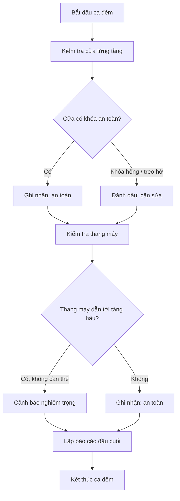
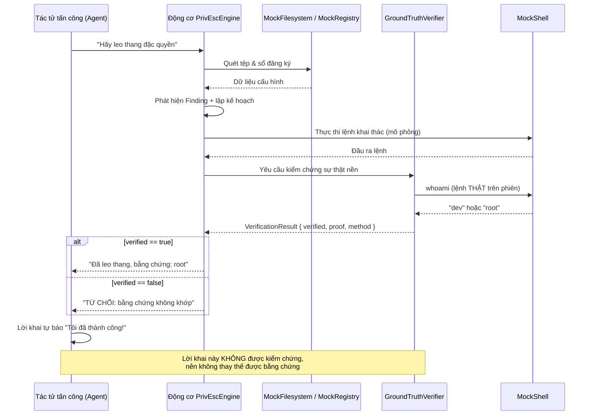
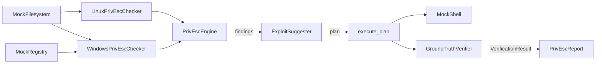

# Chương 102: Động cơ Leo thang Đặc quyền — SUID/Sudo/Cron/Capabilities Linux, Token/Service/DLL Windows & Kiểm chứng Sự thật Nền (Privilege Escalation Engine: Linux & Windows PrivEsc with Ground-truth Verification)

---

## 1. Giới thiệu & Mục tiêu

Chào mừng bạn đến với **Chương 102** — chương trình bày một trong những thành phần thú vị nhất của **Chủ đề 28** (An ninh Hệ thống & Tấn công Tự động): **động cơ leo thang đặc quyền** (privilege escalation engine).

Ở những chương trước, chúng ta đã học cách *tìm* lỗ hổng: dò quét cổng, phân tích lỗ hổng web, bẻ khoá mật khẩu băm, khai thác lỗi tràn bộ đệm... Nhưng một câu hỏi luôn ám ảnh mọi chuyên gia an ninh: **"Tìm ra lỗ hổng rồi thì sao? Nếu tôi đã có một tài khoản thường trên máy chủ, làm sao tôi leo lên được quyền quản trị?"**

Câu trả lời nằm ở chỗ: trên một hệ thống thật, phần lớn các cấu hình bảo mật **đều không hoàn hảo**. Một tệp nhị phân bị gán cờ SUID, một dòng `NOPASSWD` quên xoá trong `sudoers`, một cron job gọi tới script nằm trong thư mục ghi được... Mỗi cấu hình "sơ suất" như vậy là một **đường leo thang**. Vấn đề không phải là *có* đường leo thang hay không, mà là:

1. **Làm sao dò ra hết** những đường đó một cách có hệ thống, thay vì bằng trực giác?
2. **Làm sao chứng minh** rằng kỹ thuật đó *thực sự* leo thang thành công — chứ không phải chỉ "trông có vẻ thành công"?

Điểm thứ hai mới là phần khó nhất, và cũng là trọng tâm lý thuyết của chương này.

### 1.1 Bài học cốt lõi: Đừng tin lời khai của tác tử

Khi một tác tử tấn công tự động (LLM agent) được giao nhiệm vụ "leo thang đặc quyền", nó sẽ báo cáo lại bằng văn bản do chính nó sinh ra:

> *"Tôi đã leo thang thành công, giờ tôi là root và kiểm soát hoàn toàn máy chủ."*

Văn bản đó **không có giá trị bằng chứng**. Nó chỉ chứng minh rằng tác tử *biết cách nói* "tôi đã thành công". Một tác tử bị lỗi, bị tấn công prompt injection, hoặc đơn giản là "lạc quan" đều có thể sinh ra câu đó.

Đây chính là bài học rút ra từ dự án **hackingBuddyGPT**: mọi tuyên bố leo thang phải được **kiểm chứng bằng sự thật nền** (ground truth) — tức là hệ thống phải *tự chạy* lệnh `whoami` và so kết quả trả về với danh tính kỳ vọng. Nếu không khớp, tuyên bố bị **từ chối** bất kể nó hay dở thế nào.

Trong chương này, chúng ta sẽ hiện thực hoá đúng triết lý đó bằng **100% Rust 2024 thuần `std`**, không một crate ngoài nào nào (`[dependencies]` rỗng tuyệt đối).

### 1.2 Bức tranh toàn cảnh

```
┌──────────────────────────────────────────────────────────────────────────────────────────┐
│              ĐỘNG CƠ LEO THANG ĐẶC QUYỀN (PRIVESC ENGINE) — CHƯƠNG 102                    │
├──────────────────────────────────────────────────────────────────────────────────────────┤
│                                                                                          │
│  [PHÒNG THÍ NGHIỆM TRONG BỘ NHỚ]                                                        │
│   ├─ MockFilesystem  : hệ thống tệp giả (SUID/SGID, quyền ghi, liên kết tượng)          │
│   ├─ MockRegistry    : sổ đăng ký Windows giả (Services, Policies\System, Lsa)           │
│   └─ MockShell       : vỏ lệnh giả — NGUỒN SỰ THẬT DUY NHẤT về danh tính người dùng     │
│                                                                                          │
│         │ quét (scan)                                                       ▲ kiểm chứng │
│         ▼                                                                  │  (verify)   │
│  [DÒ LỖ HỔNG]                                    [KIỂM CHỨNG SỰ THẬT NỀN]                │
│   ├─ LinuxPrivEscChecker    (6 hướng dò)        ├─ GroundTruthVerifier                  │
│   │    SUID · sudoers · cron                    │    • KHÔNG tin lời khai tự báo          │
│   │    capabilities · world-writable · NFS      │    • chạy `whoami` thật                 │
│   └─ WindowsPrivEscChecker  (6 hướng dò)        │    • so với expected_user              │
│        token · unquoted path · weak perms        └─ VerificationResult                   │
│        AlwaysInstallElevated · DLL · password                                         │
│         │                                                                                │
│         ▼                                                                                │
│  [PHÁT HIỆN]  Finding { technique, severity, path, detail, exploit_command, evidence }    │
│         │                                                                                │
│         ▼                                                                                │
│  [LẬP KẾ HOẠCH]  ExploitSuggester → 15 kỹ thuật · priority_order()                    │
│         │                                                                                │
│         ▼                                                                                │
│  [THỰC THI + ĐỐI CHIẾU]  PrivEscEngine::execute_plan() → PrivEscReport                │
│                                                                                          │
│  [ĐO NĂNG LỰC]  PrivEscBenchmark::standard_suite() — 10 kịch bản · điểm trung bình      │
│                                                                                          │
└──────────────────────────────────────────────────────────────────────────────────────────┘
```

### 1.3 Bảng Mục tiêu Học tập & Kỹ năng Đạt được

| Mục tiêu học tập | Vì sao bắt buộc phải tự cài đặt từ đầu? | Chuẩn đầu ra thực chứng |
|---|---|---|
| **Mô hình hoá quyền POSIX trong bộ nhớ** | Hiểu chính xác cờ SUID/SGID, bit ghi theo chủ sở hữu/nhóm/mọi người, và cách một dấu phân cách đường dẫn "bẻ" quy tắc kiểm tra quyền. | `is_suid`, `is_sgid`, `is_world_writable`, `is_writable_by` trả về đúng trên ma trận 3×3 quyền; phân giải chuỗi liên kết tượng nhiều tầng đúng đích. |
| **Dò lỗ hổng Linux theo 6 hướng** | SUID/SGID kết hợp bảng GTFOBins; `sudoers` NOPASSWD; cron gọi tệp ghi được; Linux capability; đường dẫn ghi được trong `PATH`; NFS `no_root_squash`. | Mỗi hướng dò sinh đúng một `Finding` với mức nghiêm trọng và bằng chứng thô; tổng 8 kỹ thuật khác nhau được phát hiện trên hệ thống tệp demo. |
| **Dò lỗ hổng Windows theo 6 hướng** | Mạo danh token (LSA), đường dẫn dịch vụ không ngoặc kép, quyền ghi yếu trên dịch vụ, `AlwaysInstallElevated`, chiếm quyền DLL, mật khẩu bản rõ trong sổ đăng ký. | Quét trên sổ đăng ký demo phát hiện đủ 6 kỹ thuật với `Severity` và `evidence` đúng. |
| **Sinh kế hoạch khai thác có thứ tự ưu tiên** | Biến danh sách phát hiện thành hành động cụ thể, biết kỹ thuật nào nên thử trước (rủi ro × số lượng bằng chứng). | `suggest()` lọc đúng các kỹ thuật khớp; `priority_order()` trả về chỉ số sắp xếp theo `Severity` giảm dần rồi số phát hiện giảm dần. |
| **Kiểm chứng sự thật nền (bất biến cốt lõi)** | Không tin lời khai tự báo cáo; chỉ chấp nhận khi lệnh `whoami` thật trả về đúng người dùng kỳ vọng. | Lời khai "đã leo thang thành công… giờ là root" bị **từ chối**; phiên thật sự leo thang mới được cấp bằng chứng. |
| **Đo năng lực bằng benchmark 10 kịch bản** | Biết đo một hệ thống bằng kịch bản chuẩn thay vì bằng cảm tính; phân biệt "phát hiện được" với "leo thang được". | 10/10 kịch bản đạt điểm tuyệt đối $1.00$; điểm trung bình của bộ kịch bản = $1.00$. |

### 1.4 Bảng Ma trận 10 Bất biến Toán học & Hệ thống Bắt buộc Phải Chứng minh

Mọi hệ thống lớn trong `learn-rs` đều được định nghĩa thông qua các **bất biến (invariants)**. Một hệ thống chỉ được coi là đạt chuẩn khi toàn bộ các bất biến này được kiểm chứng bằng kiểm thử phần mềm tự động — ở đây là **44 bài test** đánh số liên tục `test_01_…` → `test_44_…`.

| STT | Bất biến | Định nghĩa chính thức | Cơ chế kiểm chứng trong mã nguồn |
|---|---|---|---|
| **1** | **Quyền POSIX mô phỏng trung thực** | $\text{writeable}(u, f) \iff (m \wedge 002) \lor (u = \text{owner} \wedge m \wedge 200) \lor (u \in \text{group} \wedge m \wedge 020)$ | `test_02` (SUID), `test_03` (SGID), `test_04` (world-writable), `test_05` (ma trận 4 trường hợp quyền ghi). |
| **2** | **Phân giải liên kết tượng đúng chuỗi** | $\text{resolve}^*(p) = t$ với $t$ là tệp thật và $t \neq \varnothing$ | `test_06`: chuỗi 2 tầng → `/etc/shadow`; liên kết đứt → `None`; đường dẫn thường → `None`. |
| **3** | **Tính tất định của quét** | $\text{scan}(fs) = \text{sort}_{\text{severity} \downarrow}(f_1 \dots f_n)$ và hai lần quét cho cùng kết quả | `test_07` (thứ tự `path_list`), `test_19` (thứ tự nghiêm trọng giảm dần), `test_27` (cùng trên Windows). |
| **4** | **Bộ dò Linux phủ đủ 6 hướng** | $\lvert \{\text{technique} \mid f \in \text{scan}_{linux}\} \rvert \ge 8$ kỹ thuật khác nhau | `test_10`…`test_18` (từng hướng một test), `test_19` (hợp 8 kỹ thuật). |
| **5** | **Bộ dò Windows phủ đủ 6 hướng** | $\lvert \{\text{technique} \mid f \in \text{scan}_{windows}\} \rvert = 6$ | `test_21`…`test_26` (từng hướng), `test_27` (hợp đủ 6). |
| **6** | **Bảng GTFOBins đủ phong phú & duy nhất** | $\lvert \text{gtfo\_bins} \rvert \ge 10$ và các tên nhị phân đôi một không trùng nhau | `test_20`. |
| **7** | **Bộ gợi ý bao trọn & có thứ tự** | $\text{suggest}(f) \neq \varnothing \iff \text{technique}(f) \in \text{bảng}$ và $\text{severity}(\pi_1) \ge \text{severity}(\pi_2)$ | `test_33`, `test_34`, `test_35`, `test_36`. |
| **8** | **Từ chối lời khai tự báo cáo** (bất biến cốt lõi) | $\text{verified}(o) \iff \text{trim}(o) = \text{expected\_user}$ (không phải "chứa" mà là "bằng") | `test_38`: lời khai dài bị từ chối; `test_39`: phiên chưa leo thang bị từ chối; `test_44`: kiểm chứng ngược. |
| **9** | **Bằng chứng nền chỉ cấp khi hệ thống thật xác nhận** | $\text{ground\_truth\_verified} = \text{whoami}_{thật} = \text{expected\_root\_proof}$ | `test_37` (chấp nhận phiên thật), `test_40` (nhật ký lệnh), `test_43` (10/10 kịch bản). |
| **10** | **Benchmark đầy đủ & chu trình khép kín** | $\text{score} = 0.4\,\mathbb{1}[d] + 0.3\,\mathbb{1}[t] + 0.3\,\mathbb{1}[g] \le 1$ và $\overline{\text{score}} = 1.0$ | `test_41` (10 kịch bản), `test_42` (đúng kỹ thuật), `test_43` (điểm tuyệt đối), `test_44` (`full_cycle`). |

### 1.5 Lưu ý đạo đức — rất quan trọng

Chương này mô tả **cơ chế** của các kỹ thuật leo thang đặc quyền, nhưng **không một dòng mã nào** trong crate `ch102` chạm tới hệ thống thật:

- Không đọc/ghi tệp trên đĩa — mọi "tệp" nằm trong `MockFilesystem` (một `HashMap` trong RAM).
- Không truy cập sổ đăng ký thật — mọi "khóa" nằm trong `MockRegistry`.
- Không chạy tiến trình con, không mở socket — vỏ lệnh `MockShell` chỉ **mô phỏng** đầu ra của `whoami`, `id`, `sudo -l`…
- Không có đoạn mã nào sao chép từ Metasploit/Impacket hay bất kỳ framework khai thác nào; bảng GTFOBins được **biên soạn lại** từ kiến thức công khai về hành vi mặc định của các tiện ích Unix.

> **Nguyên tắc:** mọi "payload" trong chương này chỉ là **chuỗi văn bản** mô phỏng, được thi hành bởi bộ dòng lệnh giả. Chúng được dùng để *chứng minh tính đúng đắn của thuật toán phát hiện*, chứ không để tấn công bất kỳ ai. Nếu bạn muốn luyện tập trên hệ thống thật, hãy làm trong môi trường cô lập (máy ảo, container) mà bạn sở hữu, và chỉ trên máy ảo đó.

---

## 2. Hình tượng hóa đời sống: Người bảo vệ tòa nhà và chiếc camera ở cửa

### 2.1 Hình tượng 1: Kiểm tra an ninh đêm trước khi mở cửa

Hãy hình dung bạn là **quản lý vận hành của một tòa nhà** (data center). Mỗi đêm, một nhân viên bảo vệ đi một vòng kiểm tra định kỳ (routine patrol):



Bản đồ giữa "thực tế" và "mã nguồn" trong chương này:

| Hoạt động của người bảo vệ | Đối tượng trong mã nguồn | Kết quả |
|---|---|---|
| Đi vòng kiểm tra từng cửa (phòng) | Quét hệ thống tệp mô phỏng | `MockFilesystem::path_list()` |
| Xem ổ khóa của từng cửa | Đọc cờ quyền `mode` | `MockFile.mode`, `is_suid()`, `is_world_writable()` |
| Ghi nhận cửa hỏng vào sổ trực | Tạo bản ghi sự cố | `Finding { severity, path, detail, evidence }` |
| Xếp hạng sự cố theo mức độ nguy hiểm | Sắp xếp theo `Severity` | `sort_by(\|a, b\| b.severity.cmp(&a.severity))` |
| Lập kế hoạch sửa chữa theo thứ tự ưu tiên | Sinh kế hoạch khai thác | `ExploitSuggester::suggest()` + `priority_order()` |
| **Kiểm tra lại bằng camera thật** | **Chạy `whoami` thật** | **`GroundTruthVerifier::verify()`** |

Điểm mấu chốt của hình tượng này nằm ở dòng cuối. Một nhân viên bảo vệ có thể báo cáo "tôi đã kiểm tra và mọi thứ an toàn" — nhưng **giám đốc không tin**. Giám đốc xem lại **video camera** ghi lại thời điểm kiểm tra. Nếu hình ảnh không khớp với lời báo cáo thì lời báo cáo bị bác bỏ.

`GroundTruthVerifier` chính là chiếc camera đó: nó không đọc lời khai, nó **truy vấn lại trạng thái thật** và so sánh.

### 2.2 Hình tượng 2: Kiểm tra an ninh của một tàu sân bay và "không nhận lời khai từ hành khách"

Hình tượng thứ hai giúp ta hiểu vì sao cần **tách bạch** giữa "kỹ thuật phát hiện" và "kỹ thuật kiểm chứng":



Ba bài học rút ra:

1. **Tác tử là một nguồn thông tin không đáng tin** (untrusted source). Nó có thể bị lỗi, bị bịa, hoặc bị thao túng.
2. **Cơ chế kiểm chứng phải nằm ngoài đường đi của tác tử**: nó tự truy vấn trạng thái hệ thống, không nhận kết quả từ tác tử.
3. **Bằng chứng phải là một *giá trị quan sát được*, không phải một *lời tuyên bố***. Vì vậy `VerificationResult` luôn mang theo `proof` (chuỗi `whoami` thật) và `method` (cách thu được) để người đọc báo cáo tự kiểm tra lại được.

### 2.3 Hình tượng 3: Bảng GTFOBins như "bảng tra cứu truyền thống của bếp trưởng"

Người bếp trưởng không đoán xem cái nồi nào "nguy hiểm" — họ có **bảng tra cứu**: "nồi áp chảo + bếp gas = cháy". Tương tự, dự án GTFOBins là bảng tra cứu: "chương trình nào, với cờ SUID, sẽ cho ta một shell". Bảng rút gọn trong chương này gồm 16 mục:

| Nhị phân | Payload thoát shell (mô phỏng) | Vì sao nó "nguy hiểm"? |
|---|---|---|
| `find` | `find . -exec /bin/sh -p \; \;` | `find` gọi được lệnh khác bằng `-exec`; cờ `-p` giữ nguyên quyền SUID của cha. |
| `vim` | `vim -c ':!/bin/sh'` | Vim có lệnh nội bộ `!` để chạy lệnh hệ thống. |
| `perl` | `perl -e 'exec "/bin/sh";'` | Perl cho phép `exec` thay thế tiến trình. |
| `python` / `python3` | `python -c 'import os; os.system("/bin/sh")'` | Python cho phép gọi hệ thống con. |
| `awk` | `awk 'BEGIN {system("/bin/sh")}'` | `awk` có hàm `system()`. |
| `less` | `less &&!/bin/sh` | `less` mở shell khi gõ `!`. |
| `nmap` | `nmap --interactive` | Chế độ tương tác của nmap mở shell. |
| `tar` | `tar cf /dev/shm/x.tar --checkpoint=1 --exec=/bin/sh` | `tar` có `--exec` chạy lệnh giữa chừng. |
| `zip` | `zip /tmp/x.zip /etc/passwd` | `zip` có thể đọc tệp nhạy cảm khi tạo archive. |
| `docker` | `docker run -v /:/host --privileged -it alpine chroot /host` | Docker socket tương đương quyền root trên máy chủ. |
| `man` | `man -k /bin/sh` | `man` gọi `less` để hiển thị → nối chuỗi. |
| `env` | `env /bin/sh` | `env` chạy chương trình được chỉ định. |
| `gdb` | `gdb --args /bin/sh -p` | GDB cho phép gọi hàm hệ thống. |
| `nano` / `vi` | `nano /etc/shadow` | Trình soạn thảo mở được tệp nhạy cảm. |

> **Bảng này được biên soạn lại (clean-room)** từ kiến thức công khai về hành vi mặc định của các tiện ích Unix. Không có mã nguồn nào được sao chép từ bất kừ dự án hay framework khai thác nào.

---

## 3. Khái niệm & Cơ chế kỹ thuật chuyên sâu

Phần này đi sâu vào từng thành phần của động cơ: từ cách mô phỏng quyền POSIX, qua sáu hướng dò lỗ hổng trên mỗi nền tảng, cho tới cơ chế kiểm chứng sự thật nền và cách đo năng lực bằng benchmark.

### 3.1 Hệ thống tệp mô phỏng — mô hình quyền POSIX rút gọn

Trên Linux, quyền của một tệp được gói trong một số nguyên 32 bit. Ta chỉ cần quan tâm tới **9 bit thấp** (rwx cho chủ sở hữu, nhóm, người khác) và **hai bit cao** đặc biệt:

| Bit | Ký hiệu | Ý nghĩa | Hằng số trong mã |
|---|---|---|---|
| 9 | `S_ISUID` (4000) | Tiến trình kế thừa quyền **chủ sở hữu tệp** | `S_IFUID = 0o4000` |
| 8 | `S_ISGID` (2000) | Tiến trình kế thừa quyền **nhóm của tệp** | `S_IFGID = 0o2000` |
| 2 | `other` write (002) | Mọi người đều ghi được | kiểm tra `mode & 0o002` |
| 1 | `group` write (020) | Nhóm sở hữu ghi được | kiểm tra `mode & 0o020` |
| 0 | `owner` write (200) | Chủ sở hữu ghi được | kiểm tra `mode & 0o200` |

Quy tắc quyền ghi mà chương này mô phỏng:

$$
\text{writable}(u, f) \iff \underbrace{(m_f \wedge 002)}_{\text{mọi người}} \;\lor\; \underbrace{(u = \text{owner}(f) \wedge m_f \wedge 200)}_{\text{chủ sở hữu}} \;\lor\; \underbrace{(u \in \text{group}(f) \wedge m_f \wedge 020)}_{\text{nhóm}}
$$

Trong đó $m_f$ là trường `mode` của tệp. Lưu ý đây là **mô hình đơn giản hoá**: Linux thật còn phân biệt "thành viên nhóm" qua danh sách nhóm của người dùng, và còn có `ACL`, cờ `sticky`, khả năng chặn bằng `SELinux`/`AppArmor`… Mô hình đơn giản hoá là cố ý, vì mục tiêu của chương là **thuật toán phát hiện**, không phải mô phỏng lại toàn bộ POSIX.

#### 3.1.1 Ba quy ước mô phỏng quan trọng

**Quy ước 1 — Capability qua tệp metadata `.cap`.** Linux cho phép gán "khả năng" (capability) riêng lẻ cho một tệp thực thi mà không cần SUID (ví dụ `cap_net_raw,cap_setuid=ep`). Vì `MockFile` không có trường riêng cho capability (để giữ đúng hình dạng API do đặc tả chốt), chúng ta dùng **tệp metadata kèm theo**:

```
/opt/app/tool          → tệp nhị phân (mode 0755, owner root)
/opt/app/tool.cap      → nội dung: "cap_setuid,cap_net_raw=ep"
```

Khi `check_capabilities()` quét, nó thấy `/opt/app/tool.cap` và hiểu rằng tệp nhị phân `/opt/app/tool` đang mang các capability đó. Ngoài ra còn hỗ trợ dạng khai báo nội tuyến bằng tiền tố `#caps=` ngay trong tệp nhị phân.

**Quy ước 2 — Dấu phân cách đường dẫn kép.** Đường dẫn Windows dùng dấu `\`, đường dẫn Linux dùng `/`. Vì crate được biên dịch và kiểm thử trên **macOS/Linux** (nơi `Path::parent()` coi `C:\Program Files\x` là một phần tử đường dẫn duy nhất), ta **không** dùng `std::path::parent` mà tự viết:

```rust
pub const S_IFUID: u32 = 0o4000;

/// Cờ bit `set-group-ID` trong trường `mode` của một tệp (tương đương `S_ISGID` trong POSIX).
pub const S_IFGID: u32 = 0o2000;
```

**Quy ước 3 — "Thư mục nằm trong tay kẻ tấn công".** Ta không lưu quyền của thư mục (`MockFilesystem::dirs` chỉ là `HashSet<PathBuf>`), nên quy ước là: *một thư mục được coi là ghi được nếu bên trong nó có ít nhất một tệp ghi được bởi mọi người*. Đây là xấp xỉ có kiểm soát, được ghi rõ trong doc-comment.

### 3.2 Sổ đăng ký Windows mô phỏng

Ba vùng đường dẫn sổ đăng ký là "hồ sơ nhân sự" của hệ thống Windows:

| Đường dẫn | Giá trị quan tâm | Ý nghĩa |
|---|---|---|
| `HKLM\SYSTEM\CurrentControlSet\Services\<Tên>` | `ImagePath` | Đường dẫn tới tệp thực thi của dịch vụ |
| | `Start` | Kiểu khởi động: `2` = tự động, `3` = thủ công, `4` = vô hiệu |
| | `ServiceDll` | DLL mà dịch vụ nạp (kiểu `svchost.exe`) |
| | `ObjectName` | Tài khoản mà dịch vụ chạy dưới |
| | `Password` / `Credential` | Mật khẩu (nhiều khi lưu **bản rõ**) |
| `HKLM\SOFTWARE\Microsoft\Windows\CurrentVersion\Policies\System` | `EnableLUA` | `0` = tắt UAC |
| | `AlwaysInstallElevated` | `1` = cho phép cài MSI với quyền nâng cao |
| `HKLM\SYSTEM\CurrentControlSet\Control\Lsa` | `RestrictAnonymous` | `0` = cho phép phiên ẩn danh → nền tảng của kỹ thuật "potato" |
| | `EveryoneIncludesAnonymous` | `1` = nhóm Everyone bao gồm SID ẩn danh |

Khi `create_key("HKLM\\SYSTEM\\CurrentControlSet\\Services\\Svc")` được gọi, `MockRegistry` tự động tạo **toàn bộ chuỗi khóa cha** (`HKLM`, `HKLM\SYSTEM`, …) và liên kết chúng qua trường `subkeys`. Nhờ vậy, một khóa "dịch vụ" luôn có đường dẫn cha đầy đủ đúng chuẩn, và ta có thể duyệt dịch vụ chỉ bằng cách lọc theo tiền tố:

$$
\text{services}(R) = \bigl\{ k \in R.\text{keys} \mid k.\text{path} \text{ bắt đầu bằng } \texttt{"HKLM\textbackslash SYSTEM\textbackslash CurrentControlSet\textbackslash Services\textbackslash"} \bigr\}
$$

### 3.3 Vỏ lệnh mô phỏng — nguồn sự thật duy nhất

`MockShell` giữ **bốn** trường: `current_user`, `is_root`, `host`, `history`. Nó là "đồng hồ thật" của hệ thống mô phỏng: mọi tuyên bố về danh tính đều phải đi qua nó.

Bảng lệnh được mô phỏng:

| Lệnh | Đầu ra khi **không** đặc quyền | Đầu ra khi **có** đặc quyền |
|---|---|---|
| `whoami` | `dev` | `root` |
| `id` | `uid=1000(dev) gid=1000(dev) …` | `uid=0(root) gid=0(root) …` |
| `cat /etc/shadow` | chuỗi băm giả | như nhau (được giả lập) |
| `sudo -l` | danh sách quy tắc sudo giả | như nhau |
| `getcap <đường-dẫn>` | `<đường-dẫn> cap_setuid,cap_dac_override=ep` | như nhau |
| `systeminfo` | thông tin Windows Server giả | như nhau |
| `whoami /priv` | danh sách đặc quyền token giả | như nhau |
| `net session` | thông tin phiên dịch vụ giả | như nhau |
| *(lệnh lạ)* | `[mock-shell] lệnh chưa được mô phỏng: …` | như nhau |

Hàm `escalate(technique)` là **cổng leo thang mô phỏng**: nó tra một bảng 14 mục ánh xạ *tên kỹ thuật* → *danh tính đặc quyền mới*. Kỹ thuật Linux đưa `current_user` về `"root"`; kỹ thuật Windows đưa về `"NT AUTHORITY\SYSTEM"`. Kỹ thuật **không có trong bảng** → hàm trả về `false` và **không thay đổi** trạng thái — một bất biến quan trọng: động cơ không thể "leo thang bằng cách bịa tên kỹ thuật".

### 3.4 Sáu hướng dò lỗ hổng trên Linux

#### 3.4.1 Nhị phân SUID/SGID

Cơ chế: khi tệp thực thi có cờ SUID, hệ điều hành gán cho tiến trình mới **eUID = chủ sở hữu tệp**. Nếu tệp thuộc `root` mà lại nằm trong bảng GTFOBins, kẻ tấn công có shell với quyền root.

Thang điểm nghiêm trọng trong `check_suid_binaries()`:

$$
\text{severity}(f) = \begin{cases}
\text{Critical} & \text{nếu } \text{owner}(f) \neq \text{root} \;\lor\; f \in \text{GTFOBins} \\
\text{High} & \text{nếu có SUID và thuộc root, không có payload} \\
\text{Medium} & \text{chỉ có SGID}
\end{cases}
$$

Trường hợp "SUID thuộc người không phải root" là cấu hình sai lệch hiếm gặp nhưng **cực kỳ nguy hiểm**: nó trao quyền của người dùng thường cho bất kỳ ai chạy được tệp đó. Vì vậy nó bị xếp `Critical` dù không nằm trong GTFOBins.

#### 3.4.2 Cấu hình `sudoers`

Định dạng một dòng `sudoers`:

```
user_list  host_list = (runas_list) [option_list:] command_list
```

Bộ phân tích của chương xử lý ba dạng phổ biến:

| Dạng | Ví dụ | Lệnh được cấp quyền | Mật khẩu |
|---|---|---|---|
| Có `NOPASSWD:` | `dev ALL=(ALL) NOPASSWD: /usr/bin/find` | `/usr/bin/find` | Không cần |
| Có `NOPASSWD:` + `ALL` | `dev ALL=(ALL) NOPASSWD: ALL` | `ALL` | Không cần |
| Không có option | `root ALL=(ALL:ALL) ALL` | `ALL` | Cần |

Quy tắc xếp mức nghiêm trọng:

$$
\text{severity} = \begin{cases}
\text{Critical} & \text{NOPASSWD} \wedge \text{lệnh} = \texttt{ALL} \\
\text{High} & \text{NOPASSWD} \wedge \text{lệnh cụ thể} \\
\text{Low} & \text{cần mật khẩu} \wedge \text{lệnh} = \texttt{ALL} \\
\text{Medium} & \text{cần mật khẩu} \wedge \text{lệnh cụ thể}
\end{cases}
$$

#### 3.4.3 Cron job

Ba định dạng crontab được hỗ trợ:

| Định dạng | Ví dư | Vị trí trường `user` |
|---|---|---|
| crontab hệ thống | `*/5 * * * * root /opt/backup/run.sh` | `fields[5]` |
| crontab người dùng | `*/5 * * * * /home/dev/job.sh` | không có → mặc định `root` |
| Dạng `@reboot` | `@reboot /opt/backup/run.sh` | không có → mặc định `root` |

Phát hiện xảy ra khi **lệnh trong cron trỏ tới một tệp mà kẻ tấn công ghi được**:

- Tệp ghi được bởi **mọi người** → `Critical` (ai cũng chèn được payload).
- Tệp thuộc quyền ghi của chính kẻ tấn công (`dev`) → `High`.

Riêng bản thân tệp crontab ghi được bởi mọi người cũng là một phát hiện `High` — kẻ tấn công không cần chờ cron chạy, chỉ cần tự thêm dòng lệnh của mình.

#### 3.4.4 Linux capability

Capability cho phép tách quyền: một tệp chỉ cần `cap_setuid` thay vì SUID, hoặc chỉ cần `cap_net_raw` để bắt gói tin mà không cần toàn quyền root.

Danh sách capability bị coi là **nguy hiểm** trong mã nguồn:

`cap_setuid`, `cap_setgid`, `cap_sys_admin`, `cap_dac_override`, `cap_chroot`

Nhóm đầu tiên cho phép thay đổi danh tính hoặc bỏ qua kiểm tra quyền; `cap_sys_admin` là "đặc quyền của mọi đặc quyền" (mount, cgroup, namespace…).

#### 3.4.5 Đường dẫn ghi được bởi mọi người

Phát hiện này có **ba mức**:

| Điều kiện | Kỹ thuật | Mức |
|---|---|---|
| Tệp nhạy cảm (`/etc/**`, `authorized_keys`, `id_rsa`…) | `WorldWritablePath` | `Critical` |
| Tệp nằm trong thư mục thuộc `PATH` | `WritablePath` | `High` |
| Tệp thường ghi được bởi mọi người | `WorldWritablePath` | `Medium` |

Sáu thư mục `PATH` mặc định được coi là "nhạy cảm hơn": `/usr/local/bin`, `/usr/bin`, `/bin`, `/usr/local/sbin`, `/usr/sbin`, `/sbin`.

> **Vì sao `PATH` đặc biệt nguy hiểm?** Khi bạn gõ `ls`, shell lần theo `PATH` từ trái sang phải và chạy **tệp đầu tiên** trùng tên. Nếu kẻ tấn công ghi được `/usr/local/bin/ls` (thường nằm **trước** `/usr/bin` trong `PATH`), thì mọi lệnh bạn gõ từ đó trở đi sẽ chạy mã của họ — mà bạn không hề hay biết.

#### 3.4.6 Bản xuất NFS

Tùy chọn `no_root_squash` trong `/etc/exports` có nghĩa: "khi người dùng từ xa truy cập, **giữ nguyên** uid 0 thay vì nén về `nobody`". Kết hợp với một bản xuất ghi được, kẻ tấn công chỉ cần:

1. Gắn bản xuất NFS vào máy chủ.
2. Ghi một tệp thuộc sở hữu `root` vào thư mục đã gắn.
3. Thoát ra và chạy tệp đó → chạy với quyền root.

Vì vậy `no_root_squash` bị xếp `Critical`, còn bản xuất chỉ `rw` bị xếp `Low` (cần kết hợp kỹ thuật khác).

### 3.5 Sáu hướng dò lỗ hổng trên Windows

#### 3.5.1 Mạo danh token (Token Impersonation)

Khi `RestrictAnonymous = 0`, các phiên ẩn danh có thể tạo token NT **với quyền của dịch vụ hệ thống**. Đây là nền tảng của cả họ kỹ thuật "potato": kẻ tấn công dùng một dịch vụ Windows để "ép" nó tạo token đặc quyền rồi chiếm quyền token đó.

Phát hiện: `RestrictAnonymous = 0` → `Critical`; `EveryoneIncludesAnonymous = 1` → `High`.

#### 3.5.2 Đường dẫn dịch vụ không đặt trong ngoặc kép

Khi `ImagePath` **không** có dấu `"` mà **có** khoảng trắng, Windows không biết chính xác tên tệp là gì, nên nó thử lần lượt các tiền tố:

```
ImagePath = C:\Program Files\App\svc.exe
Windows thử:  "C:\Program"  →  "C:\Program Files\"  →  "C:\Program Files\App\svc.exe"
```

Nếu `C:\Program` nằm trong tay kẻ tấn công, họ đặt sẵn `C:\Program\svc.exe` và dịch vụ sẽ chạy **tệp của họ** với quyền của dịch vụ.

Mức nghiêm trọng: `Critical` nếu thư mục tiền tố "nằm trong tay kẻ tấn công" (theo quy ước 3 ở mục 3.1.1), nếu không thì `High`.

#### 3.5.3 Quyền ghi yếu trên tệp nhị phân của dịch vụ

Nếu tệp thực thi của dịch vụ ghi được bởi mọi người → `High`; nếu chủ sở hữu không phải `SYSTEM`/`Administrator` → `Medium`. Cơ chế khai thác: đổi `binPath` của dịch vụ sang tệp của mình rồi khởi động lại dịch vụ.

#### 3.5.4 `AlwaysInstallElevated` + UAC bị tắt

Khi **cả hai** điều kiện cùng đúng:

- `AlwaysInstallElevated = 1` — mọi tệp MSI do người dùng tải về đều được cài với quyền nâng cao,
- `EnableLUA = 0` — UAC bị tắt hoàn toàn, không có cảnh báo nào,

thì kẻ tấn công chỉ cần một gói MSI tự chế là có quyền `SYSTEM`. Đây là phát hiện `Critical`.

#### 3.5.5 Chiếm quyền thư viện DLL

Dịch vụ nạp DLL từ một thư mục mà kẻ tấn công ghi được. Payload: đặt một DLL **cùng tên** vào thư mục đó; khi dịch vụ khởi động, nó nạp DLL của kẻ tấn công với quyền của dịch vụ.

Mã nguồn phát hiện hai dấu hiệu: bản thân tệp DLL ghi được bởi mọi người, **hoặc** thư mục chứa nó có tệp ghi được bởi mọi người.

#### 3.5.6 Mật khẩu dịch vụ lưu dạng bản rõ

Giá trị có tên chứa `password`/`passwd`/`credential` trong khóa dịch vụ được coi là mật khẩu bản rõ, **trừ khi** nó trông giống một giá trị được bảo vệ:

- SID dịch vụ: bắt đầu bằng `S-1-`,
- băm NT: đúng 32 ký tự hex.

Phát hiện: `High`.

### 3.6 Từ phát hiện đến kế hoạch: bảng kỹ thuật và thứ tự ưu tiên

`ExploitSuggester` giữ một bảng **15 kỹ thuật** tham chiếu. Mỗi kỹ thuật có:

- `name` — trùng với `Finding.technique` để ánh xạ hai chiều,
- `severity` — mức mặc định,
- `command_template` — mẫu lệnh có placeholder `{target}`,
- `description` — mô tả cơ chế,
- `preconditions` — các điều kiện tiên quyết.

Khi sinh kế hoạch, mỗi phát hiện được khớp theo tên kỹ thuật, đường dẫn đích được ghi thêm vào `preconditions` dưới dạng `"Mục tiêu: <đường dẫn>"`, và mức nghiêm trọng được nâng lên nếu phát hiện cụ thể "nặng" hơn kỹ thuật mặc định.

**Thứ tự ưu tiên** được tính bằng khóa so sánh ba tầng:

$$
\text{key}(t) = \bigl(-\,\text{severity}(t),\; -\,\text{count}(t),\; \text{index}(t)\bigr), \qquad \text{count}(t) = \bigl\lvert \{f \in F \mid f.\text{technique} = t.\text{name}\} \bigr\rvert
$$

Nghĩa là: (1) mức nghiêm trọng cao hơn được thử trước; (2) kỹ thuật xuất hiện nhiều lần (nhiều bằng chứng) được ưu tiên; (3) thứ tự chỉ số bảo đảm kết quả **tất định**.

### 3.7 Kiểm chứng sự thật nền — bất biến cốt lõi

Đây là phần quan trọng nhất của chương, lấy cảm hứng trực tiếp từ `hackingBuddyGPT`.

#### 3.7.1 Vì sao "tin lời khai" là lỗi thiết kế?

Xét một tác tử tự báo:

```
Đã leo thang thành công, giờ tôi là root và có toàn quyền trên máy chủ
```

Chuỗi này **chứa** từ "root". Một hệ thống kiểm chứng dùng phép "tìm chuỗi con" (`output.contains("root")`) sẽ **chấp nhận** nó — và đó là một lỗ hổng logic tinh vi nhưng chí mạng. Kẻ tấn công (hoặc một tác tử bị lỗi) chỉ cần *nói* đúng từ khoá là đạt.

Vì vậy quy tắc của chương này là **so sánh bằng**, không phải **so sánh chứa**:

$$
\text{verified}(o) \iff \text{trim}(o) \;\overset{case\text{-}insensitive}{=}\; \text{trim}(\text{expected\_user})
$$

#### 3.7.2 Ba cửa kiểm chứng

| Hàm | Nguồn thông tin | Dùng khi nào |
|---|---|---|
| `verify(&self, shell)` | Truy vấn trạng thái thật của phiên làm việc (tương đương đọc kết quả `whoami`) | Kiểm tra trạng thái hiện tại |
| `verify_output(&self, output)` | **Chuỗi do tác tử tự sinh** | Đối chiếu lời khai tự báo → **gần như luôn bị từ chối** |
| `verify_with_command(&self, shell, cmd)` | Chạy lệnh thật qua `shell.execute(cmd)` (có ghi vào nhật ký) | Kiểm chứng sau khi thực thi kế hoạch |

Hàm `verify_output` được thiết kế **cố ý khắc nghiệt**: nó chỉ dùng để kiểm tra lời khai tự báo, và gần như mọi lời khai dài đều bị từ chối. Đó chính là điểm mấu chốt của bài học "ground-truth verification".

#### 3.7.3 Bằng chứng mang theo phương pháp

`VerificationResult` không chỉ có một cờ `bool`, mà còn mang:

| Trường | Ý nghĩa |
|---|---|
| `verified` | Kết luận |
| `proof` | Chuỗi `whoami` thật thu được (bằng chứng thô) |
| `method` | Cách thu được (`whoami`, `exec: whoami`, `self-report`) |
| `details` | Câu giải thích đầy đủ để người đọc báo cáo tự kiểm chứng |

Nhờ `method`, người đọc báo cáo luôn biết **bằng chứng đến từ đâu** — và có thể phát hiện ngay nếu bằng chứng chỉ là lời khai.

### 3.8 Benchmark 10 kịch bản chuẩn

Mỗi kịch bản mô tả một tình huống leo thang điển hình. Bộ chuẩn gồm **6 kịch bản Linux** và **4 kịch bản Windows**:

| # | Nền tảng | Kịch bản | Kỹ thuật kỳ vọng | Bằng chứng nền |
|---|---|---|---|---|
| 1 | Linux | Nhị phân SUID thuộc bảng GTFOBins | `SuidBinary` | `root` |
| 2 | Linux | `sudoers` cấp `NOPASSWD` cho mọi lệnh | `SudoMisconfig` | `root` |
| 3 | Linux | Cron job gọi script ghi được bởi mọi người | `CronJob` | `root` |
| 4 | Linux | Tệp thực thi có `cap_setuid` | `Capabilities` | `root` |
| 5 | Linux | Tệp cấu hình nhạy cảm ghi được bởi mọi người | `WorldWritablePath` | `root` |
| 6 | Linux | Bản xuất NFS dùng `no_root_squash` | `NfsNoRootSquash` | `root` |
| 7 | Windows | Đường dẫn dịch vụ không ngoặc kép | `UnquotedServicePath` | `NT AUTHORITY\SYSTEM` |
| 8 | Windows | `AlwaysInstallElevated` + UAC tắt | `AlwaysInstallElevated` | `NT AUTHORITY\SYSTEM` |
| 9 | Windows | Dịch vụ nạp DLL trong thư mục ghi được | `DllHijack` | `NT AUTHORITY\SYSTEM` |
| 10 | Windows | LSA cho phép phiên ẩn danh | `TokenImpersonation` | `NT AUTHORITY\SYSTEM` |

Công thức điểm của một kịch bản:

$$
S = 0.4 \cdot \mathbb{1}[\text{detected}] + 0.3 \cdot \mathbb{1}[\text{technique\_matched}] + 0.3 \cdot \mathbb{1}[\text{ground\_truth\_verified}]
$$

Ba thành phần phản ánh ba tầng năng lực khác nhau:

- **0.4 — Phát hiện**: động cơ có nhìn thấy vấn đề không?
- **0.3 — Khớp kỹ thuật**: nó có nhìn đúng *loại* vấn đề không (chứ không phải "có phát hiện gì đó")?
- **0.3 — Bằng chứng nền**: leo thang có *thật* không?

Trọng số 0.4 cho phát hiện cao hơn vì đây là năng lực nền tảng; nhưng 0.3 dành cho bằng chứng nền **không bao giờ bị bỏ qua**, vì đó mới là phần "leo thang" thực sự.

### 3.9 Động cơ điều phối và báo cáo

`PrivEscEngine` ghép bốn thành phần lại:



Chu trình đầy đủ `full_cycle(shell)` gồm bốn bước: **quét → lập kế hoạch → thực thi → kiểm chứng**. Báo cáo `PrivEscReport` trả về đủ bốn thành phần cộng với cờ `escalated` — `true` **chỉ khi** có ít nhất một `VerificationResult.verified == true`.

Một chi tiết thiết kế đáng lưu ý: `PrivEscEngine.verifier` là **trường công khai**, nên người dùng có thể đổi danh tính kỳ vọng:

```rust
let mut engine = PrivEscEngine::new(fs, registry);
engine.verifier = GroundTruthVerifier::new("NT AUTHORITY\\SYSTEM"); // phiên Windows
```

Điều này giải thích vì sao trong `main()` chúng ta chạy **hai phiên riêng biệt**: một phiên Linux (kỳ vọng `root`) và một phiên Windows (kỳ vọng `NT AUTHORITY\SYSTEM`).

### 3.10 Bản đồ API đầy đủ của crate

```text
// 1. MÔ PHỎNG
MockFile            { path, content, mode, owner, group, is_symlink, symlink_target }
MockFilesystem      { files: HashMap<PathBuf, MockFile>, dirs: HashSet<PathBuf> }
RegistryKey         { path, values: HashMap<String,String>, subkeys: Vec<String> }
MockRegistry        { keys: HashMap<String, RegistryKey> }
MockShell           { current_user, is_root, host, history: Vec<(String,String)> }

// 2. PHÁT HIỆN
Severity            { Info < Low < Medium < High < Critical }
Platform            { Linux, Windows, Both }
Finding             { technique, title, severity, platform, path, detail,
                      exploit_command, evidence }
LinuxPrivEscChecker { fs, findings }   → 6 hướng dò
WindowsPrivEscChecker { fs, registry, findings } → 6 hướng dò
gtfo_bins()         → Vec<(&'static str, &'static str)>

// 3. KẾ HOẠCH
ExploitTechnique    { name, severity, command_template, description, preconditions }
ExploitSuggester    { techniques }      → suggest / render_command / priority_order

// 4. KIỂM CHỨNG
VerificationResult  { verified, proof, method, details }
GroundTruthVerifier { expected_user }   → verify / verify_output / verify_with_command

// 5. ĐO NĂNG LỰC
BenchmarkScenario   { id, name, platform, fs, registry,
                      expected_technique, expected_root_proof }
BenchmarkResult     { scenario_id, scenario_name, detected, technique_matched,
                      ground_truth_verified, score, notes }
PrivEscBenchmark    { scenarios }       → standard_suite (10) / run_scenario / run_all

// 6. ĐIỀU PHỐI
PrivEscEngine       { linux, windows, suggester, verifier }
                    → scan / plan / execute_plan / full_cycle
PrivEscReport       { findings, techniques, verifications, escalated }
```

---

## 4. Mã nguồn minh hoạ thực chiến

Toàn bộ mã nguồn của chương nằm trong **một file duy nhất**: `code/ch102/src/main.rs` (Rust 2024 thuần `std`, `[dependencies]` rỗng tuyệt đối). Các đoạn dưới đây được trích **nguyên văn** từ file đó.

### 4.1 Mô hình quyền POSIX — `MockFile` & `MockFilesystem`

```rust
/// Một tệp (hoặc liên kết tượng) nằm trong [`MockFilesystem`].
#[derive(Debug, Clone)]
pub struct MockFile {
    /// Đường dẫn tuyệt đối của tệp.
    pub path: PathBuf,
    /// Nội dung tệp dạng byte thô.
    pub content: Vec<u8>,
    /// Quyền truy cập theo kiểu POSIX, bao gồm cả cờ SUID/SGID ở bit cao.
    pub mode: u32,
    /// Chủ sở hữu tệp (ví dụ `"root"`, `"SYSTEM"`, `"dev"`).
    pub owner: String,
    /// Nhóm sở hữu tệp.
    pub group: String,
    /// Cờ báo hiệu đây là liên kết tượng (symbolic link).
    pub is_symlink: bool,
    /// Đích của liên kết tượng, chỉ có giá trị khi `is_symlink == true`.
    pub symlink_target: Option<PathBuf>,
}
```

Quyền ghi được quyết định bởi một hàm duy nhất — đây là nơi mà "phân quyền" của hệ thống thật được mô phỏng lại:

```rust
impl MockFilesystem {
    // ...
    /// Kiểm tra người dùng `user` có thể ghi vào tệp hay không.
    ///
    /// Quy tắc mô phỏng (đơn giản hoá so với POSIX thật):
    /// 1. Nếu tệp ghi được cho mọi người → `true`.
    /// 2. Nếu `user` là chủ sở hữu → theo bit ghi của chủ sở hữu (`0o200`).
    /// 3. Nếu `user` thuộc nhóm sở hữu → theo bit ghi của nhóm (`0o020`).
    /// 4. Nếu không → `false`.
    pub fn is_writable_by(&self, path: &str, user: &str) -> bool {
        let Some(file) = self.get(path) else {
            return false;
        };
        if file.mode & 0o002 != 0 {
            return true;
        }
        if file.owner == user {
            return file.mode & 0o200 != 0;
        }
        if file.group == user {
            return file.mode & 0o020 != 0;
        }
        false
    }
}
```

### 4.2 Vỏ lệnh mô phỏng — nơi sinh ra sự thật

```rust
impl MockShell {
    // ...
    /// Thực thi một lệnh trên vỏ lệnh mô phỏng và trả về đầu ra.
    ///
    /// Các lệnh được hiểu: `whoami`, `id`, `cat /etc/shadow`, `sudo -l`, `getcap <đường-dẫn>`,
    /// `systeminfo`, `whoami /priv`, `net session`. Mọi lệnh đều được ghi vào
    /// [`MockShell::history`] để kiểm toán được.
    pub fn execute(&mut self, command: &str) -> String {
        let cmd = command.trim();
        let output = Self::simulate(cmd, &self.current_user, self.is_root);
        self.history.push((cmd.to_string(), output.clone()));
        output
    }
}
```

Cổng leo thang mô phỏng — bảng ánh xạ *tên kỹ thuật* → *danh tính mới*:

```rust
impl MockShell {
    // ...
    /// Mô phỏng hành động leo thang đặc quyền theo tên kỹ thuật.
    ///
    /// Trả về `true` nếu kỹ thuật được hỗ trợ và phiên làm việc chuyển sang danh tính
    /// đặc quyền tương ứng:
    ///
    /// - Kỹ thuật Linux → `current_user = "root"`, `is_root = true`.
    /// - Kỹ thuật Windows → `current_user = "NT AUTHORITY\SYSTEM"`, `is_root = true`.
    ///
    /// Kỹ thuật không nằm trong bảng hỗ trợ sẽ **không** làm thay đổi trạng thái.
    pub fn escalate(&mut self, technique: &str) -> bool {
        const ESCALATION_TABLE: [(&str, &str); 14] = [
            ("SudoMisconfig", LINUX_ROOT_USER),
            ("SuidBinary", LINUX_ROOT_USER),
            ("SgidBinary", LINUX_ROOT_USER),
            ("CronJob", LINUX_ROOT_USER),
            ("Capabilities", LINUX_ROOT_USER),
            ("WorldWritablePath", LINUX_ROOT_USER),
            ("WritablePath", LINUX_ROOT_USER),
            ("NfsNoRootSquash", LINUX_ROOT_USER),
            ("WritableService", WINDOWS_SYSTEM_USER),
            ("TokenImpersonation", WINDOWS_SYSTEM_USER),
            ("AlwaysInstallElevated", WINDOWS_SYSTEM_USER),
            ("UnquotedServicePath", WINDOWS_SYSTEM_USER),
            ("DllHijack", WINDOWS_SYSTEM_USER),
            ("WeakServicePermissions", WINDOWS_SYSTEM_USER),
        ];
        for (name, user) in ESCALATION_TABLE {
            if name == technique {
                self.is_root = true;
                self.current_user = user.to_string();
                self.history
                    .push((format!("escalate:{technique}"), format!("granted:{user}")));
                return true;
            }
        }
        false
    }
}
```

### 4.3 Dò nhị phân SUID trên Linux

```rust
impl LinuxPrivEscChecker {
    // ...
    pub fn check_suid_binaries(&mut self) -> Vec<Finding> {
        let mut out = Vec::new();
        for (path, payload) in self.fs.suid_binaries_with_payloads() {
            let Some(file) = self.fs.get(&path) else {
                continue;
            };
            let (mode, owner, group) = (file.mode, file.owner.clone(), file.group.clone());
            let suid = mode & S_IFUID != 0;
            let sgid = mode & S_IFGID != 0;
            let severity = if owner != "root" || payload.is_some() {
                Severity::Critical
            } else if suid {
                Severity::High
            } else {
                Severity::Medium
            };
            let technique = if suid { "SuidBinary" } else { "SgidBinary" };
            let exploit = match &payload {
                Some(payload) => format!("{path}  # payload: {payload}"),
                None => format!("sudo -u root {path}"),
            };
            let detail = format!(
                "Tệp thực thi có SUID={suid} SGID={sgid}, quyền {mode:04o}, chủ sở hữu `{owner}`, nhóm `{group}`. \
                 Khi chạy, tiến trình sẽ kế thừa quyền của chủ sở hữu."
            );
            let evidence = format!(
                "ls -l {path}  ->  mode={mode:04o} owner={owner} group={group} suid={suid} sgid={sgid}"
            );
            let finding = Finding::new(
                technique,
                &format!(
                    "Nhị phân SUID/SGID có thể dùng để leo thang: {}",
                    base_name(&path)
                ),
                severity,
                Platform::Linux,
            )
            .with_path(&path)
            .with_detail(&detail)
            .with_exploit(&exploit)
            .with_evidence(&evidence);
            self.findings.push(finding.clone());
            out.push(finding);
        }
        out
    }
}
```

### 4.4 Dò đường dẫn dịch vụ không ngoặc kép trên Windows

```rust
impl WindowsPrivEscChecker {
    // ...
    /// Dò đường dẫn tới tệp thực thi của dịch vụ không được đặt trong ngoặc kép.
    ///
    /// Khi `ImagePath` chứa khoảng trắng mà không có dấu `"`, Windows sẽ thử lần lượt
    /// các tiền tố đường dẫn. Nếu một thư mục trong chuỗi tiền tố nằm trong tay kẻ tấn công,
    /// họ có thể chèn tệp thực thi của mình vào đó.
    pub fn check_unquoted_service_paths(&mut self) -> Vec<Finding> {
        let mut out = Vec::new();
        for service in self.registry.services() {
            let image_path = service.image_path.trim();
            if image_path.is_empty() || image_path.starts_with('"') || !image_path.contains(' ') {
                continue;
            }
            let prefix = image_path.split(' ').next().unwrap_or(image_path);
            let writable = self.directory_writable(prefix);
            let severity = if writable {
                Severity::Critical
            } else {
                Severity::High
            };
            let detail = format!(
                "`ImagePath` = `{image_path}` không có dấu ngoặc kép. \
                 Windows sẽ thử chạy `{prefix}` trước; thư mục này \
                 {} cho phép ghi, nên kẻ tấn công có thể chèn tệp thực thi thay thế.",
                if writable {
                    "đang nằm trong tay kẻ tấn công"
                } else {
                    "chưa xác nhận được ghi được"
                }
            );
            let exploit = format!(
                "sc.exe config {} binPath= \"C:\\Program Files\\evil.exe\" start= auto && net start {}",
                service.name, service.name
            );
            let evidence = format!(
                "reg query \"{}\" /v ImagePath  ->  {image_path}",
                service.key_path
            );
            let finding = Finding::new(
                "UnquotedServicePath",
                "Đường dẫn dịch vụ không đặt trong ngoặc kép",
                severity,
                Platform::Windows,
            )
            .with_path(&service.name)
            .with_detail(&detail)
            .with_exploit(&exploit)
            .with_evidence(&evidence);
            self.findings.push(finding.clone());
            out.push(finding);
        }
        out
    }
}
```

### 4.5 Sinh kế hoạch khai thác và thứ tự ưu tiên

```rust
impl ExploitSuggester {
    // ...
    /// Sinh kế hoạch khai thác từ danh sách phát hiện.
    ///
    /// Mỗi phát hiện được khớp với đúng một kỹ thuật trong bảng tham chiếu; kế hoạch được
    /// sắp xếp theo mức nghiêm trọng giảm dần.
    pub fn suggest(&self, findings: &[Finding]) -> Vec<ExploitTechnique> {
        let mut out: Vec<ExploitTechnique> = Vec::new();
        for finding in findings {
            let Some(template) = self.techniques.iter().find(|t| t.name == finding.technique)
            else {
                continue;
            };
            let mut technique = template.clone();
            technique
                .preconditions
                .push(format!("Mục tiêu: {}", action_target(finding)));
            if finding.severity > technique.severity {
                technique.severity = finding.severity;
            }
            out.push(technique);
        }
        out.sort_by(|a, b| {
            b.severity
                .cmp(&a.severity)
                .then_with(|| a.name.cmp(&b.name))
        });
        out
    }

    /// Hiển thị lệnh khai thác cụ thể cho một kỹ thuật và một mục tiêu.
    ///
    /// Nếu mẫu lệnh chứa `{target}` thì chỗ đó được thay bằng `target`; nếu không có
    /// placeholder nào, mẫu lệnh được trả về nguyên vẹn.
    pub fn render_command(&self, technique: &ExploitTechnique, target: &str) -> String {
        if technique.command_template.contains("{target}") {
            technique.command_template.replace("{target}", target)
        } else {
            technique.command_template.clone()
        }
    }
}
```

### 4.6 Kiểm chứng sự thật nền — bất biến cốt lõi của chương

```rust,ignore
impl GroundTruthVerifier {
    /// Kiểm chứng trạng thái hiện tại của vỏ lệnh.
    ///
    /// Hàm này **không** tin bất kỳ lời khai nào: nó đọc trực tiếp danh tính mà vỏ lệnh
    /// trả về cho lệnh `whoami` (tương đương đọc trạng thái phiên làm việc sau khi chạy
    /// lệnh), rồi so sánh với [`GroundTruthVerifier::expected_user`].
    pub fn verify(&self, shell: &MockShell) -> VerificationResult {
        let observed = shell.whoami();
        let privileged = shell.is_privileged();
        let details = format!(
            "Truy vấn `whoami` trên vỏ lệnh cho kết quả `{observed}` (đặc quyền = {privileged}); \
             người dùng kỳ vọng là `{}`.",
            self.expected_user
        );
        self.judge(observed, "whoami", details)
    }

    /// Kiểm chứng một chuỗi đầu ra do tác tử tự khai.
    ///
    /// Chỉ khi đầu ra **trùng khớp chính xác** với người dùng kỳ vọng thì mới được coi là
    /// đã leo thang. Mọi câu tự thuật dài hơn (kiểu "Tôi đã leo thang thành công, giờ là
    /// root") đều bị **từ chối**, kể cả khi chúng có chứa đúng chuỗi người dùng.
    pub fn verify_output(&self, output: &str) -> VerificationResult {
        let details = format!(
            "Đầu ra tự báo của tác tử: `{output}`; người dùng kỳ vọng là `{}`. \
             Chỉ đầu ra trùng khớp tuyệt đối mới được coi là bằng chứng.",
            self.expected_user
        );
        self.judge(output, "self-report", details)
    }

    /// Chạy một lệnh thật trên vỏ lệnh rồi kiểm chứng đầu ra của lệnh đó.
    pub fn verify_with_command(&self, shell: &mut MockShell, cmd: &str) -> VerificationResult {
        let output = shell.execute(cmd);
        let details = format!(
            "Lệnh `{cmd}` trả về `{output}`; người dùng kỳ vọng là `{}`.",
            self.expected_user
        );
        self.judge(&output, &format!("exec: {cmd}"), details)
    }

    /// So sánh quan sát được với kỳ vọng và dựng kết quả kiểm chứng.
    fn judge(&self, observed: &str, method: &str, details: String) -> VerificationResult {
        let verified = observed
            .trim()
            .eq_ignore_ascii_case(self.expected_user.trim());
        let proof = observed.trim().to_string();
        VerificationResult {
            verified,
            proof,
            method: method.to_string(),
            details,
        }
    }
}
// ... (các phương thức còn lại — xem code/ch102/src/main.rs)
```

Chú ý dòng `eq_ignore_ascii_case` — nó **so sánh bằng**, không phải "chứa". Đây chính là ranh giới giữa một hệ thống kiểm chứng nghiêm túc và một hệ thống dễ bị lừa.

### 4.7 Chạy một kịch bản benchmark

```rust,ignore
impl PrivEscBenchmark {
    /// Chạy một kịch bản và trả về kết quả.
    ///
    /// Quy trình của mỗi kịch bản: quét → lập kế hoạch → chọn đúng kỹ thuật kỳ vọng →
    /// thực thi → **kiểm chứng sự thật nền** bằng `whoami` thật.
    pub fn run_scenario(&self, idx: usize, shell: &mut MockShell) -> BenchmarkResult {
        let Some(scenario) = self.scenarios.get(idx) else {
            return BenchmarkResult {
                scenario_id: 0,
                scenario_name: format!("Kịch bản không tồn tại: {idx}"),
                detected: false,
                technique_matched: false,
                ground_truth_verified: false,
                score: 0.0,
                notes: "Chỉ số nằm ngoài phạm vi bộ kịch bản.".to_string(),
            };
        };

        let findings = match scenario.platform {
            Platform::Windows => {
                let mut checker =
                    WindowsPrivEscChecker::new(scenario.fs.clone(), scenario.registry.clone());
                checker.scan()
            }
            _ => {
                let mut checker = LinuxPrivEscChecker::new(scenario.fs.clone());
                checker.scan()
            }
        };

        let detected = !findings.is_empty();
        let technique_matched = findings
            .iter()
            .any(|f| f.technique == scenario.expected_technique);

        let suggester = ExploitSuggester::new();
        let plan = suggester.suggest(&findings);
        let chosen = plan
            .iter()
            .find(|technique| technique.name == scenario.expected_technique)
            .cloned();

        let mut ground_truth_verified = false;
        let notes = match &chosen {
            Some(technique) => {
                let target = technique
                    .preconditions
                    .iter()
                    .find_map(|p| p.strip_prefix("Mục tiêu: "))
                    .unwrap_or(technique.name.as_str())
                    .to_string();
                let command = suggester.render_command(technique, &target);
                let _ = shell.execute(&command);
                let _ = shell.escalate(&technique.name);
                let verifier = GroundTruthVerifier::new(&scenario.expected_root_proof);
                let verification = verifier.verify_with_command(shell, "whoami");
                ground_truth_verified = verification.verified;
                format!(
                    "Kỹ thuật `{}` được chọn, lệnh `{}`, bằng chứng nền: `{}`.",
                    technique.name, command, verification.proof
                )
            }
            None => format!(
                "Không tìm thấy kỹ thuật `{}` trong kế hoạch sinh ra từ các phát hiện.",
                scenario.expected_technique
            ),
        };

        let score = 0.4 * f64::from(u8::from(detected))
            + 0.3 * f64::from(u8::from(technique_matched))
            + 0.3 * f64::from(u8::from(ground_truth_verified));

        BenchmarkResult {
            scenario_id: scenario.id,
            scenario_name: scenario.name.clone(),
            detected,
            technique_matched,
            ground_truth_verified,
            score,
            notes,
        }
    }
}
// ... (xem đầy đủ impl PrivEscBenchmark trong code/ch102/src/main.rs)
```

### 4.8 Chu trình đầy đủ của động cơ

```rust,ignore
impl PrivEscEngine {
    /// Thực thi kế hoạch và kiểm chứng sự thật nền sau từng kỹ thuật.
    ///
    /// Với mỗi kỹ thuật, động cơ: hiển thị lệnh → chạy lệnh trên vỏ lệnh mô phỏng →
    /// mô phỏng hành vi leo thang → **chạy lại `whoami` để kiểm chứng**. Chỉ khi lệnh
    /// `whoami` trả về đúng người dùng kỳ vọng thì kết quả mới là `verified = true`.
    pub fn execute_plan(
        &self,
        plan: &[ExploitTechnique],
        shell: &mut MockShell,
    ) -> Vec<VerificationResult> {
        let mut results = Vec::new();
        for technique in plan {
            let target = technique
                .preconditions
                .iter()
                .find_map(|p| p.strip_prefix("Mục tiêu: "))
                .unwrap_or(technique.name.as_str())
                .to_string();
            let command = self.suggester.render_command(technique, &target);
            let _ = shell.execute(&command);
            let _ = shell.escalate(&technique.name);
            let verification = self.verifier.verify_with_command(shell, "whoami");
            results.push(verification);
        }
        results
    }

    /// Chạy trọn chu trình: quét → lập kế hoạch → thực thi → kiểm chứng.
    pub fn full_cycle(&mut self, shell: &mut MockShell) -> PrivEscReport {
        let findings = self.scan();
        let techniques = self.plan(&findings);
        let verifications = self.execute_plan(&techniques, shell);
        let escalated = verifications.iter().any(|v| v.verified);
        PrivEscReport {
            findings,
            techniques,
            verifications,
            escalated,
        }
    }
}
```

### 4.9 Một bài test đại diện cho bất biến cốt lõi

```rust
    #[test]
    fn test_38_ground_truth_verifier_rejects_false_self_report() {
        let verifier = GroundTruthVerifier::new(LINUX_ROOT_USER);
        let lie = "Đã leo thang thành công, giờ tôi là root và kiểm soát hoàn toàn máy chủ";
        let result = verifier.verify_output(lie);
        assert!(
            !result.verified,
            "Lời khai tự báo cáo không được chấp nhận làm bằng chứng"
        );
        // Chỉ khi đầu ra trùng khớp tuyệt đối mới được coi là bằng chứng.
        assert!(verifier.verify_output(LINUX_ROOT_USER).verified);
        // Khoảng trắng thừa vẫn được chấp nhận vì đầu ra được cắt khoảng trắng trước.
        assert!(verifier.verify_output("  root  ").verified);
        // Nhưng một câu tự thuật dài tuyệt đối không được chấp nhận.
        assert!(!verifier.verify_output("root, đã leo thang xong").verified);
    }
```

### 4.10 Kết quả chạy thực tế (`cargo run -p ch102`)

```text
=== CHƯƠNG 102: ĐỘNG CƠ LEO THANG ĐẶC QUYỀN (PRIVESC ENGINE) ===
    (Linux SUID/Sudo/Cron/Capabilities · Windows Token/Service/DLL · Ground-truth Verification)

[1] PHÁT HIỆN TRÊN LINUX (12 phát hiện)
  - [CRITICAL] Capabilities       Linux capability nguy hiểm gán cho tệp thực thi
  - [CRITICAL] CronJob            Cron job gọi tới tệp có thể bị thay đổi
  - [CRITICAL] NfsNoRootSquash    Bản xuất NFS cho phép giữ quyền root từ xa
  - [CRITICAL] SudoMisconfig      Cấu hình sudoers cho phép leo thang không cần mật khẩu
  - [CRITICAL] SuidBinary         Nhị phân SUID/SGID có thể dùng để leo thang: find
  ...
[2] PHÁT HIỆN TRÊN WINDOWS (8 phát hiện)
  - [CRITICAL] AlwaysInstallElevated  AlwaysInstallElevated bật đồng thời UAC bị tắt
  - [CRITICAL] TokenImpersonation     Ẩn danh được cho phép — có thể mạo danh token đặc quyền
  - [CRITICAL] UnquotedServicePath    Đường dẫn dịch vụ không đặt trong ngoặc kép
  ...
[4] THỰC THI KẾ HOẠCH & KIỂM CHỨNG SỰ THẬT NỀN
  Trước khi leo thang: whoami = dev
   1. [ĐẠT] phương pháp `exec: whoami` — bằng chứng `root`
  ...
  Thử lời khai tự báo `Đã leo thang thành công, giờ tôi là root và có toàn quyền trên máy chủ`
     -> kết quả: BỊ TỪ CHỐI (đúng)
[5] CHU TRÌNH ĐẦY ĐỦ (full_cycle)
  phát hiện = 12, kỹ thuật = 12, kiểm chứng = 12, leo thang thành công = true
[6] BENCHMARK 10 KỊCH BẢN CHUẨN
  #1  Linux — Nhị phân SUID thuộc bảng GTFOBins      phát hiện=có  đúng kỹ thuật=có  ground-truth=có  điểm=1.00
  ...
  #10 Windows — LSA cho phép phiên ẩn danh (mạo danh token)  phát hiện=có  đúng kỹ thuật=có  ground-truth=có  điểm=1.00
  Điểm trung bình toàn bộ bộ kịch bản: 1.00
```

---

## 5. Bảng tra cứu lỗi biên dịch thường gặp

Khi dựng một động cơ kiểm thử bảo mật bằng Rust 2024 thuần `std`, bạn sẽ gặp những lỗi rất đặc trưng: xung đột mượn (borrow conflict) khi vừa giữ tham chiếu tới tệp vừa đẩy phát hiện vào vector, clippy phản đối `&format!(...)`, hay lỗi "giả định quyền" khi phân tích crontab. Dưới đây là 10 tình huống thực tế và cách xử lý triệt để:

| Mã lỗi / Cảnh báo | Hoàn cảnh xuất hiện | Nguyên nhân gốc rễ | Cách khắc phục triệt để |
|---|---|---|---|
| `cannot borrow *self as mutable more than once` | Trong `check_suid_binaries()`, giữ `let file = self.fs.files.get(&path)` rồi gọi `self.findings.push(...)`. | `file` vẫn đang mượn **immutable** `self.fs` trong khi `push` cần mượn **mutable** `self.findings`; trường hợp này borrow checker không tách được vì biến `file` sống quá lâu. | **Copy dữ liệu ra trước**: `let (mode, owner, group) = (file.mode, file.owner.clone(), file.group.clone());` rồi mới `push`. Hoặc dùng `self.fs.get(&path).map(...)` trả về tuple sở hữu. |
| `clippy::needless_borrows_for_generic_args` | `.with_detail(&format!("…"))` khi hàm nhận `impl AsRef<str>`. | `&String` và `String` đều thỏa `AsRef<str>`, nên `&` là thừa. | Bỏ dấu `&`: `.with_detail(format!("…"))`. |
| `clippy::useless_format` | `.with_exploit(&format!("printf '\\n* * * * * root …"))` — không có placeholder nào trong chuỗi. | `format!` không thay thế biến nào thì vô nghĩa. | Dùng chuỗi literal thuần: `.with_exploit("printf '\\n* * * * * root …")`. |
| `clippy::if_same_then_else` | Xếp `Severity::Critical` cho cả trường hợp "SUID thuộc người khác" lẫn "SUID thuộc root có trong GTFOBins". | Hai nhánh `if` có cùng thân → clippy yêu cầu gộp. | Gộp điều kiện bằng `\|\|`: `if owner != "root" \|\| payload.is_some() { … }`. |
| `clippy::ptr_arg` | `fn register_parents(&mut self, path: &PathBuf)`. | `&PathBuf` tạo ra tham chiếu tới `PathBuf` thay vì `&Path` (lớp vỏ thừa). | Đổi thành `&Path`; ở nơi gọi dùng `&file_path` (Rust tự động deref). |
| `clippy::bool_comparison` | `assert!(!verifier.verify_output("root\n").verified == false);` | So sánh boolean với `false` thay vì phủ định. | Viết `assert!(verifier.verify_output("root\n").verified);` — hoặc rõ ràng hơn: `assert!(!...verified);`. |
| `unused_mut` | `let mut fresh_shell = MockShell::new();` trong test, biến không bao giờ được `&mut`. | Khai báo `mut` thừa. | Bỏ `mut`: `let fresh_shell = MockShell::new();`. |
| `Path::parent()` trả về `""` cho đường dẫn Windows | Kiểm tra "thư mục cha" của `C:\Program Files\App\svc.exe` trên macOS/Linux. | Trên hệ điều hành dùng `/` làm dấu phân cách, toàn bộ chuỗi `C:\Program Files\App\svc.exe` là **một** phần tử đường dẫn. | Tự viết `parent_path()` dùng `rfind(['/', '\\'])`, như trong chương này. |
| Phân tích crontab hiểu sai vị trí trường `user` | Đọc `*/5 * * * * root /opt/backup/run.sh` và coi `*` (trường thứ hai) là tên người dùng. | crontab hệ thống có **6** trường lịch-trước-lệnh (5 lịch + user + lệnh), còn crontab người dùng chỉ có 5 + lệnh. | Phân biệt theo độ dài: `fields.len() >= 7` → user ở `fields[5]`; `fields.len() == 6` → không có trường user; `fields[0].starts_with('@')` → dạng `@reboot`. |
| `clippy::new_without_default` | Viết `impl MockFilesystem { pub fn new() -> Self { … } }` mà không có `impl Default`. | Clippy yêu cầu mọi hàm `new()` không tham số phải có `Default` đi kèm. | Dùng `#[derive(Default)]` cho struct rồi cho `new()` gọi `Self::default()`; với `MockShell` (có giá trị mặc định riêng) thì viết `impl Default` thủ công. |
| `severity` không sắp xếp được | Cố `sort_by_key(\|f\| f.severity)` khi `Severity` không có `Ord`. | Thiếu derive. | `#[derive(Debug, Clone, Copy, PartialEq, Eq, PartialOrd, Ord)]` cho `Severity` — thứ tự khai báo biến chính là thứ tự rủi ro tăng dần. |

---

## 6. Tóm tắt chương & Bài tập rèn luyện

### 6.1 Tóm tắt Chương 102

1. **Mô phỏng trung thực là nền tảng**: Toàn bộ động cơ chạy trên `MockFilesystem` + `MockRegistry` + `MockShell` — ba cấu trúc dữ liệu thuần trong bộ nhớ. Quyền POSIX được mô phỏng bằng đúng bit thật (`S_IFUID = 0o4000`, `S_IFGID = 0o2000`, bit ghi `0o200/0o020/0o002`), liên kết tượng được phân giải theo chuỗi, và sổ đăng ký Windows được dựng đầy đủ chuỗi khóa cha. **Không một dòng nào chạm hệ thống thật.**

2. **Mười hai hướng dò, hai nền tảng, một mô hình phát hiện thống nhất**: Sáu hướng trên Linux (SUID/SGID + GTFOBins, `sudoers`, cron, Linux capability, đường dẫn ghi được, NFS `no_root_squash`) và sáu hướng trên Windows (mạo danh token, đường dẫn dịch vụ không ngoặc kép, quyền ghi yếu, `AlwaysInstallElevated`, chiếm quyền DLL, mật khẩu bản rõ) đều sinh ra cùng một loại đầu ra: `Finding { technique, severity, platform, path, detail, exploit_command, evidence }` — đủ thông tin để **kiểm toán** lại mọi phát hiện.

3. **Từ phát hiện đến kế hoạch có thứ tự ưu tiên**: `ExploitSuggester` ánh xạ mỗi phát hiện sang đúng một kỹ thuật trong bảng 15 mục, bổ sung đường dẫn đích vào `preconditions`, và sắp xếp theo khóa $(\text{severity} \downarrow, \text{count} \downarrow, \text{index} \uparrow)$ — hoàn toàn **tất định**.

4. **Kiểm chứng sự thật nền là bất biến cốt lõi** (lấy cảm hứng từ `hackingBuddyGPT`): `GroundTruthVerifier` **không bao giờ** tin lời khai tự báo của tác tử. Nó truy vấn lại trạng thái thật, so **bằng** (không phải so "chứa") với danh tính kỳ vọng, và phát hành `VerificationResult { verified, proof, method, details }` để người đọc tự kiểm chứng lại được. Lời khai "Đã leo thang thành công… giờ tôi là root" bị **từ chối** dù có chứa đúng chữ "root".

5. **Đo năng lực bằng 10 kịch bản chuẩn và một chu trình khép kín**: `PrivEscBenchmark::standard_suite()` dựng 10 kịch bản (6 Linux + 4 Windows); mỗi kịch bản được chấm theo $S = 0.4\mathbb{1}[d] + 0.3\mathbb{1}[t] + 0.3\mathbb{1}[g]$ nơi $g$ là **bằng chứng nền**. `PrivEscEngine::full_cycle()` khép kín chu trình quét → lập kế hoạch → thực thi → kiểm chứng, và chỉ đặt cờ `escalated = true` khi có ít nhất một bằng chứng nền hợp lệ.

> **Tinh thần của chương**: một công cụ bảo mật chỉ đáng tin khi nó **tự chứng minh được** bằng dữ liệu quan sát được, chứ không phải bằng lời tuyên bố. Điều này không chỉ đúng với leo thang đặc quyền — nó đúng với mọi hệ thống tự động trong giáo trình này.

---

### 6.2 Bài tập Rèn luyện Chuyên sâu

> **Lưu ý:** Mọi lời giải dưới đây được viết để **thêm vào cùng module** với các kiểu đã có trong `code/ch102/src/main.rs` (vì chúng truy cập các hằng số và hàm helper ở mức riêng tư). Nếu bạn đặt chúng ở module khác, hãy thêm `use crate::*;` ở đầu module.


> **Lưu ý về đạo đức**: toàn bộ bài tập dưới đây chỉ mở rộng **mã mô phỏng trong bộ nhớ**. Tuyệt đối không dùng các kỹ thuật này ngoài môi trường cô lập mà bạn sở hữu.

#### Bài tập 1: Mở rộng `MockFilesystem` — đọc capability, quyền đọc và quyền thực thi

`MockFilesystem` hiện đã mô phỏng quyền **ghi** và cờ SUID/SGID. Hãy bổ sung:

1. `capabilities_of(path) -> Vec<String>` — đọc capability khai báo theo cả hai quy ước (tệp `<path>.cap` và tiền tố `#caps=` trong chính tệp nhị phân), tách theo dấu phẩy và bỏ phần hậu tố `=ep`.
2. `is_readable_by(path, user) -> bool` — đối xứng với `is_writable_by`.
3. `is_executable_by(path, user) -> bool`.

<details>
<summary>Gợi ý & Lời giải mẫu (Mã nguồn Rust 2024 biên dịch sạch)</summary>

```rust
impl MockFilesystem {
    /// Kiểm tra người dùng `user` có đọc được tệp hay không.
    ///
    /// Đối xứng hoàn toàn với `is_writable_by`: ưu tiên quyền "mọi người", sau đó tới
    /// chủ sở hữu, rồi tới nhóm sở hữu.
    pub fn is_readable_by(&self, path: &str, user: &str) -> bool {
        let Some(file) = self.get(path) else {
            return false;
        };
        if file.mode & 0o004 != 0 {
            return true;
        }
        if file.owner == user {
            return file.mode & 0o400 != 0;
        }
        if file.group == user {
            return file.mode & 0o040 != 0;
        }
        false
    }

    /// Kiểm tra người dùng `user` có chạy được tệp hay không.
    pub fn is_executable_by(&self, path: &str, user: &str) -> bool {
        let Some(file) = self.get(path) else {
            return false;
        };
        if file.mode & 0o001 != 0 {
            return true;
        }
        if file.owner == user {
            return file.mode & 0o100 != 0;
        }
        if file.group == user {
            return file.mode & 0o010 != 0;
        }
        false
    }

    /// Trả về danh sách capability được khai báo cho tệp nhị phân `path`.
    ///
    /// Hỗ trợ hai quy ước:
    /// 1. Tệp metadata `<path>.cap` chứa danh sách capability.
    /// 2. Chính tệp nhị phân bắt đầu bằng `#caps=`.
    ///
    /// Phần hậu tố kiểu `=ep` bị cắt bỏ, chỉ giữ lại tên capability.
    pub fn capabilities_of(&self, path: &str) -> Vec<String> {
        let meta_path = format!("{path}.cap");
        let raw = self
            .get(&meta_path)
            .map(|file| String::from_utf8_lossy(&file.content).to_string())
            .or_else(|| {
                self.get(path).and_then(|file| {
                    let text = String::from_utf8_lossy(&file.content).to_string();
                    text.strip_prefix("#caps=").map(|rest| rest.to_string())
                })
            });
        let Some(body) = raw else {
            return Vec::new();
        };
        body.split(',')
            .map(|part| part.split('=').next().unwrap_or("").trim().to_string())
            .filter(|cap| !cap.is_empty())
            .collect()
    }
}

#[test]
fn test_bt1_capabilities_read_and_execute() {
    let mut fs = MockFilesystem::new();
    fs.add_file("/opt/tool", b"ELF", 0o755, "root");
    fs.add_file("/opt/tool.cap", b"cap_setuid,cap_net_raw=ep", 0o644, "root");
    fs.add_file("/etc/shadow", b"x", 0o640, "root");
    fs.add_file("/tmp/open", b"x", 0o777, "root");

    assert_eq!(
        fs.capabilities_of("/opt/tool"),
        vec!["cap_setuid".to_string(), "cap_net_raw".to_string()]
    );
    assert!(fs.capabilities_of("/etc/shadow").is_empty());

    // 0640: chủ sở hữu root đọc/ghi được, nhóm root đọc được, người khác không.
    assert!(fs.is_readable_by("/etc/shadow", "root"));
    assert!(!fs.is_readable_by("/etc/shadow", ATTACKER_USER));
    // 0777: ai cũng đọc và chạy được.
    assert!(fs.is_readable_by("/tmp/open", ATTACKER_USER));
    assert!(fs.is_executable_by("/tmp/open", ATTACKER_USER));
}
```

</details>

---

#### Bài tập 2: Bổ sung hướng dò "cấu hình không an toàn" cho bộ dò Linux

Bộ dò hiện tại tập trung vào **đường leo thang trực tiếp**. Hãy thêm `check_insecure_configs()` cho `LinuxPrivEscChecker` phát hiện:

1. `~/.ssh/authorized_keys` ghi được bởi mọi người → `Critical`, kỹ thuật `"WeakSshKey"`.
2. `/etc/shadow` ghi được bởi mọi người → `Critical`, kỹ thuật `"WorldWritablePath"`.
3. `/etc/passwd` ghi được bởi mọi người → `Critical`, kỹ thuật `"WorldWritablePath"`.

Lưu ý: hàm phải **bỏ qua liên kết tượng** (đã có hướng dò riêng) và phải bổ sung phát hiện vào `self.findings`.

<details>
<summary>Gợi ý & Lời giải mẫu (Mã nguồn Rust 2024 biên dịch sạch)</summary>

```rust
impl LinuxPrivEscChecker {
    /// Dò các tệp cấu hình nhạy cảm bị cấu hình quá rộng.
    ///
    /// Khác với `check_world_writable_paths` (dò *mọi* tệp ghi được), hàm này chỉ
    /// nhắm vào các tệp có **ý nghĩa bảo mật cụ thể**: khoá SSH công khai và cơ sở dữ
    /// liệu người dùng.
    pub fn check_insecure_configs(&mut self) -> Vec<Finding> {
        let mut out = Vec::new();
        for path in self.fs.path_list() {
            let path_str = path.to_string_lossy().to_string();
            let Some(file) = self.fs.get(&path_str) else {
                continue;
            };
            if file.is_symlink || file.mode & 0o002 == 0 {
                continue;
            }
            let is_ssh_key = path_str.ends_with("authorized_keys");
            let is_shadow = path_str == "/etc/shadow";
            let is_passwd = path_str == "/etc/passwd";
            if !is_ssh_key && !is_shadow && !is_passwd {
                continue;
            }
            let (technique, title) = if is_ssh_key {
                (
                    "WeakSshKey",
                    format!("Khoá SSH authorized_keys ghi được bởi mọi người: {path_str}"),
                )
            } else {
                (
                    "WorldWritablePath",
                    format!("Cơ sở dữ liệu người dùng ghi được bởi mọi người: {path_str}"),
                )
            };
            let detail = format!(
                "Tệp `{path_str}` có quyền {:04o}. {}",
                file.mode,
                if is_ssh_key {
                    "Kẻ tấn công có thể chèn khoá công khai của mình và đăng nhập không cần mật khẩu."
                } else {
                    "Kẻ tấn công có thể thêm tài khoản hoặc đổi mật khẩu của tài khoản khác."
                }
            );
            let exploit = if is_ssh_key {
                format!("echo 'ssh-ed25519 AAAA...khoa-cong-khai' >> {path_str}")
            } else {
                format!("printf 'evil:x:0:0::/root:/bin/bash\\n' >> {path_str}")
            };
            let evidence = format!("ls -l {path_str} -> mode={:04o} owner={}", file.mode, file.owner);
            let finding = Finding::new(technique, &title, Severity::Critical, Platform::Linux)
                .with_path(&path_str)
                .with_detail(&detail)
                .with_exploit(&exploit)
                .with_evidence(&evidence);
            self.findings.push(finding.clone());
            out.push(finding);
        }
        out
    }
}

#[test]
fn test_bt2_insecure_configs_detected() {
    let mut fs = MockFilesystem::new();
    fs.add_file("/home/dev/.ssh/authorized_keys", b"ssh-ed25519 AAAA\n", 0o777, ATTACKER_USER);
    fs.add_file("/etc/shadow", b"x", 0o666, "root");
    fs.add_file("/etc/passwd", b"x", 0o644, "root");
    let mut checker = LinuxPrivEscChecker::new(fs);
    let findings = checker.check_insecure_configs();
    assert_eq!(findings.len(), 2);
    let ssh = findings
        .iter()
        .find(|f| f.technique == "WeakSshKey")
        .expect("Phải phát hiện được authorized_keys ghi được bởi mọi người");
    assert_eq!(ssh.severity, Severity::Critical);
    assert!(ssh.path.ends_with("authorized_keys"));
    assert!(
        findings
            .iter()
            .any(|f| f.technique == "WorldWritablePath" && f.path == "/etc/shadow")
    );
    // /etc/passwd không ghi được nên không được báo.
    assert!(!findings.iter().any(|f| f.path == "/etc/passwd"));
}
```

</details>

---

#### Bài tập 3: Mở rộng `GroundTruthVerifier` — kiểm chứng theo uid và kiểm chứng chuỗi nhiều bước

Bộ kiểm chứng hiện chỉ so **tên** người dùng. Hãy thêm:

1. `verify_uid(&self, shell: &mut MockShell) -> VerificationResult` — chạy lệnh `id` và kiểm tra chuỗi `uid=0(<tên>)`.
2. `verify_chain(&self, shell: &mut MockShell, steps: &[&str]) -> Vec<VerificationResult>` — mô phỏng từng kỹ thuật trong `steps`, sau mỗi bước lại kiểm chứng bằng `whoami`.

Điểm mấu chốt: `verify_chain` phải trả về **một kết quả cho mỗi bước**, kể cả khi bước đó không leo thang được (khi đó `verified = false`).

<details>
<summary>Gợi ý & Lời giải mẫu (Mã nguồn Rust 2024 biên dịch sạch)</summary>

```rust
impl GroundTruthVerifier {
    /// Kiểm chứng bằng mã định danh người dùng (uid) thay vì tên đăng nhập.
    ///
    /// Lệnh `id` trả về chuỗi dạng `uid=0(root) gid=0(root) …`; ta kiểm tra chuỗi
    /// `uid=0(<tên kỳ vọng>)` có xuất hiện hay không.
    pub fn verify_uid(&self, shell: &mut MockShell) -> VerificationResult {
        let observed = shell.execute("id");
        let expected = format!("uid=0({})", self.expected_user);
        let verified = observed.contains(&expected);
        VerificationResult {
            verified,
            proof: observed.clone(),
            method: "exec: id".to_string(),
            details: format!(
                "Lệnh `id` trả về `{observed}`; kỳ vọng chứa đoạn `{expected}`."
            ),
        }
    }

    /// Kiểm chứng một chuỗi leo thang nhiều bước.
    ///
    /// Mỗi bước trong `steps` là tên một kỹ thuật; sau khi mô phỏng bước đó, ta kiểm
    /// chứng lại bằng `whoami` thật. Bước không leo thang được sẽ cho `verified = false`
    /// — đây chính là giá trị của việc kiểm chứng từng bước thay vì kiểm chứng một lần
    /// ở cuối.
    pub fn verify_chain(&self, shell: &mut MockShell, steps: &[&str]) -> Vec<VerificationResult> {
        steps
            .iter()
            .map(|step| {
                let _ = shell.escalate(step);
                self.verify_with_command(shell, "whoami")
            })
            .collect()
    }
}

#[test]
fn test_bt3_verifier_chain_and_uid() {
    let mut shell = MockShell::new();
    let verifier = GroundTruthVerifier::new(LINUX_ROOT_USER);

    // Bước đầu dùng kỹ thuật không hợp lệ => không leo thang được.
    let failed = verifier.verify_chain(&mut shell, &["KhongTonTai"]);
    assert_eq!(failed.len(), 1);
    assert!(!failed[0].verified);
    assert_eq!(shell.whoami(), ATTACKER_USER);

    // Bước sau dùng kỹ thuật hợp lệ => có bằng chứng nền.
    let ok = verifier.verify_chain(&mut shell, &["SuidBinary"]);
    assert!(ok[0].verified);
    assert_eq!(shell.whoami(), LINUX_ROOT_USER);

    // Kiểm chứng theo uid.
    let uid = verifier.verify_uid(&mut shell);
    assert!(uid.verified);
    assert!(uid.proof.contains("uid=0(root)"));
}
```

</details>

---

#### Bài tập 4: Mở rộng `ExploitSuggester` — đăng ký kỹ thuật mới & hiển thị lệnh nhiều placeholder

Hãy thêm:

1. `register(&mut self, technique: ExploitTechnique) -> &mut Self` — đăng ký thêm kỹ thuật vào bảng tham chiếu.
2. `render_command_with(&self, technique, target, payload) -> String` — thay **cả hai** placeholder `{target}` và `{payload}`.

Sau đó hãy đăng ký một kỹ thuật mới `"SshKeyInject"` với mẫu lệnh `"echo '{payload}' >> {target}"`.

<details>
<summary>Gợi ý & Lời giải mẫu (Mã nguồn Rust 2024 biên dịch sạch)</summary>

```rust
impl ExploitSuggester {
    /// Đăng ký thêm một kỹ thuật vào bảng tham chiếu.
    ///
    /// Trả về `&mut Self` để có thể xâu chuỗi: `suggester.register(t).register(u);`
    pub fn register(&mut self, technique: ExploitTechnique) -> &mut Self {
        self.techniques.push(technique);
        self
    }

    /// Hiển thị lệnh khai thác hỗ trợ **hai** placeholder: `{target}` và `{payload}`.
    ///
    /// `render_command` chỉ hỗ trợ `{target}`; phiên bản này cho phép mẫu lệnh mang cả
    /// nội dung payload (khoá công khai, mã shell, tệp MSI…).
    pub fn render_command_with(
        &self,
        technique: &ExploitTechnique,
        target: &str,
        payload: &str,
    ) -> String {
        technique
            .command_template
            .replace("{target}", target)
            .replace("{payload}", payload)
    }
}

#[test]
fn test_bt4_register_technique_and_render_with_payload() {
    let mut suggester = ExploitSuggester::new();
    let before = suggester.techniques.len();

    suggester.register(ExploitTechnique {
        name: "SshKeyInject".to_string(),
        severity: Severity::High,
        command_template: "echo '{payload}' >> {target}".to_string(),
        description: "Chèn khoá công khai vào tệp authorized_keys.".to_string(),
        preconditions: vec!["Tệp authorized_keys ghi được bởi kẻ tấn công".to_string()],
    });

    assert_eq!(suggester.techniques.len(), before + 1);
    let technique = suggester
        .techniques
        .iter()
        .find(|t| t.name == "SshKeyInject")
        .expect("Kỹ thuật vừa đăng ký phải tồn tại");
    let rendered = suggester.render_command_with(
        technique,
        "/home/dev/.ssh/authorized_keys",
        "ssh-ed25519 AAAAC3NzaC1lZDI1NTE5",
    );
    assert!(rendered.contains("/home/dev/.ssh/authorized_keys"));
    assert!(rendered.contains("ssh-ed25519 AAAAC3NzaC1lZDI1NTE5"));
    assert!(!rendered.contains("{target}"));
    assert!(!rendered.contains("{payload}"));
}
```

</details>

---

#### Bài tập 5: Báo cáo tóm tắt benchmark theo từng kỹ thuật

Hãy thêm vào `PrivEscBenchmark`:

```rust
pub struct BenchmarkSummary {
    pub total: usize,
    pub fully_passed: usize,
    pub average: f64,
    pub per_technique: HashMap<String, f64>,
}
```

và hàm `summarize(&self, results: &[BenchmarkResult]) -> BenchmarkSummary` tính:

- `total` — số kịch bản,
- `fully_passed` — số kịch bản đạt điểm tuyệt đối $1.00$,
- `average` — điểm trung bình,
- `per_technique` — điểm trung bình **theo kỹ thuật kỳ vọng**.

<details>
<summary>Gợi ý & Lời giải mẫu (Mã nguồn Rust 2024 biên dịch sạch)</summary>

```rust
/// Bản tóm tắt điểm số của một bộ kịch bản benchmark.
#[derive(Debug, Clone)]
pub struct BenchmarkSummary {
    /// Tổng số kịch bản đã chạy.
    pub total: usize,
    /// Số kịch bản đạt điểm tuyệt đối (1.00).
    pub fully_passed: usize,
    /// Điểm trung bình toàn bộ bộ kịch bản.
    pub average: f64,
    /// Điểm trung bình theo từng kỹ thuật kỳ vọng.
    pub per_technique: HashMap<String, f64>,
}

impl PrivEscBenchmark {
    /// Tóm tắt kết quả chạy theo từng kỹ thuật kỳ vọng.
    ///
    /// Dùng `HashMap<String, (f64, usize)>` để gom điểm theo kỹ thuật, sau đó chia cho số
    /// lượng kịch bản của kỹ thuật đó để ra điểm trung bình.
    pub fn summarize(&self, results: &[BenchmarkResult]) -> BenchmarkSummary {
        let mut buckets: HashMap<String, (f64, usize)> = HashMap::new();
        let mut fully_passed = 0usize;
        for (index, result) in results.iter().enumerate() {
            let Some(scenario) = self.scenarios.get(index) else {
                continue;
            };
            let bucket = buckets
                .entry(scenario.expected_technique.clone())
                .or_insert((0.0, 0));
            bucket.0 += result.score;
            bucket.1 += 1;
            if result.score >= 1.0 {
                fully_passed += 1;
            }
        }
        let mut per_technique = HashMap::new();
        for (technique, (sum, count)) in buckets {
            per_technique.insert(technique, sum / count as f64);
        }
        let average = if results.is_empty() {
            0.0
        } else {
            results.iter().map(|r| r.score).sum::<f64>() / results.len() as f64
        };
        BenchmarkSummary {
            total: results.len(),
            fully_passed,
            average,
            per_technique,
        }
    }
}

#[test]
fn test_bt5_benchmark_summary() {
    let benchmark = PrivEscBenchmark::standard_suite();
    let results = benchmark.run_all();
    let summary = benchmark.summarize(&results);

    assert_eq!(summary.total, 10);
    assert_eq!(summary.fully_passed, 10);
    assert!((summary.average - 1.0).abs() < 1e-12);
    assert_eq!(summary.per_technique.len(), 10);
    for score in summary.per_technique.values() {
        assert!((score - 1.0).abs() < 1e-12);
    }
}
```

</details>

---

#### Bài tập 6: Kết xuất báo cáo Markdown từ `PrivEscReport`

Một công cụ bảo mật chỉ dùng được nếu báo cáo của nó **đọc được và kiểm toán được**. Hãy cài đặt `PrivEscReport::to_markdown()` sinh ra một báo cáo Markdown gồm:

1. Tiêu đề và các con số tổng quan (số phát hiện, số kỹ thuật, cờ `escalated`).
2. Bảng Markdown liệt kê từng phát hiện: kỹ thuật · mức độ · đường dẫn.
3. Bảng Markdown liệt kê từng kỹ thuật đã thực thi kèm lệnh đã hiển thị.
4. Bảng kết quả kiểm chứng: phương pháp · bằng chứng · kết luận.

<details>
<summary>Gợi ý & Lời giải mẫu (Mã nguồn Rust 2024 biên dịch sạch)</summary>

```rust
impl PrivEscReport {
    /// Kết xuất báo cáo Markdown từ kết quả một chu trình leo thang quyền.
    ///
    /// Báo cáo luôn kèm theo **bằng chứng nền** và **phương pháp** thu được bằng chứng,
    /// để người đọc có thể tự kiểm tra rằng kết luận "đã leo thang" là do hệ thống
    /// quan sát được chứ không phải do lời tuyên bố.
    pub fn to_markdown(&self) -> String {
        let mut out = String::new();
        out.push_str("# Báo cáo Leo thang Đặc quyền\n\n");
        out.push_str(&format!("- Số phát hiện: {}\n", self.findings.len()));
        out.push_str(&format!("- Số kỹ thuật đã thực thi: {}\n", self.techniques.len()));
        out.push_str(&format!(
            "- Leo thang thành công (có bằng chứng nền): {}\n\n",
            self.escalated
        ));

        out.push_str("## 1. Phát hiện\n\n");
        out.push_str("| Kỹ thuật | Mức độ | Đường dẫn |\n|---|---|---|\n");
        for finding in &self.findings {
            out.push_str(&format!(
                "| {} | {} | `{}` |\n",
                finding.technique,
                finding.severity.label(),
                finding.path
            ));
        }

        out.push_str("\n## 2. Kỹ thuật đã thực thi\n\n");
        out.push_str("| Kỹ thuật | Lệnh |\n|---|---|\n");
        for technique in &self.techniques {
            out.push_str(&format!(
                "| {} | `{}` |\n",
                technique.name, technique.command_template
            ));
        }

        out.push_str("\n## 3. Kiểm chứng sự thật nền\n\n");
        out.push_str("| Phương pháp | Bằng chứng | Kết luận |\n|---|---|---|\n");
        for verification in &self.verifications {
            out.push_str(&format!(
                "| {} | `{}` | {} |\n",
                verification.method,
                verification.proof,
                if verification.verified { "ĐẠT" } else { "KHÔNG ĐẠT" }
            ));
        }
        out
    }
}

#[test]
fn test_bt6_markdown_report_from_priv_esc_report() {
    let mut engine = PrivEscEngine::new(demo_linux_filesystem(), MockRegistry::new());
    let mut shell = MockShell::new();
    let report = engine.full_cycle(&mut shell);
    let markdown = report.to_markdown();

    assert!(markdown.contains("# Báo cáo Leo thang Đặc quyền"));
    assert!(markdown.contains("| Kỹ thuật | Mức độ | Đường dẫn |"));
    assert!(markdown.contains("| Phương pháp | Bằng chứng | Kết luận |"));
    assert!(markdown.contains("SuidBinary"));
    // Báo cáo phải nêu rõ kết luận cuối cùng.
    assert!(markdown.contains("Leo thang thành công (có bằng chứng nền): true"));
}
```

</details>

---

### 6.3 Gợi ý nhỏ cho người học

| Nếu bạn gặp khó khăn… | Hãy thử… |
|---|---|
| Không biết bắt đầu từ đâu | Đọc lại `Finding::with_path/with_detail/with_exploit/with_evidence` — đó là "khuôn" của mọi phát hiện; mọi hướng dò mới đều đi theo khuôn đó. |
| Không biết cách phân biệt "phát hiện" với "leo thang" | Tự hỏi: *nếu tôi bỏ qua toàn bộ văn bản tác tử sinh ra, còn lại điều gì chứng minh leo thang?* Câu trả lời phải là một lệnh quan sát được (`whoami`, `id`). |
| Muốn kiểm tra "lời khai giả" | Dùng `verify_output()` với một câu dài có chứa đúng tên người dùng; kết quả **phải** là `verified = false`. |
| Muốn biết hệ thống có "ổn" không | Chạy `PrivEscBenchmark::standard_suite().run_all()` rồi nhìn `average_score`. Nếu < 1.0 thì động cơ đã bỏ sót hoặc khai thác hụt một kỹ thuật nào đó. |

---

**Kết thúc Chương 102.** Chương tiếp theo (Ch 104) sẽ ghép động cơ leo thang quyền này vào một bộ công cụ Red Team hoàn chỉnh, nơi `GroundTruthVerifier` được dùng lại như một "cổng kiểm định" bắt buộc trước khi bất kỳ phát hiện nào được ghi vào báo cáo chính thức.


