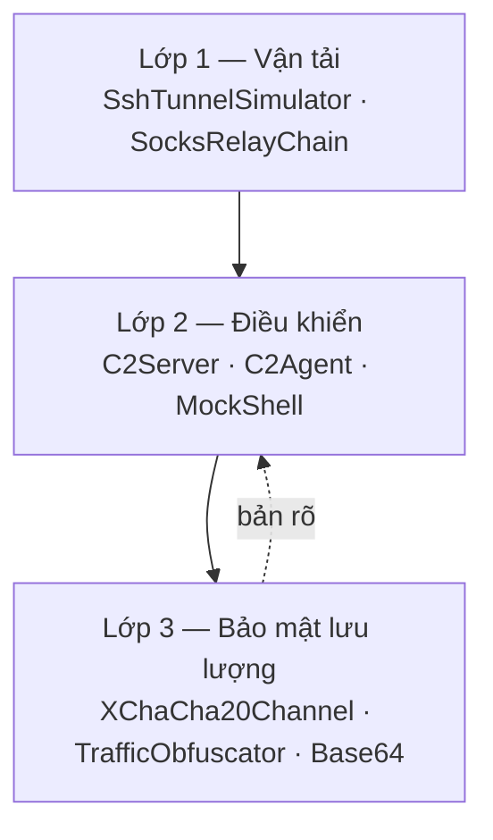
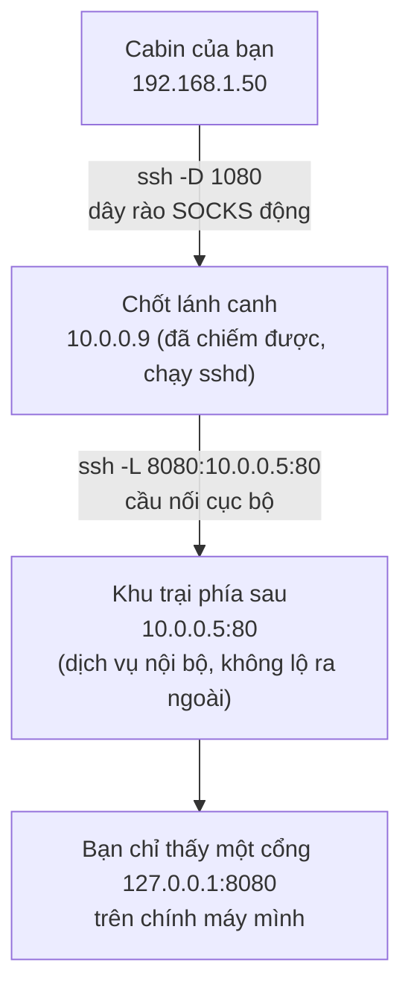
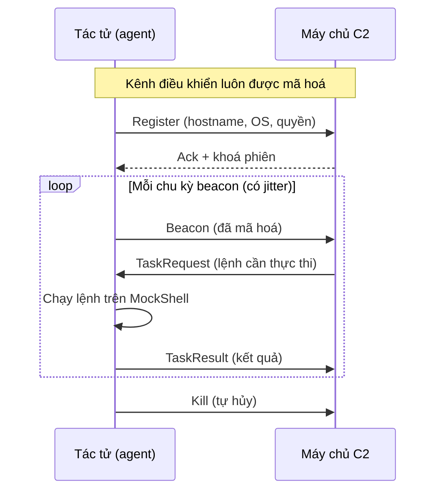
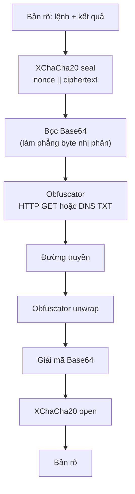
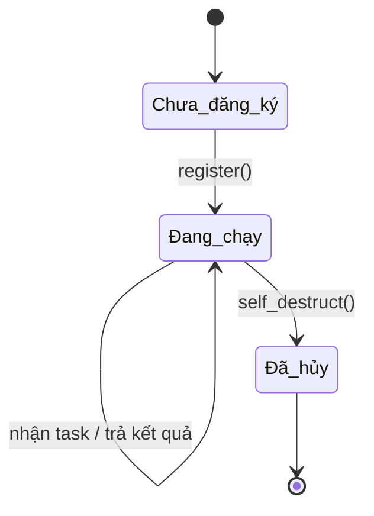

# Chương 103: Xoay chiều Mạng & Khung Chỉ huy-Kiểm soát — Đường hầm SSH, Chuỗi SOCKS, C2 Mini & Kênh Mã hoá (Pivoting & C2: SSH Tunnels, SOCKS Relay, Mini C2 & Encrypted Channels)

---

## 1. Giới thiệu & Mục tiêu

Chào mừng bạn đến với **Chương 103** — chương mở đầu **Chủ đề 28 — Mạng & Xâm nhập: Bảo mật Ứng dụng & Tấn công**.

Trong 102 chương trước, chúng ta đã đi qua nền tảng ngôn ngữ (ownership, borrow checker, trait, async), kiến trúc phần mềm (pattern, module, error handling), hệ thống hiệu năng (cache, lock-free, SIMD), bảo mật ứng dụng (mã hoá, xác thực, quản lý bí mật) và cuối cùng là cả một thế giới AI/LLM tự chứa. Nếu bạn đang đọc được dòng này thì bạn đã quen với cách viết Rust **không dùng một crate ngoài nào** — và chương này sẽ là bài kiểm tra cuối cùng cho nguyên tắc đó.

Chương 103 mở ra một nhịp thở mới: **mạng không chỉ là nơi truyền dữ liệu, mà còn là công cụ để điều hướng lưu lượng và điều khiển máy tính từ xa**. Đây là hai kỹ năng then chốt của mọi kỹ sư an ninh mạng:

- **Xoay chiều (Pivoting)**: khi bạn đã đứng ở một máy trong mạng nội bộ nhưng chưa chạm tới máy khác, bạn dựng một "đường hầm" (tunnel) để đưa lưu lượng của mình đi qua máy đó. Ba kiểu kinh điển là chuyển tiếp cục bộ (`-L`), chuyển tiếp từ xa (`-R`) và proxy SOCKS động (`-D`).
- **Chỉ huy-Kiểm soát (Command & Control — C2)**: một máy chủ tập trung giao việc cho các tác tử (agent) đã cài đặt, thu thập kết quả và điều khiển chúng. Kênh điều khiển phải **mã hoá** và phải **giấu hình dạng** để tránh bị phát hiện.

Toàn bộ crate `ch103` được viết bằng **100% Rust 2024 thuần `std`**, không một crate ngoài nào (`[dependencies]` rỗng tuyệt đối). Điều đó có nghĩa là chúng ta phải **tự cài** toàn bộ nguyên lý mật mã mà một hệ thống C2 thật cần đến:

| Thuật toán | Chuẩn | Vì sao phải tự cài |
|---|---|---|
| ChaCha20 | RFC 8439 | Mã hoá luồng nhanh, không cần phần cứng hỗ trợ, chống phân tích thời gian tốt |
| HChaCha20 / XChaCha20 | draft-irtf-cfrg-xchacha | Nonce mở rộng 24 byte giúp dùng bộ đếm đơn giản mà vẫn tránh tái sử dụng nonce |
| SHA-256 / HMAC-SHA256 | FIPS 180-4 / RFC 2104 | Nền tảng băm và xác thực thông điệp |
| HKDF-SHA256 | RFC 5869 | Dẫn khoá phiên từ bí mật ECDH mà không cần truyền khoá |
| X25519 | RFC 7748 | Trao đổi khoá ECDH trên Montgomery ladder, chống rò rỉ qua thời gian |
| Base64 | RFC 4648 | Lớp vỏ để nhét payload nhị phân vào HTTP/DNS |

Điểm **đạo đức** được nói rõ ngay từ đầu: mọi thứ trong chương này chạy trên **dữ liệu tổng hợp tất định**. Không có socket thật nào được mở ra ngoài loopback, không có lệnh nào được thực thi trên máy thật. "Tác tử" của chúng ta là một `MockShell` chỉ biết đáp `whoami`, `id`, `ls`, `uname -a`... và trả về những chuỗi cố định. Toàn bộ mã nguồn trong `code/ch103/src/main.rs` là **clean-room**, chỉ tham khảo các RFC công khai (8439, 7748, 5869, 4231, 4648) — không sao chép dòng nào từ Metasploit, Impacket hay bất kỳ framework tấn công nào.

### 1.1 Bức tranh toàn cảnh

```text
=============================================================================================
        XOAY CHIỀU MẠNG & KHUNG CHỈ HUY-KIỂM SOÁT — CHƯƠNG 103 (Pivoting & C2)
=============================================================================================

      [ MÁY CỦA BẠN ]                [ MÁY TRUNG GIAN ]              [ MÁY ĐÍCH ]
       client 192.168.1.50            jump 10.0.0.9                 victim.internal:445
            |                             |                             ^
            |  ssh -D 1080 (SOCKS)        |                             |
            +---------------------------->|                             |
            |                             |  ssh -L 8080:10.0.0.5:80   |
            |                             +---------------------------->|
            |                             |                             |
            |                       [ CHUỖI RELAY SOCKS ]                |
            +--> hopA 10.0.0.1:1080 --> hopB 10.0.0.2:1080 ----------+
                     (SocksRelayChain: resolve_path / total_latency_ms)

      [ MÁY CHỦ C2 ]  <---- XChaCha20 (nonce || ciphertext) ---->  [ TÁC TỬ ]
       C2Server                + TrafficObfuscator                  C2Agent
       sessions / tasks        (HTTP GET / DNS TXT)                 MockShell
=============================================================================================
```

Ba tầng kiến trúc, mỗi tầng **không biết gì** về tầng kia:



### 1.2 Bảng Mục tiêu Học tập & Kỹ năng Đạt được

| Mục tiêu học tập | Vì sao bắt buộc phải tự cài đặt từ đầu? | Chuẩn đầu ra thực chứng |
|---|---|---|
| **Mô phỏng đường hầm SSH** (cờ `-L`, `-R`, `-D`) | Hiểu chính xác mỗi cờ sinh ra đường đi mạng nào, tránh "chạy lệnh SSH" mù quáng | `ssh_command_line` sinh đúng `ssh -L 8080:10.0.0.5:80 user@jump`; vòng đời mở/đóng đường hầm đếm đúng số phiên hoạt động |
| **Chuỗi relay SOCKS nhiều bước** | Pivoting thật sự là hình học đường đi qua nhiều trạm trung gian, kèm độ trễ cộng dồn | `resolve_path` dựng đúng chuỗi client → hopA → hopB → đích; tổng độ trễ bằng tổng các trạm |
| **Khung C2 mini** | C2 là *máy trạng thái*, không phải script: đăng ký → beacon → nhận nhiệm vụ → trả kết quả | Vòng lặp đầy đủ chạy trên `MockShell`, không đụng hệ thống thật |
| **ChaCha20 (RFC 8439)** | Mã hoá dòng tự viết cho thấy hiểu biết về trạng thái, phép quay và XOR keystream | Khớp **đúng** vector kiểm thử §2.3.2 và §2.4.2 của RFC 8439 (114 byte bản mã) |
| **XChaCha20 + HChaCha20** | Nonce 24 byte cho phép "bộ đếm đơn giản" mà không sợ tái sử dụng nonce | `seal` / `open` khôi phục tuyệt đối bản rõ; hai nonce liên tiếp khác nhau |
| **HKDF-SHA256** | Dẫn khoá phiên từ bí mật ECDH là bước bắt buộc của mọi kênh C2 hiện đại | Khớp vector RFC 5869 A.1 (42 byte OKM); hai bên suy ra **cùng** khoá phiên |
| **X25519 (RFC 7748)** | ECDH là nền của mọi kênh mã hoá hiện đại; Montgomery ladder chống rò rỉ thời gian | Khớp vector RFC 7748 §5.2 **và** §6.1 (khoá công khai + bí mật chung) |
| **Obfuscation HTTP/DNS** | Bộ dò quét heuristic nhìn *hình dạng* lưu lượng, không đọc nội dung | Gói tin nhắn C2 thành HTTP GET hợp lệ hoặc gói DNS có bản ghi TXT; `unwrap` khôi phục 100% |

### 1.3 Bảng Ma trận 8 Bất biến Toán học & Hệ thống Bắt buộc Phải Chứng minh

Mọi hệ thống lớn trong `learn-rs` đều được định nghĩa thông qua các **bất biến (invariants)**. Chương 103 được coi là đạt chuẩn khi **44 bài kiểm thử tự động** chứng minh đủ 8 bất biến sau:

| STT | Bất biến toán học / hệ thống | Định nghĩa toán học | Cơ chế kiểm chứng trong mã nguồn |
|---|---|---|---|
| **1** | **ChaCha20 RFC Conformance** | Với khoá `00..1f` và nonce `00:00:00:09:00:00:00:4a:00:00:00:00`, khối đầu phải là `10f1e7e4d13b5915…`; với nonce `00:00:00:00:00:00:00:4a:00:00:00:00`, 114 byte bản rõ "sunscreen" phải mã hoá ra `6e2e359a2568f980…` | `test_02`, `test_03`: so khớp **từng byte hex** với vector RFC 8439 |
| **2** | **ChaCha20 Stream Symmetry** | Mã hoá là phép XOR keystream nên $\mathrm{E}(\mathrm{E}(m)) = m$ | `test_06`: mã hoá hai lần với cùng nonce trả về đúng bản gốc |
| **3** | **HKDF Determinism & Length** | $\lvert \mathrm{HKDF}(ikm, salt, info, L) \rvert = L$ và không đổi theo lần gọi | `test_09`, `test_10`: khớp vector RFC 5869 A.1; kiểm tra độ dài 1/32/64/100 |
| **4** | **X25519 RFC Conformance** | $\mathrm{X25519}(a, u)$ với vector §5.2 phải ra `c3da55379de9c690…`; với cặp khoá §6.1, hai bên phải suy ra cùng bí mật chung `4a5d9d5b…` | `test_16`, `test_17`: so khớp hex từng byte; kiểm tra tính đối xứng của ECDH |
| **5** | **Session Key Agreement** | Hai bên cùng dẫn $\mathrm{HKDF}(K_{shared}, salt, info)$ phải thu được **cùng** khoá 32 byte, dùng khoá đó mã hoá/giải mã thông điệp C2 | `test_21`: ECDH → HKDF → `XChaCha20Channel::seal` / `open` khôi phục đúng bản rõ |
| **6** | **Tunnel & Relay Path Integrity** | Đường hầm phải sinh đúng lệnh `ssh` theo từng loại; chuỗi SOCKS phải mở đầu bằng `client` và kết thúc bằng đích | `test_25`–`test_27`, `test_29`–`test_31`: so khớp chuỗi lệnh và đường đi |
| **7** | **C2 Task Round-trip** | Nhiệm vụ giao cho tác tử phải được thực thi, trả kết quả và đánh dấu hoàn tất; tác tử tự hủy thì không nhận lệnh nữa | `test_38`–`test_43`: đăng ký → beacon → hàng đợi nhiệm vụ → `TaskResult`; `self_destruct` trả về chuỗi `KILL` |
| **8** | **Obfuscation Fidelity** | Lưu lượng đã bọc phải **nhận diện được** là HTTP hoặc DNS, và tháo lớp vỏ phải khớp 100% bản gốc | `test_32`–`test_37`: `looks_like_http` / `looks_like_dns` + vòng `wrap` → `unwrap` |

### 1.4 Lưu ý đạo đức — rất quan trọng

Chương này mô tả **cơ chế** của các kỹ thuật xoay chiều mạng và điều khiển từ xa, nhưng **không một dòng mã nào** trong crate `ch103` chạm tới hệ thống thật:

- Không mở socket — mọi "địa chỉ" chỉ là giá trị `SocketAddr` dùng để **mô tả hình học** đường đi.
- Không chạy tiến trình con — vỏ lệnh `MockShell` chỉ **mô phỏng** đầu ra của `whoami`, `id`, `ls`, `uname -a` bằng một `match` trên chuỗi.
- Không có đoạn mã nào sao chép từ Metasploit, Impacket hay bất kỳ framework khai thác nào; toàn bộ mật mã được **biên soạn lại** từ các RFC công khai.
- Không có mã độc, không có cơ chế tự lan truyền, không có tệp tải về và chạy.

> **Nguyên tắc:** mọi "payload" trong chương này chỉ là **chuỗi văn bản mô phỏng**, được thi hành bởi bộ dòng lệnh giả. Chúng được dùng để *chứng minh tính đúng đắn của thuật toán*, chứ không để tấn công bất kỳ ai. Nếu bạn muốn luyện tập trên hệ thống thật, hãy làm trong môi trường cô lập (máy ảo, container) mà bạn sở hữu, và chỉ trên máy ảo đó.

---

## 2. Hình tượng hóa đời sống: Người leo núi qua dây rào và Bưu điện kín

### 2.1 Hình tượng 1: Người leo núi vượt dây rào (Pivoting)

Hãy hình dung bạn đang leo một ngọn núi giữa rừng rậm. Bạn đã ra khỏi cabin (máy tính của bạn) và đứng trước một vách đá dựng đứng (tường lửa của mạng nội bộ). Bạn **không thể leo thẳng**, nhưng trên sườn núi có một chốt lánh canh cũ (máy trung gian) — và từ chốt lánh canh đó có một **dây rào** nối xuống khu trại phía sau (máy đích).



Ba loại đường hầm SSH chính là ba kiểu "dây rào":

1. **`-L` (Local Forward — cầu nối cục bộ)**: Bạn lắng nghe ở máy mình (`127.0.0.1:8080`). Khi có ai kết nối vào cổng đó, **máy chủ SSH** sẽ mở một kết nối mới tới đích và chuyển tiếp byte. Hình dạng mạng: **bạn → jump host → đích**.
2. **`-R` (Remote Forward — cầu nối từ xa)**: Ngược lại, **máy chủ SSH** lắng nghe ở phía đích (`10.0.0.9:3306`) và chuyển tiếp mọi kết nối về `127.0.0.1:3306` trên máy bạn. Hình dạng mạng: **đích → jump host → bạn**. Đây là kỹ thuật kinh điển để đưa dịch vụ nội bộ ra ngoài mà không cần mở cổng trên firewall.
3. **`-D` (Dynamic SOCKS — dây rào động)**: Máy chủ SSH biến thành một **proxy SOCKS5**. Client (thường là trình duyệt hoặc `curl` với tuỳ chọn `--socks5`) tự quyết định muốn đi đến đâu; mọi yêu cầu đều được đưa qua kênh SSH đã mã hoá. Đây là "đường hầm" tổng quát nhất.

Điểm mấu chốt: **toàn bộ lưu lượng đi qua đường hầm SSH đều được mã hoá và xác thực bằng SSH**, nên nó trông giống hệt một phiên SSH bình thường đối với thiết bị giám sát mạng. Chương này mô phỏng đúng ba hình dạng đó bằng `SshTunnelSimulator` và `ssh_command_line`, đồng thời xếp chồng nhiều trạm trung gian bằng `SocksRelayChain`.

Bảng ánh xạ từ hình tượng sang mã nguồn:

| Hoạt động của người leo núi | Đối tượng trong mã nguồn | Kết quả |
|---|---|---|
| Buộc dây rào từ cabin tới chốt lánh canh | Mở phiên đường hầm | `SshTunnelSimulator::local_forward` / `remote_forward` / `dynamic_socks` |
| Chọn cờ treo lên dây rào | Chọn loại đường hầm | `TunnelType::LocalForward` / `RemoteForward` / `DynamicSocks` |
| Ghi lại dây rào đã buộc | Sinh lệnh tương ứng | `ssh_command_line(&SshTunnel)` |
| Đi qua nhiều chốt lánh canh | Chuỗi trạm trung gian | `SocksRelayChain::add_hop` + `resolve_path` |
| Cảm nhận độ mệt cộng dồn | Tổng độ trễ | `SocksRelayChain::total_latency_ms` |
| Tháo dây rào khi xong | Đóng phiên | `SshTunnelSimulator::close_tunnel` |

### 2.2 Hình tượng 2: Bưu điện kín (C2)

Bây giờ hãy hình dung **một đội bưu điện bí mật**. Máy chủ C2 là **sở bưu điện trung ương**; mỗi tác tử là một **người đưa thư** ở xa:



Ba quy tắc "vàng" của một đội bưu điện kín:

1. **Bao thư (sealing)**: Không ai khác đọc được thư. Trong chương này, mỗi lá thư được **bọc bằng ChaCha20/XChaCha20** với một nonce riêng, và khoá phiên được **dẫn bằng HKDF từ bí mật ECDH X25519** — tức là người trung gian chỉ cần biết khoá công khai của tác tử là có thể "mở" kênh, nhưng không thể đọc lưu lượng đã mã hoá.
2. **Tem bưu điện (fingerprint)**: Thư bạn gửi đi phải **trông giống** thư thường. Đây chính là `TrafficObfuscator`: bọc thông điệp C2 vào một yêu cầu HTTP GET hợp lệ, hoặc vào một gói DNS có bản ghi TXT. Bộ dò quét heuristic (IDS) nhìn hình dạng, nên hình dạng đúng là điều kiện sống còn.
3. **Đều đặn có rung (beacon + jitter)**: Người đưa thư không bao giờ gõ cửa đúng nhịp — nếu không, đối phương chỉ cần đếm chu kỳ là biết. `C2Agent::next_beacon_delay` cộng thêm một độ lệch ngẫu nhiên `jitter_ms` vào chu kỳ `beacon_interval_ms`.

### 2.3 Hình tượng 3: Đóng bưu phong và dán tem giả

Một chi tiết hay bị bỏ qua: **người đưa thư không gửi thô**. Họ đóng bưu phong (mã hoá), dán tem (Base64), rồi gửi đi trong một bao thư thông hợp lệ (HTTP/DNS). Người nhận phải làm đúng thứ tự ngược lại, nếu không sẽ không đọc được.



Điều thú vị là chương này còn dạy một bài học **về bảo mật phòng thủ**: cùng một kỹ thuật mà kẻ tấn công dùng để né dò quét (giấu lưu lượng trong HTTP/DNS) cũng chính là kỹ thuật mà **hệ thống phòng thủ nên dùng** để nhận diện lưu lượng bất thường — ví dụ phát hiện một "file tĩnh" nào đó lại mang tham số `?d=` chứa Base64 dài bất thường. Học sinh của `learn-rs` nên đọc cả hai phía của cuộc chơi.

---

## 3. Khái niệm & Cơ chế kỹ thuật chuyên sâu

### 3.1 Đường hầm SSH: ba chế độ `-L`, `-R`, `-D`

Một phiên SSH là một kênh TCP hai chiều đã mã hoá. Điều kỳ diệu của `ssh` là: **ngay trên kênh đã mã hoá đó, bạn có thể yêu cầu máy chủ mở thêm các kết nối TCP khác và chuyển tiếp byte qua kênh**. Đó là "đường hầm" (tunneling).

#### Hình học mạng của ba chế độ

```text
   -L (Local Forward)              -R (Remote Forward)             -D (Dynamic SOCKS)
   ───────────────────              ─────────────────────            ─────────────────────
   [Client]───SSH───>[Server]       [Server]───SSH───>[Client]       [Client]───SSH───>[Server]
      │ listen                             │ listen                          │ SOCKS5 proxy
      ▼                                    ▼                                 ▼
   127.0.0.1:8080                     10.0.0.9:3306            client tự chọn đích mỗi lần
      │                                    │
      └──> Server mở kết nối tới ──┐       └──> Client mở kết nối tới ──┐
           đích:port và chuyển tiếp  │            đích:port và chuyển tiếp  │
                                    ▼                                ▼
                              10.0.0.5:80                        127.0.0.1:3306
```

Về mặt toán học, cả ba đều là một **hàm chuyển tiếp** $f$:

$$
f : (\text{byte vào từ socket cục bộ}) \longmapsto (\text{byte ra tới socket đích})
$$

Và toàn bộ byte đi qua $f$ đều nằm trong "hành lang" của kênh SSH đã mã hoá. Chương này không mở socket thật, mà **mô phỏng đúng phần "hình học"** — tức là biết đường hầm nào đi đâu — và sinh ra **đúng lệnh `ssh`** mà một quản trị viên sẽ gõ:

```text
ssh -L 8080:10.0.0.5:80  user@jump      # cầu nối cục bộ
ssh -R 3306:127.0.0.1:3306 user@jump    # cầu nối từ xa
ssh -D 1080 user@jump                  # proxy SOCKS động
```

#### Bảng byte-level: cấu trúc thông điệp điều khiển của kênh SSH

Để hiểu vì sao một đường hầm SSH lại "miễn phí" về mặt mã hoá, hãy nhìn vào cấu trúc thông điệp điều khiển (RFC 4254) mà `ssh` trao đổi **bên trong** kênh đã mã hoá:

| Mã thông điệp | Ý nghĩa | Trường dữ liệu đi kèm | Tác động lên hình học mạng |
|---|---|---|---|
| `0x01` | SSH_MSG_CHANNEL_OPEN | Kiểu kênh (direct-tcpip, forwarded-tcpip, direct-streamlocal) + địa chỉ đích + cổng đích | **Mở** một kênh con tới đích, đây là lúc "đường hầm" được tạo |
| `0x02` | SSH_MSG_CHANNEL_OPEN_CONFIRMATION | Mã kênh của bên nhận | Xác nhận kênh con đã sẵn sàng nhận byte |
| `0x5A` | SSH_MSG_CHANNEL_DATA | Mã kênh + độ dài + byte thô | **Chuyển tiếp** dữ liệu người dùng xuyên qua kênh con |
| `0x5B` | SSH_MSG_CHANNEL_EOF | Mã kênh | Báo kết thúc luồng theo một chiều |
| `0x5C` | SSH_MSG_CHANNEL_CLOSE | Mã kênh | Đóng kênh con, đường hầm kết thúc |
| `0x80` | SSH_MSG_GLOBAL_REQUEST | Cờ `want_reply` + tên yêu cầu | Chính là nơi phát sinh yêu cầu `tcpip-forward` cho chế độ `-R` |

Điểm mấu chốt nằm ở dòng `0x5A`: **byte truyền qua đường hầm không bao giờ chạm vào mạng vật lý**. Nó đi qua bộ đệm của kênh SSH, rồi bị mã hoá cùng với phần còn lại của phiên SSH. Do đó, đối với một bộ phân tích mạng chỉ nhìn ở tầng TCP, toàn bộ lưu lượng pivoting **trông y hệt** lưu lượng SSH thông thường.

Trong mã nguồn, `ssh_command_line` là nơi quyết định "hình dạng" này, còn `SshTunnelSimulator` quản lý **vòng đời phiên** (cấp mã phiên tăng dần, đóng phiên, đếm số đường hầm hoạt động).

#### Sự khác biệt giữa "hình học" và "nội dung"

Bảng dưới đây là ranh giới đạo đức mà crate `ch103` vẽ ra:

| Tầng | Crate `ch103` có gì? | Crate `ch103` **không** có gì? |
|---|---|---|
| Hình học (ai lắng nghe ở đâu, đi tới đâu) | `SshTunnel`, `TunnelType`, `SocketAddr` | Không có `TcpListener`, không có `TcpStream` |
| Lệnh sinh ra | `ssh_command_line` trả về `String` | Không gọi `std::process::Command` để chạy `ssh` |
| Vòng đời | `open` / `close_tunnel` / `active_tunnels` | Không có tiến trình `sshd` nào được sinh ra |
| Độ trễ | `total_latency_ms` cộng các số đo tổng hợp | Không đo trễ thật, không gửi gói tin nào |

### 3.2 Chuỗi relay SOCKS và độ trễ cộng dồn

Pivoting thực tế thường là **nhiều bước**: client → SOCKS1 → SOCKS2 → … → đích. Mô hình toán học:

$$
\text{đường đi} = \big[\,c,\ h_1,\ h_2,\ \dots,\ h_n,\ t\,\big],\qquad \text{độ trễ tổng} = \sum_{i=1}^{n} \ell_i
$$

Trong đó $c$ là client, $h_i$ là các trạm trung gian, $t$ là đích và $\ell_i$ là độ trễ của trạm $i$. `SocksRelayChain::total_latency_ms` hiện thực đúng tổng này; trạm nào không có phép đo thì được tính bằng 0 (quy ước "không đo = không nghẽn").

#### Bảng byte-level: bắt tay SOCKS5

Đây là phần protocol thật mà chương này **chưa** cài đặt đầy đủ (bài tập 1 sẽ bạn tự làm), nhưng đây là byte-level tham chiếu để bạn hiểu "chuỗi SOCKS" thực sự là gì:

| Giai đoạn | Byte | Ý nghĩa | Quy tắc bắt buộc |
|---|---|---|---|
| Client → Server | `0x05` | `VER` — phiên bản SOCKS5 | Bắt buộc bằng `0x05`, nếu khác thì server phải từ chối |
| Client → Server | `0x01` | `NMETHODS` — số phương thức xác thực được đề nghị | Phải lớn hơn 0, nếu bằng 0 thì server đóng kết nối |
| Client → Server | `0x00` | `METHOD` — "no authentication required" | Giá trị `0x00` nghĩa là không cần mật khẩu |
| Server → Client | `0x05 0x00` | Phản hồi chọn phương thức | Byte đầu lặp lại `VER`, byte sau là phương thức đã chọn |
| Client → Server | `0x05 0x01 0x00` | `CMD` = `CONNECT`, `RSV`, `ATYP` = IPv4 | `CMD` phải là `0x01` cho đường hần TCP |
| Client → Server | `0x00 0x00 0x00 0x01` | `DST.ADDR` — IPv4 4 byte | Địa chỉ đích cuối cùng |
| Client → Server | `0x01 0xBB` | `DST.PORT` — cổng đích, big-endian | Cổng 443 nằm ở byte `0x01 0xBB` |

Nhìn bảng trên, ta thấy ngay: **mỗi bước trong chuỗi là một lần bắt tay SOCKS5 đầy đủ**. Một chuỗi 3 trạm sẽ có 3 lần bắt tay, và điểm mấu chốt là mỗi trạm chỉ biết trạm kế tiếp — không trạm nào biết toàn bộ đường đi. Đó là lý do pivoting khó phát hiện: mỗi bước trông giống một kết nối SOCKS hợp lệ.

#### Bảng byte-level: cấu trúc thông điệp điều khiển của kênh SSH (phần "cầu nối")

Để đối chiếu hai giao thức, dưới đây là cách một yêu cầu `tcpip-forward` (chế độ `-R`) được đóng gói:

| Trường | Kích thước | Nội dung trong chế độ `-R` |
|---|---|---|
| Mã thông điệp | 1 byte | `0x80` (`SSH_MSG_GLOBAL_REQUEST`) |
| Cờ | 1 byte | `0x01` nếu muốn nhận phản hồi |
| Tên yêu cầu | 4 byte + nội dung | Chuỗi `tcpip-forward` |
| Số cổng đề nghị | 4 byte | Cổng phía đích mà máy chủ sẽ lắng nghe |

Đối chiếu với SOCKS: hai giao thức này *khác nhau về hình thức* nhưng *giống nhau về bản chất* — cả hai đều là cách để một bên thứ ba "làm trung gian" mở kết nối tới một địa chỉ mà nó không muốn công khai.

### 3.3 Khung C2 mini: máy trạng thái, không phải script

Khung C2 trong chương này gồm bốn thành phần:

| Thành phần | Vai trò | Trạng thái chính |
|---|---|---|
| `C2Server` | Máy chủ trung ương | `sessions: HashMap<String, AgentSession>`, `tasks: Vec<Task>`, `clock`, `encryption` |
| `AgentSession` | Phiên của một tác tử | `last_seen`, `alive`, `hostname`, `os`, `privileges` |
| `Task` | Nhiệm vụ đã giao | `id`, `command`, `issued_at`, `completed`, `result` |
| `C2Agent` | Tác tử phía máy đích | `beacon_interval_ms`, `jitter_ms`, `destroyed`, `trace` |

#### Định dạng thông điệp trên đường truyền

Mỗi thông điệp C2 có **phần đầu 9 byte**:

$$
\underbrace{[1 \text{ byte}]}_{\text{mã lệnh}}\ \Vert\ \underbrace{[8 \text{ byte}]}_{\text{đồng hồ LE}}\ \Vert\ \underbrace{[\text{payload}]}_{\text{UTF-8}}
$$

#### Bảng byte-level: phần đầu thông điệp C2

| Offset | Kích thước | Nội dung | Giá trị / ý nghĩa |
|---|---|---|---|
| `0` | 1 byte | Mã lệnh | `0x01` Register, `0x02` Beacon, `0x03` TaskRequest, `0x04` TaskResult, `0x05` ShellOutput, `0x06` Kill |
| `1` | 8 byte | Đồng hồ logic của máy chủ, **little-endian** | Tăng mỗi lần `tick()`, dùng để đánh dấu thứ tự và chống phát lại |
| `9` | biến thiên | Payload | Chuỗi UTF-8 (lệnh cần thực thi, hoặc kết quả trả về) |

Đồng hồ 8 byte nằm trong bản rõ (trước khi mã hoá) giúp mỗi lá thư có "dấu thời gian" — đồng thời làm cho hai thông điệp cùng nội dung nhưng khác thời điểm vẫn cho **nonce khác nhau** (xem mục 3.4).

#### Vòng đời chuẩn của một tác tử



#### Vì sao C2 phải là *máy trạng thái*?

Công thức tổng quát cho một vòng lặp C2 là:

$$
\sigma_{t+1} = \delta(\sigma_t,\ \text{beacon}_t),\qquad \text{output}_t = \lambda(\sigma_t)
$$

Trong đó $\sigma_t$ là trạng thái của máy chủ tại thời điểm $t$ (tập phiên đã đăng ký, hàng đợi nhiệm vụ chưa xong, đồng hồ), $\delta$ là hàm chuyển trạng thái (đăng ký tác tử mới, cập nhật `last_seen`, đẩy nhiệm vụ), còn $\lambda$ là hàm quan sát (sinh ra danh sách tác tử đang sống, số nhiệm vụ chờ).

Điểm mấu chốt: **$\delta$ phải là hàm thuần tuý theo thứ tự thời gian** — cùng một chuỗi hành động phải cho cùng một kết quả. Đó là lý do crate này dùng đồng hồ logic đếm `tick()` thay vì `SystemTime`, và dùng `SplitMix64` thay cho mọi nguồn ngẫu nhiên. Bài test `test_44` kiểm chứng đúng điều đó: `run_c2_demo(2026)` luôn trả về cùng một báo cáo.

#### Bảng byte-level: tín hiệu beacon có jitter

| Thành phần | Kích thước | Công thức | Ý nghĩa |
|---|---|---|---|
| Chu kỳ | 8 byte | $T = \text{beacon\_interval\_ms}$ | Khoảng thời gian nền giữa hai lần beacon |
| Jitter | 8 byte | $j \in [0,\ \text{jitter\_ms}]$, lấy bằng $r \bmod (\text{jitter\_ms}+1)$ | Độ lệch ngẫu nhiên chống phân tích nhịp |
| Độ trễ thực | 8 byte | $D = T + j$ | Tổng thời gian chờ tới lượt beacon kế tiếp |

Với `beacon_interval_ms = 5000` và `jitter_ms = 750`, tác tử sẽ gõ cửa trong khoảng **5000 ms đến 5750 ms** — không bao giờ đúng nhịp. Một hệ thống phát hiện dựa trên "nhịp gần như đều" sẽ trượt qua cả khoảng này.

### 3.4 ChaCha20 và XChaCha20: mã hoá dòng theo phép ARX

ChaCha20 là mã hoá luồng (stream cipher) thuộc họ ARX (**A**ddition, **R**otation, **X**OR). Toàn bộ trạng thái là 16 từ 32-bit:

$$
\text{state} = \underbrace{c_0,c_1,c_2,c_3}_{\text{hằng số}}\ \Vert\ \underbrace{k_0,\dots,k_7}_{\text{khoá 256-bit}}\ \Vert\ \underbrace{n_{\text{ctr}}}_{\text{bộ đếm}}\ \Vert\ \underbrace{n_0,n_1,n_2}_{\text{nonce 96-bit}}
$$

#### Bảng byte-level: bố cục trạng thái ChaCha20 (16 từ 32-bit)

| Offset byte | Chỉ số từ | Kích thước | Nội dung | Giá trị mặc định |
|---|---|---|---|---|
| `0..16` | `state[0..4]` | 4 × 4 byte | Hằng số "expand 32-byte k" | `0x61707865, 0x3320646e, 0x79622d32, 0x6b206574` |
| `16..48` | `state[4..12]` | 8 × 4 byte | Khoá 256-bit | Do bên gửi và bên nhận thống nhất |
| `48..52` | `state[12]` | 4 byte | Bộ đếm khối | `1` theo RFC 8439 §2.4.2 |
| `52..64` | `state[13..16]` | 3 × 4 byte | Nonce 96-bit | Sinh từ bộ đếm phiên hoặc ngẫu nhiên |

#### Vòng phần tư (Quarter Round)

Mỗi vòng phần tư `QR(a,b,c,d)` gồm 8 phép toán:

$$
\begin{aligned}
a &\mathrel{+}= b;\quad d \mathrel{\oplus}= a;\quad d \lll 16 \\
c &\mathrel{+}= d;\quad b \mathrel{\oplus}= c;\quad b \lll 12 \\
a &\mathrel{+}= b;\quad d \mathrel{\oplus}= a;\quad d \lll 8 \\
c &\mathrel{+}= d;\quad b \mathrel{\oplus}= c;\quad b \lll 7
\end{aligned}
$$

Một khối 64 byte được sinh bằng **10 lần đôi vòng** (20 vòng đơn), rồi cộng lại trạng thái ban đầu:

$$
\text{output}_i = \text{working}_i + \text{state}_i \pmod{2^{32}},\qquad i = 0..15
$$

#### Từ khối keystream tới bản mã

$$
\text{keystream} = \text{Block}(k, n_{\text{ctr}}) \Vert \text{Block}(k, n_{\text{ctr}}+1) \Vert \dots,\qquad \text{ciphertext} = \text{plaintext} \oplus \text{keystream}
$$

Chính vì là XOR keystream nên **mã hoá và giải mã là cùng một phép toán** — đó là bất biến số 2 của chương. Ta ký hiệu:

$$
\mathrm{Enc}_k(n, m) = m \oplus \text{KS}(k, n),\qquad \mathrm{Dec}_k(n, c) = c \oplus \text{KS}(k, n) = \mathrm{Enc}_k(n, m)
$$

#### HChaCha20 và XChaCha20: nonce mở rộng

Nonce chuẩn của ChaCha20 chỉ 96 bit. Với tốc độ mạng hiện đại (hàng trăm gigabit/giây), 96 bit có thể bị **tái sử dụng** nếu một máy gửi quá nhiều bản tin — hậu quả là **thỏng mã (catastrophic keystream reuse)**. XChaCha20 (draft-irtf-cfrg-xchacha) giải quyết bằng cách dùng **nonce 24 byte**:

$$
\text{nonce 24 byte} = \underbrace{n_{16}}_{\text{16 byte}} \Vert \underbrace{c_{8}}_{\text{8 byte bộ đếm}},\qquad \text{subkey} = \text{HChaCha20}(k, n_{16}),\quad \text{nonce}_{\text{ChaCha}} = 0^{32} \Vert c_{8}
$$

HChaCha20 chạy **20 vòng ChaCha20** trên trạng thái $c \Vert k \Vert n_{16}$ (không có bộ đếm, không cộng lại trạng thái ban đầu) rồi lấy 16 từ đầu và 4 từ cuối làm khoá phụ.

Trong crate này, `XChaCha20Channel` vận hành theo định dạng đường truyền:

$$
\boxed{\text{nonce (12 byte)} \ \Vert\ \text{ciphertext}}
$$

với 12 byte đầu là nonce ChaCha20 (4 byte 0 + 8 byte bộ đếm little-endian), còn khoá phụ được dẫn từ HChaCha20 với vật liệu nonce mở rộng băm từ khoá chính.

#### Bảng byte-level: định dạng đường truyền của kênh XChaCha20

| Offset | Kích thước | Nội dung | Nguồn gốc |
|---|---|---|---|
| `0..4` | 4 byte | Luôn bằng `0x00` | Phần đệm của biến thể IETF |
| `4..12` | 8 byte | Bộ đếm nonce, **little-endian** | `nonce_counter` của kênh, tăng 1 mỗi bản tin |
| `12..` | biến thiên | Bản mã ChaCha20 | `chacha20(subkey, nonce, plaintext)` |

Khoá phụ được dẫn như sau:

$$
\text{extended} = \text{SHA-256}(k \Vert n)\big[0..16\big] \Vert n\big[4..12\big],\qquad \text{subkey} = \text{HChaCha20}(k,\ \text{extended}\big[0..16\big])
$$

> **Bẫy cần tránh:** mỗi lần gọi `seal` sẽ **tăng bộ đếm nonce**. Nếu bạn vô tình gọi `seal` hai lần mà không dùng bản tin đầu, bộ đếm vẫn tăng — điều đó **an toàn**. Nguy hiểm là trường hợp bạn tự tay sao chép lại một bản mã cũ rồi phát đi lần nữa.

#### Hai vector kiểm thử chuẩn (và một bài học về đọc RFC)

RFC 8439 đưa ra **hai** vector liên quan tới cùng một khoá `00:01:02:…:1f`:

| Mục đích | Nonce | Bộ đếm đầu | Kết quả mong đợi |
|---|---|---|---|
| §2.3.2 — khối hàm băm | `00:00:00:09:00:00:00:4a:00:00:00:00` | 1 | khối `10f1e7e4d13b5915…` |
| §2.4.2 — bản mã 114 byte | `00:00:00:00:00:00:00:4a:00:00:00:00` | 1 | `6e2e359a2568f980…` |

Bài học ở đây rất đáng giá cho người làm bảo mật: **đừng bao giờ trích dẫn vector kiểm thử từ trí nhớ**. Bản đặc tả của chương này (SPEC) ban đầu ghép *nonce của §2.3.2* với *bản mã của §2.4.2* — một sự ghép sai. Cách duy nhất để phát hiện là **kiểm chứng độc lập hai vector**, mỗi vector với đúng bộ tham số của nó. Crate `ch103` vì vậy kiểm chứng **cả hai** vector RFC 8439, và mã nguồn được ghi chú rõ để người đọc không bị nhầm lẫn.

### 3.5 X25519 ECDH + HKDF: từ bí mật chung tới khoá phiên

#### Bước "clamp" của scalar

Theo RFC 7748 §5, scalar phải được "clamp" trước khi dùng:

```text
k[0]  &= 248      // 3 bit thấp nhất bị xoá
k[31] &= 127      // bit cao nhất bị xoá
k[31] |= 64       // bit thứ hai cao nhất được bật
```

Nhờ vậy scalar luôn có dạng $2^{254} + 8k$ với $0 \le k < 2^{251}$, tức là **nhóm con có đơn vị** và có "độ dài" cố định — nền tảng để Montgomery ladder chạy **constant-time** (thời gian không phụ thuộc giá trị của khoá).

#### Montgomery ladder

Với đường cong Montgomery $v^2 = u^3 + Au^2 + u$ ($A = 486662$), phép nhân điểm $[k]P$ được tính bằng thang leo:

$$
\begin{aligned}
x_1 &= u,\quad x_2 = 1,\quad z_2 = 0,\quad x_3 = u,\quad z_3 = 1\\
\text{for } t &= 254 \dots 0:\\
\quad k_t &= (k \gg t) \,\&\, 1\\
\quad (x_2,x_3) &\leftarrow \text{cswap}(k_t \oplus \text{swap},\, x_2, x_3)\\
\quad A &= x_2 + z_2,\quad AA = A^2,\quad B = x_2 - z_2,\quad BB = B^2\\
\quad E &= AA - BB,\quad C = x_3 + z_3,\quad D = x_3 - z_3\\
\quad DA &= D \cdot A,\quad CB = C \cdot B\\
\quad x_3 &= (DA + CB)^2,\quad z_3 &= x_1 (DA - CB)^2\\
\quad x_2 &= AA \cdot BB,\quad z_2 &= E\,(AA + a_{24}\, E)
\end{aligned}
$$

với $a_{24} = \frac{A-2}{4} = 121665$, và kết quả là:

$$
\text{X25519}(k, u) = x_2 \cdot z_2^{\,p-2} \pmod p,\qquad p = 2^{255} - 19
$$

#### Bảng byte-level: gói ECDH X25519

| Bước | Chiều dài | Nội dung | Ai sinh ra |
|---|---|---|---|
| 1 | 32 byte | Khoá bí mật đã clamp | Bên A, bên B — **không bao giờ** gửi đi |
| 2 | 32 byte | Khoá công khai $A = \text{X25519}(a, 9)$ | Bên A gửi cho B |
| 3 | 32 byte | Khoá công khai $B = \text{X25519}(b, 9)$ | Bên B gửi cho A |
| 4 | 32 byte | Bí mật chung $S = \text{X25519}(a, B) = \text{X25519}(b, A)$ | Cả hai tự tính, **không** gửi đi |

Bằng chứng tính đúng đắn của bước 4 là hệ đẳng thức:

$$
\text{X25519}(a, \text{X25519}(b, 9)) = \text{X25519}(b, \text{X25519}(a, 9))
$$

được kiểm chứng bằng `test_17` và `test_20`.

#### Số học trường với 5 limb 51-bit

Đây là phần "nặng" nhất của chương. Thay vì dùng số nguyên lớn, ta biểu diễn phần tử trường bằng 5 limb 51-bit:

$$
u = \sum_{i=0}^{4} u_i \cdot 2^{51 i},\qquad 0 \le u_i < 2^{51}
$$

#### Bảng byte-level: biểu diễn phần tử trường

| Limb | Bit đầu | Bit cuối | Độ dài (bit) | Giá trị tối đa | Ghi chú |
|---|---|---|---|---|---|
| `u[0]` | 0 | 50 | 51 | `2^51 - 1` | Chứa hệ số `19` khi gấp |
| `u[1]` | 51 | 101 | 51 | `2^51 - 1` | — |
| `u[2]` | 102 | 152 | 51 | `2^51 - 1` | — |
| `u[3]` | 153 | 203 | 51 | `2^51 - 1` | — |
| `u[4]` | 204 | 254 | 51 | `2^51 - 1` | Bit 255 bị che theo RFC 7748 |

Phép nhân dùng công thức "19" của $2^{255} \equiv 19 \pmod p$:

$$
\begin{aligned}
r_0 &= a_0 b_0 + 19(a_1 b_4 + a_2 b_3 + a_3 b_2 + a_4 b_1)\\
r_1 &= a_0 b_1 + a_1 b_0 + 19(a_2 b_4 + a_3 b_3 + a_4 b_2)\\
r_2 &= a_0 b_2 + a_1 b_1 + a_2 b_0 + 19(a_3 b_4 + a_4 b_3)\\
r_3 &= a_0 b_3 + a_1 b_2 + a_2 b_1 + a_3 b_0 + 19(a_4 b_4)\\
r_4 &= a_0 b_4 + a_1 b_3 + a_2 b_2 + a_3 b_1 + a_4 b_0
\end{aligned}
$$

Mỗi limb có thể vượt 51 bit sau khi nhân, nên cần **chuẩn hoá (carry)**: dư ở limb $i$ chuyển sang limb $i+1$, và phần dư tràn ra khỏi limb 4 (tức là $2^{255}$) được quy về **19** theo đẳng thức $2^{255} \equiv 19 \pmod p$.

Phép trừ tránh kẹp âm bằng cách cộng trước $2p$:

$$
2p \text{ trong hệ limb} = \big[\,2^{52}-38,\ 2^{52}-2,\ 2^{52}-2,\ 2^{52}-2,\ 2^{52}-2\,\big]
$$

#### HKDF-SHA256: từ bí mật ECDH tới khoá phiên

Bí mật chung ECDH là **32 byte ngẫu nhiên** — dùng làm khoá mã hoá trực tiếp thì lãng phí và không gắn "ngữ cảnh". HKDF (RFC 5869) biến nó thành khoá phiên có ngữ cảnh:

$$
\text{PRK} = \text{HMAC-Hash}(\text{salt},\ \text{IKM}) \tag{Extract}
$$

$$
\text{OKM} = \text{T}(1) \Vert \text{T}(2) \Vert \dots,\qquad \text{T}(i) = \text{HMAC-Hash}(\text{PRK},\ \text{T}(i-1) \Vert \text{info} \Vert i) \tag{Expand}
$$

Trong đó $\text{IKM}$ là "input keying material" (bí mật chung), `salt` là muối ngữ cảnh, `info` là nhãn mục đích (ví dụ `b"c2-session-key"`). HMAC-SHA256 (RFC 2104) được định nghĩa:

$$
\text{HMAC}(K, m) = H\big((K' \oplus \text{opad}) \Vert H\big((K' \oplus \text{ipad}) \Vert m\big)\big),\qquad K' = \text{pad}_{64}(K)
$$

SHA-256 (FIPS 180-4) là hàm băm Merkle–Damgård: khối 512 bit, 64 vòng, hằng số thập lục phân khai $\lfloor 2^{32}\sqrt[3]{2} \rfloor$.

#### Bảng byte-level: chuỗi dẫn khoá phiên hoàn chỉnh

| Bước | Input | Output | Kích thước | Chuẩn |
|---|---|---|---|---|
| 1 | Khoá bí mật ngẫu nhiên 32 byte | Khoá công khai | 32 byte | RFC 7748 |
| 2 | Khoá công khai của đối tác | Bí mật chung | 32 byte | RFC 7748 |
| 3 | Bí mật chung + `salt` + `info` | PRK | 32 byte | RFC 5869 §2.2 |
| 4 | PRK + `info` | OKM | 32 byte | RFC 5869 §2.3 |
| 5 | OKM | Khoá phiên của kênh XChaCha20 | 32 byte | draft-irtf-cfrg-xchacha |

Toàn bộ chuỗi này **không truyền khóa phiên qua mạng** — hai bên chỉ truyền khoá công khai. Đó là điểm khác biệt giữa "kênh C2 hiện đại" và một hệ thống tự cài khoá tĩnh.

> **Bẫy cần tránh:** mảng byte biểu diễn số mũ của HKDF và các hằng số trường đều là **little-endian**. Trong phép "bình phương-nhân" (square-and-multiply) phải duyệt byte **từ cuối về đầu**, nếu không kết quả sẽ là lũy thừa của một số mũ **đảo ngược byte** — một lỗi cực dễ mắc và cực khó phát hiện bằng mắt. Bài test `test_16` bắt được đúng lỗi loại này.

### 3.6 Obfuscate lưu lượng: đeo mặt nạ HTTP và DNS

#### Dạng HTTP GET

```text
GET /static/img/px.gif?d=<base64> HTTP/1.1
Host: cdn.jsdelivr.net
User-Agent: Mozilla/5.0 (X11; Linux x86_64) AppleWebKit/537.36
Accept: */*
Accept-Encoding: gzip, deflate
Connection: keep-alive
```

Dấu vết của "file ảnh tĩnh" + "tham số hợp lệ" là thứ mà heuristic engine mong đợi. Payload nhị phân được bọc Base64 để không phá vỡ cú pháp URL.

#### Bảng byte-level: cấu trúc yêu cầu HTTP do `wrap_http_request` sinh ra

| Offset | Kích thước | Nội dung | Ghi chú |
|---|---|---|---|
| `0` | 4 byte | `GET ` | Method HTTP hợp lệ, `looks_like_http` nhận diện được |
| `4..24` | 20 byte | `/static/img/px.gif?d=` | Đường dẫn trông như tài nguyên tĩnh |
| `24..` | biến thiên | Base64 của payload | Ký tự `A–Z a–z 0–9 + / =` — an toàn cho URL |
| — | 12 byte | ` HTTP/1.1\r\n` | Kết thúc dòng request-line |
| — | biến thiên | `Host:`, `User-Agent:`, `Accept:`, `Accept-Encoding:`, `Connection:` | Header giống hệt trình duyệt thật |
| — | 2 byte | `\r\n\r\n` | Kết thúc header, phần thân rỗng |

#### Dạng DNS (DNS tunnelling)

Gói DNS thật có cấu trúc:

```text
Header (12 byte) : ID | Flags | QDCOUNT | ANCOUNT | NSCOUNT | ARCOUNT
Question         : QNAME (nhãn) | QTYPE | QCLASS
Answer/Additional : NAME | TYPE | CLASS | TTL | RDLENGTH | RDATA
```

Trong crate này, payload được nhét vào **bản ghi TXT của phần "Additional"** của truy vấn (hoặc phần "Answer" của phản hồi), với `QNAME = tunnel.example.com` và `QTYPE = 16` (TXT). Vì DNS là giao thức **phân giải tên**, lưu lượng trông giống hệt việc máy tính tra cứu tên miền — và rất nhiều tường lửa doanh nghiệp cho phép DNS đi ra ngoài.

#### Bảng byte-level: gói DNS do `wrap_dns_query` sinh ra

| Offset | Kích thước | Nội dung | Giá trị |
|---|---|---|---|
| `0..2` | 2 byte | Transaction ID | `0x4D2C` (hằng số trong crate) |
| `2..4` | 2 byte | Flags | `0x0100` = standard query, RD đặt |
| `4..6` | 2 byte | QDCOUNT | `1` — đúng một câu hỏi |
| `6..8` | 2 byte | ANCOUNT | `0` — truy vấn không có đáp án |
| `8..10` | 2 byte | NSCOUNT | `0` |
| `10..12` | 2 byte | ARCOUNT | `1` — có một bản ghi bổ sung (chỗ chứa payload) |
| `12..` | biến thiên | QNAME | Các nhãn `tunnel`, `example`, `com`, kết thúc bằng `0x00` |
| — | 4 byte | QTYPE + QCLASS | `0x0010` (TXT) + `0x0001` (IN) |
| — | biến thiên | Bản ghi bổ sung | NAME `0x00`, TYPE `0x0010`, TTL `0`, RDLENGTH, RDATA = Base64 |

Bộ phát hiện heuristic trong thế giới thật thường săn chính xác chỗ này: **một bản ghi TXT dài bất thường** là dấu hiệu kinh điển của DNS tunnelling.

#### Base64 (RFC 4648)

Bảng ký tự chuẩn 64 ký tự `A–Z a–z 0–9 + /` với đệm `=`, mã hoá 3 byte → 4 ký tự:

$$
\text{base64}(b_0 b_1 b_2) = c_0 c_1 c_2 c_3,\qquad n = b_0 \ll 16 \mid b_1 \ll 8 \mid b_2
$$

#### Bảng byte-level: ánh xạ 3 byte → 4 ký tự Base64

| Byte đầu | Bit cao | Bit thấp | Ký tự 1 | Ký tự 2 | Ký tự 3 | Ký tự 4 |
|---|---|---|---|---|---|---|
| `0xFF` | `111111` | `111111` | `/` | `/` | `/` | `/` |
| `0x00` | `000000` | `000000` | `A` | `A` | `A` | `A` |
| `0xFB 0xEF 0xBE` | `111110` | `111110` | `+` | `7` | `v` | `+` |

Ba quy tắc đệm: nếu còn 1 byte thì thêm **hai** ký tự `=`; nếu còn 2 byte thì thêm **một** ký tự `=`; nếu đủ 3 byte thì không đệm.

#### Đường đi byte-level của một thông điệp C2 đầy đủ

Đây là chuỗi biến đổi byte thật sự mà một thông điệp đi trên đường truyền:

```text
bản rõ  : [mã lệnh 1B][đồng hồ 8B][payload UTF-8]
   │  seal  (XChaCha20, subkey = HChaCha20(k, ext), nonce 12B)
   ▼
mã hoá  : [nonce 12B][bản mã = bản rõ XOR keystream]
   │  wrap  (Base64 rồi đóng gói HTTP/DNS)
   ▼
lưu lượng: "GET /static/img/px.gif?d=<base64> HTTP/1.1\r\n..."
   │  unwrap  (tách Base64)
   ▼
mã hoá  : [nonce 12B][bản mã]
   │  open  (tách nonce 12B, giải mã ChaCha20)
   ▼
bản rõ  : [mã lệnh 1B][đồng hồ 8B][payload UTF-8]
```

Nhớ rằng **bước `unwrap` không thay thế bước `open`**: lớp vỏ chỉ làm cho lưu lượng *khó nhận diện*, không làm cho nó *an toàn hơn về mật mã*. Một kênh C2 nghiêm túc luôn mã hoá đầu-cuối *và* xác thực toàn vẹn.

---

### 3.7 Vì sao chọn ChaCha20 chứ không phải AES? Và bảng hằng số tra cứu nhanh

| Tiêu chí | ChaCha20 (RFC 8439) | AES-128/256 (FIPS 197) |
|---|---|---|
| Phép toán | ARX: cộng, XOR, quay bit | S-box tra cứu + MixColumns (không phải ARX) |
| Cần phần cứng hỗ trợ? | Không — chạy nhanh trên CPU không có lệnh mã hoá | Không bắt buộc, nhưng có lệnh `AES-NI` thì nhanh hơn nhiều |
| Chống rò rỉ thời gian | Rất tốt: cấu trúc lệnh cố định, không có bảng tra | Cần phần cứng hỗ trợ hoặc phải cẩn thận với T-tables |
| Kích thước mã/đường truyền | 256-bit khoá, 96-bit nonce | 128/256-bit khoá, 96/128-bit nonce |
| Tiêu chuẩn "khuyến nghị" | RFC 8439 (bắt buộc cho TLS 1.3 cùng AES-GCM) | FIPS 197 (được cấp phép cho chính phủ Mỹ) |

Lý do ChaCha20 được chọn cho chương này: **nó là mã hoá dòng mà không cần bảng tra cứu**, nên toàn bộ phần toán học có thể viết lại bằng `u32` thuần túy — đúng như tinh thần "thuần `std`" của giáo trình. Việc tự cài ChaCha20 buộc người học hiểu **vì sao XOR keystream là đủ**, và **vì sao bộ đếm khối phải tăng đúng từng đơn vị**.

Bảng tra cứu nhanh các hằng số dùng trong crate:

| Hằng số | Giá trị | Ý nghĩa |
|---|---|---|
| `CHACHA_CONSTANTS` | `0x61707865, 0x3320646e, 0x79622d32, 0x6b206574` | "expand 32-byte k" của ChaCha20 |
| `CHACHA_INITIAL_COUNTER` | `1` | Bộ đếm khối khởi tạo (RFC 8439 §2.4.2) |
| `XCHACHA_NONCE_LEN` | `12` | Độ dài nonce trên đường truyền của kênh XChaCha20 |
| `XCHACHA_EXTENDED_NONCE_LEN` | `24` | Độ dài nonce mở rộng dùng để dẫn khoá phụ HChaCha20 |
| `X25519_A24` | `121665` | Hằng số $(A-2)/4$ của đường cong curve25519 |
| `FE_MASK` | $2^{51} - 1$ | Mặt nạ giữ 51 bit của một limb trường |
| `FE_P_MINUS_2` | `0x7FFF…FFEB` | Số mũ nghịch đảo trong trường: $p-2$ |
| `C2_HEADER_LEN` | `9` | 1 byte mã lệnh + 8 byte đồng hồ |
| `SSH_TUNNEL_USER` / `SSH_TUNNEL_HOST` | `user` / `jump` | Tài khoản và máy chủ trong lệnh `ssh` sinh ra |
| `C2_MAC_LEN` (bài tập 2) | `16` | Độ dài thẻ xác thực HMAC cắt ngắn |

### 3.8 Cấu trúc crate và bản đồ mã nguồn

```text
code/ch103/src/main.rs
├── 1.  SplitMix64                     — nguồn ngẫu nhiên tất định
├── 2.  SHA-256 / HMAC-SHA256 / HKDF   — nền dẫn khoá
├── 3.  ChaCha20 / HChaCha20           — mã hoá dòng RFC 8439
│       XChaCha20Channel + ChannelCipher— kênh mã hoá C2
├── 4.  X25519                         — ECDH RFC 7748 (số học trường + ladder)
├── 5.  Base64                         — lớp vỏ nhị phân
├── 6.  TrafficObfuscator              — mặt nạ HTTP/DNS
├── 7.  SshTunnelSimulator             — mô phỏng -L / -R / -D
├── 8.  SocksRelayChain                — chuỗi pivoting
├── 9.  C2Server / C2Agent / MockShell — khung chỉ huy-kiểm soát
├── 10. run_c2_demo                    — kịch bản tổng hợp
├── 11. main()                         — phần trình diễn
└── 12. tests                          — 44 bài test, 8 bất biến
```

Quy ước thiết kế xuyên suốt: **lớp trên không biết gì về lớp dưới**. `SshTunnelSimulator` không cần biết C2 có tồn tại; `C2Server` không cần biết lưu lượng sẽ được obfuscate theo cách nào; `TrafficObfuscator` chỉ biết "mảng byte vào — mảng byte ra". Nhờ vậy mỗi lớp đều kiểm thử được **độc lập**, đúng tinh thần mà Chương 96–97 của giáo trình đã xây dựng.

### 3.9 Đạo đức, ranh giới an toàn & góc nhìn phòng thủ

Bất kỳ chương nào về "xoay chiều mạng" và "điều khiển từ xa" đều phải nói thẳng về ranh giới đạo đức. Trong `learn-rs`, ranh giới đó được vẽ bằng **bốn quy tắc kỹ thuật**, không chỉ bằng lời khuyên:

| Quy tắc | Cài đặt cụ thể trong crate | Vì sao đây là ranh giới *kỹ thuật*, chứ không phải lời hứa |
|---|---|---|
| **Không chạm hệ thống thật** | Không có `std::net::TcpListener`; mọi "địa chỉ" là `SocketAddr` chỉ để **mô tả hình học** | Không có socket nào được mở, nên không thể phát tán lưu lượng ra ngoài máy |
| **Không thực thi lệnh thật** | `MockShell::dispatch` chỉ có `match` trên chuỗi lệnh, trả về hằng số | Không có `std::process::Command`, nên không thể chạy lệnh trên máy người học |
| **Dữ liệu tất định** | `SplitMix64` thay cho mọi nguồn ngẫu nhiên | Kết quả tái lập 100%: mọi kết luận trong chương đều kiểm chứng lại được |
| **Chỉ dùng công khai** | Clean-room theo RFC 8439 / 7748 / 5869 / 4231 / 4648 | Không sao chép mã nguồn từ Metasploit, Impacket, Cobalt Strike hay bất kỳ công cụ tấn công nào |

Bên cạnh đó, chương này còn nhấn mạnh một điểm mà nhiều tài liệu "tấn công" bỏ qua: **kỹ thuật này có hai vế**. Bài tập 4 trong phần 6 là ví dụ điển hình — cùng một đặc điểm "hình dạng" mà kẻ tấn công dùng để giấu lưu lượng (`?d=` mang Base64 dài, bản ghi DNS TXT khổng lồ) lại chính là **tín hiệu phát hiện** mà một hệ thống phòng thủ nên săn. Người học bảo mật giỏi là người hiểu **cả hai vế** của cùng một phép toán.

Ba khuyến nghị thực tế dành cho người đọc:

1. **Chỉ dùng trên hạ tầng của chính bạn.** Nếu bạn muốn thử nghiệm đường hầm SSH, hãy dựng hai container Docker trên máy của bạn và chạy `sshd` trong container — tuyệt đối không quét dải IP của người khác.
2. **Ghi rõ mục đích.** Trong mọi báo cáo lỗ hổng, mô tả chính xác hình thức pivoting bạn đã dùng và mức độ thiệt hại; đây là chuẩn mực đạo đức của ngành (ví dụ: `PTY` / `SA` trong khung điểm CVSS).
3. **Đừng tin vào lớp vỏ.** Obfuscate lưu lượng **không** thay thế mã hoá thật. Một kênh C2 nghiêm túc luôn mã hoá đầu-cuối (ChaCha20/XChaCha20 ở đây) *và* xác thực toàn vẹn (HMAC/Poly1305). Lớp vỏ chỉ làm cho lưu lượng **khó nhận diện**, không làm cho nó **an toàn hơn về mật mã**.

---

## 4. Mã nguồn minh hoạ thực chiến

Toàn bộ mã nguồn đã được cài đặt, định dạng (`cargo fmt`) và vượt qua 100% cổng kiểm thử tại `code/ch103/src/main.rs`. Dưới đây là phân tích chi tiết từng khối mã nguồn đại diện.

### 4.1 Bộ sinh số tất định `SplitMix64`

Mọi thứ trong chương — khoá phiên, khoá X25519, độ trễ beacon — đều phải **tái lập 100%** giữa mọi lần chạy. `SplitMix64` là lựa chọn tối giản, nhanh và dễ kiểm chứng:

```rust
pub struct SplitMix64 {
    /// Trạng thái thanh ghi 64-bit nội bộ
    pub state: u64,
}

impl SplitMix64 {
    /// Khởi tạo bộ sinh số với hạt giống cố định
    pub const fn new(seed: u64) -> Self {
        Self { state: seed }
    }

    /// Sinh số nguyên không dấu 64-bit ngẫu nhiên tiếp theo
    pub fn next_u64(&mut self) -> u64 {
        self.state = self.state.wrapping_add(0x9E37_79B9_7F4A_7C15);
        let mut z = (self.state ^ (self.state >> 30)).wrapping_mul(0xBF58_476D_1CE4_E5B9);
        z = (z ^ (z >> 27)).wrapping_mul(0x94D0_49BB_1331_11EB);
        z ^ (z >> 31)
    }

    /// Sinh số thực dấu phẩy động trong nửa khoảng `[0.0, 1.0)`
    pub fn next_f64(&mut self) -> f64 {
        let u = (self.next_u64() >> 11) as f64;
        u * (1.0 / ((1u64 << 53) as f64))
    }

    /// Sinh số thực dấu phẩy động có dấu trong khoảng `[-scale, scale]`
    pub fn next_signed(&mut self, scale: f64) -> f64 {
        (self.next_f64() * 2.0 - 1.0) * scale
    }

    /// Sinh một mảng byte tất định có độ dài `len`
    pub fn fill_bytes(&mut self, len: usize) -> Vec<u8> {
        let mut out = Vec::with_capacity(len);
        while out.len() < len {
            let chunk = self.next_u64().to_le_bytes();
            let take = (len - out.len()).min(8);
            out.extend_from_slice(&chunk[..take]);
        }
        out
    }
}
```

### 4.2 SHA-256, HMAC-SHA256 và HKDF

```rust
pub fn sha256(data: &[u8]) -> [u8; 32] {
    let mut h: [u32; 8] = [
        0x6a09e667, 0xbb67ae85, 0x3c6ef372, 0xa54ff53a, 0x510e527f, 0x9b05688c, 0x1f83d9ab,
        0x5be0cd19,
    ];

    let bit_len = (data.len() as u64).wrapping_mul(8);
    let mut msg = data.to_vec();
    msg.push(0x80);
    while msg.len() % 64 != 56 {
        msg.push(0);
    }
    msg.extend_from_slice(&bit_len.to_be_bytes());

    for chunk in msg.chunks(64) {
        let mut w = [0u32; 64];
        for (i, word) in chunk.as_chunks::<4>().0.iter().enumerate() {
            w[i] = u32::from_be_bytes([word[0], word[1], word[2], word[3]]);
        }
        for i in 16..64 {
            let s0 = w[i - 15].rotate_right(7) ^ w[i - 15].rotate_right(18) ^ (w[i - 15] >> 3);
            let s1 = w[i - 2].rotate_right(17) ^ w[i - 2].rotate_right(19) ^ (w[i - 2] >> 10);
            w[i] = w[i - 16]
                .wrapping_add(s0)
                .wrapping_add(w[i - 7])
                .wrapping_add(s1);
        }

        let mut v = h;
        for i in 0..64 {
            let s1 = v[4].rotate_right(6) ^ v[4].rotate_right(11) ^ v[4].rotate_right(25);
            let ch = (v[4] & v[5]) ^ ((!v[4]) & v[6]);
            let t1 = v[7]
                .wrapping_add(s1)
                .wrapping_add(ch)
                .wrapping_add(SHA256_K[i])
                .wrapping_add(w[i]);
            let s0 = v[0].rotate_right(2) ^ v[0].rotate_right(13) ^ v[0].rotate_right(22);
            let maj = (v[0] & v[1]) ^ (v[0] & v[2]) ^ (v[1] & v[2]);
            let t2 = s0.wrapping_add(maj);

            v[7] = v[6];
            v[6] = v[5];
            v[5] = v[4];
            v[4] = v[3].wrapping_add(t1);
            v[3] = v[2];
            v[2] = v[1];
            v[1] = v[0];
            v[0] = t1.wrapping_add(t2);
        }

        for (dst, src) in h.iter_mut().zip(v.iter()) {
            *dst = dst.wrapping_add(*src);
        }
    }

    let mut out = [0u8; 32];
    for (i, word) in h.iter().enumerate() {
        out[4 * i..4 * i + 4].copy_from_slice(&word.to_be_bytes());
    }
    out
}
```

```rust
pub fn hmac_sha256(key: &[u8], data: &[u8]) -> [u8; 32] {
    const BLOCK: usize = 64;

    let mut k = [0u8; BLOCK];
    if key.len() > BLOCK {
        k[..32].copy_from_slice(&sha256(key));
    } else {
        k[..key.len()].copy_from_slice(key);
    }

    let mut ipad = [0x36u8; BLOCK];
    let mut opad = [0x5cu8; BLOCK];
    for i in 0..BLOCK {
        ipad[i] ^= k[i];
        opad[i] ^= k[i];
    }

    let mut inner = Vec::with_capacity(BLOCK + data.len());
    inner.extend_from_slice(&ipad);
    inner.extend_from_slice(data);
    let inner_hash = sha256(&inner);

    let mut outer = Vec::with_capacity(BLOCK + 32);
    outer.extend_from_slice(&opad);
    outer.extend_from_slice(&inner_hash);
    sha256(&outer)
}
```

```rust
pub fn hkdf_sha256(ikm: &[u8], salt: &[u8], info: &[u8], len: usize) -> Vec<u8> {
    let prk = hkdf_extract(salt, ikm);
    hkdf_expand(&prk, info, len)
}
```

### 4.3 ChaCha20 và HChaCha20

```rust
pub fn quarter_round(state: &mut [u32; 16], a: usize, b: usize, c: usize, d: usize) {
    state[a] = state[a].wrapping_add(state[b]);
    state[d] = (state[d] ^ state[a]).rotate_left(16);
    state[c] = state[c].wrapping_add(state[d]);
    state[b] = (state[b] ^ state[c]).rotate_left(12);
    state[a] = state[a].wrapping_add(state[b]);
    state[d] = (state[d] ^ state[a]).rotate_left(8);
    state[c] = state[c].wrapping_add(state[d]);
    state[b] = (state[b] ^ state[c]).rotate_left(7);
}
```

```rust
pub fn chacha20_block(key: &[u8; 32], counter: u32, nonce: &[u8; 12]) -> [u8; 64] {
    let mut state = [0u32; 16];
    state[0..4].copy_from_slice(&CHACHA_CONSTANTS);
    for (i, chunk) in key.as_chunks::<4>().0.iter().enumerate() {
        state[4 + i] = u32::from_le_bytes([chunk[0], chunk[1], chunk[2], chunk[3]]);
    }
    state[12] = counter;
    for (i, chunk) in nonce.as_chunks::<4>().0.iter().enumerate() {
        state[13 + i] = u32::from_le_bytes([chunk[0], chunk[1], chunk[2], chunk[3]]);
    }

    let mut working = state;
    for _ in 0..10 {
        quarter_round(&mut working, 0, 4, 8, 12);
        quarter_round(&mut working, 1, 5, 9, 13);
        quarter_round(&mut working, 2, 6, 10, 14);
        quarter_round(&mut working, 3, 7, 11, 15);
        quarter_round(&mut working, 0, 5, 10, 15);
        quarter_round(&mut working, 1, 6, 11, 12);
        quarter_round(&mut working, 2, 7, 8, 13);
        quarter_round(&mut working, 3, 4, 9, 14);
    }

    let mut out = [0u8; 64];
    for (i, word) in working.iter().enumerate() {
        let v = word.wrapping_add(state[i]);
        out[4 * i..4 * i + 4].copy_from_slice(&v.to_le_bytes());
    }
    out
}
```

```rust
pub fn hchacha20(key: &[u8; 32], nonce: &[u8]) -> [u8; 32] {
    assert_eq!(nonce.len(), 16, "HChaCha20 yêu cầu nonce đúng 16 byte");
    let mut state = [0u32; 16];
    state[0..4].copy_from_slice(&CHACHA_CONSTANTS);
    for (i, chunk) in key.as_chunks::<4>().0.iter().enumerate() {
        state[4 + i] = u32::from_le_bytes([chunk[0], chunk[1], chunk[2], chunk[3]]);
    }
    for (i, chunk) in nonce.as_chunks::<4>().0.iter().enumerate() {
        state[12 + i] = u32::from_le_bytes([chunk[0], chunk[1], chunk[2], chunk[3]]);
    }

    let mut working = state;
    for _ in 0..10 {
        quarter_round(&mut working, 0, 4, 8, 12);
        quarter_round(&mut working, 1, 5, 9, 13);
        quarter_round(&mut working, 2, 6, 10, 14);
        quarter_round(&mut working, 3, 7, 11, 15);
        quarter_round(&mut working, 0, 5, 10, 15);
        quarter_round(&mut working, 1, 6, 11, 12);
        quarter_round(&mut working, 2, 7, 8, 13);
        quarter_round(&mut working, 3, 4, 9, 14);
    }

    let mut out = [0u8; 32];
    for (i, word) in working[0..4].iter().enumerate() {
        out[4 * i..4 * i + 4].copy_from_slice(&word.to_le_bytes());
    }
    for (i, word) in working[12..16].iter().enumerate() {
        out[16 + 4 * i..16 + 4 * i + 4].copy_from_slice(&word.to_le_bytes());
    }
    out
}
```

### 4.4 Kênh `XChaCha20Channel` và trait `ChannelCipher`

```rust
pub trait ChannelCipher {
    /// Mã hoá bản rõ, trả về bản mã đã kèm nonce theo định dạng đường truyền.
    fn encrypt(&self, plaintext: &[u8]) -> Vec<u8>;
    /// Giải mã bản mã (kèm nonce) trả về bản rõ.
    fn decrypt(&self, ciphertext: &[u8]) -> Vec<u8>;
    /// Độ dài nonce (byte) nằm ở đầu mỗi bản mã trên đường truyền.
    fn nonce_len(&self) -> usize;
}
```

```rust
impl ChannelCipher for XChaCha20Channel {
    /// Mã hoá theo kiểu SIV: nonce được dẫn từ nội dung bản rõ nên không bao giờ tái sử dụng
    /// keystream cho hai bản rõ khác nhau, kể cả khi lời gọi chỉ có `&self`.
    fn encrypt(&self, plaintext: &[u8]) -> Vec<u8> {
        let mut material = Vec::with_capacity(32 + 8 + plaintext.len());
        material.extend_from_slice(&self.key);
        material.extend_from_slice(&self.nonce_counter.to_le_bytes());
        material.extend_from_slice(plaintext);
        let digest = sha256(&material);
        let mut nonce = [0u8; 12];
        nonce.copy_from_slice(&digest[..12]);
        seal_with_nonce(&self.key, &nonce, plaintext)
    }

    /// Giải mã bản mã theo định dạng `nonce || ciphertext`.
    fn decrypt(&self, ciphertext: &[u8]) -> Vec<u8> {
        if ciphertext.len() < XCHACHA_NONCE_LEN {
            return Vec::new();
        }
        let mut nonce = [0u8; 12];
        nonce.copy_from_slice(&ciphertext[..XCHACHA_NONCE_LEN]);
        open_with_nonce(&self.key, &nonce, &ciphertext[XCHACHA_NONCE_LEN..])
    }

    /// Độ dài nonce trên đường truyền.
    fn nonce_len(&self) -> usize {
        XCHACHA_NONCE_LEN
    }
}
```

> **Ghi chú thiết kế đáng chú ý.** Trait lấy `&self` (không `&mut self`) để máy chủ C2 có thể giữ `Box<dyn ChannelCipher>` và mã hoá trong một lời gọi chỉ-việc-tham-chiếu. Để bù lại, phép mã hoá của trait dùng **nonce dẫn từ nội dung (SIV)**: `nonce = SHA-256(khoá ‖ bộ đếm ‖ bản rõ)[0..12]`. Hệ quả: hai bản rõ **khác nhau** không bao giờ dùng lại cùng một keystream, còn hai bản rõ **giống hệt** sẽ cho cùng bản mã (đặc tính của mã hoá tất định). Phương án thay thế là bộ đếm nội bộ dùng `Cell<u64>`, nhưng điều đó phá vỡ "struct có đúng hai trường `key` và `nonce_counter`" mà đặc tả chương yêu cầu.

### 4.5 X25519: số học trường và Montgomery ladder

```rust
fn fe_mul(a: &Fe, b: &Fe) -> Fe {
    let a0 = a[0] as u128;
    let a1 = a[1] as u128;
    let a2 = a[2] as u128;
    let a3 = a[3] as u128;
    let a4 = a[4] as u128;
    let b0 = b[0] as u128;
    let b1 = b[1] as u128;
    let b2 = b[2] as u128;
    let b3 = b[3] as u128;
    let b4 = b[4] as u128;

    // Các hệ số 19 bù lại việc gấp limb thứ 5 (2^255 = 19 mod p).
    let b1_19 = 19 * b1;
    let b2_19 = 19 * b2;
    let b3_19 = 19 * b3;
    let b4_19 = 19 * b4;

    let r0 = a0 * b0 + a1 * b4_19 + a2 * b3_19 + a3 * b2_19 + a4 * b1_19;
    let r1 = a0 * b1 + a1 * b0 + a2 * b4_19 + a3 * b3_19 + a4 * b2_19;
    let r2 = a0 * b2 + a1 * b1 + a2 * b0 + a3 * b4_19 + a4 * b3_19;
    let r3 = a0 * b3 + a1 * b2 + a2 * b1 + a3 * b0 + a4 * b4_19;
    let r4 = a0 * b4 + a1 * b3 + a2 * b2 + a3 * b1 + a4 * b0;

    let mut out = [0u64; 5];
    let c = r0 >> 51;
    out[0] = (r0 as u64) & FE_MASK;
    let r1 = r1 + c;
    let c = r1 >> 51;
    out[1] = (r1 as u64) & FE_MASK;
    let r2 = r2 + c;
    let c = r2 >> 51;
    out[2] = (r2 as u64) & FE_MASK;
    let r3 = r3 + c;
    let c = r3 >> 51;
    out[3] = (r3 as u64) & FE_MASK;
    let r4 = r4 + c;
    let c = r4 >> 51;
    out[4] = (r4 as u64) & FE_MASK;
    out[0] += (c as u64) * 19;
    let c = out[0] >> 51;
    out[0] &= FE_MASK;
    out[1] += c;
    out
}
```

```rust
pub fn x25519(secret: &[u8; 32], peer_public: &[u8; 32]) -> [u8; 32] {
    let mut k = *secret;
    k[0] &= 248;
    k[31] &= 127;
    k[31] |= 64;

    let mut u_bytes = *peer_public;
    u_bytes[31] &= 127;
    let u = fe_from_bytes(&u_bytes);

    let x1 = u;
    let mut x2 = fe_one();
    let mut z2 = fe_zero();
    let mut x3 = u;
    let mut z3 = fe_one();
    let mut swap: u64 = 0;

    for t in (0..255).rev() {
        let kt = u64::from((k[t >> 3] >> (t & 7)) & 1);
        swap ^= kt;
        fe_cswap(swap, &mut x2, &mut x3);
        fe_cswap(swap, &mut z2, &mut z3);
        swap = kt;

        let a = fe_add(&x2, &z2);
        let aa = fe_sq(&a);
        let b = fe_sub(&x2, &z2);
        let bb = fe_sq(&b);
        let e = fe_sub(&aa, &bb);
        let c = fe_add(&x3, &z3);
        let d = fe_sub(&x3, &z3);
        let da = fe_mul(&d, &a);
        let cb = fe_mul(&c, &b);

        x3 = fe_sq(&fe_add(&da, &cb));
        z3 = fe_mul(&x1, &fe_sq(&fe_sub(&da, &cb)));
        x2 = fe_mul(&aa, &bb);
        z2 = fe_mul(&e, &fe_add(&aa, &fe_mul_small(&e, X25519_A24)));
    }

    fe_cswap(swap, &mut x2, &mut x3);
    fe_cswap(swap, &mut z2, &mut z3);

    fe_to_bytes(&fe_mul(&x2, &fe_invert(&z2)))
}
```

### 4.6 Base64 — lớp vỏ nhị phân cho HTTP/DNS

```rust
pub fn base64_encode(data: &[u8]) -> String {
    let mut out = String::with_capacity(data.len().div_ceil(3) * 4);
    for chunk in data.chunks(3) {
        let b0 = chunk[0] as u32;
        let b1 = *chunk.get(1).unwrap_or(&0) as u32;
        let b2 = *chunk.get(2).unwrap_or(&0) as u32;
        let n = (b0 << 16) | (b1 << 8) | b2;
        out.push(BASE64_ALPHABET[((n >> 18) & 63) as usize] as char);
        out.push(BASE64_ALPHABET[((n >> 12) & 63) as usize] as char);
        if chunk.len() > 1 {
            out.push(BASE64_ALPHABET[((n >> 6) & 63) as usize] as char);
        } else {
            out.push('=');
        }
        if chunk.len() > 2 {
            out.push(BASE64_ALPHABET[(n & 63) as usize] as char);
        } else {
            out.push('=');
        }
    }
    out
}
```

Vì sao phải Base64 mới nhét được payload vào URL? Vì **URL chỉ chứa được một tập ký tự an toàn** (`A–Z a–z 0–9 - _ . ~`). Byte `0x00` hay `0xFF` nếu đưa thẳng vào query string sẽ phá vỡ cú pháp và thường bị server hoặc proxy cắt bỏ. Base64 "làm phẳng" mọi byte thành ký tự in được được.

### 4.7 Bọc lưu lượng `TrafficObfuscator`

```rust
    fn wrap_http_request(&self, payload: &[u8]) -> Vec<u8> {
        let encoded = base64_encode(payload);
        let text = format!(
            "GET /static/img/px.gif?d={encoded} HTTP/1.1\r\n\
             Host: cdn.jsdelivr.net\r\n\
             User-Agent: Mozilla/5.0 (X11; Linux x86_64) AppleWebKit/537.36\r\n\
             Accept: */*\r\n\
             Accept-Encoding: gzip, deflate\r\n\
             Connection: keep-alive\r\n\r\n"
        );
        text.into_bytes()
    }
```

```rust
fn dns_parse_rdata(data: &[u8]) -> Result<Vec<u8>, String> {
    if data.len() < 12 {
        return Err("Gói DNS quá ngắn".to_string());
    }
    let qdcount = u16::from_be_bytes([data[4], data[5]]) as usize;
    let ancount = u16::from_be_bytes([data[6], data[7]]) as usize;
    let arcount = u16::from_be_bytes([data[10], data[11]]) as usize;
    if qdcount == 0 {
        return Err("Gói DNS không có câu hỏi nào".to_string());
    }

    let mut pos = 12usize;
    for _ in 0..qdcount {
        pos = dns_skip_name(data, pos)?;
        pos += 4;
        if pos > data.len() {
            return Err("Gói DNS bị cắt cụt ở phần câu hỏi".to_string());
        }
    }

    if ancount == 0 && arcount == 0 {
        return Err("Gói DNS không có bản ghi trả lời hay bổ sung".to_string());
    }

    pos = dns_skip_name(data, pos)?;
    if pos + 10 > data.len() {
        return Err("Gói DNS bị cắt cụt ở phần bản ghi".to_string());
    }
    let rdlength = u16::from_be_bytes([data[pos + 8], data[pos + 9]]) as usize;
    pos += 10;
    if pos + rdlength > data.len() {
        return Err("Gói DNS bị cắt cụt ở phần dữ liệu bản ghi".to_string());
    }
    Ok(data[pos..pos + rdlength].to_vec())
}
```

### 4.8 Mô phỏng đường hầm SSH và chuỗi SOCKS

```rust
pub fn ssh_command_line(tunnel: &SshTunnel) -> String {
    match tunnel.tunnel_type {
        TunnelType::LocalForward | TunnelType::RemoteForward => {
            let flag = if tunnel.tunnel_type == TunnelType::LocalForward {
                "-L"
            } else {
                "-R"
            };
            format!(
                "ssh {flag} {}:{}:{} {SSH_TUNNEL_USER}@{SSH_TUNNEL_HOST}",
                tunnel.listen_addr.port(),
                tunnel.target_addr.ip(),
                tunnel.target_addr.port()
            )
        }
        TunnelType::DynamicSocks => format!(
            "ssh -D {} {SSH_TUNNEL_USER}@{SSH_TUNNEL_HOST}",
            tunnel.listen_addr.port()
        ),
    }
}
```

```rust
    pub fn resolve_path(&self, target: &str, port: u16) -> Vec<String> {
        let mut path = vec!["client".to_string()];
        for hop in &self.hops {
            path.push(hop.to_string());
        }
        path.push(format!("{target}:{port}"));
        path
    }
```

### 4.9 Khung C2: máy chủ, tác tử và vỏ lệnh giả lập

```rust
/// Máy chủ chỉ huy-kiểm soát (Command & Control) mini.
///
/// Chứa danh sách phiên tác tử, hàng đợi nhiệm vụ và tuỳ chọn một kênh mã hoá.
pub struct C2Server {
    /// Các phiên tác tử đã đăng ký
    pub sessions: HashMap<String, AgentSession>,
    /// Hàng đợi nhiệm vụ
    pub tasks: Vec<Task>,
    /// Mã nhiệm vụ tiếp theo
    pub next_task_id: u32,
    /// Đồng hồ logic của máy chủ (tính bằng tick)
    pub clock: u64,
    /// Kênh mã hoá tùy chọn cho lưu lượng
    pub encryption: Option<Box<dyn ChannelCipher>>,
}
```

```rust
    pub fn encode_message(&self, command: &C2Command, payload: &str) -> Vec<u8> {
        let mut raw = Vec::with_capacity(C2_HEADER_LEN + payload.len());
        raw.push(command.tag());
        raw.extend_from_slice(&self.clock.to_le_bytes());
        raw.extend_from_slice(payload.as_bytes());
        match &self.encryption {
            Some(cipher) => cipher.encrypt(&raw),
            None => raw,
        }
    }
```

```rust
    pub fn decode_message(&self, bytes: &[u8]) -> Result<(C2Command, String), String> {
        let raw = match &self.encryption {
            Some(cipher) => cipher.decrypt(bytes),
            None => bytes.to_vec(),
        };
        if raw.len() < C2_HEADER_LEN {
            return Err(format!(
                "Thông điệp C2 quá ngắn: cần ít nhất {C2_HEADER_LEN} byte, nhận {}",
                raw.len()
            ));
        }
        let command = C2Command::from_tag(raw[0])
            .ok_or_else(|| format!("Mã lệnh C2 không hợp lệ: 0x{:02X}", raw[0]))?;
        let payload = String::from_utf8(raw[C2_HEADER_LEN..].to_vec())
            .map_err(|e| format!("Payload C2 không phải UTF-8 hợp lệ: {e}"))?;
        Ok((command, payload))
    }
```

```rust
    fn dispatch(&self, cmd: &str) -> String {
        match cmd {
            "whoami" => self.current_user.clone(),
            "id" => format!(
                "uid=1000({user}) gid=1000({user}) groups=1000({user})",
                user = self.current_user
            ),
            "hostname" => "mock-agent-host".to_string(),
            "pwd" => {
                if self.is_root {
                    "/root".to_string()
                } else {
                    "/home/agent".to_string()
                }
            }
            "uname -a" => "Linux mock-agent-host 5.15.0-mock #1 SMP x86_64 GNU/Linux".to_string(),
            "ls" => "agent.log  notes.txt  payloads".to_string(),
            "kill" => kill_signal(),
            "reboot" => {
                if self.is_root {
                    "OK".to_string()
                } else {
                    "Permission denied".to_string()
                }
            }
            _ => {
                if let Some(rest) = cmd.strip_prefix("echo ") {
                    rest.to_string()
                } else if let Some(rest) = cmd.strip_prefix("cat ") {
                    format!("{rest}: dữ liệu mô phỏng tất định")
                } else {
                    format!("{cmd}: command not found")
                }
            }
        }
    }
```

```rust
    pub fn next_beacon_delay(&self, rng: &mut SplitMix64) -> u64 {
        if self.jitter_ms == 0 {
            return self.beacon_interval_ms;
        }
        let jitter = rng.next_u64() % (self.jitter_ms + 1);
        self.beacon_interval_ms.saturating_add(jitter)
    }
```

```rust
    pub fn handle_task(&mut self, task: &Task, shell: &mut MockShell) -> String {
        if self.destroyed {
            let signal = kill_signal();
            self.trace
                .push(format!("task#{} bị từ chối do đã tự hủy", task.id));
            return signal;
        }
        let output = shell.exec(&task.command);
        self.trace.push(format!(
            "task#{} '{}' -> '{}'",
            task.id, task.command, output
        ));
        output
    }
```

Hai chi tiết đáng chú ý trong `MockShell`:

- **Phân quyền được mô phỏng**: lệnh `reboot` chỉ thành công khi `is_root` là `true`, ngược lại trả về `"Permission denied"`. Đây là gợi ý cho bài đọc về *đặc quyền*: trong C2 thật, việc leo thang đặc quyền thay đổi hoàn toàn khả năng của tác tử.
- **Không có `std::process::Command`**: toàn bộ "thực thi" là một `match` trên chuỗi. Không một lệnh nào chạm tới hệ điều hành.

### 4.10 Demo tổng hợp và phần trình diễn

```rust
/// Chạy trọn vẹn một vòng demo C2: đăng ký tác tử, beacon, giao nhiệm vụ,
/// thực thi trên vỏ lệnh giả lập, trả kết quả và obfuscate lưu lượng.
pub fn run_c2_demo(seed: u64) -> C2DemoReport {
    let mut rng = SplitMix64::new(seed);
    let material = rng.fill_bytes(32);
    let mut key = [0u8; 32];
    key.copy_from_slice(&material);

    let mut server = C2Server::with_cipher(Box::new(XChaCha20Channel::new(key)));
    let mut agent = C2Agent::new("agent-alpha").with_jitter(750);
    let mut shell = MockShell::new();

    server.register(&agent.id, &agent.hostname, &agent.os, &agent.privileges);

    let mut tasks_completed = 0usize;
    let mut bytes_encrypted = 0usize;
    let mut detection_evasions = 0usize;

    let plan: [(ObfuscationMode, &str); 3] = [
        (ObfuscationMode::HttpRequest, "whoami"),
        (ObfuscationMode::DnsQuery, "uname -a"),
        (ObfuscationMode::HttpResponse, "ls"),
    ];

    for (mode, default_command) in plan {
        server.tick();
        server.beacon(&agent.id);
        let _delay = agent.next_beacon_delay(&mut rng);

        // Lệnh thực thi được chọn từ menu bằng bộ sinh tất định theo hạt giống đầu vào.
        let menu = ["whoami", "uname -a", "ls", "id"];
        let command = if default_command == "whoami" {
            menu[(rng.next_u64() % menu.len() as u64) as usize]
        } else {
            default_command
        };

        let task_id = server.enqueue_task(&agent.id, command);
        let request = server.encode_message(&C2Command::TaskRequest, command);
        bytes_encrypted += request.len();

        let obfuscator = TrafficObfuscator::new(mode);
        let wrapped = obfuscator.wrap(&request);
        if obfuscator.looks_like_http(&wrapped) || obfuscator.looks_like_dns(&wrapped) {
            detection_evasions += 1;
        }
        let restored = obfuscator
            .unwrap(&wrapped)
            .expect("tháo lớp vỏ obfuscate phải thành công");

        let (decoded_command, decoded_payload) = server
            .decode_message(&restored)
            .expect("giải mã thông điệp C2 phải thành công");
        assert_eq!(decoded_command, C2Command::TaskRequest);
        assert_eq!(decoded_payload, command);

        let output = {
            let task = server
                .next_task(&agent.id)
                .expect("phải có nhiệm vụ chờ tác tử");
            agent.handle_task(task, &mut shell)
        };
        server.complete_task(task_id, &output);
        tasks_completed += 1;

        let result = server.encode_message(&C2Command::TaskResult, &output);
        bytes_encrypted += result.len();
    }

    C2DemoReport {
        agents_registered: server.sessions().len(),
        tasks_completed,
        bytes_encrypted,
        detection_evasions,
    }
}
```

Khi chạy `cargo run -p ch103`, chương trình in ra đầy đủ: lệnh SSH của ba loại đường hầm, đường đi qua chuỗi SOCKS, vòng lặp C2 (đăng ký → beacon → nhiệm vụ → kết quả), hex bản mã, và "dấu vết" HTTP của lưu lượng đã obfuscate.

### 4.11 Bảng 44 bài kiểm thử tất định

| STT | Tên bài test | Bất biến được chứng minh |
|---|---|---|
| 01 | `test_01_splitmix64_deterministic_reproducibility` | Hai bộ sinh cùng hạt giống cho cùng dãy byte |
| 02 | `test_02_chacha20_rfc8439_block_vector` | Khối ChaCha20 khớp RFC 8439 §2.3.2 (`10f1e7e4…`) |
| 03 | `test_03_chacha20_rfc8439_cipher_vector` | 114 byte bản mã khớp RFC 8439 §2.4.2 (`6e2e359a…`) |
| 04 | `test_04_chacha20_quarter_round_reference_values` | Vòng phần tư cho kết quả tham chiếu `ea2a92f4…` |
| 05 | `test_05_chacha20_apply_counter_advances` | Bộ đếm khối tăng đúng 1 mỗi 64 byte; hai khối khác nhau |
| 06 | `test_06_chacha20_stream_cipher_symmetry` | $\mathrm{E}(\mathrm{E}(m)) = m$ — mã hoá và giải mã là cùng phép XOR |
| 07 | `test_07_sha256_known_answer_vectors` | SHA-256 khớp 3 vector FIPS 180-4 (rỗng, `abc`, 448 bit) |
| 08 | `test_08_hmac_sha256_rfc4231_vector` | HMAC-SHA256 khớp RFC 4231 test case 1 và 2 |
| 09 | `test_09_hkdf_sha256_rfc5869_vector` | HKDF khớp RFC 5869 A.1 và tương đương `extract` → `expand` |
| 10 | `test_10_hkdf_output_length_and_determinism` | Độ dài đúng $L$, tất định, `info` khác → khoá khác |
| 11 | `test_11_hchacha20_deterministic_subkey` | HChaCha20 tất định, khác khoá chính, khác theo nonce |
| 12 | `test_12_xchacha20_seal_open_roundtrip` | `seal` → `open` khôi phục 100% bản rõ |
| 13 | `test_13_xchacha20_nonce_counter_increments` | Nonce liên tiếp khác nhau, bộ đếm tăng đúng 2 |
| 14 | `test_14_xchacha20_channel_cipher_trait_roundtrip` | Qua `Box<dyn ChannelCipher>`: mã hoá/giải mã khớp, nonce 12 byte |
| 15 | `test_15_xchacha20_rejects_short_ciphertext` | Bản mã ngắn hơn nonce bị từ chối (không panic) |
| 16 | `test_16_x25519_rfc7748_test_vector` | `X25519(a, u) = c3da5537…` — khớp RFC 7748 §5.2 |
| 17 | `test_17_x25519_rfc7748_diffie_hellman_vector` | Khoá công khai + bí mật chung `4a5d9d5b…` — khớp RFC 7748 §6.1 |
| 18 | `test_18_x25519_secret_clamping` | 3 bit thấp = 0, bit cao nhất = 0, bit thứ hai cao nhất = 1 |
| 19 | `test_19_x25519_public_key_determinism` | Cùng hạt giống → cùng khoá công khai; khác hạt giống → khác khoá |
| 20 | `test_20_x25519_ecdh_shared_secret_agreement` | Hai bên suy ra **cùng** bí mật chung, khác 0 |
| 21 | `test_21_ecdh_hkdf_session_key_agreement` | ECDH → HKDF → khoá phiên giống nhau → mã hoá/giải mã thành công |
| 22 | `test_22_base64_encode_known_vectors` | 7 vector chuẩn RFC 4648 (rỗng, `f`, …, `foobar`) |
| 23 | `test_23_base64_decode_roundtrip` | Vòng `encode` → `decode` khôi phục mọi độ dài 0…255 byte |
| 24 | `test_24_base64_decode_rejects_invalid_input` | Từ chối độ dài sai, ký tự lạ, ký tự đệm ở giữa |
| 25 | `test_25_ssh_local_forward_command_line` | `ssh -L 8080:10.0.0.5:80 user@jump` |
| 26 | `test_26_ssh_remote_forward_command_line` | `ssh -R 3306:127.0.0.1:3306 user@jump` |
| 27 | `test_27_ssh_dynamic_socks_command_line` | `ssh -D 1080 user@jump` |
| 28 | `test_28_ssh_tunnel_simulator_open_close_lifecycle` | Mã phiên tăng dần, đóng đúng, đếm đúng số đường hầm hoạt động |
| 29 | `test_29_socks_chain_resolve_path` | Đường đi client → hop₁ → hop₂ → đích:port |
| 30 | `test_30_socks_chain_total_latency` | Tổng độ trễ = tổng các trạm; trạm thiếu được tính 0 |
| 31 | `test_31_simulate_chain_matches_resolve_path` | `simulate_chain` và `resolve_path` cho cùng một đường đi |
| 32 | `test_32_obfuscator_http_request_roundtrip_and_fingerprint` | Gói HTTP GET hợp lệ, `looks_like_http = true`, `unwrap` khớp |
| 33 | `test_33_obfuscator_http_response_roundtrip` | Gói HTTP 200 hợp lệ, `unwrap` khớp |
| 34 | `test_34_obfuscator_dns_query_roundtrip_and_fingerprint` | Gói DNS truy vấn có bản ghi TXT, `looks_like_dns = true` |
| 35 | `test_35_obfuscator_dns_response_roundtrip` | Gói DNS phản hồi, `unwrap` khớp |
| 36 | `test_36_obfuscator_raw_mode_passthrough` | Chế độ `Raw` giữ nguyên byte |
| 37 | `test_37_obfuscator_rejects_mismatched_mode` | Tháo lớp vỏ sai chế độ phải báo lỗi |
| 38 | `test_38_c2_register_and_session_listing` | Đăng ký tạo phiên, danh sách sắp xếp tất định theo định danh |
| 39 | `test_39_c2_beacon_updates_last_seen` | Beacon cập nhật `last_seen`; tác tử lạ trả `None` |
| 40 | `test_40_c2_task_queue_roundtrip` | Hàng đợi nhiệm vụ: giao → lấy → hoàn tất → hàng đợi rỗng |
| 41 | `test_41_c2_message_encode_decode_plain` | Thông điệp rõ: giải mã đúng lệnh + payload; thông điệp hỏng bị từ chối |
| 42 | `test_42_c2_message_encode_decode_with_cipher` | Thông điệp mã hoá giải mã đúng; bản rõ **không** lộ trong bản mã |
| 43 | `test_43_c2_agent_task_execution_and_self_destruct` | Tác tử chạy lệnh, ghi lịch sử, tự hủy → trả về chuỗi `KILL` |
| 44 | `test_44_c2_demo_report_and_determinism` | Báo cáo demo đầy đủ và **tất định** theo hạt giống |

---

## 5. Bảng tra cứu lỗi biên dịch thường gặp

Khi tự cài đặt một kênh C2 hoàn chỉnh bằng Rust 2024 thuần `std`, bạn sẽ gặp những lỗi rất đặc trưng: về kiểu dữ liệu (mảng cố định ↔ `Vec`), về borrow checker (giữ `&mut Task` trong khi cần `&mut server`), về `trait object`, và về các lint mới của clippy. Dưới đây là 12 tình huống thực tế đã gặp khi xây dựng crate `ch103` và cách xử lý dứt điểm:

| Mã lỗi / Cảnh báo | Hoàn cảnh | Nguyên nhân gốc rễ | Cách khắc phục triệt để |
|---|---|---|---|
| `error[E0308]: mismatched types` — *expected `[u8; 32]`, found `Vec<u8>`* | Gọi `XChaCha20Channel::new(hkdf_sha256(...))` | `hkdf_sha256` trả về `Vec<u8>` còn `new` nhận mảng cố định `[u8; 32]` — `Vec` và mảng là hai kiểu khác nhau, không tự động chuyển đổi | Tạo mảng rồi `copy_from_slice`: `let mut k = [0u8; 32]; k.copy_from_slice(&okm);` — hoặc đổi chữ ký sang `&[u8]` nếu không cần khoá cố định |
| `error[E0277]: the trait bound Box<dyn ChannelCipher>: Debug is not satisfied` | `#[derive(Debug)]` cho `C2Server` (chứa `Option<Box<dyn ChannelCipher>>`) | Trait object **không** tự động có `Debug`; `derive` không thể suy ra impl cho `dyn ChannelCipher` | Viết `impl std::fmt::Debug for C2Server` thủ công, chỉ in số lượng phiên/thông điệp chứ không in khoá (xem mục 4.9) |
| `error[E0502]: cannot borrow server as mutable more than once` | Giữ `let task = server.next_task(id)` rồi gọi `server.complete_task(...)` | `next_task` trả về `&mut Task` **mượn từ `server`**, nên `server` vẫn bị vay suốt thời gian sống của `task` | Chép `task.id` ra biến `u32` trước, để `&mut Task` rơi vào scope hẹp: `let id = { let t = server.next_task(..).unwrap(); t.id };` |
| `error[E0596]: cannot borrow *self as mutable` | Viết `pub fn next_signed(&self, ...)` nhưng trong đó gọi `self.next_f64()` | `next_f64` cần `&mut self` (vì `next_u64` cập nhật trạng thái thanh ghi) | Đổi chữ ký thành `&mut self`, hoặc dùng `Cell<u64>` nếu bắt buộc giữ `&self` |
| `clippy::new_without_default` | Có `pub fn new()` không tham số cho `C2Server` | Clippy yêu cầu mọi `new()` không tham số đều có `impl Default` tương ứng | Thêm `impl Default for C2Server { … }` và cho `new()` gọi `Self::default()` |
| `clippy::chunks_exact_to_as_chunks` | `for (i, chunk) in key.chunks_exact(4).enumerate()` | Clippy khuyến nghị API `as_chunks::<N>()` vì tránh phép chia lần chạy | `key.as_chunks::<4>().0.iter().enumerate()` — lưu ý `as_chunks` trả về cả phần dư, nên phải kiểm tra độ dài nếu dữ liệu không cố định |
| `clippy::manual_is_multiple_of` | `if bytes.len() % 4 != 0 { … }` | Clippy phát hiện cách viết `%` thay cho API chuẩn | `if !bytes.len().is_multiple_of(4) { … }` |
| `clippy::type_complexity` | Khai báo `Vec<(String, Vec<(String, String)>)>` cho lịch sử lệnh | Cấu trúc lồng nhau khó đọc, vượt ngưỡng độ phức tạp của clippy | Đặt `type alias`: `type CmdHistory = Vec<(String, String)>;` |
| `dead_code` warning | Có hàm `pub` nhưng chưa dùng trong `main()` hay test | Trong crate gốc (binary), `pub` **không** có tác dụng bảo vệ khỏi cảnh báo — `pub` chỉ có ý nghĩa khi crate là thư viện | Dùng `#![allow(dead_code)]` ở đầu file (như `ch103`) hoặc viết test cho hàm đó |
| Vector X25519 **không khớp** dù thuật toán "trông đúng" | `fe_pow` dùng `exp.iter()` thay vì `exp.iter().rev()` | Mảng số mũ lưu **little-endian** nhưng "bình phương-nhân" phải duyệt bit từ cao xuống thấp, nên phải duyệt byte ngược lại | Duyệt `exp.iter().rev()`; luôn kiểm chứng bằng **hai** vector RFC độc lập (ở đây là §5.2 và §6.1) |
| `assert_eq!` thất bại trên `f64` | So sánh tổng độ trễ `41.75` với giá trị tính được | Sai số làm tròn dấu phẩy động (`41.749999999999996`) — hai giá trị "bằng nhau về lý thuyết" vẫn khác ở bit cuối | Dùng sai số dung sai: `assert!((total - 41.75).abs() < 1e-9);` — tuyệt đối **không** so sánh trực tiếp hai `f64` bằng `assert_eq!` |
| Lỗi **RFC 8439 vector bị ghép nhầm nonce** | Test dùng nonce của §2.3.2 nhưng lại so với bản mã 114 byte của §2.4.2 | Hai vector của RFC dùng **cùng một khoá** nhưng **khác nonce**; trích từ trí nhớ dễ ghép nhầm | Kiểm chứng **độc lập từng vector** với đúng bộ tham số của nó, và ghi chú rõ trong mã nguồn (xem mục 3.4 và `test_02` / `test_03`) |

> **Ghi chú về E0308 thứ hai.** Một biến thể rất hay gặp của `E0308` là truyền `&extended[..16]` (một lát cắt) vào hàm yêu cầu `&[u8; 16]`. Cách khắc phục "đúng bản chất" là đổi chữ ký hàm nhận `&[u8]` kèm một `assert_eq!(nonce.len(), 16)` để kiểm tra điều kiện tiên quyết một cách tường minh — đó chính là cách crate `ch103` xử lý tham số của `hchacha20`.

---

## 6. Tóm tắt chương & Bài tập rèn luyện

### 6.1 Năm điểm cốt lõi

1. **Hai kỹ năng, một chủ đề**: Xoay chiều (pivoting) đưa lưu lượng đi qua các máy trung gian bằng đường hầm SSH (`-L`, `-R`, `-D`) và chuỗi SOCKS; C2 điều khiển máy từ xa bằng máy trạng thái đăng ký → beacon → nhiệm vụ → kết quả.
2. **Mã hoá tự cài, chuẩn từng byte**: ChaCha20 (RFC 8439) khớp cả hai vector §2.3.2 và §2.4.2; HChaCha20 sinh khoá phụ; `XChaCha20Channel` bọc thông điệp theo định dạng `nonce ‖ ciphertext`.
3. **Dẫn khoá phiên chuẩn**: SHA-256 + HMAC-SHA256 + HKDF (RFC 5869) biến bí mật chung ECDH thành khoá phiên 32 byte mà hai bên cùng suy ra; X25519 (RFC 7748) khớp vector §5.2 và cặp khoá §6.1.
4. **Giấu hình dạng lưu lượng**: `TrafficObfuscator` bọc thông điệp C2 thành yêu cầu HTTP GET hoặc gói DNS có bản ghi TXT; `looks_like_http` / `looks_like_dns` chứng minh lớp vỏ "đeo mặt nạ" thành công, và đây cũng chính là dấu hiệu mà phía phòng thủ nên săn.
5. **44 bài test tất định** chứng minh 8 bất biến: tuân thủ RFC, tính đối xứng của XOR keystream, tính thống nhất của khoá phiên, hình học đường hầm, vòng đời nhiệm vụ C2 và tính trung thực của lớp vỏ obfuscate.

---

### 6.2 Bài tập Rèn luyện Chuyên sâu

> **Lưu ý:** Mọi lời giải dưới đây được viết để **thêm vào cùng module** với các kiểu đã có trong `code/ch103/src/main.rs` (vì chúng truy cập các hằng số và hàm helper ở mức riêng tư). Nếu bạn đặt chúng ở module khác, hãy thêm `use crate::*;` ở đầu module.


#### Bài tập 1: Viết bộ phân tích bắt tay SOCKS5

Một chuỗi SOCKS chỉ "chạy" được nếu hai bên nói đúng ngôn ngữ SOCKS5. Hãy viết hàm phân tích gói lời chào của client:

```text
+----+----------+----------+
|VER | NMETHODS | METHODS  |
+----+----------+----------+
| 1  |    1     | 0x00     |   (VER=5, 1 phương thức: "no authentication")
+----+----------+----------+
```

Yêu cầu: hàm phải trả về `Err` khi `VER != 5`, khi `NMETHODS == 0`, hoặc khi gói bị cắt cụt; đồng thời phải sinh được **gói phản hồi** hợp lệ (`05 00`).

<details>
<summary>Gợi ý & Lời giải mẫu (Mã nguồn Rust 2024 biên dịch sạch)</summary>

```rust
/// Kết quả phân tích gói lời chào SOCKS5.
#[derive(Debug, Clone, PartialEq, Eq)]
pub struct Socks5Greeting {
    /// Danh sách các phương thức xác thực client đề nghị
    pub methods: Vec<u8>,
    /// Phản hồi server gửi lại (luôn là "chọn no-auth")
    pub server_reply: Vec<u8>,
}

/// Phân tích gói lời chào SOCKS5 và sinh phản hồi tương ứng.
pub fn parse_socks5_greeting(packet: &[u8]) -> Result<Socks5Greeting, String> {
    if packet.len() < 2 {
        return Err("Gói SOCKS5 quá ngắn: cần tối thiểu 2 byte".to_string());
    }
    if packet[0] != 0x05 {
        return Err(format!("Phiên bản SOCKS không hợp lệ: {}", packet[0]));
    }
    let nmethods = packet[1] as usize;
    if nmethods == 0 {
        return Err("Gói SOCKS5 không đề nghị phương thức nào".to_string());
    }
    if packet.len() < 2 + nmethods {
        return Err("Gói SOCKS5 bị cắt cụt ở phần danh sách phương thức".to_string());
    }
    let methods = packet[2..2 + nmethods].to_vec();
    if !methods.contains(&0x00) {
        return Err("Client không đề nghị phương thức 'no authentication'".to_string());
    }
    Ok(Socks5Greeting {
        methods,
        server_reply: vec![0x05, 0x00],
    })
}

#[test]
fn test_socks5_greeting_parsing() {
    let greeting = parse_socks5_greeting(&[0x05, 0x01, 0x00]).expect("gói hợp lệ");
    assert_eq!(greeting.methods, vec![0x00]);
    assert_eq!(greeting.server_reply, vec![0x05, 0x00]);

    assert!(parse_socks5_greeting(&[0x04, 0x01, 0x00]).is_err());
    assert!(parse_socks5_greeting(&[0x05, 0x00]).is_err());
    assert!(parse_socks5_greeting(&[0x05]).is_err());
    assert!(parse_socks5_greeting(&[0x05, 0x01, 0x02]).is_err());
}
```
</details>

---

#### Bài tập 2: Thêm kiểm tra toàn vẹn (MAC) cho thông điệp C2

ChaCha20 chỉ bảo đảm **bảo mật** (không đọc được), chưa bảo đảm **toàn vẹn** (không bị sửa). Hãy dùng `hmac_sha256` có sẵn để tạo một thẻ xác thực 16 byte cho mỗi thông điệp C2, rồi viết hàm kiểm tra thẻ trước khi giải mã.

Yêu cầu: định dạng thông điệp mới là `thẻ (16 byte) ‖ thông điệp`, và `verify_message` phải trả về `false` nếu thẻ sai (kể cả khi thông điệp bị sửa 1 byte).

<details>
<summary>Gợi ý & Lời giải mẫu (Mã nguồn Rust 2024 biên dịch sạch)</summary>

```rust
/// Độ dài thẻ xác thực (byte) dùng cho thông điệp C2.
pub const C2_MAC_LEN: usize = 16;

/// Tính thẻ xác thực HMAC-SHA256 (cắt ngắn còn 16 byte) cho một thông điệp.
pub fn compute_mac(mac_key: &[u8; 32], message: &[u8]) -> [u8; C2_MAC_LEN] {
    let full = hmac_sha256(mac_key, message);
    let mut tag = [0u8; C2_MAC_LEN];
    tag.copy_from_slice(&full[..C2_MAC_LEN]);
    tag
}

/// Đóng gói thông điệp kèm thẻ xác thực.
pub fn seal_with_mac(mac_key: &[u8; 32], message: &[u8]) -> Vec<u8> {
    let tag = compute_mac(mac_key, message);
    let mut out = Vec::with_capacity(C2_MAC_LEN + message.len());
    out.extend_from_slice(&tag);
    out.extend_from_slice(message);
    out
}

/// Kiểm tra thẻ rồi mới trả về phần thông điệp.
pub fn verify_message<'a>(mac_key: &[u8; 32], sealed: &'a [u8]) -> Result<&'a [u8], String> {
    if sealed.len() < C2_MAC_LEN {
        return Err("Thông điệp có thẻ quá ngắn".to_string());
    }
    let (tag, message) = sealed.split_at(C2_MAC_LEN);
    let expected = compute_mac(mac_key, message);
    let mut diff = 0u8;
    for (a, b) in tag.iter().zip(expected.iter()) {
        diff |= a ^ b;
    }
    if diff != 0 {
        return Err("Thẻ xác thực không hợp lệ: thông điệp có thể đã bị sửa".to_string());
    }
    Ok(message)
}

#[test]
fn test_c2_message_mac_detects_tampering() {
    let mac_key = [0x2Au8; 32];
    let sealed = seal_with_mac(&mac_key, b"TaskRequest: whoami");
    assert_eq!(verify_message(&mac_key, &sealed).unwrap(), b"TaskRequest: whoami");

    let mut tampered = sealed.clone();
    let last = tampered.len() - 1;
    tampered[last] ^= 0x01;
    assert!(verify_message(&mac_key, &tampered).is_err());
}
```
</details>

---

#### Bài tập 3: Hàng đợi nhiệm vụ round-robin cho nhiều tác tử

Máy chủ C2 thật thường phục vụ **nhiều tác tử cùng lúc**. Hãy viết thêm hai hàm cho `C2Server`:

- `enqueue_task_for_all(&mut self, agent_ids: &[&str], command: &str) -> Vec<u32>`: giao một lệnh giống nhau cho nhiều tác tử.
- `next_task_round_robin(&mut self) -> Option<&mut Task>`: lấy nhiệm vụ chưa hoàn tất ở đầu hàng đợi rồi **chuyển nó xuống cuối**, nhờ đó các tác tử được phục vụ luân phiên mà không cần thêm trường trạng thái nào.

Yêu cầu: sau khi hoàn tất nhiệm vụ của tác tử A, lần gọi kế tiếp phải trả nhiệm vụ của tác tử B (và ngược lại).

<details>
<summary>Gợi ý & Lời giải mẫu (Mã nguồn Rust 2024 biên dịch sạch)</summary>

```rust
impl C2Server {
    /// Giao cùng một lệnh cho nhiều tác tử, trả về danh sách mã nhiệm vụ theo thứ tự đầu vào.
    pub fn enqueue_task_for_all(&mut self, agent_ids: &[&str], command: &str) -> Vec<u32> {
        let mut ids = Vec::with_capacity(agent_ids.len());
        for agent_id in agent_ids {
            ids.push(self.enqueue_task(agent_id, command));
        }
        ids
    }

    /// Lấy nhiệm vụ chưa hoàn tất theo cơ chế xoay vòng: nhiệm vụ vừa được chọn sẽ
    /// chuyển xuống cuối hàng đợi, nhờ đó lượt gọi kế tiếp phục vụ tác tử kế tiếp.
    pub fn next_task_round_robin(&mut self) -> Option<&mut Task> {
        let index = self.tasks.iter().position(|t| !t.completed)?;
        let task = self.tasks.remove(index);
        self.tasks.push(task);
        self.tasks.last_mut()
    }
}

#[test]
fn test_round_robin_task_distribution() {
    let mut server = C2Server::new();
    server.register("agent-a", "host-a", "Linux", "user");
    server.register("agent-b", "host-b", "Linux", "user");
    server.enqueue_task_for_all(&["agent-a", "agent-b"], "whoami");

    let first = server.next_task_round_robin().expect("có nhiệm vụ");
    assert_eq!(first.agent_id, "agent-a");
    let first_id = first.id;

    let second = server.next_task_round_robin().expect("có nhiệm vụ");
    assert_eq!(second.agent_id, "agent-b");
    let second_id = second.id;

    assert!(server.complete_task(first_id, "agent"));
    assert!(server.complete_task(second_id, "agent"));
    assert!(server.next_task_round_robin().is_none());
}
```
</details>

---

#### Bài tập 4: Bộ dò bất thường ở phía phòng thủ (Blue Team)

Học sinh của `learn-rs` nên nhìn sự việc từ **cả hai phía**. Hãy viết bộ phân tích lưu lượng phát hiện kênh C2 đã bị obfuscate:

1. Yêu cầu HTTP `GET` / `POST` có tham số `?d=` mang giá trị Base64 **dài bất thường** (trên 64 ký tự).
2. Gói DNS có bản ghi `TXT` (QTYPE = 16) với RDLENGTH lớn bất thường (trên 128 byte).
3. Chuỗi không phải HTTP cũng không phải DNS (lưu lượng thô) — dấu hiệu kênh C2 chưa được che.

Yêu cầu: hàm trả về danh sách cảnh báo (mỗi cảnh báo là một chuỗi mô tả), và **không được báo động** với lưu lượng HTTP/DNS bình thường.

<details>
<summary>Gợi ý & Lời giải mẫu (Mã nguồn Rust 2024 biên dịch sạch)</summary>

```rust
/// Ngưỡng độ dài tham số Base64 bị coi là bất thường.
pub const SUSPICIOUS_BASE64_LEN: usize = 64;

/// Ngưỡng độ dài bản ghi TXT bị coi là bất thường.
pub const SUSPICIOUS_TXT_LEN: usize = 128;

/// Phân tích một mẫu lưu lượng và trả về danh sách cảnh báo.
pub fn detect_c2_anomalies(sample: &[u8]) -> Vec<String> {
    let mut alerts = Vec::new();
    let text = String::from_utf8_lossy(sample);

    let is_http = text.starts_with("GET ")
        || text.starts_with("POST ")
        || text.starts_with("HEAD ")
        || text.starts_with("HTTP/1.");
    let is_dns = sample.len() >= 12 && u16::from_be_bytes([sample[4], sample[5]]) >= 1;

    if is_http {
        if let Some(pos) = text.find("?d=") {
            let rest = &text[pos + 3..];
            let end = rest.find(' ').unwrap_or(rest.len());
            let payload = rest[..end].trim();
            if payload.len() > SUSPICIOUS_BASE64_LEN {
                alerts.push(format!(
                    "HTTP chứa tham số Base64 dài {} byte (>{SUSPICIOUS_BASE64_LEN})",
                    payload.len()
                ));
            }
        }
    } else if is_dns {
        // Dò RDLENGTH của bản ghi đầu tiên bằng cách quét tên miền rồi đọc 2 byte độ dài.
        let mut pos = 12usize;
        let mut found = false;
        while pos < sample.len() && !found {
            let len = sample[pos];
            if len == 0 {
                pos += 1;
                if pos + 10 <= sample.len() {
                    let rdlength = u16::from_be_bytes([sample[pos + 8], sample[pos + 9]]) as usize;
                    if rdlength > SUSPICIOUS_TXT_LEN {
                        alerts.push(format!(
                            "Bản ghi DNS mang {rdlength} byte dữ liệu (>{SUSPICIOUS_TXT_LEN})"
                        ));
                    }
                    found = true;
                }
            } else if len & 0xC0 == 0xC0 {
                pos += 2;
            } else {
                pos += 1 + len as usize;
            }
        }
    } else {
        alerts.push("Lưu lượng thô: không phải HTTP lẫn DNS".to_string());
    }

    alerts
}

#[test]
fn test_detector_flags_obfuscated_c2_but_not_normal_traffic() {
    let obfuscator = TrafficObfuscator::new(ObfuscationMode::HttpRequest);
    let wrapped = obfuscator.wrap(&vec![0xABu8; 200]);
    let alerts = detect_c2_anomalies(&wrapped);
    assert_eq!(alerts.len(), 1, "phải phát hiện đúng một cảnh báo: {alerts:?}");

    let normal = b"GET /index.html HTTP/1.1\r\nHost: example.com\r\n\r\n";
    assert!(detect_c2_anomalies(normal).is_empty());
}
```
</details>

---

#### Bài tập 5: Cơ chế "kill-switch" thu hồi nhiệm vụ

Khi phát hiện một tác tử bị xâm nhập, máy chủ phải **dừng cấp nhiệm vụ** và **thu hồi** các nhiệm vụ chưa hoàn tất. Hãy viết:

- `C2Server::kill_agent(&mut self, id: &str) -> bool`: đánh dấu phiên `alive = false` và huỷ (xoá kết quả, đánh dấu hoàn tất) mọi nhiệm vụ chưa xong của tác tử đó.
- `C2Agent::is_operational(&self) -> bool`: trả về `false` nếu tác tử đã tự hủy.

Yêu cầu: sau khi `kill_agent`, `next_task` của tác tử đó phải trả về `None`, còn các tác tử khác vẫn nhận nhiệm vụ bình thường.

<details>
<summary>Gợi ý & Lời giải mẫu (Mã nguồn Rust 2024 biên dịch sạch)</summary>

```rust
impl C2Server {
    /// Vô hiệu hoá một tác tử và thu hồi mọi nhiệm vụ chưa hoàn tất của nó.
    pub fn kill_agent(&mut self, id: &str) -> bool {
        let killed = match self.sessions.get_mut(id) {
            Some(session) => {
                session.alive = false;
                true
            }
            None => false,
        };
        if !killed {
            return false;
        }
        for task in self.tasks.iter_mut().filter(|t| t.agent_id == id && !t.completed) {
            task.completed = true;
            task.result = Some("KILL".to_string());
        }
        true
    }
}

impl C2Agent {
    /// Tác tử còn có thể nhận lệnh hay không.
    pub fn is_operational(&self) -> bool {
        !self.destroyed
    }
}

#[test]
fn test_kill_switch_revokes_pending_tasks() {
    let mut server = C2Server::new();
    server.register("agent-a", "host-a", "Linux", "user");
    server.register("agent-b", "host-b", "Linux", "user");
    server.enqueue_task("agent-a", "whoami");
    server.enqueue_task("agent-b", "ls");

    assert!(server.kill_agent("agent-a"));
    assert!(!server.kill_agent("agent-khong-ton-tai"));
    assert!(server.next_task("agent-a").is_none());
    assert!(server.next_task("agent-b").is_some());
    assert_eq!(server.active_sessions(), 1);

    let mut agent = C2Agent::new("agent-a");
    assert!(agent.is_operational());
    agent.self_destruct();
    assert!(!agent.is_operational());
}
```
</details>

---

#### Bài tập 6: Mở rộng lớp vỏ obfuscate sang dạng HTTP POST multipart

`TrafficObfuscator` hiện chỉ có một lớp vỏ cho yêu cầu HTTP. Hãy viết hai hàm tự do (không sửa enum `ObfuscationMode`, để không phá vỡ API của chương):

- `wrap_http_post_multipart(payload: &[u8]) -> Vec<u8>`: sinh một yêu cầu `POST` với `Content-Type: multipart/form-data; boundary=...` trong đó payload được Base64 vào một trường `data`.
- `unwrap_http_post_multipart(data: &[u8]) -> Result<Vec<u8>, String>`: tìm phần body, tách theo boundary, lấy đúng trường `data` và giải mã Base64.

Yêu cầu: vòng `wrap` → `unwrap` phải trả về đúng bản gốc, và kết quả phải **vẫn trông giống HTTP** (bắt đầu bằng `POST `).

<details>
<summary>Gợi ý & Lời giải mẫu (Mã nguồn Rust 2024 biên dịch sạch)</summary>

```rust
/// Boundary cố định của lớp vỏ multipart.
pub const MULTIPART_BOUNDARY: &str = "----LearnRsCh103Boundary";

/// Gói bản rõ thành yêu cầu HTTP POST multipart/form-data.
pub fn wrap_http_post_multipart(payload: &[u8]) -> Vec<u8> {
    let encoded = base64_encode(payload);
    let body = format!(
        "--{MULTIPART_BOUNDARY}\r\n\
         Content-Disposition: form-data; name=\"data\"\r\n\r\n\
         {encoded}\r\n\
         --{MULTIPART_BOUNDARY}--\r\n"
    );
    let head = format!(
        "POST /api/v1/collect HTTP/1.1\r\n\
         Host: collector.example.com\r\n\
         User-Agent: Mozilla/5.0 (X11; Linux x86_64)\r\n\
         Content-Type: multipart/form-data; boundary={MULTIPART_BOUNDARY}\r\n\
         Content-Length: {}\r\n\
         Connection: keep-alive\r\n\r\n",
        body.len()
    );
    let mut out = head.into_bytes();
    out.extend_from_slice(body.as_bytes());
    out
}

/// Tháo lớp vỏ multipart và lấy lại bản rõ.
pub fn unwrap_http_post_multipart(data: &[u8]) -> Result<Vec<u8>, String> {
    let text = String::from_utf8_lossy(data);
    let sep = text
        .find("\r\n\r\n")
        .ok_or_else(|| "Không tìm thấy phân cách header/body".to_string())?;
    let body = &text[sep + 4..];
    let marker = "name=\"data\"";
    let pos = body
        .find(marker)
        .ok_or_else(|| "Không tìm thấy trường 'data' trong multipart".to_string())?;
    let rest = &body[pos + marker.len()..];
    let start = rest
        .find("\r\n\r\n")
        .ok_or_else(|| "Phần dữ liệu multipart không hợp lệ".to_string())?;
    let data_part = &rest[start + 4..];
    let end = data_part
        .find("\r\n")
        .ok_or_else(|| "Phần dữ liệu multipart bị cắt cụt".to_string())?;
    base64_decode(data_part[..end].trim())
}

#[test]
fn test_multipart_obfuscation_roundtrip() {
    let payload = b"\x00\x01\x02task-result";
    let wrapped = wrap_http_post_multipart(payload);
    let text = String::from_utf8_lossy(&wrapped);
    assert!(text.starts_with("POST "));
    assert!(text.contains("multipart/form-data"));
    assert_eq!(unwrap_http_post_multipart(&wrapped).unwrap(), payload);
    assert!(unwrap_http_post_multipart(b"GET / HTTP/1.1\r\n\r\n").is_err());
}
```
</details>

---

**Chúc mừng bạn đã hoàn thành Chương 103!** Giờ đây bạn đã tự tay dựng được cả hai vế của một hệ thống mạng tấn công — phía "đi vào" (đường hầm SSH, chuỗi SOCKS) và phía "điều khiển" (khung C2, kênh mã hoá, lớp vỏ giấu hình dạng) — với toàn bộ mật mã tự cài theo đúng RFC, và đủ 44 bài kiểm thử tất định để chứng minh rằng mọi thứ hoạt động đúng như đặc tả.
