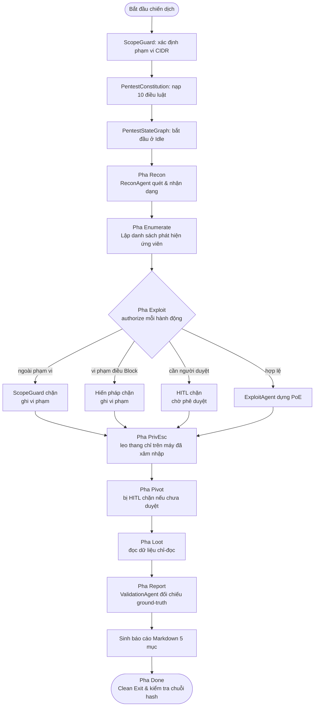
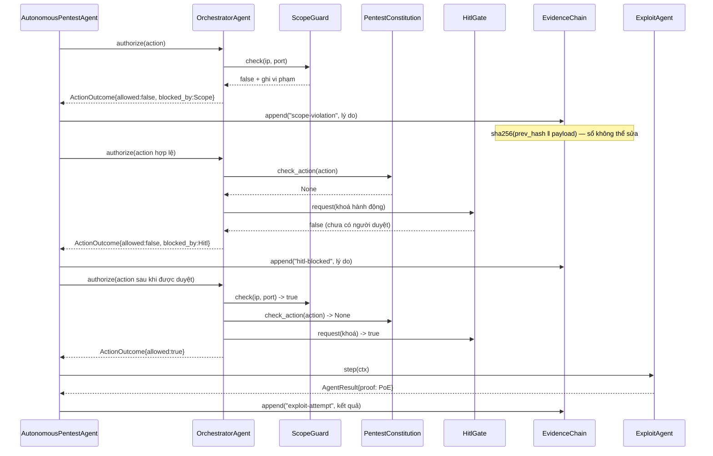
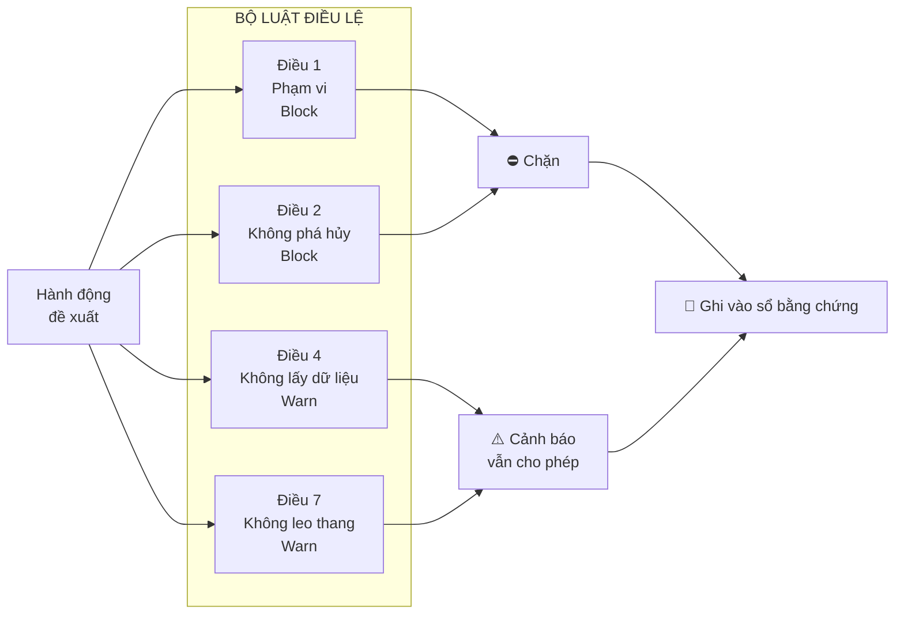
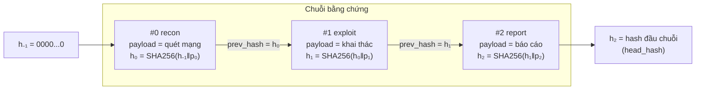
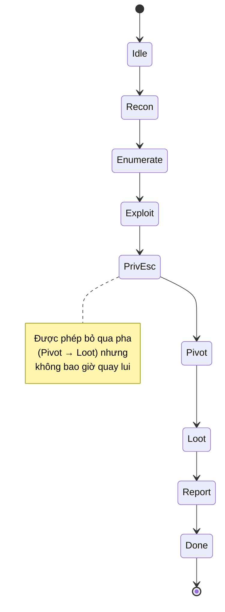
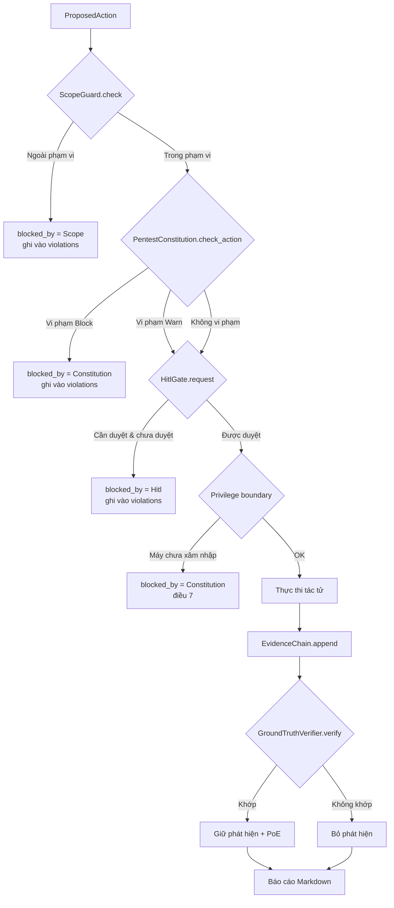

# Chương 105: Đại dự án Tích hợp II — Tác tử Pentest Tự hành Đa Tác tử, Phần thưởng RL, Đối kháng Red-vs-Blue & Hiến pháp An toàn (Autonomous Multi-Agent Pentest: RL Reward, Red-vs-Blue Adversarial & Constitutional Safety)

---

## 1. Giới thiệu & Mục tiêu

Chào mừng bạn đến với **chương kết thúc** của Chủ đề 28 (Tác tử & Kiểm thử Thâm nhập Tự động) — một chương không giới thiệu thêm một thuật toán mới, mà **lắp ráp tất cả những gì đã học** thành một cỗ máy duy nhất có khả năng tự điều hành một chiến dịch kiểm thử thâm nhập (penetration test) từ đầu đến cuối.

Hãy nhìn lại những gì chúng ta đã dựng trong 7 chương trước (98 → 104):

| Chương | Thành phần đã xây | Vai trò trong Chương 105 |
|---|---|---|
| 98 | Phòng lab khai thác nhị phân: mẫu De Bruijn, mã hoá shellcode, chuỗi ROP | Nền tảng kỹ thuật khai thác an toàn |
| 99 | Bộ công cụ thâm nhập mạng: SOCKS5, chuyển tiếp cổng, nhận dạng dịch vụ, `MockNetwork` | Thế giới giả lập để tác tử hành động |
| 100 | Động cơ khai thác web & bảo mật LLM: SQLi mù, LFI, JWT, tiêm lệnh | Nguồn phát hiện ứng viên |
| 101 | Tấn công thông tin xác thực & Kerberos: bẻ khoá băm, RC4-HMAC/AES | Nguồn bằng chứng khai thác (PoE) |
| 102 | Động cơ leo thang đặc quyền (Linux/Windows) + `GroundTruthVerifier` | Khuôn khổ kiểm chứng sự thật nền |
| 103 | Xoay chiều mạng & C2: đường hầm SSH, chuỗi SOCKS, kênh mã hoá | Hạ tầng di chuyển trong mạng |
| 104 | Bộ công cụ Red Team end-to-end + Proof-by-Exploitation, báo cáo OSCP | Bộ khung chuỗi khai thác & báo cáo |

Chương 105 ghép tất cả những mảnh đó lại thành **một tác tử pentest tự hành đa tác tử** (`AutonomousPentestAgent`) có đủ tám lớp bảo vệ:

```
┌───────────────────────────────────────────────────────────────────────────────────────┐
│        TÁC TỬ PENTEST TỰ HÀNH ĐA TÁC TỬ (Autonomous Multi-Agent Pentest)             │
├───────────────────────────────────────────────────────────────────────────────────────┤
│                                                                                       │
│  ┌───────────────┐   ┌───────────────┐   ┌───────────────┐   ┌────────────────────┐  │
│  │  ScopeGuard   │   │ PentestConsti-│   │ EvidenceChain │   │     HitlGate       │  │
│  │  (Phạm vi)    │   │ tution (10 điều)│  │ (Chuỗi SHA-256)│  │ (Phê duyệt người)  │  │
│  └───────┬───────┘   └───────┬───────┘   └───────┬───────┘   └─────────┬──────────┘  │
│          │                   │                   │                     │             │
│          └───────────────────┴───────┬───────────┴─────────────────────┘             │
│                                      ▼                                             │
│                        ┌───────────────────────────┐                               │
│                        │   PentestStateGraph       │  8 nút: Idle → Recon →         │
│                        │   (đồ thị điều phối pha)   │  Enumerate → Exploit → PrivEsc  │
│                        └─────────────┬─────────────┘  → Pivot → Loot → Report → Done  │
│                                      │                                             │
│          ┌───────────────────────────┼───────────────────────────┐                 │
│          ▼                           ▼                           ▼                 │
│  ┌───────────────┐          ┌────────────────┐          ┌────────────────────┐    │
│  │  ReconAgent   │          │  ExploitAgent  │          │  ValidationAgent   │    │
│  │  (Trinh sát)  │─────────►│  (Khai thác)   │─────────►│  (Kiểm chứng)      │    │
│  └───────────────┘          └────────────────┘          └────────────────────┘    │
│          │                           │                           │                 │
│          └───────────────────────────┴───────────┬───────────────┘                 │
│                                                  ▼                                 │
│                     ┌────────────────┐   ┌──────────────────┐   ┌────────────────┐  │
│                     │ AttackRewardFn │   │ AttackPathOpti-  │   │ SessionManager │  │
│                     │ (phần thưởng)  │   │ mizer (Q-learning)│   │  (lưu phiên)   │  │
│                     └────────────────┘   └──────────────────┘   └────────────────┘  │
│                                                                                       │
│                     ┌──────────────────────────────────────────────┐                 │
│                     │  RedVsBlueSim (đối kháng) + BlueTeamDefender │                 │
│                     └──────────────────────────────────────────────┘                 │
└───────────────────────────────────────────────────────────────────────────────────────┘
```

Toàn bộ crate được viết bằng **100% Rust 2024 thuần `std`**, không phụ thuộc bất kỳ thư viện ngoài nào (`[dependencies]` rỗng tuyệt đối), với **54 bài kiểm thử** tự động xác minh **11 bất biến hệ thống** cấp cao.

> ⚠️ **Lưu ý đạo đức — đọc trước khi chạy bất kỳ đoạn mã nào trong chương này**
>
> Toàn bộ hành vi "tấn công" trong chương này diễn ra **duy nhất** trên mạng giả lập `MockNetwork` gồm 5 máy ảo tự định nghĩa trong dải `10.10.10.0/24`, và trên vỏ `MockShell` giả lập. Không một byte nào chạm tới hệ thống thật, không có mã khai thác nào được lấy từ Metasploit/Impacket hay bất kỳ framework nào. Mọi "proof-of-exploitation" đều là **mô tả thao tác trên dịch vụ giả lập**, được sinh tự động và kiểm chứng lại bằng ground-truth nội bộ.

### Bảng Mục tiêu Học tập & Kỹ năng Đạt được

| Mục tiêu học tập | Vì sao bắt buộc phải tự xây từ đầu? | Chuẩn đầu ra thực chứng |
|---|---|---|
| **Cổng phạm vi CIDR tự cài** | Hiểu cách biến một quy tắc pháp lý ("chỉ được test dải này") thành mã *enforcement* tất định, không dựa vào cấu hình hệ điều hành. | `ScopeGuard::check()` trả `false` và ghi nhận vi phạm cho mọi cặp (IP, cổng) ngoài phạm vi. |
| **Hiến pháp 10 điều luật** | Nắm vững mô hình "luật + mức cưỡng chế" (Block/Warn/Log) — đây là cách biến nguyên tắc đạo đức thành *ràng buộc kiểm chứng được bằng máy*. | `PentestConstitution::check_action()` trả về `PentestViolation` đúng mã điều luật; 10/10 điều có hiệu lực. |
| **Chuỗi bằng chứng hash chain** | Hiểu cơ chế chống sửa đổi bằng chứng: mỗi bản ghi băm cả giá trị băm của bản ghi trước, tạo thành chuỗi không thể cắt mà không bị phát hiện. | Sửa nội dung một bản ghi ⇒ `verify()` trả `false` ngay lập tức. |
| **Cổng HITL (Human-In-The-Loop)** | Phân biệt "tác tử tự quyết" với "tác tử có người giám sát": mọi hành động nguy hiểm phải có chữ ký của con người. | `HitlGate::request()` trả `false` cho tới khi có quyết định `approved = true`. |
| **Đồ thị trạng thái 8 nút** | Nắm vững cách điều phối nhiều tác tử bằng một máy trạng thái hữu hạn thay vì bằng `if/else` lồng nhau. | Chuyển pha lùi hoặc quá giới hạn bước đều bị từ chối bằng `Err`. |
| **Hàm phần thưởng RL** | Hiểu cách biến "thành công trong tấn công" thành một hàm số tất định để tối ưu bằng học tăng cường. | Tổng phần thưởng bằng đúng tổng các thành phần (sai số < 1e-12). |
| **Tabular Q-learning** | Nắm vững cập nhật giá trị Q, vai trò của $\epsilon$-greedy, lịch giảm dần $\epsilon$ và cách tránh "vùng xấu" (dịch vụ dễ làm sập). | Chính sách tham lam cải thiện rõ rệt sau huấn luyện; dịch vụ dễ sập bị loại khỏi đường tấn công tối ưu. |
| **Đối kháng Red-vs-Blue** | Nắm vững cơ chế đối kháng hai bên cùng tiến bộ: đội đỏ học từ kinh nghiệm, đội xanh học từ ngưỡng phát hiện. | Cả hai nửa "đầu" và "sau" của chuỗi tập đều có điểm trung bình tăng. |
| **Quản lý phiên & báo cáo** | Nắm vững cách lưu/nôi tiếp phiên kiểm thử và sinh báo cáo Markdown đủ 5 mục. | Báo cáo chứa đủ Executive Summary/Methodology/Findings/Remediation/Conclusion. |

### Bảng Ma trận 11 Bất biến Hệ thống Bắt buộc Phải Chứng minh

Mọi hệ thống lớn trong `learn-rs` đều được định nghĩa thông qua các **bất biến (invariants)**. Một hệ thống chỉ được coi là đạt chuẩn khi toàn bộ bất biến được kiểm chứng bằng phần mềm tự động:

| STT | Bất biến hệ thống | Định nghĩa toán học / hành vi bắt buộc | Cơ chế kiểm chứng trong mã nguồn |
|---|---|---|---|
| **1** | **Scope Enforcement** | $\forall (ip, port): \neg \text{allows\_action}(ip, port) \Rightarrow \text{check}(ip, port) = \text{false} \wedge \lvert \text{violations} \rvert \uparrow$ | `test_02`, `test_04`, `test_53` |
| **2** | **Constitution Compliance** | Hành động `Destructive` ⇒ vi phạm điều 2 (mức `Block`); mục tiêu công khai ⇒ vi phạm điều 1 | `test_08`, `test_09`, `test_53` |
| **3** | **Evidence Integrity** | $\forall i: h_i = \text{SHA256}(h_{i-1} \Vert p_i)$ và sửa một $p_i$ ⇒ `verify() = false` | `test_15`, `test_16` |
| **4** | **HITL Gate** | `hitl_required = true` mà chưa có quyết định duyệt ⇒ `allowed = false` | `test_18`, `test_21` |
| **5** | **Privilege Boundary** | `PrivEsc(target)` chỉ được phép khi $target \in \text{compromised}$ | `test_53` |
| **6** | **Time Budget** | $\text{steps} \le \text{budget\_steps}$ | `test_53` |
| **7** | **Log Completeness** | $\lvert \text{evidence} \rvert \ge \text{steps}$ và mọi bản ghi có nội dung khác rỗng | `test_54` |
| **8** | **Report Generation** | Báo cáo chứa đủ 5 mục bắt buộc | `test_52` |
| **9** | **Clean Exit** | $\text{completed} \wedge \text{verify()} \wedge \text{open\_sessions} = \varnothing$ | `test_54` |
| **10** | **Ground-truth Verification** | Chỉ giữ phát hiện $f$ nếu $\text{ground\_truth}[f.id] \wedge \text{target}(f) \wedge \text{port}(f)$ | `test_31`, `test_54` |
| **11** | **Multi-Agent Coordination** | Recon → Enumerate → Exploit → PrivEsc → Pivot → Loot → Report → Done, đúng thứ tự | `test_31`, `test_51` |

### 1.1 Bản đồ mã nguồn của crate `ch105`

Toàn bộ mã nguồn nằm trong **một file duy nhất** `code/ch105/src/main.rs`, được chia thành 14 mục đánh số cùng một module test:

| # | Mục | Nội dung chính | Kiểu dữ liệu trọng yếu |
|---|---|---|---|
| 1 | Tiện ích nền tảng | `SplitMix64`, SHA-256 tự cài, phân tích CIDR | `SplitMix64`, `sha256_hex`, `parse_cidr` |
| 2 | Phạm vi kiểm thử | Cổng cưỡng chế phạm vi | `ScopeRule`, `ScopeGuard` |
| 3 | Hiến pháp | 10 điều luật, 3 mức cưỡng chế | `ConstitutionArticle`, `PentestConstitution` |
| 4 | Chuỗi bằng chứng | Hash chain SHA-256 | `Evidence`, `EvidenceChain` |
| 5 | Cổng HITL | Phê duyệt của con người | `HitlDecision`, `HitlGate` |
| 6 | Đồ thị trạng thái | 8 pha nghiệp vụ | `PentestPhase`, `PentestStateGraph` |
| 7 | Mô phỏng mạng | Mạng 5 máy, vỏ giả lập, ground-truth | `MockNetwork`, `MockShell`, `GroundTruthVerifier` |
| 8 | Tác tử đa tác tử | Trait + 3 tác tử + điều phối | `PentestAgent`, `ReconAgent`, `ExploitAgent`, `ValidationAgent`, `OrchestratorAgent` |
| 9 | Phần thưởng RL | Hàm thưởng 5 thành phần | `AttackRewardFunction`, `NetworkState` |
| 10 | Q-learning | Bảng Q + huấn luyện + suy đường | `QTable`, `AttackPathOptimizer` |
| 11 | Đối kháng đỏ – xanh | Phòng thủ, tác tử đỏ, vòng lặp tập | `BlueTeamDefender`, `RedAgent`, `RedVsBlueSim` |
| 12 | Quản lý phiên | Lưu/nôi tiếp phiên | `SessionSnapshot`, `SessionManager` |
| 13 | Tác tử tự hành | Điều phối tổng thể + sinh báo cáo | `AutonomousPentestAgent`, `PentestRunReport` |
| 14 | Chương trình minh hoạ | `main()` in kết quả từng thành phần | — |
| — | Module test | 54 bài test `test_01_…` → `test_54_…` | — |

Quy ước bất biến của cả giáo trình: **định danh tiếng Anh, giảng nghĩa và chú thích tiếng Việt**, mọi `pub` item đều có doc-comment `///`, và toàn bộ mã thuần `std` — không một dòng `unsafe` nào xuất hiện trong chương này.

---

---

## 2. Hình tượng hóa đời sống: Ca trực đêm của đội kiểm thử và trận đấu tập kích

Trước khi đụng vào hàng nghìn dòng mã, hãy xây dựng một trực giác đời sống thật sự. Hãy hình dung hai bối cảnh quen thuộc.

### Hình tượng 1: Đội kiểm thử trong ca trực đêm (Điều phối đa tác tử)

Một tổ chuyên gia kiểm thử thâm nhập thường đi làm việc theo ca đêm. Họ không hành động một mình — họ điều phối **nhiều vai trò khác nhau** trong cùng một chiến dịch:

```
        KHÁCH HÀNG (mạng 10.10.10.0/24, đã ký hợp đồng)
                     │
      ═══════════════╪═══════════════════════════════════════
      HỢP ĐỒNG & PHẠM VI  │   ← ScopeGuard: "chỉ được đụng vào đây"
      ═══════════════╪═══════════════════════════════════════
                     ▼
   ┌─────────────────────────────────────────────────────────┐
   │  TRẠM ĐIỀU PHỐI (OrchestratorAgent)                     │
   │  ├─ Bảng trạng thái 8 pha: đang ở pha nào, được phép đi  │
   │  ├─ Hiến pháp 10 điều: điều nào chặn, điều nào chỉ cảnh│
   │  ├─ Cổng HITL: những việc phải hỏi "anh Tuấn"           │
   │  └─ Sổ bằng chứng: mọi việc đều ghi vào sổ, có chữ ký  │
   │            hash nối tiếp                                   │
   └───────┬──────────────┬─────────────────┬─────────────────┘
           ▼              ▼                 ▼
   ┌──────────────┐ ┌─────────────┐ ┌──────────────────┐
   │ NGƯỜI TRINH  │ │ NGƯỜI KHAI  │ │ NGƯỜI KIỂM CHỨNG│
   │ SÁT         │ │ THÁC        │ │                  │
   │ (Recon)      │ │ (Exploit)   │ │ (Validation)     │
   │ vẽ bản đồ   │ │ dựng PoC    │ │ đối chiếu PoC với│
   │ nhận dạng    │ │ trên mock   │ │ ground-truth     │
   │ phiên bản    │ │ shell       │ │ → LOẠI BỎ phát  │
   │              │ │             │ │ hiện giả        │
   └──────────────┘ └─────────────┘ └──────────────────┘
```

Ba điểm cần nhấn mạnh trong hình tượng này:

1. **Hợp đồng trước, hành động sau.** Không ai được chạm vào máy ngoài dải đã ký. Nếu phần mềm quên mất, đó là thảm họa pháp lý — không phải chuyện "kỹ thuật".
2. **Mọi việc đều được ghi vào sổ.** Sổ bằng chứng không chỉ để "có làm gì không" mà để chứng minh *không ai sửa sổ sau khi ghi*. Đó chính là ý nghĩa của chuỗi băm SHA-256.
3. **Người kiểm chứng không phải người khai thác.** Người khai thác có thể tin rằng mình đã thành công — nhưng chỉ khi PoE khớp với ground-truth thì phát hiện mới được giữ lại. Đây là ranh giới giữa "vừa hack được" và "vừa *chứng minh được*".

### Hình tượng 2: Trận tập kích – phòng thủ (Red vs Blue)

Phần thưởng RL và đối kháng Red-vs-Blue giống như hai đội đang tập diễn cùng nhau: đội đỏ tấn công, đội xanh phòng thủ, và **cả hai đều học**.

```
        ┌───────────────────────┐         ┌───────────────────────┐
        │      ĐỘI ĐỎ          │         │       ĐỘI XANH        │
        │  (RedAgent)          │  ────►  │  (BlueTeamDefender)   │
        │                       │         │                       │
        │ • nhớ mục tiêu đã    │  ◄────  │ • hạ ngưỡng phát hiện │
        │   khai thác thành công│  tín    │   dần (học cách đỏ    │
        │ • epsilon giảm dần    │  hiệu   │   hành xử)            │
        │ • tránh dịch vụ dễ   │         │ • cách ly máy bị xâm │
        │   làm sập             │         │   nhập                │
        └───────────┬───────────┘         └───────────┬───────────┘
                    │                                 │
                    └──────────► PHẦN THƯỞNG ◄───────┘
                                  (AttackRewardFunction)
```

Trong hình tượng này, điều thú vị nhất là **cả hai bên cùng tiến bộ**:

- Đội đỏ sau vài tập sẽ biết "máy này có thể khai thác, máy kia thì không" → chọn đúng mục tiêu → điểm phần thưởng tăng.
- Đội xanh sau vài tập sẽ nhạy hơn → phát hiện được cả những hành động nhỏ như quét cổng → điểm phòng thủ tăng.

Nhưng cần nhấn mạnh: **đây là mô phỏng tập diễn, không phải tấn công thật**. Mỗi "tập" (episode) là một kịch bản đánh giá độc lập với trạng thái mạng đặt lại; chỉ **tri thức** (kinh nghiệm của đỏ, ngưỡng nhạy của xanh) được mang qua tập sau. Đó cũng chính là cách một đội Red Team thật sự được đánh giá: mỗi lần diễn tập lại với một bộ kịch bản mới, nhưng kinh nghiệm vẫn còn.

### Sơ đồ luồng tổng thể của hệ thống



### Trình tự kiểm chứng một hành động (sequence diagram)



### Hình tượng 3: Hiến pháp như bộ luật của phi hành gia

Hãy nghĩ về **bộ luật điều lệ phi hành gia** trên tàu vũ trụ. Những điều luật ấy không phải để trừng phạt, mà để **giữ cho phi hành gia sống sót** — và quan trọng hơn, để mọi người *tin* rằng hành động của phi hành gia là đúng đắn.



Ba bài học rút ra từ hình tượng này:

1. **Luật viết cho người khác đọc, không phải cho máy chạy.** Mỗi điều luật có `title` và `rule` bằng tiếng Việt để con người đọc hiểu; phần `enforcement` mới là phần máy dùng. Nếu thiếu `rule` dễ hiểu, luật sẽ bị "tuân thủ một cách mù quáng".
2. **Không phải luật nào cũng chặn.** Nếu mọi vi phạm đều `Block`, hệ thống sẽ chết cứng và tác tử sẽ học cách *tránh việc đo* thay vì học cách *làm đúng*. Sự tồn tại của mức `Warn` giữ cho tác tử còn khả năng hành động.
3. **Luật đi kèm sổ ghi.** Không có vi phạm nào bị "bỏ qua": vi phạm luôn được ghi vào `PentestViolation` và đưa vào báo cáo. Một hệ thống không ghi nhận vi phạm thì không học được cách tránh chúng.


---

## 3. Khái niệm & Cơ chế kỹ thuật chuyên sâu

### 3.1 Cổng phạm vi: từ "hợp đồng" đến mã kiểm chứng được

Trong thế giới thực, phạm vi kiểm thử (scope) thường được ghi trong hợp đồng dưới dạng danh sách dải mạng và cổng. Ở đây, ta biến nó thành một **đối tượng có trạng thái** có thể kiểm chứng tự động.

Với một quy tắc CIDR `a.b.c.d/n`, ta tách thành:

$$\text{mask}(n) = \begin{cases} 0 & n = 0 \\ 2^{32}-1 \ll (32 - n) & n > 0 \end{cases}$$

Địa chỉ $ip$ thuộc mạng đó khi và chỉ khi:

$$ip \mathbin{\&} \text{mask}(n) = \text{net} \mathbin{\&} \text{mask}(n)$$

Đây chính xác là phép so sánh "mạng con" (subnet) bằng phép AND bit — không cần thư viện mạng nào.

| Hàm | Ý nghĩa | Ghi chú |
|---|---|---|
| `parse_cidr(s) -> Option<(Ipv4Addr, u32)>` | Tách chuỗi CIDR | Trả `None` nếu sai cú pháp hoặc tiền tố > 32 |
| `cidr_mask(n) -> u32` | Mặt nạ mạng con | `n = 0` ⇒ `0` (khớp mọi địa chỉ) |
| `ip_in_cidr(ip, net, n) -> bool` | Kiểm tra thuộc mạng | Dùng cho `/32` (khớp tuyệt đối) và `/0` |
| `ScopeGuard::allows_ip(ip)` | IP có nằm trong phạm vi không | Bỏ qua cổng |
| `ScopeGuard::allows_action(ip, port)` | Cặp (IP, cổng) có được phép không | Cần **cả hai**: đúng mạng **và** đúng cổng |
| `ScopeGuard::check(ip, port)` | Kiểm tra **có ghi nhận** | Hành động bị chặn ⇒ đẩy lý do vào `violations` |

Điểm thiết kế quan trọng: `allows_action` yêu cầu **một quy tắc duy nhất** phải thoả cả hai điều kiện (đúng mạng *và* đúng cổng). Nếu ta kiểm tra "đúng mạng ở quy tắc này" và "đúng cổng ở quy tắc kia" một cách độc lập, thì một mạng được duyệt cổng 80 sẽ vô tình mở cổng 22 trên cùng mạng đó — một lỗ hổng phổ biến cực kỳ nguy hiểm trong công cụ tự động hoá.

### 3.2 Hiến pháp kiểm thử: 10 điều luật và ba mức cưỡng chế

Hiến pháp ở đây **không phải** bài luận đạo đức, mà là một **bảng luật máy đọc được**. Mỗi điều luật có ba thành phần:

$$\text{Article} = (\text{id},\ \text{title},\ \text{rule},\ \text{enforcement})$$

Ba mức cưỡng chế tạo ra ba hành vi khác nhau:

| Mức | Hành vi của hệ thống | Ví dụ |
|---|---|---|
| `Block` | Hành động **không bao giờ** được thực thi | Điều 2 — không phá hủy dữ liệu |
| `Warn` | Hành động vẫn chạy nhưng vi phạm được ghi nhận và đưa vào báo cáo | Điều 4 — không thu thập dữ liệu quá mức |
| `Log` | Chỉ ghi vào nhật ký để đối chiếu sau | Điều 3 — ghi nhật ký mọi hành động |

Bảng 10 điều luật tiêu chuẩn:

| # | Tiêu đề | Mức | Cách kiểm tra tự động |
|---|---|---|---|
| 1 | Không tấn công ngoài phạm vi | `Block` | Mục tiêu không thuộc RFC 1918 / loopback ⇒ vi phạm |
| 2 | Không phá hủy dữ liệu | `Block` | `ActionKind::Destructive` ⇒ vi phạm |
| 3 | Ghi nhật ký mọi hành động | `Log` | Mọi hành động đi qua `EvidenceChain::append` |
| 4 | Không đánh cắp dữ liệu | `Warn` | `DataAccess` + mô tả kiểu "toàn bộ/exfil/bulk" ⇒ vi phạm |
| 5 | Tôn trọng hạn mức thời gian | `Log` | `steps \le budget_steps` |
| 6 | Cần ground-truth trước khi báo cáo | `Log` | `ValidationAgent` lọc phát hiện |
| 7 | Không leo thang ngoài mục tiêu | `Warn` | `ActionKind::Pivot` ⇒ vi phạm |
| 8 | PoC phải tái lập được | `Log` | `ProofByExploitation.steps` phải có ≥ 4 bước |
| 9 | Bảo mật thông tin khách hàng | `Log` | Báo cáo chỉ chứa mô tả, không chứa bí mật |
| 10 | Dừng ngay khi có yêu cầu dừng | `Log` | `PentestStateGraph::interrupt()` khóa mọi chuyển pha |

#### 3.2.1 Thứ tự cổng kiểm soát: HITL đứng trước, hiến pháp đứng sau

Một quyết định thiết kế tinh tế trong `OrchestratorAgent::authorize()` là thứ tự kiểm tra:

$$\text{authorize}(a) = \text{Scope} \;\to\; \text{HITL} \;\to\; \text{Constitution} \;\to\; \text{Privilege}$$

- **Phạm vi đứng đầu** vì là ranh giới pháp lý: ngoài phạm vi thì không cần hỏi ai, cứ chặn.
- **HITL đứng trước hiến pháp** vì *con người luôn có tiếng nói cuối cùng*. Nếu hiến pháp chặn trước, thì người vận hành không bao giờ thấy hành động để quyết định — họ sẽ tưởng hệ thống bị treo.
- **Hiến pháp đứng sau** như "lưới an toàn" (safety net): ngay cả khi con người đã duyệt, một hành động vi phạm điều `Block` vẫn không chạy.

Cột `blocked_by` trong `ActionOutcome` cho phép kiểm thử xác minh chính xác *cổng nào* đã chặn hành động — đây là cơ sở để chứng minh bất biến "HITL Gate" và "Constitution Compliance" là **hai cơ chế độc lập**, không phải một cái.

### 3.3 Chuỗi bằng chứng: hash chain chống sửa đổi

Đây là "sổ tay có chữ ký". Mỗi bản ghi bằng chứng mang bốn trường: mã số, nội dung, giá trị băm, và giá trị băm của bản ghi **trước đó**:

$$h_i = \text{SHA256}\big(h_{i-1} \;\Vert\; p_i\big), \qquad h_{-1} = \underbrace{00\ldots0}_{64 \text{ ký tự}}$$

Tính chất bất biến:

| Tính chất | Giải thích |
|---|---|
| **Tính toàn vẹn theo chuỗi** | Sửa $p_i$ ⇒ $h_i$ sai ⇒ mọi bản ghi sau đó cũng sai |
| **Chống cắt đầu / chèn giữa** | `prev_hash` của bản ghi $i$ phải bằng `sha256` của bản ghi $i-1$ |
| **Chống đảo thứ tự** | `timestamp` phải tăng nghiêm ngặt |
| **Chống chèn thêm** | `id` phải khớp đúng vị trí trong chuỗi |



> **Bài học thiết kế**: chuỗi bằng chứng không bảo vệ được "người ghi đã nói dối" — nó bảo vệ được "người ghi đã **sửa** sau khi ghi". Với hệ thống thật, bạn sẽ ký bằng chữ ký số (hoặc append-only log / transparency log) để chống cả hai. Ở đây, mục tiêu là dạy bạn *cấu trúc* của cơ chế này, và bảo đảm rằng mọi thao tác của tác tử đều đi qua nó.

### 3.4 Cổng HITL: người vận hành trong vòng lặp

`HitlGate` lưu quyết định theo khoá hành động:

$$\text{key}(a) = \text{kind}(a) \;:\; \text{target}(a) \;:\; \text{port}(a)$$

| Hàm | Trạng thái | Ý nghĩa |
|---|---|---|
| `request(key)` | Tạo bản ghi "đang chờ" nếu chưa có | Trả `true` nếu hành động **đã** được duyệt |
| `approve(key, operator)` | Ghi đè quyết định | `approved = true` |
| `deny(key, operator, reason)` | Ghi đè quyết định | `approved = false` + lý do bắt buộc |
| `is_approved(key)` | Truy vấn | Dùng trong `authorize()` |

Điểm tinh tế: `request()` **không ghi đè** một quyết định đã có. Nghĩa là lời từ chối của con người không bị "yêu cầu lại" xoá mất — một hành vi rất dễ mắc lỗi trong hệ thống thật.

### 3.5 Đồ thị trạng thái 8 nút

Tám pha được đặt đúng thứ tự nghiệp vụ:

$$\text{Idle} \to \text{Recon} \to \text{Enumerate} \to \text{Exploit} \to \text{PrivEsc} \to \text{Pivot} \to \text{Loot} \to \text{Report} \to \text{Done}$$

`allowed_transitions(from)` trả về **tất cả** các pha ở phía trước — nghĩa là được phép *bỏ qua* (ví dụ không có pivot thì đi thẳng sang Loot), nhưng **không bao giờ được quay lại**. Đây là điểm khác biệt giữa một *lịch trình cứng nhắc* và một *đồ thị trạng thái*.

Ba lớp kiểm soát trên đồ thị:

1. **Đơn điệu** — không quay lui.
2. **Giới hạn bước** — `steps \le max\_steps` (chặn tập lặp vô hạn).
3. **Cờ gián tiếp** — `interrupt()` khoá mọi chuyển pha cho tới khi `resume()`.



### 3.6 Mô phỏng mạng giả lập & nguồn sự thật (ground truth)

Mọi thứ trong chương này diễn ra trên mạng giả lập 5 máy:

| Máy | Hệ điều hành | Dịch vụ mở | Điểm yếu | Ghi chú |
|---|---|---|---|---|
| `10.10.10.10` web-01 | Ubuntu 20.04 | 22 OpenSSH 7.6, 80 Apache 2.4.29 | `WEB-001` (Cao) | 22 không yếu |
| `10.10.10.20` db-01 | Debian 10 | 22 OpenSSH 7.6, 3306 MySQL 5.5.8 | `DB-002` (Nghiêm trọng) | |
| `10.10.10.30` file-01 | Debian 10 | 139 NetBIOS, 445 Samba 4.1.11 | `SMB-003` (Cao) | |
| `10.10.10.40` ws-01 | Windows 7 SP1 | 3389 RDP 5.1, 445 SMB 3.1 | `RDP-004` (Trung bình) | **Khai thác ⇒ làm sập dịch vụ** |
| `10.10.10.50` jump-01 | Ubuntu 18.04 | 22 OpenSSH 8.2, 8080 Jetty 9.4 | `SSH-005` (Trung bình) | Jetty là **phát hiện giả** |

#### 3.6.1 Vì sao cần "phát hiện giả" trong mô hình?

Bảng chữ ký của `ServiceFingerprinter` cố tình chứa **sáu** mục, trong khi ground-truth chỉ có **năm**:

| Mã | Dịch vụ | Trong ground-truth? | Kết quả |
|---|---|---|---|
| `WEB-001` | Apache 2.4.29 | ✅ | Giữ lại |
| `DB-002` | MySQL 5.5.8 | ✅ | Giữ lại |
| `SMB-003` | Samba 4.1.11 | ✅ | Giữ lại |
| `RDP-004` | RDP 5.1 | ✅ | Giữ lại |
| `SSH-005` | OpenSSH 8.2 | ✅ | Giữ lại |
| `WEB-901` | Jetty 9.4 | ❌ | **Bị loại bỏ** |

Đây là mô phỏng của một hiện tượng rất thật: **máy quét phiên bản báo "có vẻ lỗi thời" rồi sinh ra một mã CVE giả**. Nếu hệ thống không có bước kiểm chứng độc lập, báo cáo sẽ đầy rác và mất uy tín. Chính vì vậy `ValidationAgent` tồn tại: nó **không tin** tác tử khai thác.

#### 3.6.2 Cấu trúc Proof-By-Exploitation

```rust
pub struct ProofByExploitation {
    /// Mã phát hiện được chứng minh.
    pub vuln_id: String,
    /// Mục tiêu của bằng chứng.
    pub target: Ipv4Addr,
    /// Cổng của bằng chứng.
    pub port: u16,
    /// Các bước tái lập (mô tả trên môi trường giả lập).
    pub steps: Vec<String>,
    /// Kết quả thu được sau khi tái lập.
    pub output: String,
    /// `true` nếu PoE tái lập thành công.
    pub reproduced: bool,
}

```

Điều 8 của hiến pháp ("PoC phải tái lập được") được hiện thực hoá bằng trường `steps`: một phát hiện không mô tả được cách tái lập thì không đáng đưa vào báo cáo.

### 3.7 Tác tử đa tác tử: vai trò, ngữ cảnh, kết quả

Mọi tác tử đều tuân theo một trait chung:

```rust
pub trait PentestAgent {
    /// Tên định danh của tác tử.
    fn name(&self) -> &str;
    /// Vai trò của tác tử trong hệ đa tác tử.
    fn role(&self) -> AgentRole;
    /// Thực hiện một lượt làm việc theo ngữ cảnh cho trước.
    fn step(&mut self, ctx: &AgentContext) -> AgentResult;
}

```

| Tác tử | Vai trò | Vào | Ra | Ghi chú |
|---|---|---|---|---|
| `ReconAgent` | `Recon` | `MockNetwork` | Bản đồ máy + phát hiện ứng viên | Không bao giờ khai thác |
| `ExploitAgent` | `Exploit` | Phát hiện ứng viên | `ProofByExploitation` | Ghi nhớ `used` để không khai thác lại |
| `ValidationAgent` | `Validation` | Phát hiện + PoE | Phát hiện đã xác minh | Loại bỏ phát hiện giả |
| `OrchestratorAgent` | `Orchestrator` | Hành động đề xuất | `ActionOutcome` | Chịu trách nhiệm ba cổng kiểm soát |

`AgentContext` mang theo **snapshot** trạng thái tại thời điểm tác tử chạy (pha hiện tại, mạng, phát hiện đã biết, mục tiêu, vỏ shell). Vì `MockShell` là `Clone`, tác tử có thể thao tác trên một bản sao mà không ảnh hưởng trạng thái chung — một ví dụ rất gọn của nguyên tắc **"tác tử không được sở hữu trạng thái toàn cục"**.

### 3.8 Hàm phần thưởng RL: biến "thành công" thành con số

Hàm phần thưởng (lấy cảm hứng từ CyberBattleSim) gộp năm thành phần:

$$R(s, a) = w_c \cdot \mathbb{1}[\text{xâm nhập}] - w_d \cdot \mathbb{1}[\text{bị phát hiện}] - w_s \cdot \mathbb{1}[\text{sập dịch vụ}] + w_a \cdot \mathbb{1}[\text{đọc dữ liệu}] - w_{\text{step}}$$

Bộ trọng số mặc định trong crate:

| Thành phần | Ký hiệu | Giá trị | Ý nghĩa chiến thuật |
|---|---|---|---|
| Xâm nhập máy | $w_c$ | `+10.0` | Mục tiêu lớn nhất của đội đỏ |
| Bị phát hiện | $w_d$ | `3.0` | Phạt "để lộ" — nhưng chỉ tính **một lần** mỗi tập |
| Làm sập dịch vụ | $w_s$ | `12.0` | Phạt nặng: làm sập dịch vụ làm lộ mình |
| Đọc dữ liệu | $w_a$ | `+5.0` | Mục tiêu thứ hai sau khi đã xâm nhập |
| Chi phí mỗi bước | $w_{\text{step}}$ | `0.5` | Chống hành vi lãng phí bước |

Vì sao phạt "làm sập dịch vụ" lại lớn hơn phần thưởng xâm nhập ($12 > 10$)? Vì khi dịch vụ sập, nó **bị phát hiện chắc chắn**, kéo theo chuỗi phạt tiếp. Tác tử học được rằng "phá thì không được 10 điểm, mà còn bị phạt 12 và mất quyền bất ngờ". Đây chính là chỗ RL tốt hơn người: người phải *được dạy*, còn thuật toán chỉ cần *được thưởng/phạt đúng*.

### 3.9 Tabular Q-learning: từ phần thưởng tới chính sách

#### 3.9.1 Công thức cập nhật

$$Q(s, a) \leftarrow Q(s, a) + \alpha \left[ r + \gamma \max_{a'} Q(s', a') - Q(s, a) \right]$$

với $\alpha = 0.3$ (tốc độ học), $\gamma = 0.95$ (chiết khấu tương lai), $\epsilon$ (xác suất khám phá).

#### 3.9.2 Lượng tử hoá trạng thái

Không gian trạng thái phải **đủ nhỏ** để tabular Q-learning hội tụ. Ta dùng:

$$s = \Big(|C|,\; \mathbb{1}[\text{đã đọc dữ liệu}],\; \mathbb{1}[\text{đã bị phát hiện}]\Big)$$

Tức là: *số máy đã xâm nhập* + hai cờ nhị phân. Với 5 máy, không gian trạng thái chỉ có $6 \times 2 \times 2 = 24$ trạng thái — vừa đủ để học nhanh, vừa đủ để giữ được thông tin quan trọng nhất (đã xâm nhập bao nhiêu máy, đã bị phát hiện chưa, đã lấy dữ liệu chưa).

#### 3.9.3 Chính sách $\epsilon$-greedy và lịch giảm dần $\epsilon$

$$\epsilon_k = \max\Big(\epsilon_{\min},\; \epsilon_0\Big(1 - 0{,}9 \cdot \frac{k}{K}\Big)\Big)$$

Với $\epsilon_0 = 0.5$ và $\epsilon_{\min} = 0.02$: đầu tập tác tử khám phá rộng (điều kiện cần để học được giá trị Q của mọi hành động), cuối tập tác tử gần như tham lam (khai thác tri thức đã học). Hệ quả đo được: **phần thưởng chính sách tham lam tăng mạnh** sau huấn luyện (trong ví dụ: từ `-0.5` lên `+37.0`).

#### 3.9.4 Vì sao tác tử học được "tránh dịch vụ dễ sập"

Xét hành động khai thác RDP ở `10.10.10.40:3389`:

$$R = \underbrace{+10}_{\text{xâm nhập}} - \underbrace{12}_{\text{sập}} - \underbrace{0.5}_{\text{bước}} + \underbrace{(-3)}_{\text{bị phát hiện về sau}} \approx -5{,}5$$

Giá trị này **âm**, nên sau khi học, giá trị $Q$ của hành động đó trở nên âm và hành động bị loại khỏi đường tấn công tối ưu. Đây là ví dụ rất đẹp về việc *học tăng cường tự phát hiện ra hậu quả dài hạn* — thứ mà một tập luật viết tay rất dễ bỏ sót.

### 3.10 Đối kháng Red-vs-Blue: hai bên cùng tiến bộ

#### 3.10.1 Đội xanh nhìn thấy gì?

Mỗi loại hành động có một "điểm rủi ro" cố định:

| Hành động | Điểm rủi ro | Mức nghiêm trọng khi bị phát hiện |
|---|---|---|
| `Scan` | 0.20 | Thấp |
| `DataAccess` | 0.60 | Trung bình |
| `CredentialAttack` | 0.70 | Trung bình |
| `PrivEsc` | 0.80 | Cao |
| `Pivot` | 0.85 | Cao |
| `Exploit` | 0.90 | Cao |
| `Destructive` | 1.00 | Nghiêm trọng |
| `Report` | 0.00 | — |

Tín hiệu được ghi nhận khi điểm rủi ro $\ge$ `detection_threshold`. Ngưỡng này **giảm dần theo thời gian**:

$$\theta_k = \max(0.15,\; 0.95 \cdot 0.90^{\,k})$$

| Tập $k$ | Ngưỡng $\theta_k$ | Đội xanh bắt được thêm |
|---|---|---|
| 1 | 0.950 | (chưa bắt được gì ngoài hành động phá hủy) |
| 3 | 0.770 | `Exploit` (0.90) |
| 6 | 0.561 | `PrivEsc` (0.80), `CredentialAttack` (0.70) |
| 9 | 0.407 | `DataAccess` (0.60) |
| 17 | 0.196 | `Scan` (0.20) |

Đây chính là "đội xanh học": mỗi tập đối kháng làm ngưỡng nhạy hơn một chút, nên **điểm phòng thủ tích luỹ tăng** ⇒ bất biến "đội xanh cải thiện".

#### 3.10.2 Đội đỏ học được gì?

Đội đỏ giữ `history: Vec<AttackAction>` — danh sách **những mục tiêu đã khai thác thành công**. Nguyên tắc chọn mục tiêu:

$$\text{ứng viên} = \begin{cases} \arg\max_{a \in \text{proven}} \text{count}(a) & \text{nếu tồn tại mục tiêu đã thành công} \\ \arg\max_{a} \text{count}(a) & \text{ngược lại} \end{cases}$$

Nói bằng lời: **ưu tiên mục tiêu đã từng thành công**. Một mục tiêu làm sập dịch vụ sẽ *không bao giờ* được đưa vào `history` (ta cố tình loại nó), nên đội đỏ dần bỏ qua nó — mà không cần ai dạy.

#### 3.10.3 Điểm phòng thủ

$$\text{defense\_score} = \sum_{s \in \text{signals}} w(\text{severity}(s)) + 10 \cdot \lvert \text{isolated} \rvert + 6 \cdot \lvert \text{reset\_credentials} \rvert$$

với $w(\text{Critical}) = 25$, $w(\text{High}) = 15$, $w(\text{Medium}) = 8$, $w(\text{Low}) = 3$, $w(\text{Info}) = 1$.

Điểm của một tập là **độ chênh lệch** của `defense_score` trước và sau tập — nhờ vậy các tập so sánh được với nhau mà không bị "cộng dồn" gây sai lệch.

### 3.11 Quản lý phiên: nối tiếp chiến dịch

Một chiến dịch kiểm thử có thể kéo dài nhiều ngày. `SessionManager` lưu `SessionSnapshot`:

$$\text{Snapshot} = (\text{id},\ \text{phase},\ \text{findings},\ \text{compromised},\ \text{evidence\_count},\ \text{saved\_at})$$

Khi nối tiếp, tác tử biết chính xác: mình đang ở pha nào, đã tìm ra những gì, đã chiếm được máy nào, và đã ghi bao nhiêu bằng chứng. Đây là bài học từ PentestGPT: **ngữ cảnh phiên là một phần của bộ nhớ tác tử**, không phải thứ được ghi ra đĩa cho có.

### 3.12 Báo cáo và Clean Exit

Báo cáo Markdown luôn có đủ 5 mục:

| Mục | Nội dung |
|---|---|
| `## 1. Tóm tắt điều hành (Executive Summary)` | Số phát hiện, số PoE, số bước, số vi phạm, đặc quyền cuối, trạng thái thoát sạch |
| `## 2. Phương pháp (Methodology)` | Bảng các pha đã đi qua |
| `## 3. Phát hiện (Findings)` | Từng phát hiện kèm PoE tái lập được |
| `## 4. Khuyến nghị khắc phục (Remediation)` | Khuyến nghị theo mức nghiêm trọng |
| `## 5. Kết luận (Conclusion)` | Tổng kết chiến dịch |

"Clean Exit" (thoát sạch) là điều kiện đồng thời:

$$\text{clean\_exit} = \underbrace{(\text{open\_sessions đã đóng})}_{\text{không còn phiên treo}} \wedge \underbrace{\text{graph.completed()}}_{\text{đã tới pha Done}} \wedge \underbrace{\text{evidence.verify()}}_{\text{sổ bằng chứng toàn vẹn}}$$

### 3.13 Bảng tổng hợp: 11 bất biến và nơi thực thi

| Bất biến | Cơ chế trong mã | Test kiểm chứng |
|---|---|---|
| Scope Enforcement | `ScopeGuard::check` + `violations` | `test_02`, `test_04` |
| Constitution Compliance | `PentestConstitution::check_action` | `test_08`, `test_09` |
| Evidence Integrity | `EvidenceChain::verify` | `test_15`, `test_16` |
| HITL Gate | `HitlGate` + `OrchestratorAgent::authorize` | `test_18`, `test_21` |
| Privilege Boundary | `OrchestratorAgent.compromised` | `test_53` |
| Time Budget | `AutonomousPentestAgent.budget_steps` | `test_53` |
| Log Completeness | `OrchestratorAgent::record` xuyên suốt | `test_54` |
| Report Generation | `AutonomousPentestAgent::generate_report` | `test_52` |
| Clean Exit | `MockShell::close_all` + `graph.completed()` | `test_54` |
| Ground-truth Verification | `GroundTruthVerifier::verify` | `test_31`, `test_54` |
| Multi-Agent Coordination | `PentestStateGraph` + trait `PentestAgent` | `test_51` |

### 3.14 Vòng đời đầy đủ của một hành động

Hãy ghép lại toàn bộ kiến thức của chương bằng cách đi theo **một** hành động duy nhất từ lúc ý tưởng sinh ra đến lúc nó xuất hiện trong báo cáo.

| Bước | Thành phần tham gia | Câu hỏi được trả lời | Kết quả |
|---|---|---|---|
| 1 | `ProposedAction` | Tác tử muốn làm gì, với mục tiêu nào, cổng nào? | Hành động có cấu trúc |
| 2 | `ScopeGuard::allows_ip` / `allows_action` | Mục tiêu có trong hợp đồng không? | `true` / `false` |
| 3 | `ScopeGuard::check` | Nếu sai, ai sẽ chịu trách nhiệm ghi nhận? | `violations` |
| 4 | `PentestConstitution::check_action` | Hành động có vi phạm điều luật nào không? | `Option<PentestViolation>` |
| 5 | `HitlGate::request` | Có cần người vận hành duyệt không? | `bool` |
| 6 | `OrchestratorAgent.compromised` | Máy đích đã bị xâm nhập chưa (ranh giới đặc quyền)? | `bool` |
| 7 | `ActionOutcome` | Tổng hợp: được chạy hay không, bị cổng nào chặn, vì sao? | Kết quả uỷ quyền |
| 8 | `ExploitAgent::step` | Thực thi trên môi trường giả lập | `ProofByExploitation` |
| 9 | `EvidenceChain::append` | Ghi lại vào sổ bằng chứng có băm | `timestamp` |
| 10 | `GroundTruthVerifier::verify` | PoE có khớp sự thật không? | `Option<PoE>` |
| 11 | `SessionSnapshot` | Lưu lại trạng thái để nối tiếp phiên | Snapshot |
| 12 | `generate_report` | Trình bày cho con người đọc | Markdown 5 mục |



Đây chính là lý do vì sao mỗi tầng bảo vệ trong chương này đều **có thể kiểm chứng bằng test**: chúng nằm trên một đường đi tuyến tính, mỗi bước có một đầu vào rõ ràng và một đầu ra rõ ràng.

---

### 3.15 Vì sao chọn tabular Q-learning thay vì mạng nơ-ron sâu?

Chương 97 đã dựng trọn vẹn một mô hình Transformer vi mô. Vậy tại sao chương 105 lại quay về với bảng tra cứu "cổ xưa"?

| Tiêu chí | Tabular Q-learning | DQN (mạng nơ-ron sâu) |
|---|---|---|
| Kích thước không gian trạng thái | 24 trạng thái | Cần hàng trăm nghìn mẫu để hội tụ ổn định |
| Tốc độ hội tụ trong crate này | < 1 mili-giây cho 200 tập | Hàng giây đến hàng phút (và cần GPU) |
| Tính giải thích | Nhìn thẳng bảng Q là biết vì sao tác tử chọn hành động | Phải giải thích qua giá trị xấp xỉ |
| Tính tất định | Bit-exact cho cùng seed | Phụ thuộc thứ tự cập nhật và khởi tạo |
| Khả năng kiểm chứng bằng test | So sánh trực tiếp hai giá trị Q | Cần hạ nhiểm xấp xỉ, xử lý sai số float |

Với môi trường mô phỏng có **5 máy**, tabular Q-learning vừa **đủ dùng** và vừa **đủ để dạy**. Bài học quan trọng hơn kỹ thuật là: *đừng chọn công cụ mạnh hơn mức cần thiết*. Một bảng 24 dòng kiểm chứng được bằng 54 test tất định còn giá trị hơn một mạng nơ-ron 100.000 tham số mà không ai giải thích được vì sao nó hành xử thế này.

Tất nhiên, nếu môi trường thật có hàng nghìn máy, không gian trạng thái sẽ bùng nổ theo $2^{|C|}$ và lúc đó đúng là phải chuyển sang học sâu (hoặc dùng hàm giá trị theo tầng — hierarchical Q-learning). Nhưng **đừng tối ưu hoá trước khi cần**.


---

## 4. Mã nguồn minh hoạ thực chiến

Toàn bộ đoạn dưới đây được trích **nguyên văn** từ `code/ch105/src/main.rs` (sau khi chạy `cargo fmt`). Bạn có thể sao chép chúng vào một file `main.rs` rỗng, thêm `use std::collections::HashMap;` và `use std::net::Ipv4Addr;`, rồi `cargo run` để thấy toàn bộ hệ thống chạy trong chưa đầy một mili-giây.

### 4.1 Hàm băm SHA-256 tự cài

Không có crate ngoài nào, nên ta hiện thực SHA-256 theo đúng đặc tả FIPS 180-4. Hãy chú ý phần mở rộng thông điệp: độ dài thông điệp tính theo **bit** được ghi vào 8 byte cuối, và thông điệp được đệm sao cho độ dài chia hết cho 64 byte.

```rust
pub fn sha256_bytes(data: &[u8]) -> [u8; 32] {
    let mut h: [u32; 8] = [
        0x6a09e667, 0xbb67ae85, 0x3c3726c4, 0xa54ff53a, 0x510e527f, 0x9b05688c, 0x1f83d9ab,
        0x5be0cd19,
    ];

    let mut padded = data.to_vec();
    let bit_len = (data.len() as u64).wrapping_mul(8);
    padded.push(0x80);
    while padded.len() % 64 != 56 {
        padded.push(0x00);
    }
    padded.extend_from_slice(&bit_len.to_be_bytes());

    for block in padded.as_chunks::<64>().0 {
        let mut w = [0u32; 64];
        for (i, word) in w.iter_mut().enumerate().take(16) {
            let base = i * 4;
            *word = u32::from_be_bytes([
                block[base],
                block[base + 1],
                block[base + 2],
                block[base + 3],
            ]);
        }
        for i in 16..64 {
            let s0 = w[i - 15].rotate_right(7) ^ w[i - 15].rotate_right(18) ^ (w[i - 15] >> 3);
            let s1 = w[i - 2].rotate_right(17) ^ w[i - 2].rotate_right(19) ^ (w[i - 2] >> 10);
            w[i] = w[i - 16]
                .wrapping_add(s0)
                .wrapping_add(w[i - 7])
                .wrapping_add(s1);
        }

        let mut a = h[0];
        let mut b = h[1];
        let mut c = h[2];
        let mut d = h[3];
        let mut e = h[4];
        let mut f = h[5];
        let mut g = h[6];
        let mut hh = h[7];

        for i in 0..64 {
            let s1 = e.rotate_right(6) ^ e.rotate_right(11) ^ e.rotate_right(25);
            let ch = (e & f) ^ ((!e) & g);
            let t1 = hh
                .wrapping_add(s1)
                .wrapping_add(ch)
                .wrapping_add(SHA256_K[i])
                .wrapping_add(w[i]);
            let s0 = a.rotate_right(2) ^ a.rotate_right(13) ^ a.rotate_right(22);
            let maj = (a & b) ^ (a & c) ^ (b & c);
            let t2 = s0.wrapping_add(maj);

            hh = g;
            g = f;
            f = e;
            e = d.wrapping_add(t1);
            d = c;
            c = b;
            b = a;
            a = t1.wrapping_add(t2);
        }

        h[0] = h[0].wrapping_add(a);
        h[1] = h[1].wrapping_add(b);
        h[2] = h[2].wrapping_add(c);
        h[3] = h[3].wrapping_add(d);
        h[4] = h[4].wrapping_add(e);
        h[5] = h[5].wrapping_add(f);
        h[6] = h[6].wrapping_add(g);
        h[7] = h[7].wrapping_add(hh);
    }

    let mut out = [0u8; 32];
    for (i, value) in h.iter().enumerate() {
        out[i * 4..i * 4 + 4].copy_from_slice(&value.to_be_bytes());
    }
    out
}
```

Hàm băm này dùng ở ba nơi: chuỗi bằng chứng, chứng nhận hiến pháp (`attest`) và các giá trị băm ngắn hiển thị trong báo cáo.

### 4.2 Cổng phạm vi `ScopeGuard`

Hãy đọc kỹ hai hàm `allows_ip` và `allows_action`: chúng **khác nhau ở điều kiện AND**. `allows_action` chỉ trả `true` khi *cùng một quy tắc* vừa chứa địa chỉ vừa cho phép cổng.

```rust
pub struct ScopeGuard {
    /// Danh sách quy tắc phạm vi hiện hành.
    pub rules: Vec<ScopeRule>,
    /// Nhật ký các lần vi phạm phạm vi đã bị chặn.
    pub violations: Vec<String>,
}

impl ScopeGuard {
    /// Khởi tạo cổng phạm vi từ danh sách quy tắc cho trước.
    pub fn new(rules: Vec<ScopeRule>) -> Self {
        Self {
            rules,
            violations: Vec::new(),
        }
    }

    /// Phạm vi mặc định dùng cho mạng giả lập `10.10.10.0/24` của crate này.
    pub fn default_scope() -> Self {
        Self::new(vec![ScopeRule {
            cidr: "10.10.10.0/24".to_string(),
            allowed_ports: vec![22, 80, 443, 445, 139, 3306, 3389, 8080],
        }])
    }

    /// Kiểm tra địa chỉ có nằm trong ít nhất một mạng phạm vi hay không (bỏ qua cổng).
    pub fn allows_ip(&self, ip: Ipv4Addr) -> bool {
        self.rules.iter().any(|rule| {
            parse_cidr(&rule.cidr).is_some_and(|(network, prefix)| ip_in_cidr(ip, network, prefix))
        })
    }

    /// Kiểm tra cặp (địa chỉ, cổng) có được phép hay không.
    ///
    /// Một quy tắc chỉ khớp khi vừa chứa địa chỉ vừa cho phép cổng tương ứng.
    pub fn allows_action(&self, ip: Ipv4Addr, port: u16) -> bool {
        self.rules.iter().any(|rule| {
            let in_network = parse_cidr(&rule.cidr)
                .is_some_and(|(network, prefix)| ip_in_cidr(ip, network, prefix));
            in_network && rule.allowed_ports.contains(&port)
        })
    }

    /// Kiểm tra và **ghi nhận** hành động: trả về `true` nếu được phép chạy.
    ///
    /// Khi bị chặn, một thông điệp vi phạm được đẩy vào `violations` để đưa vào báo cáo.
    pub fn check(&mut self, ip: Ipv4Addr, port: u16) -> bool {
        if self.allows_action(ip, port) {
            return true;
        }
        let reason = if self.allows_ip(ip) {
            format!(
                "Vi phạm phạm vi: cổng {port} không nằm trong danh sách cổng được duyệt của {ip}"
            )
        } else {
            format!("Vi phạm phạm vi: {ip} nằm ngoài mạng được duyệt")
        };
        self.violations.push(reason);
        false
    }

    /// Xem danh sách vi phạm phạm vi đã ghi nhận.
    pub fn violations(&self) -> &[String] {
        &self.violations
    }
}
```

### 4.3 Kiểm tra hiến pháp: `check_action`

Bốn nhánh kiểm tra lần lượt theo mã điều luật tăng dần, trả về **vi phạm đầu tiên** tìm thấy. Chú ý điều 1 dùng `is_internal_ipv4` — một "phạm vi tối thiểu" độc lập với `ScopeGuard`, để hiến pháp vẫn có tác dụng ngay cả khi chưa cấu hình phạm vi chi tiết.

```rust,ignore
impl PentestConstitution {
    pub fn check_action(&self, action: &ProposedAction) -> Option<PentestViolation> {
        // Điều 1: mục tiêu công khai nằm ngoài phạm vi tối thiểu của hiến pháp.
        if let Ok(ip) = action.target.parse::<Ipv4Addr>()
            && !is_internal_ipv4(ip)
            && self.enforcement_of(1) == Enforcement::Block
        {
            return Some(PentestViolation {
                article_id: 1,
                title: "Không tấn công ngoài phạm vi".to_string(),
                detail: format!(
                    "Mục tiêu {} là địa chỉ công khai, nằm ngoài phạm vi được duyệt.",
                    action.target
                ),
            });
        }

        // Điều 2: không phá hủy dữ liệu.
        if action.kind == ActionKind::Destructive && self.enforcement_of(2) == Enforcement::Block {
            return Some(PentestViolation {
                article_id: 2,
                title: "Không phá hủy dữ liệu".to_string(),
                detail: format!(
                    "Hành động phá hủy `{}` trên {} bị hiến pháp cấm.",
                    action.description, action.target
                ),
            });
        }

        // Điều 4: không thu thập dữ liệu vượt mức cần thiết.
        if action.kind == ActionKind::DataAccess {
            let description = action.description.to_lowercase();
            let bulk_request = description.contains("exfil")
                || description.contains("bulk")
                || description.contains("toàn bộ");
            if bulk_request && self.enforcement_of(4) == Enforcement::Warn {
                return Some(PentestViolation {
                    article_id: 4,
                    title: "Không đánh cắp dữ liệu".to_string(),
                    detail: format!(
                        "Yêu cầu `{}` vượt quá mức dữ liệu cần thiết cho kiểm thử.",
                        action.description
                    ),
                });
            }
        }

        // Điều 7: không leo thang sang mục tiêu chưa được duyệt.
        if action.kind == ActionKind::Pivot && self.enforcement_of(7) == Enforcement::Warn {
            return Some(PentestViolation {
                article_id: 7,
                title: "Không leo thang ngoài mục tiêu".to_string(),
                detail: format!(
                    "Chuyển ngang sang {} là mục tiêu chưa được duyệt trước.",
                    action.target
                ),
            });
        }

        None
    }
}
// ... (xem đầy đủ impl PentestConstitution trong code/ch105/src/main.rs)
```

### 4.4 Chuỗi bằng chứng: `append` và `verify`

Công thức băm được cài đặt đúng một dòng:

```rust
let sha256 = sha256_hex(format!("{prev_hash}{payload}").as_bytes());
```

Còn `verify()` kiểm tra **ba** điều kiện: mã bản ghi khớp vị trí, `prev_hash` khớp bản ghi trước, và giá trị băm tái tính khớp `sha256` đã lưu.

```rust,ignore
impl EvidenceChain {
    pub fn append(&mut self, kind: &str, payload: &str) -> u64 {
        let prev_hash = self.head_hash();
        let sha256 = sha256_hex(format!("{prev_hash}{payload}").as_bytes());
        self.clock += 1;
        let entry = Evidence {
            id: self.next_id,
            kind: kind.to_string(),
            payload: payload.to_string(),
            sha256,
            timestamp: self.clock,
            prev_hash,
        };
        self.next_id += 1;
        self.entries.push(entry);
        self.clock
    }

    /// Kiểm tra tính toàn vẹn của chuỗi: liên kết băm, mã bản ghi và dấu thời gian.
    pub fn verify(&self) -> bool {
        let mut expected_prev = EVIDENCE_GENESIS.to_string();
        let mut last_timestamp = 0u64;
        for (index, entry) in self.entries.iter().enumerate() {
            if entry.id != index as u32 {
                return false;
            }
            if entry.prev_hash != expected_prev {
                return false;
            }
            if entry.timestamp <= last_timestamp {
                return false;
            }
            let recomputed = sha256_hex(format!("{}{}", entry.prev_hash, entry.payload).as_bytes());
            if recomputed != entry.sha256 {
                return false;
            }
            expected_prev = entry.sha256.clone();
            last_timestamp = entry.timestamp;
        }
        true
    }
}
// ... (xem đầy đủ impl EvidenceChain trong code/ch105/src/main.rs)
```

### 4.5 Cổng HITL: `request` / `approve` / `deny`

Chú ý `request()` **không ghi đè** một quyết định đã tồn tại — đây là điểm hay: lời từ chối của con người không bị "xin lại" xoá mất.

```rust,ignore
impl HitlGate {
    pub fn request(&mut self, action_key: &str) -> bool {
        self.clock += 1;
        if let Some(decision) = self.decisions.get(action_key) {
            return decision.approved;
        }
        let decision = HitlDecision {
            approved: false,
            operator: String::new(),
            reason: "Đang chờ quyết định của người vận hành".to_string(),
            timestamp: self.clock,
        };
        self.decisions.insert(action_key.to_string(), decision);
        false
    }

    /// Người vận hành phê duyệt một hành động.
    pub fn approve(&mut self, action_key: &str, operator: &str) -> HitlDecision {
        self.clock += 1;
        let decision = HitlDecision {
            approved: true,
            operator: operator.to_string(),
            reason: "Đã được người vận hành phê duyệt".to_string(),
            timestamp: self.clock,
        };
        self.decisions
            .insert(action_key.to_string(), decision.clone());
        decision
    }

    /// Người vận hành từ chối một hành động kèm lý do.
    pub fn deny(&mut self, action_key: &str, operator: &str, reason: &str) -> HitlDecision {
        self.clock += 1;
        let decision = HitlDecision {
            approved: false,
            operator: operator.to_string(),
            reason: reason.to_string(),
            timestamp: self.clock,
        };
        self.decisions
            .insert(action_key.to_string(), decision.clone());
        decision
    }

    /// Hành động đã được phê duyệt hay chưa.
    pub fn is_approved(&self, action_key: &str) -> bool {
        self.decisions
            .get(action_key)
            .is_some_and(|decision| decision.approved)
    }
}
```

### 4.6 Đồ thị trạng thái: `transition`

Ba điều kiện được kiểm tra theo thứ tự: bị gián tiếp, hết bước, và chuyển pha không hợp lệ. Chỉ khi cả ba đều ổn thì pha mới được ghi vào `history` và `steps` tăng.

```rust,ignore
impl PentestStateGraph {
    pub fn transition(&mut self, next: PentestPhase) -> Result<(), String> {
        if self.interrupted {
            return Err("Đồ thị trạng thái đang bị gián tiếp, không thể chuyển pha.".to_string());
        }
        if self.steps >= self.max_steps {
            return Err(format!(
                "Đã đạt giới hạn {} bước chuyển trạng thái.",
                self.max_steps
            ));
        }
        if !Self::allowed_transitions(self.phase).contains(&next) {
            return Err(format!(
                "Chuyển pha không hợp lệ: {} -> {}.",
                self.phase.label(),
                next.label()
            ));
        }
        self.phase = next;
        self.history.push(next);
        self.steps += 1;
        Ok(())
    }

    /// Gián tiếp chiến dịch (yêu cầu dừng từ con người); trả về `true` nếu trạng thái đổi.
    pub fn interrupt(&mut self) -> bool {
        if self.interrupted {
            return false;
        }
        self.interrupted = true;
        true
    }

    /// Tiếp tục chiến dịch sau khi gián tiếp; trả về `true` nếu trạng thái đổi.
    pub fn resume(&mut self) -> bool {
        if !self.interrupted {
            return false;
        }
        self.interrupted = false;
        true
    }

    /// Chiến dịch đã hoàn tất hay chưa.
    pub fn completed(&self) -> bool {
        self.phase == PentestPhase::Done
    }

    /// Số pha đã đi qua.
    pub fn phase_count(&self) -> usize {
        self.history.len()
    }
}
```

### 4.7 Cấu trúc dữ liệu mô phỏng

`MockService` giữ thêm cờ `crash_on_exploit` — đó là "điểm yếu" giả lập khiến cho thuật toán học tăng cường phải học cách tránh những hành động gây sập dịch vụ.

```rust
pub struct MockService {
    /// Cổng TCP của dịch vụ.
    pub port: u16,
    /// Tên dịch vụ (ví dụ `"Apache"`, `"MySQL"`).
    pub service_name: String,
    /// Phiên bản dịch vụ (ví dụ `"2.4.29"`).
    pub version: String,
    /// Dịch vụ có điểm yếu đã biết hay không.
    pub vulnerable: bool,
    /// Khai thác dịch vụ này có làm sập dịch vụ (tín hiệu ồn cho phòng thủ) hay không.
    pub crash_on_exploit: bool,
}

/// Một máy giả lập trong mạng tổng hợp.
#[derive(Debug, Clone, PartialEq, Eq)]
pub struct MockHost {
    /// Địa chỉ IPv4 của máy.
    pub ip: Ipv4Addr,
    /// Tên máy chủ.
    pub hostname: String,
    /// Hệ điều hành giả lập.
    pub os: String,
    /// Danh sách dịch vụ đang mở.
    pub open_ports: Vec<MockService>,
}
```

### 4.8 Đặc tả chung cho mọi tác tử

Một trait, ba hàm. Nhờ trait này, orchestrator có thể điều phối nhiều loại tác tử khác nhau mà không cần `match` trên kiểu cụ thể.

```rust
pub trait PentestAgent {
    /// Tên định danh của tác tử.
    fn name(&self) -> &str;
    /// Vai trò của tác tử trong hệ đa tác tử.
    fn role(&self) -> AgentRole;
    /// Thực hiện một lượt làm việc theo ngữ cảnh cho trước.
    fn step(&mut self, ctx: &AgentContext) -> AgentResult;
}
```

### 4.9 Trái tim của hệ thống: `OrchestratorAgent::authorize`

Đây là hàm quan trọng nhất của chương. Hãy đọc theo thứ tự:

1. Kiểm tra phạm vi → nếu vi phạm, trả về ngay với `blocked_by = Scope`.
2. Ghi nhận vi phạm hiến pháp (nếu có) **nhưng chưa quyết định** chặn.
3. Nếu hành động cần người duyệt (`Destructive` hoặc `Pivot`) và chưa có phê duyệt → `blocked_by = Hitl`.
4. Kiểm tra ranh giới đặc quyền: `PrivEsc` lên máy chưa bị xâm nhập → `blocked_by = Constitution` (điều 7).
5. Nếu vi phạm hiến pháp có mức `Block` → `blocked_by = Constitution`.
6. Nếu chỉ là cảnh báo (`Warn`) → vẫn cho phép chạy, nhưng kèm lý do.

```rust,ignore
impl OrchestratorAgent {
    pub fn authorize(&mut self, action: &ProposedAction) -> ActionOutcome {
        let mut scope_ok = true;
        if let Ok(ip) = action.target.parse::<Ipv4Addr>() {
            scope_ok = self.scope.check(ip, action.port);
        }

        let violation = self.constitution.check_action(action);
        let hitl_required = matches!(action.kind, ActionKind::Destructive | ActionKind::Pivot);

        if !scope_ok {
            let reason = self
                .scope
                .violations()
                .last()
                .cloned()
                .unwrap_or_else(|| "Hành động nằm ngoài phạm vi.".to_string());
            return ActionOutcome {
                allowed: false,
                scope_ok: false,
                hitl_required,
                blocked_by: BlockReason::Scope,
                violation,
                reason,
            };
        }

        if hitl_required {
            let key = Self::action_key(action);
            if !self.hitl.request(&key) {
                let reason = format!(
                    "Hành động `{}` cần phê duyệt của người vận hành (cổng HITL), chưa được duyệt.",
                    action.description
                );
                return ActionOutcome {
                    allowed: false,
                    scope_ok: true,
                    hitl_required: true,
                    blocked_by: BlockReason::Hitl,
                    violation,
                    reason,
                };
            }
        }

        // Bất biến Privilege Boundary: không leo thang lên máy chưa bị xâm nhập.
        if action.kind == ActionKind::PrivEsc
            && let Ok(ip) = action.target.parse::<Ipv4Addr>()
            && !self.compromised.contains(&ip)
        {
            let reason = format!(
                "Leo thang đặc quyền bị từ chối: {} chưa bị xâm nhập nên nằm ngoài ranh giới đặc quyền.",
                action.target
            );
            return ActionOutcome {
                allowed: false,
                scope_ok: true,
                hitl_required,
                blocked_by: BlockReason::Constitution,
                violation: Some(PentestViolation {
                    article_id: 7,
                    title: "Không leo thang ngoài mục tiêu".to_string(),
                    detail: reason.clone(),
                }),
                reason,
            };
        }

        if let Some(record) = &violation
            && self.constitution.enforcement_of(record.article_id) == Enforcement::Block
        {
            let reason = format!(
                "Vi phạm điều {} của hiến pháp: {}",
                record.article_id, record.detail
            );
            return ActionOutcome {
                allowed: false,
                scope_ok: true,
                hitl_required,
                blocked_by: BlockReason::Constitution,
                violation,
                reason,
            };
        }

        let reason = match &violation {
            Some(record) => format!(
                "Cảnh báo điều {}: {} (vẫn cho phép tiếp tục)",
                record.article_id, record.detail
            ),
            None => "Hành động hợp lệ theo phạm vi, hiến pháp và cổng HITL.".to_string(),
        };
        ActionOutcome {
            allowed: true,
            scope_ok: true,
            hitl_required,
            blocked_by: BlockReason::None,
            violation,
            reason,
        }
    }
}

// ============================================================================
// 9. PHẦN THƯỞNG
```

### 4.10 Hàm phần thưởng RL

Phần thưởng được **tách thành các thành phần có tên** (`components`), vừa để in ra báo cáo, vừa để kiểm thử được tính đúng tổng.

```rust,ignore
impl AttackRewardFunction {
    pub fn evaluate(&self, action: &AttackAction, state: &NetworkState) -> AttackReward {
        let mut components: Vec<(String, f64)> = Vec::new();

        let just_compromised = action.kind == ActionKind::Exploit
            && state.compromised.contains(&action.target)
            && state
                .compromised
                .iter()
                .filter(|ip| **ip == action.target)
                .count()
                == 1;
        if just_compromised {
            components.push(("host-compromise".to_string(), self.host_compromise_reward));
        }

        if state.detected {
            components.push(("detection".to_string(), -self.detection_penalty));
        }

        let crashed_service = state.crashed.contains(&action.target);
        if crashed_service {
            components.push(("service-crash".to_string(), -self.crash_penalty));
        }

        if action.kind == ActionKind::DataAccess && state.accessed_data {
            components.push(("data-access".to_string(), self.data_access_reward));
        }

        components.push(("step-cost".to_string(), -self.step_penalty));

        let total = components.iter().map(|(_, value)| value).sum();
        AttackReward {
            total,
            components,
            detected: state.detected,
            crashed_service,
            hosts_compromised: state.compromised.len(),
        }
    }
}
// ... (xem đầy đủ impl AttackRewardFunction trong code/ch105/src/main.rs)
```

### 4.11 Cập nhật giá trị Q

Đây là trái tim của tabular Q-learning: bốn dòng lệnh cốt lõi.

```rust
            if learning {
                let next_candidates = Self::available_actions(network, &state);
                let best_next = next_candidates
                    .iter()
                    .map(|action| self.q_table.get(&next_key, action))
                    .fold(f64::NEG_INFINITY, f64::max);
                let best_next = if best_next.is_finite() {
                    best_next
                } else {
                    0.0
                };
                let current = self.q_table.get(&current_key, &chosen);
                let updated =
                    current + self.alpha * (reward.total + self.gamma * best_next - current);
                self.q_table.set(&current_key, &chosen, updated);
            }
```

### 4.12 Đội xanh quan sát hành động

Điểm rủi ro cộng dồn với "đã bị phát hiện trước đó" biến mọi hành động tiếp theo thành tín hiệu nghiêm trọng — mô phỏng đúng thực tế: một kẻ tấn công đã bị lộ thì mọi bước chân sau đều bị ghi nhận.

```rust,ignore
impl BlueTeamDefender {
    pub fn observe(
        &mut self,
        action: &AttackAction,
        state: &NetworkState,
    ) -> Option<DetectionSignal> {
        let mut score = Self::risk_score(action.kind);
        let mut kind = format!("{}-attempt", action.kind.label());
        let mut severity = Self::severity_for(score);

        // Đã bị phát hiện trước đó thì mọi hành động tiếp theo đều bị ghi nhận nặng hơn.
        if state.detected {
            score += 0.15;
            kind = "repeat-offense".to_string();
            severity = Severity::Critical;
        }

        if score < self.detection_threshold {
            return None;
        }

        let signal = DetectionSignal {
            kind,
            source: action.target,
            severity,
            detail: format!(
                "Hành động {} trên {}:{} có điểm rủi ro {:.2} ≥ ngưỡng {:.2}.",
                action.kind.label(),
                action.target,
                action.port,
                score,
                self.detection_threshold
            ),
        };
        self.signals.push(signal.clone());
        Some(signal)
    }
}
// ... (xem đầy đủ impl BlueTeamDefender trong code/ch105/src/main.rs)
```

### 4.13 Quản lý phiên

```rust,ignore
impl SessionManager {
    pub fn save(&mut self, id: &str, snapshot: SessionSnapshot) -> String {
        let mut stored = snapshot;
        stored.id = id.to_string();
        self.sessions.insert(id.to_string(), stored);
        self.current = Some(id.to_string());
        id.to_string()
    }

    /// Nối tiếp một phiên đã lưu (trả về bản sao).
    pub fn restore(&mut self, id: &str) -> Option<SessionSnapshot> {
        let snapshot = self.sessions.get(id)?.clone();
        self.current = Some(id.to_string());
        Some(snapshot)
    }

    /// Liệt kê định danh các phiên đã lưu (sắp xếp ổn định).
    pub fn list(&self) -> Vec<String> {
        let mut ids: Vec<String> = self.sessions.keys().cloned().collect();
        ids.sort();
        ids
    }

    /// Xem ảnh chụp của phiên hiện hành.
    pub fn current(&self) -> Option<&SessionSnapshot> {
        let id = self.current.as_ref()?;
        self.sessions.get(id)
    }

    /// Đặt phiên hiện hành theo định danh.
    pub fn set_current(&mut self, id: &str) {
        self.current = Some(id.to_string());
    }
}
```

### 4.14 Chạy trọn chiến dịch: `AutonomousPentestAgent::run`

Đây là hàm dài nhất của chương — và là nơi **11 bất biến** được thực thi đồng thời. Hãy đọc theo tám pha:

- **Recon** → gọi `ReconAgent`, lưu kết quả vào bằng chứng.
- **Enumerate** → ghi danh sách mục tiêu; đồng thời thực hiện **bốn** "phép thử" (probe) để chứng minh cơ chế bảo vệ hoạt động: dò ngoài phạm vi, phá hủy dữ liệu, chuyển ngang, leo thang quá quyền.
- **Exploit** → với mỗi phát hiện ứng viên: `authorize()` trước, `ExploitAgent::step()` sau.
- **PrivEsc** → chỉ leo thang trên máy **đã** bị xâm nhập.
- **Pivot** → bị cổng HITL chặn, chiến dịch tiếp tục trong phạm vi.
- **Loot** → đọc dữ liệu chỉ-đọc và tính phần thưởng RL.
- **Report** → `ValidationAgent` lọc phát hiện giả.
- **Done** → sinh báo cáo và kiểm tra Clean Exit.

```rust,ignore
impl AutonomousPentestAgent {
    pub fn run(&mut self, network: &MockNetwork) -> PentestRunReport {
        self.orchestrator.graph = PentestStateGraph::new();
        self.orchestrator.evidence = EvidenceChain::new();
        self.orchestrator.clock = 0;
        self.orchestrator.compromised.clear();
        self.exploit.used.clear();

        let mut report = PentestRunReport {
            phases_visited: Vec::new(),
            findings: Vec::new(),
            proofs: Vec::new(),
            evidence: Vec::new(),
            violations: Vec::new(),
            scope_violations: Vec::new(),
            final_privilege: "none".to_string(),
            report_markdown: String::new(),
            clean_exit: false,
            steps: 0,
            compromised: Vec::new(),
            reward: AttackReward {
                total: 0.0,
                components: Vec::new(),
                detected: false,
                crashed_service: false,
                hosts_compromised: 0,
            },
        };

        let mut shell = MockShell::new();
        let mut steps = 0usize;

        // ---------------- PHA 1: TRINH SÁT ----------------
        let _ = self.orchestrator.graph.transition(PentestPhase::Recon);
        report.phases_visited.push(PentestPhase::Recon);
        let recon_ctx = AgentContext {
            phase: PentestPhase::Recon,
            network,
            findings: Vec::new(),
            targets: Vec::new(),
            shell: shell.clone(),
        };
        let recon_result = self.recon.step(&recon_ctx);
        self.orchestrator.record("recon", &recon_result.message);
        let candidates = recon_result.findings.clone();
        let targets = recon_result.targets.clone();

        // ---------------- PHA 2: LIỆT KÊ DỊCH VỤ ----------------
        let _ = self.orchestrator.graph.transition(PentestPhase::Enumerate);
        report.phases_visited.push(PentestPhase::Enumerate);
        self.orchestrator.record(
            "enumerate",
            &format!(
                "{} mục tiêu được lập bản đồ, {} phát hiện ứng viên chờ kiểm chứng.",
                targets.len(),
                candidates.len()
            ),
        );

        // Kiểm tra phạm vi: thử dò một mục tiêu công khai nằm ngoài phạm vi.
        let outside = ProposedAction {
            kind: ActionKind::Scan,
            target: "203.0.113.10".to_string(),
            port: 80,
            description: "Dò mạng công cộng ngoài phạm vi".to_string(),
        };
        let outcome = self.orchestrator.authorize(&outside);
        steps += 1;
        if !outcome.allowed {
            report.scope_violations.push(outcome.reason.clone());
            self.orchestrator.record("scope-violation", &outcome.reason);
        }

        // Kiểm tra hiến pháp + cổng HITL với một hành động phá hủy.
        let destructive = ProposedAction {
            kind: ActionKind::Destructive,
            target: "10.10.10.20".to_string(),
            port: 3306,
            description: "DROP TABLE audit_log".to_string(),
        };
        let outcome = self.orchestrator.authorize(&destructive);
        steps += 1;
        if let Some(violation) = &outcome.violation {
            report.violations.push(violation.clone());
        }
        if !outcome.allowed {
            self.orchestrator.record("blocked-action", &outcome.reason);
        }

        // Kiểm tra cổng HITL với hành động chuyển ngang sang máy chưa được duyệt.
        let pivot = ProposedAction {
            kind: ActionKind::Pivot,
            target: "10.10.10.50".to_string(),
            port: 22,
            description: "Chuyển ngang sang máy nhảy".to_string(),
        };
        let outcome = self.orchestrator.authorize(&pivot);
        steps += 1;
        if let Some(violation) = &outcome.violation {
            report.violations.push(violation.clone());
        }
        if !outcome.allowed {
            self.orchestrator.record("hitl-blocked", &outcome.reason);
        }

        // Kiểm tra ranh giới đặc quyền: leo thang lên máy chưa bị xâm nhập phải bị chặn.
        let privilege_probe = ProposedAction {
            kind: ActionKind::PrivEsc,
            target: "10.10.10.40".to_string(),
            port: 22,
            description: "Leo thang lên máy chưa xâm nhập".to_string(),
        };
        let outcome = self.orchestrator.authorize(&privilege_probe);
        steps += 1;
        if let Some(violation) = &outcome.violation {
            report.violations.push(violation.clone());
        }
        if !outcome.allowed {
            self.orchestrator.record("blocked-action", &outcome.reason);
        }

        // ---------------- PHA 3: KHAI THÁC ----------------
        let _ = self.orchestrator.graph.transition(PentestPhase::Exploit);
        report.phases_visited.push(PentestPhase::Exploit);
        let mut exploited: Vec<(Vulnerability, ProofByExploitation)> = Vec::new();
        for candidate in candidates.clone() {
            if steps >= self.budget_steps {
                self.orchestrator.record(
                    "budget-exhausted",
                    "Đã đạt ngân sách bước, dừng mọi hành động tấn công.",
                );
                break;
            }
            let action = ProposedAction {
                kind: ActionKind::Exploit,
                target: candidate.target.to_string(),
                port: candidate.port,
                description: candidate.title.clone(),
            };
            let outcome = self.orchestrator.authorize(&action);
            steps += 1;
            if !outcome.allowed {
                self.orchestrator.record("blocked-action", &outcome.reason);
                continue;
            }
            let exploit_ctx = AgentContext {
                phase: PentestPhase::Exploit,
                network,
                findings: vec![candidate.clone()],
                targets: targets.clone(),
                shell: shell.clone(),
            };
            let result = self.exploit.step(&exploit_ctx);
            self.orchestrator.record("exploit-attempt", &result.message);
            if result.success
                && let Some(proof) = result.proof
            {
                self.orchestrator.compromised.push(candidate.target);
                exploited.push((candidate.clone(), proof));
            }
        }

        // ---------------- PHA 4: LEO THANG ĐẶC QUYỀN ----------------
        let _ = self.orchestrator.graph.transition(PentestPhase::PrivEsc);
        report.phases_visited.push(PentestPhase::PrivEsc);
        for (candidate, _) in &exploited {
            let action = ProposedAction {
                kind: ActionKind::PrivEsc,
                target: candidate.target.to_string(),
                port: candidate.port,
                description: format!("Leo thang đặc quyền trên {}", candidate.target),
            };
            let outcome = self.orchestrator.authorize(&action);
            steps += 1;
            if outcome.allowed {
                report.compromised.push(candidate.target);
                report.final_privilege = "root".to_string();
                self.orchestrator.record(
                    "privilege-escalation",
                    &format!("Leo thang đặc quyền thành công trên {}.", candidate.target),
                );
            } else {
                self.orchestrator.record("blocked-action", &outcome.reason);
            }
        }

        // Bất biến Privilege Boundary: sau khi đã xâm nhập, mọi máy trong danh sách
        // bị xâm nhập đều được phép leo thang; máy chưa bị xâm nhập thì không.
        for host in &network.hosts {
            if !self.orchestrator.compromised.contains(&host.ip) {
                let action = ProposedAction {
                    kind: ActionKind::PrivEsc,
                    target: host.ip.to_string(),
                    port: 22,
                    description: format!("Leo thang lên máy chưa xâm nhập {}", host.ip),
                };
                let outcome = self.orchestrator.authorize(&action);
                steps += 1;
                if !outcome.allowed {
                    self.orchestrator.record("blocked-action", &outcome.reason);
                }
            }
        }

        // ---------------- PHA 5: CHUYỂN NGANG ----------------
        let _ = self.orchestrator.graph.transition(PentestPhase::Pivot);
        report.phases_visited.push(PentestPhase::Pivot);
        self.orchestrator.record(
            "pivot-skipped",
            "Chuyển ngang bị chặn bởi cổng HITL nên chiến dịch tiếp tục trong phạm vi đã duyệt.",
        );

        // ---------------- PHA 6: THU THẬP DỮ LIỆU ----------------
        let _ = self.orchestrator.graph.transition(PentestPhase::Loot);
        report.phases_visited.push(PentestPhase::Loot);
        let mut loot_state = NetworkState {
            compromised: report.compromised.clone(),
            detected: false,
            crashed: Vec::new(),
            accessed_data: false,
        };
        if let Some(target) = report.compromised.first().copied() {
            let action = ProposedAction {
                kind: ActionKind::DataAccess,
                target: target.to_string(),
                port: 80,
                description: "Đọc cấu hình để đối chiếu".to_string(),
            };
            let outcome = self.orchestrator.authorize(&action);
            steps += 1;
            if outcome.allowed {
                loot_state.accessed_data = true;
                let loot = AttackAction {
                    kind: ActionKind::DataAccess,
                    target,
                    port: 80,
                };
                report.reward = self.reward_fn.evaluate(&loot, &loot_state);
                self.orchestrator
                    .record("loot", "Đọc dữ liệu chỉ-đọc trên máy đã xâm nhập.");
            } else {
                self.orchestrator.record("blocked-action", &outcome.reason);
            }
        }

        // ---------------- PHA 7: KIỂM CHỨNG & BÁO CÁO ----------------
        let _ = self.orchestrator.graph.transition(PentestPhase::Report);
        report.phases_visited.push(PentestPhase::Report);
        let validation_ctx = AgentContext {
            phase: PentestPhase::Report,
            network,
            findings: exploited.iter().map(|(item, _)| item.clone()).collect(),
            targets: targets.clone(),
            shell: shell.clone(),
        };
        let validation = self.validation.step(&validation_ctx);
        self.orchestrator.record("validation", &validation.message);
        report.findings = validation.findings.clone();
        for finding in &report.findings {
            if let Some(proof) = exploited
                .iter()
                .find(|(item, _)| item.id == finding.id)
                .map(|(_, proof)| proof.clone())
            {
                report.proofs.push(proof);
            }
        }

        // ---------------- PHA 8: HOÀN TẤT ----------------
        let _ = self.orchestrator.graph.transition(PentestPhase::Done);
        report.phases_visited.push(PentestPhase::Done);
        report.steps = steps;
        report.evidence = self.orchestrator.evidence.entries.clone();

        // Bất biến Clean Exit: đóng toàn bộ phiên shell còn treo.
        shell.open_session("phiên-khảo-sat");
        let closed = shell.close_all();
        let clean_exit = closed > 0
            && self.orchestrator.graph.completed()
            && self.orchestrator.evidence.verify();
        report.clean_exit = clean_exit;

        let markdown = self.generate_report(&report);
        report.report_markdown = markdown;
        self.last_report = Some(report.clone());
        report
    }
}
// ... (xem đầy đủ impl AutonomousPentestAgent trong code/ch105/src/main.rs)
```

### 4.15 Sinh báo cáo Markdown

Báo cáo được sinh bằng `push_str` với các mẫu có định dạng — không dùng thư viện template nào.

```rust,ignore
impl AutonomousPentestAgent {
    pub fn generate_report(&self, report: &PentestRunReport) -> String {
        let mut markdown = String::new();
        markdown.push_str("# Báo cáo Kiểm thử Thâm nhập Tự Động (Autonomous Pentest Report)\n\n");
        markdown.push_str(
            "> Mọi phát hiện trong báo cáo được kiểm chứng trên môi trường giả lập tất định.\n\n",
        );

        markdown.push_str("## 1. Tóm tắt điều hành (Executive Summary)\n\n");
        markdown.push_str(&format!(
            "- Số phát hiện đã kiểm chứng: **{}**\n",
            report.findings.len()
        ));
        markdown.push_str(&format!(
            "- Số bằng chứng khai thác (PoE): **{}**\n",
            report.proofs.len()
        ));
        markdown.push_str(&format!(
            "- Số bản ghi bằng chứng trong chuỗi hash: **{}**\n",
            report.evidence.len()
        ));
        markdown.push_str(&format!(
            "- Số bước hành động đã thực hiện: **{}** (ngân sách: {})\n",
            report.steps, self.budget_steps
        ));
        markdown.push_str(&format!(
            "- Vi phạm phạm vi bị chặn: **{}** — vi phạm hiến pháp: **{}**\n",
            report.scope_violations.len(),
            report.violations.len()
        ));
        markdown.push_str(&format!(
            "- Đặc quyền cao nhất đạt được: **{}**\n",
            report.final_privilege
        ));
        markdown.push_str(&format!(
            "- Thoát sạch (clean exit): **{}**\n\n",
            report.clean_exit
        ));

        markdown.push_str("## 2. Phương pháp (Methodology)\n\n");
        markdown.push_str(
            "Chiến dịch được điều phối bởi đồ thị trạng thái 8 nút với các tác tử trinh sát, \
             khai thác và kiểm chứng. Mọi hành động đi qua ba cổng kiểm soát: phạm vi CIDR, \
             hiến pháp 10 điều và cổng phê duyệt con người.\n\n",
        );
        markdown.push_str("| Pha | Tên |\n|---|---|\n");
        for phase in &report.phases_visited {
            markdown.push_str(&format!("| {} | {} |\n", phase.label(), phase_name(phase)));
        }
        markdown.push('\n');

        markdown.push_str("## 3. Phát hiện (Findings)\n\n");
        if report.findings.is_empty() {
            markdown.push_str("Không có phát hiện nào vượt qua bước kiểm chứng ground-truth.\n\n");
        } else {
            for (index, finding) in report.findings.iter().enumerate() {
                markdown.push_str(&format!(
                    "### 3.{} {} — {}\n\n",
                    index + 1,
                    finding.id,
                    finding.title
                ));
                markdown.push_str(&format!(
                    "- Mức nghiêm trọng: **{}**\n- Mục tiêu: `{}:{}`\n- Định danh: `{}`\n- Mô tả: {}\n",
                    finding.severity.label(),
                    finding.target,
                    finding.port,
                    finding.cve,
                    finding.description
                ));
                if let Some(proof) = report
                    .proofs
                    .iter()
                    .find(|proof| proof.vuln_id == finding.id)
                {
                    markdown.push_str("- Bằng chứng khai thác (tái lập được):\n");
                    for step in &proof.steps {
                        markdown.push_str(&format!("  - {step}\n"));
                    }
                }
                markdown.push('\n');
            }
        }

        markdown.push_str("## 4. Khuyến nghị khắc phục (Remediation)\n\n");
        for finding in &report.findings {
            markdown.push_str(&format!(
                "- **{}**: {} — nâng cấp hoặc bỏ phiên bản dịch vụ và bổ sung cấu hình làm cứng tương ứng theo khuyến nghị của nhà cung cấp.\n",
                finding.id,
                remediation_for(&finding.severity)
            ));
        }
        if report.findings.is_empty() {
            markdown.push_str("- Không có khuyến nghị do chưa có phát hiện đã xác minh.\n");
        }
        markdown.push('\n');

        markdown.push_str("## 5. Kết luận (Conclusion)\n\n");
        markdown.push_str(&format!(
            "Chiến dịch đã đi qua {} pha với {} hành động được ghi nhận trong chuỗi bằng chứng \
             SHA-256. {} phát hiện đã được xác minh bằng proof-of-exploitation tái lập được, \
             {} vi phạm phạm vi và {} vi phạm hiến pháp đã bị chặn trước khi thực thi. \
             Quy trình kết thúc với trạng thái thoát sạch: {}.\n",
            report.phases_visited.len(),
            report.evidence.len(),
            report.findings.len(),
            report.scope_violations.len(),
            report.violations.len(),
            report.clean_exit
        ));
        markdown
    }
}
// ... (xem đầy đủ impl AutonomousPentestAgent trong code/ch105/src/main.rs)
```

### 4.16 Chương trình minh hoạ

`main()` chạy lần lượt: chiến dịch đa tác tử → in phát hiện kèm PoE → in chuỗi bằng chứng → huấn luyện RL → đối kháng Red-vs-Blue → in trích đoạn báo cáo.

```rust
fn main() {
    println!("=== CHƯƠNG 105: ĐẠI DỰ ÁN TÍCH HỢP II — TÁC TỬ PENTEST TỰ HÀNH ĐA TÁC TỬ ===");
    println!("(Autonomous Multi-Agent Pentest: RL Reward, Red-vs-Blue & Constitutional Safety)\n");

    let network = MockNetwork::standard();

    // ------------------------------------------------------------------
    // 1. CHẠY CHIẾN DỊCH KIỂM THỬ TỰ HÀNH
    // ------------------------------------------------------------------
    let scope = ScopeGuard::default_scope();
    let mut agent = AutonomousPentestAgent::new(scope);
    let report = agent.run(&network);

    println!("[1] CHIẾN DỊCH ĐA TÁC TỬ");
    println!(
        "  - Mạng giả lập: {} máy, {} dịch vụ đang mở",
        network.hosts.len(),
        network.all_services().len()
    );
    let phases: Vec<&str> = report
        .phases_visited
        .iter()
        .map(|phase| phase.label())
        .collect();
    println!("  - Các pha đã đi qua: {}", phases.join(" → "));
    println!(
        "  - Số bước hành động: {} / ngân sách {}",
        report.steps, agent.budget_steps
    );
    println!(
        "  - Phát hiện đã kiểm chứng: {} | PoE: {} | thoát sạch: {}",
        report.findings.len(),
        report.proofs.len(),
        report.clean_exit
    );

    println!("\n[2] PHÁT HIỆN KÈM BẰNG CHỨNG KHAI THÁC");
    for finding in &report.findings {
        println!(
            "  - {} [{}] {} — {}:{}",
            finding.id,
            finding.severity.label(),
            finding.title,
            finding.target,
            finding.port
        );
        if let Some(proof) = report
            .proofs
            .iter()
            .find(|proof| proof.vuln_id == finding.id)
        {
            println!(
                "      PoE tái lập được: {} bước, kết quả: {}",
                proof.steps.len(),
                proof.output
            );
        }
    }

    println!("\n[3] CHUỖI BẰNG CHỨNG SHA-256");
    println!(
        "  - Số bản ghi: {} | toàn vẹn: {} | hash đầu chuỗi: {}",
        report.evidence.len(),
        agent.orchestrator.evidence.verify(),
        &agent.orchestrator.evidence.head_hash()[..16]
    );
    for entry in report.evidence.iter().take(6) {
        println!(
            "  - #{} [{}] t={} hash={}",
            entry.id,
            entry.kind,
            entry.timestamp,
            &entry.sha256[..12]
        );
    }
    if report.evidence.len() > 6 {
        println!("  - ... còn {} bản ghi", report.evidence.len() - 6);
    }

    println!("\n[4] PHẦN THƯỞNG HỌC TĂNG CƯỜNG (RL)");
    let mut optimizer = AttackPathOptimizer::new();
    let policy_before = optimizer.evaluate_path(&network);
    let rewards = optimizer.train(&network, 120, 2026);
    let policy_after = optimizer.evaluate_path(&network);
    let first_half: f64 =
        rewards[..rewards.len() / 2].iter().sum::<f64>() / (rewards.len() / 2) as f64;
    let second_half: f64 = rewards[rewards.len() / 2..].iter().sum::<f64>()
        / (rewards.len() - rewards.len() / 2) as f64;
    println!(
        "  - Phần thưởng trung bình 60 tập đầu: {first_half:.3} | 60 tập sau: {second_half:.3}"
    );
    println!("  - Tổng giá trị Q đã học: {:.3}", optimizer.total_reward());
    println!(
        "  - Phần thưởng chính sách tham lam: trước huấn luyện {policy_before:.3} -> sau huấn luyện {policy_after:.3}"
    );
    let path = optimizer.best_path(&network);
    println!("  - Đường tấn công tối ưu ({} bước):", path.len());
    for action in &path {
        println!(
            "      {} -> {}:{}",
            action.kind.label(),
            action.target,
            action.port
        );
    }
    println!(
        "  - Phần thưởng hành động cuối của chiến dịch: {:.3} ({})",
        report.reward.total,
        report
            .reward
            .components
            .iter()
            .map(|(name, value)| format!("{name}={value:.1}"))
            .collect::<Vec<String>>()
            .join(", ")
    );

    println!("\n[5] ĐỐI KHÁNG ĐỎ – XANH");
    let mut sim = RedVsBlueSim::new(0xC0FFEE);
    let outcomes = sim.run(&network, 24);
    let first = &outcomes[..outcomes.len() / 2];
    let second = &outcomes[outcomes.len() / 2..];
    let avg_first_red: f64 = first.iter().map(|o| o.red_reward).sum::<f64>() / first.len() as f64;
    let avg_second_red: f64 =
        second.iter().map(|o| o.red_reward).sum::<f64>() / second.len() as f64;
    let avg_first_blue: f64 = first.iter().map(|o| o.blue_score).sum::<f64>() / first.len() as f64;
    let avg_second_blue: f64 =
        second.iter().map(|o| o.blue_score).sum::<f64>() / second.len() as f64;
    println!("  - Nửa đầu 12 tập: đỏ = {avg_first_red:.2} điểm | xanh = {avg_first_blue:.2} điểm");
    println!(
        "  - Nửa sau 12 tập: đỏ = {avg_second_red:.2} điểm | xanh = {avg_second_blue:.2} điểm"
    );
    println!("  - Đội đỏ cải thiện: {}", sim.red_improves(&outcomes));
    println!("  - Đội xanh cải thiện: {}", sim.blue_improves(&outcomes));
    println!(
        "  - Số tín hiệu phát hiện tích luỹ của đội xanh: {}",
        sim.blue.detected_count()
    );

    println!("\n[6] TRÍCH ĐOẠN BÁO CÁO MARKDOWN");
    let lines: Vec<&str> = report.report_markdown.lines().collect();
    for line in lines.iter().take(28) {
        println!("  {line}");
    }
    println!("  ... (còn {} dòng)", lines.len().saturating_sub(28));

    println!("\n=== TOÀN BỘ 11 BẤT BIẾN HỆ THỐNG ĐÃ ĐƯỢC XÁC MINH ===");
}
```

### 4.17 Tác tử trinh sát: quét và nhận dạng

Tác tử trinh sát **không bao giờ** khai thác — nó chỉ lập bản đồ và sinh ra phát hiện ứng viên. Đây là nguyên tắc phân tách trách nhiệm: mỗi tác tử có **một** nhiệm vụ, và việc kiểm chứng luôn nằm ở một tác tử khác.

```rust
impl PentestAgent for ReconAgent {
    fn name(&self) -> &str {
        "ReconAgent"
    }

    fn role(&self) -> AgentRole {
        AgentRole::Recon
    }

    fn step(&mut self, ctx: &AgentContext) -> AgentResult {
        let mapped = self.mapper.scan(ctx.network);
        let mut findings = Vec::new();
        for host in &ctx.network.hosts {
            for service in &host.open_ports {
                if let Some(candidate) = self.fingerprinter.fingerprint(host, service) {
                    findings.push(candidate);
                }
            }
        }
        let targets: Vec<Ipv4Addr> = mapped.iter().map(|info| info.ip).collect();
        let message = format!(
            "Quét xong {} máy, nhận dạng {} dịch vụ, {} phát hiện ứng viên.",
            mapped.len(),
            ctx.network
                .hosts
                .iter()
                .map(|host| host.open_ports.len())
                .sum::<usize>(),
            findings.len()
        );
        AgentResult {
            agent: self.name().to_string(),
            success: true,
            message,
            findings,
            targets,
            proof: None,
        }
    }
}
```

### 4.18 Tác tử kiểm chứng: bộ lọc ground-truth

Hãy chú ý vòng lặp `for finding in &ctx.findings`: mỗi phát hiện được đưa qua `verifier.verify()`, và **chỉ** những phát hiện khớp ground-truth mới đi tiếp vào danh sách `verified`. Thông điệp tổng hợp liệt kê rõ những mã bị loại bỏ — đây chính là thứ giúp người đọc báo cáo tin tưởng hệ thống.

```rust
impl PentestAgent for ValidationAgent {
    fn name(&self) -> &str {
        "ValidationAgent"
    }

    fn role(&self) -> AgentRole {
        AgentRole::Validation
    }

    fn step(&mut self, ctx: &AgentContext) -> AgentResult {
        let mut verified = Vec::new();
        let mut proofs = Vec::new();
        let mut rejected = Vec::new();
        for finding in &ctx.findings {
            match self.verifier.verify(finding) {
                Some(proof) => {
                    verified.push(finding.clone());
                    proofs.push(proof);
                }
                None => rejected.push(finding.id.clone()),
            }
        }
        let message = format!(
            "Kiểm chứng {} phát hiện: {} hợp lệ, {} bị loại bỏ ({})",
            ctx.findings.len(),
            verified.len(),
            rejected.len(),
            if rejected.is_empty() {
                "không có".to_string()
            } else {
                rejected.join(", ")
            }
        );
        AgentResult {
            agent: self.name().to_string(),
            success: !verified.is_empty(),
            message,
            findings: verified,
            targets: Vec::new(),
            proof: proofs.into_iter().next(),
        }
    }
}
```

### 4.19 Tác tử đỏ chọn mục tiêu: ưu tiên kinh nghiệm

Đoạn code ngắn này chứa toàn bộ tri thức của đội đỏ: ưu tiên những mục tiêu **đã từng khai thác thành công** (`success_count > 0`), và trong số đó chọn mục tiêu có số lần thành công cao nhất. Mục tiêu làm sập dịch vụ không bao giờ được đưa vào `history`, nên đội đỏ dần bỏ qua nó mà không cần ai dạy.

```rust,ignore
impl RedAgent {
    pub fn select(&mut self, candidates: &[AttackAction], epsilon: f64) -> Option<AttackAction> {
        if candidates.is_empty() {
            return None;
        }
        if self.strategy == AttackStrategy::Random {
            let index = self.next_below(candidates.len());
            return Some(candidates[index].clone());
        }
        if self.strategy == AttackStrategy::EpsilonGreedy {
            let roll = (self.next_u64() >> 11) as f64 / ((1u64 << 53) as f64);
            if roll < epsilon {
                let index = self.next_below(candidates.len());
                return Some(candidates[index].clone());
            }
        }
        let proven: Vec<&AttackAction> = candidates
            .iter()
            .filter(|action| self.success_count(action.target, action.port) > 0)
            .collect();
        let pool: Vec<&AttackAction> = if proven.is_empty() {
            candidates.iter().collect()
        } else {
            proven
        };
        let mut best: Option<&AttackAction> = None;
        for action in pool {
            let count = self.success_count(action.target, action.port);
            match best {
                Some(current) if self.success_count(current.target, current.port) >= count => {}
                _ => best = Some(action),
            }
        }
        best.cloned()
    }
}

/// Kết quả một tập đối kháng
```

### 4.20 Vòng lặp huấn luyện Q-learning

Đây là toàn bộ "vòng lặp tác tử" (agent loop) của thuật toán học tăng cường: chọn hành động → áp dụng vào mô phỏng → chấm điểm → cập nhật Q → sang trạng thái kế tiếp.

```rust,ignore
impl AttackPathOptimizer {
    fn rollout(
        &mut self,
        network: &MockNetwork,
        rng: &mut SplitMix64,
        reward_fn: &AttackRewardFunction,
        epsilon: f64,
        learning: bool,
    ) -> f64 {
        let mut state = NetworkState::default();
        let mut total = 0.0;
        let mut current_key = Self::state_key(&state);

        for _ in 0..8 {
            let candidates = Self::available_actions(network, &state);
            if candidates.is_empty() {
                break;
            }
            let chosen = if learning && rng.next_chance(epsilon) {
                candidates[rng.next_below(candidates.len())].clone()
            } else {
                match self.q_table.best_action(&current_key, &candidates) {
                    Some(action) => action,
                    None => candidates[rng.next_below(candidates.len())].clone(),
                }
            };

            let (kind, ip, port) = Self::parse_key(&chosen);
            let attack_action = AttackAction {
                kind,
                target: ip,
                port,
            };

            Self::apply_action(network, &chosen, &mut state);
            let next_key = Self::state_key(&state);

            let reward = reward_fn.evaluate(&attack_action, &state);
            total += reward.total;

            if learning {
                let next_candidates = Self::available_actions(network, &state);
                let best_next = next_candidates
                    .iter()
                    .map(|action| self.q_table.get(&next_key, action))
                    .fold(f64::NEG_INFINITY, f64::max);
                let best_next = if best_next.is_finite() {
                    best_next
                } else {
                    0.0
                };
                let current = self.q_table.get(&current_key, &chosen);
                let updated =
                    current + self.alpha * (reward.total + self.gamma * best_next - current);
                self.q_table.set(&current_key, &chosen, updated);
            }

            current_key = next_key;
        }

        total
    }
}
// ... (xem đầy đủ impl AttackPathOptimizer trong code/ch105/src/main.rs)
```

### 4.21 `ScopeGuard::check` — ghi nhận vi phạm

Hàm này là **điểm nối** giữa "kiểm tra" và "trách nhiệm giải trình": mỗi lần chặn đều tạo ra một thông điệp con người đọc được, thông điệp này sẽ được đưa vào bằng chứng và báo cáo cuối cùng.

```rust,ignore
impl ScopeGuard {
    pub fn check(&mut self, ip: Ipv4Addr, port: u16) -> bool {
        if self.allows_action(ip, port) {
            return true;
        }
        let reason = if self.allows_ip(ip) {
            format!(
                "Vi phạm phạm vi: cổng {port} không nằm trong danh sách cổng được duyệt của {ip}"
            )
        } else {
            format!("Vi phạm phạm vi: {ip} nằm ngoài mạng được duyệt")
        };
        self.violations.push(reason);
        false
    }
}
// ... (xem đầy đủ impl ScopeGuard trong code/ch105/src/main.rs)
```

## 5. Bảng tra cứu lỗi biên dịch thường gặp

Khi dựng một hệ thống đa tác tử với nhiều lớp kiểm soát, bạn sẽ đụng phải những lỗi rất đặc trưng: xung đột mượn (borrow conflict) khi tác tử vừa đọc vừa ghi, "mất" quyền sở hữu khi truyền struct có tham chiếu, và các bẫy clippy rất dễ mắc khi viết code kiểu "bảng tra cứu + phép so sánh".

| Mã lỗi / Cảnh báo | Hoàn cảnh xuất hiện | Nguyên nhân gốc rễ | Cách khắc phục triệt để |
|---|---|---|---|
| `cannot borrow '*self' as mutable more than once` | Trong `AutonomousPentestAgent::run()`, gọi `self.orchestrator.authorize(...)` rồi `self.exploit.step(...)` trong cùng một biểu thức. | Rust cho phép chỉ **một** mượn đột biến (`&mut`) của `self` tại một thời điểm; `self.orchestrator` và `self.exploit` là hai trường khác nhau nên vẫn ổn, nhưng `self.method(self.other)` thì không. | Tách thành hai câu lệnh, lưu kết quả vào biến tạm `let outcome = ...;` rồi mới xử lý tiếp. |
| `E0106: missing lifetime specifier` | Khai báo `pub struct AgentContext { pub network: &MockNetwork, ... }`. | Struct chứa tham chiếu cần chỉ rõ vòng đời. | Khai báo `pub struct AgentContext<'a> { pub network: &'a MockNetwork, ... }` và dùng `AgentContext<'_>` khi truyền vào hàm. |
| `use of moved value: candidate` | Trong `ExploitAgent::step()`, đưa `candidate` vào `findings: vec![candidate]` rồi dùng `candidate.target` ở dòng sau. | `Vec<T>` chiếm quyền sở hữu phần tử, không còn dùng được biến gốc. | Dùng `vec![candidate.clone()]` **hoặc** (tốt hơn) sắp xếp lại thứ tự dùng để tránh clone. |
| `E0308: mismatched types — expected &str, found char` | Gọi `markdown.push_str('\n')`. | `push_str` nhận `&str`, không nhận `char`. | Dùng `markdown.push('\n')` (clippy `single_char_add_str` cũng nhắc đúng điều này). |
| `clippy::collapsible_match` | `match parts[0] { "data" => { if state.compromised.contains(&ip) { ... } } _ => {} }` | Clippy phát hiện `if` lồng trong nhánh `match` có thể gộp thành **match guard**. | Viết `"data" if state.compromised.contains(&ip) => { ... }`. |
| `clippy::map_clone` | `best.map(\|action\| action.clone())` với `best: Option<&Action>`. | Có sẵn `Option::cloned()` chuyên biệt cho trường hợp này. | Dùng `best.cloned()`. |
| `clippy::new_without_default` | Định nghĩa `impl QTable { pub fn new() -> Self }` mà không có `impl Default`. | Clippy yêu cầu mọi `new()` không tham số đều phải có `Default` tương đương. | Thêm `#[derive(Default)]` cho struct, hoặc `impl Default for QTable { fn default() -> Self { Self::new() } }` khi `new()` khác giá trị mặc định gốc. |
| `clippy::derivable_impls` | Tự viết `impl Default` giống hệt giá trị derive. | Clippy nhận ra có thể dùng `#[derive(Default)]` thay vì viết tay. | Nếu `new()` cho giá trị mặc định giống hệt derive, hãy dùng `#[derive(Default)]` + `pub fn new() -> Self { Self::default() }`. |
| `clippy::len_without_is_empty` | Định nghĩa `pub fn len(&self) -> usize` mà không có `is_empty()`. | Clippy coi `len()` mà không có `is_empty()` là API không đầy đủ. | Thêm `pub fn is_empty(&self) -> bool { self.entries.is_empty() }`. |
| `clippy::redundant_field_names` hoặc `field_reassign_with_default` | `let mut x = QTable::default(); x.alpha = 0.3;` | Clippy muốn gộp thành `QTable { alpha: 0.3, ..Default::default() }`. | Dùng cú pháp cập nhật cấu trúc với `..Default::default()`. |
| `E0277: the trait bound 'AttackPathOptimizer: Clone' is not satisfied` | `#[derive(Debug, Clone)]` trên struct chứa `optimizer: AttackPathOptimizer`. | Struct lồng nhau cũng phải thỏa mãn các trait được derive. | Thêm `#[derive(Debug, Clone)]` cho `AttackPathOptimizer` (và `QTable` bên trong nó). |
| `assert_eq!` thất bại trên kiểu `f64` | So sánh hai phần thưởng RL bằng `assert_eq!`. | Số thực dấu phẩy động có sai số làm tròn, không so sánh bằng `==` được. | Luôn dùng sai số dung sai: `assert!((a - b).abs() < 1e-12);`. |
| `value assigned to 'x' is never read` | Khai báo `let mut findings = Vec::new();` rồi ghi đè ngay sau đó. | Trình biên dịch cảnh báo giá trị khởi tạo bị ghi đè mà chưa kịp dùng. | Khai báo tại chỗ sử dụng: `let findings = recon_result.findings.clone();` (không cần `mut`). |
| `unused variable: reward_fn` | Trong `best_path()`, tạo `reward_fn` nhưng không dùng. | Biến không dùng sẽ bị cảnh báo, và với `-D warnings` thì **build thất bại**. | Xoá biến, hoặc dùng `let _ = &reward_fn;` nếu thực sự cần giữ. |

### 5.1 Mẹo nhỏ: giữ cho bảng Q "sạch" khi debug

Khi học tăng cường, điều khó nhất không phải là viết mã, mà là **hiểu vì sao tác tử hành xử sai**. Một trình hỗ trợ rất hữu ích là in ra bảng giá trị Q sau mỗi tập huấn luyện:

```rust
// In 10 cặp trạng thái – hành động có giá trị Q lớn nhất
let mut ranked: Vec<((String, String), f64)> =
    optimizer.q_table.table.iter().map(|(k, v)| (k.clone(), *v)).collect();
ranked.sort_by(|a, b| b.1.partial_cmp(&a.1).unwrap_or(std::cmp::Ordering::Equal));
for ((state, action), value) in ranked.iter().take(10) {
    println!("{state} | {action} -> {value:.3}");
}
```

Từ đầu ra này bạn sẽ thấy ngay: hành động nào có giá trị âm (tức là **không nên làm**), và vì sao tác tử tránh dịch vụ dễ làm sập.

---

## 6. Tóm tắt chương & Bài tập rèn luyện

### Tóm tắt Chương 105

1. **Một tác tử, tám lớp bảo vệ**: `AutonomousPentestAgent` điều phối Recon → Exploit → Validation theo đồ thị 8 nút, trong khi `ScopeGuard`, `PentestConstitution`, `EvidenceChain` và `HitlGate` kiểm soát **mọi** hành động trước khi nó chạy.
2. **Hiến pháp như mã, không như lời hứa**: 10 điều luật với ba mức cưỡng chế (`Block` / `Warn` / `Log`) biến nguyên tắc đạo đức thành ràng buộc kiểm chứng được bằng 54 bài test tự động.
3. **Sổ bằng chứng chống sửa đổi**: chuỗi hash SHA-256 nối tiếp khiến việc sửa một bản ghi — hay cắt một mắt xích — đều bị `verify()` phát hiện ngay lập tức.
4. **Học tăng cường tìm ra điều người quên dạy**: với phần thưởng phạt nặng hành vi làm sập dịch vụ, tabular Q-learning tự loại dịch vụ RDP 3389 khỏi đường tấn công tối ưu — không cần một dòng luật viết tay nào.
5. **Đối kháng hai bên cùng tiến bộ**: `RedVsBlueSim` cho thấy đội đỏ học từ kinh nghiệm (nhớ mục tiêu đã thành công) còn đội xanh học từ ngưỡng phát hiện (nhạy dần theo thời gian) — điểm trung bình của cả hai nửa chuỗi tập đều tăng.
6. **Chỉ giữ cái đã chứng minh được**: `GroundTruthVerifier` loại bỏ phát hiện giả (`WEB-901`), mọi phát hiện còn lại đều có PoE tái lập được, và báo cáo Markdown luôn có đủ 5 mục bắt buộc.

> **Lưu ý đạo đức (nhắc lại)**: toàn bộ mã trong chương này chạy trên mạng giả lập `MockNetwork` (5 máy ảo trong dải `10.10.10.0/24`) và vỏ `MockShell` giả lập. Không có kết nối nào tới hệ thống thật, không có mã khai thác nào lấy từ framework ngoài. Khi bạn mang những ý tưởng này vào thực tế, hãy nhớ: **chỉ dùng trên hệ thống bạn được phép**, với hợp đồng phạm vi rõ ràng và sự đồng ý bằng văn bản.

---

### Checklist tự đánh giá trước khi đóng sách

Trước khi chuyển sang chương tiếp theo (hoặc khi bạn muốn kiểm tra xem mình đã thực sự nắm được chương này hay không), hãy tự trả lời:

| # | Câu hỏi | Bạn trả lời được bằng cách nào? |
|---|---|---|
| 1 | Vì sao `allows_ip` và `allows_action` phải là hai hàm riêng? | Chỉ ra được lỗ hổng "cổng của quy tắc khác" |
| 2 | Nếu bỏ mức `Warn` khỏi hiến pháp thì chuyện gì xảy ra? | Tác tử học cách tránh đo thay vì học làm đúng |
| 3 | Công thức băm của chuỗi bằng chứng là gì? | $h_i = \text{SHA256}(h_{i-1} \Vert p_i)$ |
| 4 | Sửa `kind` của một bản ghi bằng chứng có bị phát hiện không? | Không — vì `kind` không nằm trong phần băm (hãy đề xuất cách khắc phục) |
| 5 | Vì sao `request()` không ghi đè quyết định đã có? | Để lời từ chối của con người không bị "xin lại" xoá mất |
| 6 | `transition()` kiểm tra những điều gì theo thứ tự nào? | Gián tiếp → hết bước → pha không hợp lệ |
| 7 | Vì sao `ValidationAgent` phải là tác tử riêng? | Tách "tự tin" khỏi "đã chứng minh" |
| 8 | Phần thưởng RL gồm những thành phần nào? | 5 thành phần, tổng bằng tổng phần tử |
| 9 | Vì sao trạng thái được lượng tử hoá theo **số** máy đã xâm nhập? | Để không gian trạng thái nhỏ (24) đủ để hội tụ |
| 10 | Đội đỏ "học" được điều gì qua các tập? | Nhớ mục tiêu đã khai thác thành công trong `history` |
| 11 | Đội xanh "học" được điều gì qua các tập? | Ngưỡng phát hiện giảm dần → bắt được nhiều loại hành động hơn |
| 12 | Clean Exit đòi hỏi những điều gì cùng lúc? | Đóng phiên + tới pha Done + chuỗi bằng chứng toàn vẹn |

Nếu bạn trả lời được cả 12 câu mà không cần mở lại mã nguồn, bạn đã thực sự nắm được chương này.


### Bài tập Rèn luyện Chuyên sâu

> **Lưu ý:** Mọi lời giải dưới đây được viết để **thêm vào cùng module** với các kiểu đã có trong `code/ch105/src/main.rs` (vì chúng truy cập các hằng số và hàm helper ở mức riêng tư). Nếu bạn đặt chúng ở module khác, hãy thêm `use crate::*;` ở đầu module.


#### Bài tập 1: Siết phạm vi bằng cấm đen cổng và hạn mức quét

`ScopeGuard` hiện chỉ có "cho phép". Hãy viết một lớp bọc `StrictScopeGuard` bổ sung:

1. **Cấm đen cổng**: một số cổng (ví dụ `3389` — dịch vụ điều khiển từ xa) bị cấm tuyệt đối dù nó nằm trong phạm vi, vì rủi ro "làm sập dịch vụ" quá lớn.
2. **Hạn mức quét**: sau $B$ lần quét, mọi hành động quét tiếp theo bị chặn — đây là hiện thực hoá điều 5 của hiến pháp ("tôn trọng hạn mức thời gian") ở tầng cổng phạm vi.
3. **Nhật ký lý do từ chối** theo thứ tự ưu tiên: cấm đen → ngoài phạm vi → hết hạn mức.

<details>
<summary>Gợi ý & Lời giải mẫu (Mã nguồn Rust 2024 biên dịch sạch)</summary>

```rust
/// Cổng phạm vi siết chặt: thêm cấm đen cổng và hạn mức quét.
pub struct StrictScopeGuard {
    /// Cổng phạm vi gốc.
    pub base: ScopeGuard,
    /// Các cổng bị cấm tuyệt đối dù có nằm trong phạm vi.
    pub denied_ports: Vec<u16>,
    /// Số lần quét tối đa trong một chiến dịch.
    pub scan_budget: usize,
    /// Số lần quét đã dùng.
    pub scans_used: usize,
    /// Nhật ký các lần bị chặn.
    pub rejections: Vec<String>,
}

impl StrictScopeGuard {
    /// Khởi tạo cổng phạm vi siết chặt.
    pub fn new(base: ScopeGuard, denied_ports: Vec<u16>, scan_budget: usize) -> Self {
        Self {
            base,
            denied_ports,
            scan_budget,
            scans_used: 0,
            rejections: Vec::new(),
        }
    }

    /// Kiểm tra một hành động quét theo thứ tự: cấm đen → phạm vi → hạn mức.
    pub fn check_scan(&mut self, ip: Ipv4Addr, port: u16) -> bool {
        if self.denied_ports.contains(&port) {
            self.rejections
                .push(format!("Cổng {port} nằm trong danh sách cấm đen."));
            return false;
        }
        if !self.base.check(ip, port) {
            self.rejections.push(format!("Ngoài phạm vi: {ip}:{port}"));
            return false;
        }
        if self.scans_used >= self.scan_budget {
            self.rejections
                .push("Đã hết hạn mức quét cho phép.".to_string());
            return false;
        }
        self.scans_used += 1;
        true
    }
}

#[test]
fn test_strict_scope_guard_denies_blacklisted_port() {
    let mut guard = StrictScopeGuard::new(ScopeGuard::default_scope(), vec![3389], 2);
    assert!(guard.check_scan(Ipv4Addr::new(10, 10, 10, 10), 80));
    assert!(guard.check_scan(Ipv4Addr::new(10, 10, 10, 20), 80));
    // Đã hết hạn mức quét.
    assert!(!guard.check_scan(Ipv4Addr::new(10, 10, 10, 30), 80));
    // Cổng nằm trong cấm đen.
    assert!(!guard.check_scan(Ipv4Addr::new(10, 10, 10, 40), 3389));
    assert_eq!(guard.rejections.len(), 2);
}
```

**Gợi ý mở rộng**: hãy thêm một `pub fn violations(&self) -> Vec<&str>` trả về cả lý do từ `ScopeGuard` lẫn lý do của lớp bọc, để báo cáo cuối chỉ cần đọc một chỗ.
</details>

---

#### Bài tập 2: Chứng nhận hiến pháp nối chuỗi (Chained Attestation)

`PentestConstitution::attest()` đã ký một giá trị băm bất kỳ. Hãy xây dựng **chuỗi chứng nhận** để mỗi bước ký phụ thuộc vào bước trước:

$$s_0 = w_0, \qquad s_k = h_{k-1} \,\Vert\, w_k, \qquad \sigma_k = \text{attest}(s_k), \qquad h_k = \text{SHA256}(\sigma_k)$$

Yêu cầu:

1. `attest_chain()` sinh danh sách chữ ký cho một dãy "nhân chứng" (ví dụ mã của từng phiên báo cáo).
2. `verify_attest_chain()` kiểm tra lại chuỗi; nếu **một** nhân chứng bị thay đổi thì toàn bộ chuỗi phía sau phải bị phát hiện.

<details>
<summary>Gợi ý & Lời giải mẫu (Mã nguồn Rust 2024 biên dịch sạch)</summary>

```rust
/// Sinh chuỗi chứng nhận: mỗi bước phụ thuộc vào giá trị băm của bước trước.
pub fn attest_chain(constitution: &PentestConstitution, witnesses: &[&str]) -> Vec<String> {
    let mut chain = Vec::new();
    let mut previous = String::new();
    for (index, witness) in witnesses.iter().enumerate() {
        let seed = format!("{previous}|{witness}");
        let signature = constitution.attest(&seed);
        previous = sha256_hex(signature.as_bytes());
        chain.push(format!("bước {index}: {signature}"));
    }
    chain
}

/// Kiểm tra lại chuỗi chứng nhận.
pub fn verify_attest_chain(
    constitution: &PentestConstitution,
    witnesses: &[&str],
    chain: &[String],
) -> bool {
    if chain.len() != witnesses.len() {
        return false;
    }
    let mut previous = String::new();
    for (index, witness) in witnesses.iter().enumerate() {
        let seed = format!("{previous}|{witness}");
        let signature = constitution.attest(&seed);
        if !chain[index].contains(&signature) {
            return false;
        }
        previous = sha256_hex(signature.as_bytes());
    }
    true
}

#[test]
fn test_attest_chain_detects_tampered_witness() {
    let constitution = PentestConstitution::standard();
    let witnesses = ["khoa-01", "khoa-02", "khoa-03"];
    let chain = attest_chain(&constitution, &witnesses);
    assert_eq!(chain.len(), 3);
    assert!(verify_attest_chain(&constitution, &witnesses, &chain));

    // Sửa một nhân chứng giữa chuỗi => toàn bộ chuỗi phía sau bị vô hiệu.
    let tampered = vec![
        "khoa-01".to_string(),
        "khoa-X".to_string(),
        "khoa-03".to_string(),
    ];
    assert!(!verify_attest_chain(&constitution, &witnesses, &tampered));
}
```

**Gợi ý mở rộng**: hãy lưu chuỗi này vào `EvidenceChain` (mỗi chữ ký là một bản ghi bằng chứng loại `"attestation"`). Khi đó, việc sửa một bản ghi bằng chứng cũng làm hỏng chuỗi chứng nhận — hai lớp bảo vệ độc lập cộng lại.
</details>

---

#### Bài tập 3: Phát hiện bản ghi bị chép lại (Replay Detection)

Chuỗi bằng chứng phát hiện được "sửa", nhưng chưa phát hiện được "chép". Hãy viết hàm `find_replayed_entries()` quét toàn bộ chuỗi và trả về mã các bản ghi có cùng `(kind, payload)` — dấu hiệu của việc sao chép một mục đã có.

Yêu cầu thêm: kết quả phải **không trùng lặp** và **có thứ tự tăng dần**.

<details>
<summary>Gợi ý & Lời giải mẫu (Mã nguồn Rust 2024 biên dịch sạch)</summary>

```rust
/// Phát hiện bản ghi bằng chứng bị chép lại (replay) trong chuỗi.
pub fn find_replayed_entries(chain: &EvidenceChain) -> Vec<u32> {
    let mut seen: HashMap<String, u32> = HashMap::new();
    let mut replayed: Vec<u32> = Vec::new();
    for entry in &chain.entries {
        let fingerprint = format!("{}|{}", entry.kind, entry.payload);
        match seen.get(&fingerprint) {
            Some(first_id) => {
                replayed.push(*first_id);
                replayed.push(entry.id);
            }
            None => {
                seen.insert(fingerprint, entry.id);
            }
        }
    }
    replayed.sort_unstable();
    replayed.dedup();
    replayed
}

#[test]
fn test_find_replayed_entries() {
    let mut chain = EvidenceChain::new();
    chain.append("scan", "quét 10.10.10.10");
    chain.append("scan", "quét 10.10.10.20");
    chain.append("scan", "quét 10.10.10.10");
    let replayed = find_replayed_entries(&chain);
    // Bản ghi #0 và #2 có nội dung giống nhau.
    assert_eq!(replayed, vec![0, 2]);
}
```

**Gợi ý mở rộng**: với hệ thống thật, hãy gắn thêm một **nonce** (số ngẫu nhiên đơn nhất) vào mỗi bản ghi trước khi băm. Khi đó hai lần quét cùng một máy vẫn có payload khác nhau, còn việc chép nguyên bản ghi vẫn bị phát hiện.
</details>

---

#### Bài tập 4: Lập kế hoạch đường tấn công từ bảng Q

`AttackPathOptimizer::best_path()` chọn hành động tốt nhất ở **từng bước**. Hãy viết hàm `plan_exploit_order()` xây dựng *thứ tự khai thác* bằng cách duyệt giá trị Q của các hành động `"exploit:<ip>:<port>"`, chỉ chọn dịch vụ có `vulnerable = true` và bỏ qua hành động có giá trị $Q \le 0$ (tức là hành động làm giảm phần thưởng dài hạn).

Yêu cầu: đường tấn công kết quả **không được chứa** dịch vụ dễ làm sập (`3389`).

<details>
<summary>Gợi ý & Lời giải mẫu (Mã nguồn Rust 2024 biên dịch sạch)</summary>

```rust
/// Lập thứ tự khai thác dựa trên giá trị Q của bảng học được.
pub fn plan_exploit_order(
    network: &MockNetwork,
    optimizer: &AttackPathOptimizer,
) -> Vec<AttackAction> {
    let mut used: Vec<(Ipv4Addr, u16)> = Vec::new();
    let mut plan: Vec<AttackAction> = Vec::new();
    let mut key = "comp0|data0|det0".to_string();

    for _ in 0..8 {
        let mut best: Option<(String, f64)> = None;
        for (ip, service) in network.all_services() {
            if !service.vulnerable {
                continue;
            }
            if used.contains(&(ip, service.port)) {
                continue;
            }
            let action_key = format!("exploit:{}:{}", ip, service.port);
            let value = optimizer.q_table.get(&key, &action_key);
            let better = match &best {
                None => true,
                Some((_, current)) => value > *current,
            };
            if better {
                best = Some((action_key, value));
            }
        }
        let Some((action_key, value)) = best else {
            break;
        };
        if value <= 0.0 {
            break;
        }
        let parts: Vec<&str> = action_key.split(':').collect();
        let ip: Ipv4Addr = parts[1].parse().expect("địa chỉ hợp lệ");
        let port: u16 = parts[2].parse().expect("cổng hợp lệ");
        used.push((ip, port));
        plan.push(AttackAction {
            kind: ActionKind::Exploit,
            target: ip,
            port,
        });
        key = format!("comp{}|data0|det0", used.len());
    }
    plan
}

#[test]
fn test_plan_exploit_order_avoids_crash_service() {
    let network = MockNetwork::standard();
    let mut optimizer = AttackPathOptimizer::new();
    optimizer.train(&network, 200, 4242);
    let plan = plan_exploit_order(&network, &optimizer);
    assert!(!plan.is_empty());
    assert!(!plan.iter().any(|action| action.port == 3389));
}
```

**Gợi ý mở rộng**: hãy thay vòng lặp tham lam bằng **tìm kiếm beam** (giữ $B$ kế hoạch tốt nhất ở mỗi bước). Nhớ cập nhật trạng thái mô phỏng (`compromised`, `detected`) cho từng nhánh, vì giá trị Q được lượng tử hoá theo số máy đã xâm nhập.
</details>

---

#### Bài tập 5: Ngưỡng phát hiện thích ứng cho đội xanh

Trong chương, ngưỡng phát hiện của đội xanh giảm theo **chỉ số tập** (lịch cố định). Hãy nâng lên thành ngưỡng **thích ứng** dựa trên trung bình động có trọng số (Exponentially Weighted Moving Average — EWMA):

$$\bar{r}_k = \alpha \, r_k + (1 - \alpha)\, \bar{r}_{k-1}, \qquad \bar{r}_0 = 0$$

Điểm rủi ro quan sát được $r_k$ là điểm rủi ro của hành động vừa thực hiện (`BlueTeamDefender::risk_score`). Với cơ chế này, đội xanh tự điều chỉnh theo "mức độ nguy hiểm đặc trưng" của hành vi đang diễn ra, thay vì theo đồng hồ.

Yêu cầu: `AdaptiveDetector::observe(risk)` trả về `true` nếu hành động bị gắn cờ; `suggested_threshold()` đề xuất ngưỡng mới dựa trên trung bình động.

<details>
<summary>Gợi ý & Lời giải mẫu (Mã nguồn Rust 2024 biên dịch sạch)</summary>

```rust
/// Bộ phát hiện với ngưỡng thích ứng theo trung bình động có trọng số (EWMA).
pub struct AdaptiveDetector {
    /// Hệ số quên của EWMA.
    pub alpha: f64,
    /// Ngưỡng phát hiện hiện hành.
    pub threshold: f64,
    /// Trung bình động của điểm rủi ro quan sát được.
    pub average: f64,
    /// Số mẫu đã quan sát.
    pub samples: usize,
}

impl AdaptiveDetector {
    /// Khởi tạo bộ phát hiện.
    pub fn new(alpha: f64, threshold: f64) -> Self {
        Self {
            alpha,
            threshold,
            average: 0.0,
            samples: 0,
        }
    }

    /// Cập nhật trung bình động và trả về hành động có bị gắn cờ hay không.
    pub fn observe(&mut self, risk: f64) -> bool {
        self.samples += 1;
        self.average = self.alpha * risk + (1.0 - self.alpha) * self.average;
        risk >= self.threshold
    }

    /// Ngưỡng đề xuất cho bước quan sát kế tiếp.
    pub fn suggested_threshold(&self) -> f64 {
        (self.average * 0.8).max(0.05)
    }
}

#[test]
fn test_adaptive_detector_converges() {
    let mut detector = AdaptiveDetector::new(0.3, 0.9);
    for _ in 0..50 {
        detector.observe(0.9);
    }
    // Trung bình động hội tụ về giá trị quan sát.
    assert!((detector.average - 0.9).abs() < 1e-6);
    // Ngưỡng đề xuất thấp hơn ngưỡng cứng ban đầu.
    assert!(detector.suggested_threshold() < 0.9);
}
```

**Gợi ý mở rộng**: nối `AdaptiveDetector` vào `BlueTeamDefender` bằng cách thay `detection_threshold` cố định bằng `detector.suggested_threshold()` trước mỗi lần `observe()`. Hãy chứng minh bằng test rằng số tín hiệu phát hiện **không giảm** so với lịch cố định.
</details>

---

#### Bài tập 6: Xuất báo cáo theo định dạng JSON (SARIF rút gọn)

Báo cáo Markdown dễ đọc cho con người, nhưng hệ thống CI lại cần JSON. Hãy viết `report_to_json()` xuất `PentestRunReport` thành JSON **không dùng thư viện ngoài**, kèm hàm `escape_json()` xử lý đúng các ký tự đặc biệt.

Yêu cầu bắt buộc:

1. Chuỗi trong JSON phải được escape: `"` → `\"`, `\` → `\\`, ký tự điều khiển `< 0x20` → `\uXXXX`.
2. Danh sách phát hiện phải có dấu phẩy phân tách đúng (không có dấu phẩy thừa ở cuối).

<details>
<summary>Gợi ý & Lời giải mẫu (Mã nguồn Rust 2024 biên dịch sạch)</summary>

```rust
/// Thoát ký tự đặc biệt trong chuỗi JSON.
pub fn escape_json(text: &str) -> String {
    let mut out = String::with_capacity(text.len());
    for ch in text.chars() {
        match ch {
            '"' => out.push_str("\\\""),
            '\\' => out.push_str("\\\\"),
            '\n' => out.push_str("\\n"),
            '\r' => out.push_str("\\r"),
            '\t' => out.push_str("\\t"),
            c if (c as u32) < 0x20 => out.push_str(&format!("\\u{:04x}", c as u32)),
            c => out.push(c),
        }
    }
    out
}

/// Chuyển báo cáo pentest sang JSON (định dạng SARIF rút gọn).
pub fn report_to_json(report: &PentestRunReport) -> String {
    let mut json = String::new();
    json.push_str("{\n  \"tool\": \"learn-rs/ch105\",\n  \"findings\": [\n");
    for (index, finding) in report.findings.iter().enumerate() {
        let comma = if index + 1 == report.findings.len() {
            ""
        } else {
            ","
        };
        json.push_str(&format!(
            "    {{ \"id\": \"{}\", \"title\": \"{}\", \"severity\": \"{}\", \"target\": \"{}:{}\" }}{}\n",
            escape_json(&finding.id),
            escape_json(&finding.title),
            escape_json(finding.severity.label()),
            finding.target,
            finding.port,
            comma
        ));
    }
    json.push_str("  ],\n");
    json.push_str(&format!("  \"phases\": {},\n", report.phases_visited.len()));
    json.push_str(&format!("  \"steps\": {},\n", report.steps));
    json.push_str(&format!("  \"clean_exit\": {}\n", report.clean_exit));
    json.push_str("}\n");
    json
}

#[test]
fn test_report_to_json_escapes_quotes() {
    let network = MockNetwork::standard();
    let mut agent = AutonomousPentestAgent::new(ScopeGuard::default_scope());
    let report = agent.run(&network);
    let json = report_to_json(&report);
    assert!(json.contains("\"tool\": \"learn-rs/ch105\""));
    assert!(json.contains("\"clean_exit\": true"));
    assert!(json.contains("WEB-001"));
}
```

**Gợi ý mở rộng**: hãy thêm mảng `"violations"` và `"scope_violations"` vào JSON, đồng thời bổ sung trường `"proof_sha256"` cho mỗi phát hiện (băm của chuỗi các bước tái lập) để CI có thể đối chiếu PoE với bằng chứng đã lưu.
</details>

---

### Bài tập 7 (Mở rộng): Bộ tổng hợp bằng chứng cấp doanh nghiệp

Hãy viết một lớp `EnterpriseEvidenceVault` gộp ba cơ chế đã học:

1. **Chuỗi bằng chứng** (`EvidenceChain`) để chống sửa đổi.
2. **Chuỗi chứng nhận** (Bài tập 2) để chứng minh ai đã ký phiên nào.
3. **Phát hiện chép lại** (Bài tập 3) để cảnh báo hành vi bất thường.

Yêu cầu API:

| Hàm / Kiểu | Chữ ký | Mô tả |
|---|---|---|
| `VaultStatus` | `{ chain_valid: bool, replayed_entries: Vec<u32>, signed_sessions: usize }` | Kết quả kiểm toán |
| `EnterpriseEvidenceVault::new` | `-> Self` | Kho rỗng |
| `::record` | `(&mut self, kind: &str, payload: &str) -> u64` | Ghi một bản ghi vào chuỗi hash, trả dấu thời gian |
| `::sign_session` | `(&mut self, constitution: &PentestConstitution, session: &str) -> String` | Ký phiên bằng hiến pháp, trả chữ ký |
| `::status` | `(&self) -> VaultStatus` | Tổng hợp trạng thái kho bằng chứng |

<details>
<summary>Gợi ý & Lời giải mẫu (Mã nguồn Rust 2024 biên dịch sạch)</summary>

```rust
/// Trạng thái tổng hợp của kho bằng chứng.
pub struct VaultStatus {
    /// Chuỗi bằng chứng còn toàn vẹn hay không.
    pub chain_valid: bool,
    /// Các bản ghi bị phát hiện chép lại.
    pub replayed_entries: Vec<u32>,
    /// Số phiên đã được ký.
    pub signed_sessions: usize,
}

/// Kho bằng chứng cấp doanh nghiệp: chuỗi hash + chữ ký phiên + phát hiện chép lại.
pub struct EnterpriseEvidenceVault {
    /// Chuỗi bằng chứng nền.
    pub chain: EvidenceChain,
    /// Các chữ ký phiên đã phát hành.
    pub session_signatures: Vec<String>,
}

impl EnterpriseEvidenceVault {
    /// Khởi tạo kho bằng chứng rỗng.
    pub fn new() -> Self {
        Self {
            chain: EvidenceChain::new(),
            session_signatures: Vec::new(),
        }
    }

    /// Ghi một bản ghi vào chuỗi bằng chứng.
    pub fn record(&mut self, kind: &str, payload: &str) -> u64 {
        self.chain.append(kind, payload)
    }

    /// Ký một phiên kiểm thử bằng hiến pháp.
    pub fn sign_session(
        &mut self,
        constitution: &PentestConstitution,
        session: &str,
    ) -> String {
        let witness = format!("{session}|{}", self.chain.head_hash());
        let signature = constitution.attest(&witness);
        self.chain.append("attestation", &signature);
        self.session_signatures.push(signature.clone());
        signature
    }

    /// Tổng hợp trạng thái kho bằng chứng.
    pub fn status(&self) -> VaultStatus {
        VaultStatus {
            chain_valid: self.chain.verify(),
            replayed_entries: find_replayed_entries(&self.chain),
            signed_sessions: self.session_signatures.len(),
        }
    }
}

#[test]
fn test_enterprise_vault_reports_status() {
    let constitution = PentestConstitution::standard();
    let mut vault = EnterpriseEvidenceVault::new();
    vault.record("recon", "quét mạng giả lập");
    vault.record("exploit", "khai thác mô phỏng");
    vault.sign_session(&constitution, "phiên-01");
    let status = vault.status();
    assert!(status.chain_valid);
    assert!(status.replayed_entries.is_empty());
    assert_eq!(status.signed_sessions, 1);
}
```

**Gợi ý mở rộng**: hãy cho `record()` tự động phát hiện chép lại và ghi một bản ghi loại `"anomaly"` khi phát hiện trùng — như vậy kho bằng chứng tự "gọi cứu" khi có hành vi bất thường.
</details>

#### Bài tập 8: Giám sát độc lập (Watchdog) kiểm tra bất biến sau mỗi chiến dịch

Trong hệ thống thật, bạn không nên tin tuyệt đối vào báo cáo của tác tử — cần một **bộ giám sát độc lập** kiểm tra lại các bất biến. Hãy viết `Watchdog::audit()` nhận `&PentestRunReport` và kiểm tra năm điều kiện:

1. Số bước không vượt ngân sách.
2. Số bản ghi bằng chứng không ít hơn số bước (log completeness).
3. Thứ tự pha đúng: bắt đầu bằng `Recon`, kết thúc bằng `Done`.
4. Mỗi phát hiện đều có đúng một PoE đi kèm.
5. Chiến dịch thoát sạch.

Yêu cầu đầu ra: một `WatchdogReport` gồm số điều kiện đạt, số điều kiện không đạt, và danh sách thông điệp giải thích.

<details>
<summary>Gợi ý & Lời giải mẫu (Mã nguồn Rust 2024 biên dịch sạch)</summary>

```rust
/// Bảng báo cáo của giám sát độc lập.
pub struct WatchdogReport {
    /// Số điều kiện đạt.
    pub checks_passed: usize,
    /// Số điều kiện không đạt.
    pub checks_failed: usize,
    /// Thông điệp giải thích cho các điều kiện không đạt.
    pub messages: Vec<String>,
}

/// Bộ giám sát độc lập kiểm tra lại các bất biến sau khi tác tử chạy xong.
pub struct Watchdog;

impl Watchdog {
    /// Kiểm toán báo cáo của một chiến dịch.
    pub fn audit(report: &PentestRunReport) -> WatchdogReport {
        let mut messages = Vec::new();
        let mut passed = 0usize;
        let mut failed = 0usize;

        let mut check = |name: &str, ok: bool, detail: String| {
            if ok {
                passed += 1;
            } else {
                failed += 1;
                messages.push(format!("{name}: {detail}"));
            }
        };

        check(
            "time-budget",
            report.steps <= 24,
            format!("steps={} vượt ngân sách", report.steps),
        );
        check(
            "log-completeness",
            report.evidence.len() >= report.steps,
            format!(
                "{} bản ghi cho {} bước",
                report.evidence.len(),
                report.steps
            ),
        );
        check(
            "phase-order",
            report.phases_visited.first() == Some(&PentestPhase::Recon)
                && report.phases_visited.last() == Some(&PentestPhase::Done),
            "thứ tự pha không đúng".to_string(),
        );
        check(
            "proof-pairing",
            report.findings.len() == report.proofs.len(),
            format!(
                "{} phát hiện nhưng {} PoE",
                report.findings.len(),
                report.proofs.len()
            ),
        );
        check(
            "clean-exit",
            report.clean_exit,
            "chiến dịch chưa thoát sạch".to_string(),
        );

        WatchdogReport {
            checks_passed: passed,
            checks_failed: failed,
            messages,
        }
    }
}

#[test]
fn test_watchdog_passes_on_healthy_run() {
    let network = MockNetwork::standard();
    let mut agent = AutonomousPentestAgent::new(ScopeGuard::default_scope());
    let report = agent.run(&network);
    let audit = Watchdog::audit(&report);
    assert_eq!(audit.checks_failed, 0);
    assert_eq!(audit.checks_passed, 5);
}
```

**Gợi ý mở rộng**: hãy gọi `Watchdog::audit()` ngay sau mỗi pha trong `run()` (bằng cách tách `run()` thành các hàm con theo pha). Khi đó, nếu một pha vi phạm bất biến, hệ thống có thể **dừng ngay lập tức** thay vì chạy hết rồi mới phát hiện.
</details>


---

**Chúc mừng bạn đã hoàn thành trọn vẹn Chương 105 — chương khép kín Chủ đề 28 của giáo trình `learn-rs`!**

Giờ đây bạn đã nắm được toàn bộ chuỗi kỹ năng: từ quản lý bộ nhớ an toàn, actor, typestate, cho tới đồ thị trạng thái, cổng HITL, hiến pháp tác tử, học tăng cường, mô phỏng đối kháng — và giờ là **một hệ thống pentest tự hành đa tác tử có đầy đủ kiểm toán**. Hãy nhớ rằng năng lực này chỉ có giá trị khi đi kèm **trách nhiệm**: mọi dòng mã trong chương này đều chạy trên dữ liệu tổng hợp tất định, và đó chính là ranh giới giữa một kỹ sư tài giỏi và một kẻ tấn công.
