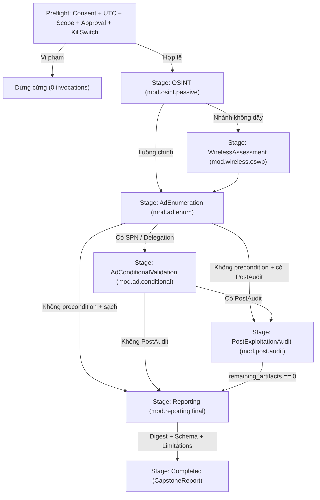

# Chương 112: Red Team Capstone II — Tác tử Đa Module Tự Hành, Điều Phối Scope/Checkpoint, Đối Kháng Red-vs-Blue & Báo Cáo End-to-End

> **Phạm vi hợp pháp và ranh giới bắt buộc:** đây là chương tốt nghiệp khép lại **Phần II** của giáo trình. Toàn bộ crate `code/ch112` (`MockCapstoneLab`) chạy **100% offline và tất định trên dữ liệu tổng hợp** bằng thư viện chuẩn Rust 2024 (`std`), `#![forbid(unsafe_code)]`, dùng tên miền dành riêng `.example` (RFC 2606), địa chỉ RFC 1918 và URI tổng hợp `virtual://` hoặc `lab-sensor://`. Chương này tích hợp OSINT thụ động, không dây OSWP, Active Directory, kiểm kê hậu khai thác và báo cáo có quản trị — **tuyệt đối không** mở socket mạng, **không** điều khiển radio Wi-Fi, **không** truy vấn LDAP/Kerberos/OS thật, **không** thu thập credential thật và **Cloud pentest nằm ngoài phạm vi Phần II**.

## 1. Giới thiệu, bản đồ tích hợp Phần II & mục tiêu học tập

Nếu Chương 105 đóng vai trò điểm kết cho bộ công cụ tấn công lõi (Ch 98–104), thì **Chương 112** là bộ điều phối tổng hợp cho toàn bộ **Phần II (Ch 106–111)** kèm kỷ luật hệ thống tác tử an toàn:

| Nguồn tri thức | Cơ chế cốt lõi mang vào Chương 112 | Thành phần tương ứng trong `code/ch112` |
|---|---|---|
| **Ch 105** | Hàm phần thưởng RL, đối kháng Red-vs-Blue & đồ thị điều phối pha | `CapstoneRewardWeights`, `CapstoneQPolicy`, `BlueDefensePolicy` |
| **Ch 106** | Đánh giá fixture 802.11 / WPA2-WPA3 / PMKID / SNR & tách biệt AP hợp lệ khỏi Evil Twin | `WirelessModuleAdapter` (`"mod.wireless.oswp"`) |
| **Ch 107–108** | Kiểm kê Active Directory, ACL, precondition Roasting/Delegation có rẽ nhánh điều kiện | `AdEnumerationModuleAdapter`, `AdConditionalAttackAdapter` |
| **Ch 109** | OSINT thụ động trên nguồn `.example`/RFC 1918, lọc stale record & bàn giao thực thể | `OsintModuleAdapter` (`"mod.osint.passive"`) |
| **Ch 110** | Baseline diff hậu kiểm thử `virtual://`, telemetry gap & cleanup lũy đẳng về `0` | `PostExploitationAuditAdapter` (`"mod.post.audit"`) |
| **Ch 111** | Ủy quyền RoE/Scope (`Deny > 3P > Allow`), redaction secret/PII, khử trùng lặp & báo cáo tất định | `EngagementScope`, `EvidenceLedger`, `ReportingModuleAdapter`, `CapstoneReport` |

### Mục tiêu học tập

Sau khi hoàn tất chương này, bạn có thể:

- Thiết kế trait chung `PentestModule` không rò rỉ chuỗi lệnh shell tùy ý, điều phối qua `ModuleRegistry` có kiểm tra đồ thị phụ thuộc (`required_prerequisites`), tương thích `ModuleInput`/`ModuleOutput` và quy tắc chuyển pha `Stage::can_transition_to`.
- Dựng cổng an toàn **dừng trước module đầu tiên** (`total_invocations() == 0`) khi thiếu văn bản chấp thuận, thiếu phê duyệt chiến dịch/pha (`ApprovalGrant`), bật `kill_switch`, sai cửa sổ UTC, vi phạm `EngagementScope` (`Deny > ThirdPartyConsent > Allow`) hoặc chứa `ProhibitedActionKind`.
- Cưỡng chế provenance bằng `EvidenceLedger` SHA-256 đóng khung độ dài, tự che secret/PII (`REDACTED_SECRET_MARKER`, `REDACTED_PII_MARKER`), từ chối `UnsupportedClaim` khi thiếu hoặc sai `evidence_id`, và khử trùng lặp độc lập hoán vị.
- Vận hành `OrchestratorCheckpoint` / `resume` nguyên tử với `scenario_fingerprint_sha256` và MAC SHA-256 sao cho khi phục hồi **không chạy lại pha đã commit**, **không nhân đôi bằng chứng**, và cho kết quả **khớp từng byte**.
- Tách bạch phán quyết `BlueDefensePolicy` với công thức thưởng RL dùng **bảng trọng số phạt độ lớn dương trừ trong công thức**, bảo đảm hành động Red bị Blue chặn không bao giờ được tính là thành công.
- Đóng gói báo cáo cuối 7 mục (`Scope`, `Module Trace`, `Evidence`, `Findings`, `Remediation`, `Cleanup`, `Limitations`) bằng JSON/Markdown tất định và kiểm chứng End-to-End với `CapstoneEvaluator`.

---

## 2. Hình tượng hóa đời sống: Trung tâm Điều hành Diễn tập Đa Bộ môn

Hãy tưởng tượng một buổi diễn tập an toàn tổng hợp cấp tập đoàn (Red Team + Blue SOC + Ban Pháp chế):

1. **Cửa an ninh ngoài cổng (`preflight_scenario`)**: Đội kiểm thử mang hộp công cụ đến sảnh, nhưng chưa ai được mở vali nếu thẻ ủy quyền RoE chưa có chữ ký, đồng hồ sai ngày diễn tập, phạm vi liệt kê nhầm phòng ban loại trừ (`payroll.corp.example`), hoặc đề cập tài sản ngoài hợp đồng (như cloud control plane). Chỉ cần một điểm đỏ trên bảng kiểm, bảo vệ đóng cổng ngay khi **số lượt gọi chuyên gia bằng `0`**.
2. **Đội chuyên gia nói chung một bảng mẫu có sẵn (`PentestModule` + `ModuleInput`/`ModuleOutput`)**: Chuyên gia OSINT bàn giao danh sách tên miền đã niêm phong sang chuyên gia AD Enumeration; nếu AD Enumeration không tìm thấy ứng viên SPN hay delegation bất thường thì điều phối viên đi thẳng tới báo cáo thay vì dựng kịch bản thừa.
3. **Hộp đen chuyến bay (`OrchestratorCheckpoint`)**: Mỗi bước hoàn tất đều bấm niêm phong SHA-256 kèm chữ ký MAC. Nếu thiết bị đọc snapshot AD bỗng nghẽn ở pha thứ ba, tổ vận hành nối lại từ hộp đen — bỏ qua hoàn toàn pha 1 và 2 đã niêm phong, không đẻ trùng hồ sơ bằng chứng.
4. **Trọng tài Đỏ–Xanh (`BlueDefensePolicy` + `CapstoneRewardWeights`)**: Nếu chuyên gia Đỏ làm ồn (`bulk_spn_sweep`), trọng tài Xanh giơ thẻ đỏ chặn hành động; điểm thắng không được ghi công, đồng thời **độ lớn phạt dương** trong bảng trọng số được trừ thẳng khỏi bảng điểm khiến tác tử Q-learning tự né chiến thuật ồn ở tập sau.



---

## 3. Kiến trúc `PentestModule`, `ModuleRegistry` & Chuyển Pha Có Điều Kiện

### 3.1 Trait `PentestModule` và Hợp đồng Dữ liệu Định kiểu

Toàn bộ sáu adapter giả lập tự chứa trong `code/ch112/src/main.rs` đều cài đặt đúng hợp đồng duy nhất:

```rust
pub trait PentestModule {
    fn id(&self) -> &'static str;
    fn run(
        &mut self,
        context: &EngagementContext,
        input: ModuleInput,
    ) -> Result<ModuleOutput, ModuleError>;
}
```

Thay vì nhận chuỗi lệnh shell tự do như `"run --cmd ..."`, `ModuleInput` là `enum` đóng kín 6 biến thể (`OsintSeed`, `WirelessAssessment`, `AdEnumeration`, `AdConditionalValidation`, `PostExploitationAudit`, `Reporting`). Nhờ kiểu đại số của Rust:

- `ModuleRegistry::check_compatibility` đối chiếu `input.kind() == descriptor.accepted_input` và kiểm tra mọi `required_prerequisites` đã có trong `completed_stages` **trước khi** gọi `instance.run(...)`.
- `ModuleRegistry::execute_stage` kiểm tra lại đầu ra: `output.executed_stage == stage`, `output.module_id == descriptor.expected_id`, và `Stage::can_transition_to(next)` cùng `allowed_next_stages.contains(&next)`. Bất kỳ pha nào trả bước nhảy lùi (như `Reporting -> Osint`) hoặc bước nhảy cóc trái phép (như `Osint -> AdConditionalValidation`) đều bị từ chối tức thì bằng `OrchestratorError::InvalidStageTransition`.

### 3.2 Kịch bản chính vs Các nhánh mở rộng

- **Golden Scenario (4 pha)**: `Osint` → `AdEnumeration` → (phát hiện `svc_sql_lab` / `svc_web_deleg`) → `AdConditionalValidation` → `Reporting` → `Completed`.
- **Clean AD Scenario (3 pha)**: khi `AdEnumerationInput` không có `roastable_spn_accounts` lẫn `constrained_delegation_accounts`, `AdEnumerationModuleAdapter` chủ động rẽ nhánh sang `Reporting`, bỏ qua `AdConditionalValidation` (`invocations_for(Stage::AdConditionalValidation) == 0`).
- **Full Branch Scenario (6 pha)**: bật thêm nhánh `WirelessAssessment` (`enable_wireless_branch = true`) sau OSINT và `PostExploitationAudit` (`enable_post_audit_branch = true`) trước `Reporting`. Ở nhánh Wi-Fi, nếu BSSID thứ hai đã được duyệt trong danh mục tài sản (`second_bssid_authorized == true`), hệ thống xếp mục đó vào `excluded_false_positives` thay vì báo nhầm Evil Twin.

---

## 4. An toàn trước Module Đầu Tiên, Provenance & Khử Trùng Lặp

### 4.1 Cổng `preflight_scenario` — Phòng thủ theo chiều sâu

`CapstoneOrchestrator::preflight_scenario` kiểm tra toàn bộ ngữ cảnh **và toàn bộ mục tiêu khai báo trong kịch bản** trước khi bước vào vòng lặp điều phối:

1. Chữ ký ủy quyền (`signed_written_consent == true`, `authorization_ref` khác rỗng) và phê duyệt khởi chạy (`campaign_approved == true`).
2. `kill_switch_engaged == false` và danh sách `requested_prohibited_actions` rỗng (từ chối ngay `CloudControlPlaneOutOfScope`, `RealNetworkSocket`, `HardwareRadioControl`, `RawCredentialHarvest`, `DestructiveHostModification`, `AutonomousSelfPropagation`).
3. Thời điểm `current_virtual_utc` nằm trọn trong `[window_start_utc .. window_end_utc]` (phân tích UTC ISO-8601 có kiểm tra năm nhuận và số ngày thực của từng tháng).
4. `EngagementScope::check_domain` và `check_ip`: tên miền bắt buộc kết thúc bằng `.example` (RFC 2606), IPv4 nghiêm ngặt (chặn `010.x.x.x`) và thuộc RFC 1918; **Deny luôn thắng Allow**, kiểm tra `ThirdPartyConsent` còn hạn trước khi đối chiếu allowlist.
5. `check_stage_approval` cho các pha bắt buộc trong `required_stage_approvals`.

Khi bị chặn ở bất kỳ điều kiện nào, `registry.total_invocations()` giữ nguyên **`0`** — module đầu tiên chưa từng được gọi. Đồng thời, từng `PentestModule` vẫn tự kiểm tra lại scope và approval bên trong `run()` để phòng thủ nhiều lớp ngay cả khi được gọi trực tiếp không qua `CapstoneOrchestrator`.

### 4.2 Provenance, Chuỗi Băm Đóng Khung Độ Dài & Redaction An Toàn UTF-8

- **URI tổng hợp siết host (`validate_synthetic_location`)**: chỉ chấp nhận `virtual://<host>/<path>` hoặc `lab-sensor://<host>/<path>` với `<host>` bắt buộc là tên miền `.example` hoặc IPv4 RFC 1918 hợp lệ.
- **Đóng khung độ dài `push_lp`**: mọi hàm tính hash (`EvidenceRecord::compute_linked_hash`, `OrchestratorCheckpoint::compute_mac`, `CapstoneReport::compute_digest`, `CapstoneScenario::fingerprint_sha256`) đều ghi `<len>:<field>;` trước giá trị để triệt tiêu va chạm ranh giới trường.
- **Tự động redaction & chống panic UTF-8**: `find_kv_secret_spans` và `find_pattern_secret_spans` quét thuần trên lát cắt byte `&[u8]` trước khi đối chiếu `is_char_boundary`, không bao giờ cắt ngang ký tự tiếng Việt đa byte khi văn bản có dấu đi cùng token `Bearer`, `password="..."`, JSON `{"api_key": "..."}`, nhiều khối PEM, JWT `eyJ...`, hay email ngoài `.example`.
- **`UnsupportedClaim`**: `validate_finding_provenance` từ chối mọi `Verified` hoặc `RemediatedVerified` finding nếu thiếu `remediation`, rỗng `evidence_ids` hoặc trỏ tới ID không tồn tại trong `EvidenceLedger`.
- **`deduplicate_capstone_findings`**: gom nhóm theo bộ khóa chữ thường `(rule_id, root_cause_key, affected_asset, status)`, sắp xếp nội bộ tất định `(cvss_tenths DESC, finding_id ASC)`, hợp nhất toàn bộ `evidence_ids` nên kết quả **độc lập với mọi hoán vị đầu vào**.

---

## 5. Checkpoint / Resume, Đối Kháng Red-vs-Blue & Bảng Phạt RL

### 5.1 Phục hồi nguyên tử từ `OrchestratorCheckpoint`

Mỗi vòng lặp điều phối chỉ commit trạng thái khi cả 4 bước kiểm tra đều qua: ngân sách `ResourceUsage::checked_add`, nạp lô bằng chứng `EvidenceLedger::append_batch` + `verify()`, chấm telemetry `BlueDefensePolicy`, và `validate_finding_provenance`. Nếu module trả `ModuleError::TransientFailure`:

- Trạng thái pha thất bại không bị ghi lửng; `OrchestratorCheckpoint` đóng dấu `checkpoint_version = 1`, `scenario_fingerprint_sha256` (băm mọi trường kịch bản) và `checkpoint_mac_sha256`.
- Khi gọi `orchestrator.resume(&checkpoint, &mut reg_recover, &scenario)`: hệ thống xác thực lại `preflight_scenario`, `checkpoint.verify(&fingerprint)`, rồi tiếp tục đúng từ `checkpoint.next_stage`. Nhờ kiểm tra trên, các pha nằm trong `completed_stages` như `Osint` và `AdEnumeration` giữ **`invocations_for == 0`**, không nhân đôi bằng chứng và tạo ra `CapstoneReport` khớp từng byte JSON/Markdown với lần chạy thẳng không lỗi.

### 5.2 Red-vs-Blue & Công thức Thưởng RL (Penalty Độ Lớn Dương)

Khi `ModuleTelemetryEvent` vượt ngưỡng chặn của `BlueDefensePolicy::standard()` (`noise_score >= 70` hoặc `action_kind == "bulk_spn_sweep"`):

1. Chính sách trả `BlueDisposition::DetectAndBlock` và tạo `BlockedActionRecord` kèm `feedback_for_red`.
2. Bộ điều phối tự động gán trạng thái `CapstoneFindingStatus::BlockedByBlue` cho các phát hiện gắn với sự kiện đó và đẩy vào danh sách bị loại — **`verified_findings_added` của bước đó giảm về `0`**, tuyệt đối không tính là thành công.
3. Công thức chấm thưởng tại `CapstoneRewardWeights::compute_step_reward`:

$$R_{\text{step}} = w_{\text{ver}} \cdot n_{\text{ver}} + w_{\text{rep}} \cdot \mathbb{1}_{\text{clean}} - \left( p_{\text{det}} \cdot \mathbb{1}_{\text{det}} + p_{\text{blk}} \cdot n_{\text{blk}} + p_{\text{dis}} \cdot \mathbb{1}_{\text{dis}} + p_{\text{saf}} \cdot n_{\text{saf}} + p_{\text{step}} \right)$$

> **Quy tắc bất biến về dấu (`AGENTS.md` §5):** Mọi trọng số phạt trong `CapstoneRewardWeights` phải là **độ lớn dương (`>= 0.0`)** và **bị trừ (`-`)** trong công thức trên. Hàm `CapstoneRewardWeights::validate()` từ chối bất kỳ trọng số nào âm, `NaN` hoặc vô cực bằng `OrchestratorError::RewardConfigInvalid`, tránh sai lầm "phạt âm rồi trừ thành cộng thưởng".

| Thành phần trong `CapstoneRewardWeights::standard()` | Kiểu | Giá trị lưu trong bảng | Dấu khi áp dụng vào $R_{\text{step}}$ |
|---|---|---|---|
| `verified_finding_reward` ($w_{\text{ver}}$) | Thưởng | `10.0` | `+ 10.0` cho mỗi finding xác minh hợp lệ |
| `clean_report_bonus` ($w_{\text{rep}}$) | Thưởng | `5.0` | `+ 5.0` khi báo cáo cuối sạch & cleanup đủ chuẩn |
| `detection_penalty` ($p_{\text{det}}$) | Phạt (độ lớn dương) | `3.0` | **`- 3.0`** khi Blue phát hiện telemetry |
| `blue_block_penalty` ($p_{\text{blk}}$) | Phạt (độ lớn dương) | `6.0` | **`- 6.0`** trên mỗi hành động bị Blue chặn |
| `service_disruption_penalty` ($p_{\text{dis}}$) | Phạt (độ lớn dương) | `12.0` | **`- 12.0`** nếu gây gián đoạn dịch vụ giả |
| `safety_violation_penalty` ($p_{\text{saf}}$) | Phạt (độ lớn dương) | `25.0` | **`- 25.0`** trên mỗi vi phạm an toàn |
| `step_cost_penalty` ($p_{\text{step}}$) | Phạt (độ lớn dương) | `0.5` | **`- 0.5`** chi phí mỗi bước điều phối |

---

## 6. Bảng Bất Biến Hệ Thống & Mã Nguồn `code/ch112`

| # | Bất biến bắt buộc (Outline §10) | Cơ chế cưỡng chế trong `code/ch112/src/main.rs` | Bài kiểm thử chứng minh |
|---|---|---|---|
| 1 | Out-of-scope / thiếu approval dừng trước module 1 | `preflight_scenario`, `preflight_validate`, `total_invocations() == 0` | `test_05`–`test_12`, `test_32`, `test_43`–`test_44` |
| 2 | Mọi finding hợp lệ phải có evidence thật | `validate_finding_provenance`, từ chối `UnsupportedClaim` | `test_17`, `test_33`, `test_45` |
| 3 | Mọi chuyển pha hợp lệ, không chu trình | `Stage::can_transition_to`, `max_steps`, `completed_stages` | `test_15`, `test_16` |
| 4 | Resume không chạy lại pha cũ, không nhân đôi evidence | `OrchestratorCheckpoint::verify`, `invocations_for` = 0 cho pha cũ | `test_21`, `test_22`, `test_34`, `test_38`, `test_42` |
| 5 | Red bị Blue chặn không tính thành công | `BlockedByBlue`, lọc `step_verified`, `- blue_block_penalty` | `test_23`, `test_24`, `test_36` |
| 6 | Cleanup hậu kiểm thử đưa artifact phòng lab về `0` | `CleanupIncomplete` trong `PostExploitationAudit`, `Reporting`, `validate` | `test_25`, `test_43` |
| 7 | Cùng seed & input cho cùng trace, RL và byte báo cáo | `BTreeMap`/`BTreeSet`, `SplitMix64`, `CapstoneEvaluator` | `test_01`, `test_20`, `test_26`–`test_30`, `test_41`, `test_46` |

Cấu trúc mã nguồn đầy đủ nằm tại [`code/ch112/src/main.rs`](code/ch112/src/main.rs) chia thành 10 mục:

1. **Mục 1**: `sha256_hex` chuẩn FIPS 180-4 (`.as_chunks::<64>().0`), `push_lp` và `SplitMix64`.
2. **Mục 2**: `ModuleError`, `OrchestratorError`, kiểm tra `.example` / RFC 1918 / UTC / URI ảo và redaction an toàn UTF-8.
3. **Mục 3**: `Stage`, `ProhibitedActionKind`, `EngagementScope`, `EngagementContext`, `ModuleInput`, `ModuleOutput` và trait `PentestModule`.
4. **Mục 4**: `EvidenceRecord`, `EvidenceLedger`, `CapstoneFinding`, `validate_finding_provenance`, `deduplicate_capstone_findings`.
5. **Mục 5**: `BlueDefensePolicy`, `CapstoneRewardWeights` (penalty dương trừ trong công thức) và `CapstoneQPolicy`.
6. **Mục 6**: 6 adapter giả lập tự chứa (`OsintModuleAdapter` … `ReportingModuleAdapter`).
7. **Mục 7**: `ModuleDescriptor` và `ModuleRegistry`.
8. **Mục 8**: `CapstoneScenario`, `OrchestratorCheckpoint`, `CapstoneReport` (JSON/Markdown escape & digest), `CapstoneOrchestrator`, `CapstoneEvaluator`.
9. **Mục 9**: `MockCapstoneLab` và `main()`.
10. **Mục 10**: 46 unit tests từ cơ bản tới đối kháng.

### Kết quả chạy thực tế `cargo run --manifest-path code/Cargo.toml -p ch112`

```text
MockCapstoneLab — 100% synthetic multi-module autonomous agent, checkpoint/resume & Red-vs-Blue
Out-of-scope pre-gate: blocked=true total_invocations=0
Golden pipeline: stages=4 verified=4 false_positives=1 rl_milli=40000 replay_identical=true resume_identical=true
Full multi-branch pipeline: stages=6 evidence=7 findings=6 cleanup_clean=true digest_prefix=6b4ea76e979b3223
Red-vs-Blue adversarial guard: blue_blocks=1 verified_total=2 rl_milli=14000
```

Giải thích nhanh các con số đo được:

- `Out-of-scope pre-gate`: dùng tên miền loại trừ `payroll.corp.example` ⇒ bị chặn ngay ở cổng trước module với `total_invocations=0`.
- `Golden pipeline`: chạy đúng 4 pha (`OSINT -> ADEnumeration -> ADConditionalValidation -> Reporting`), thu 4 phát hiện xác minh (`CAP-OSINT-001`, `CAP-AD-ACL-001`, `CAP-AD-SPN-001`, `CAP-AD-DELEG-001`), tách 1 false-positive từ OSINT (`CAP-OSINT-FP-002`), tổng điểm RL `40.000` điểm tương ứng `rl_milli=40000` (40 điểm nhân 1.000: 4 verified × 10 + 5 report bonus − 3 detect − 4 × 0.5 step = `40.0`), và cả phát lại lẫn phục hồi checkpoint đều khớp từng byte (`true`).
- `Full multi-branch pipeline`: chạy đủ 6 pha (thêm `WirelessAssessment` và `PostExploitationAudit`), niêm phong 7 bằng chứng, xác minh 6 phát hiện, dọn sạch `remaining_lab_artifacts == 0` (`cleanup_clean=true`).
- `Red-vs-Blue adversarial guard`: bật `noisy_ad_sweep = true` ⇒ `BlueDefensePolicy` chặn 1 lần quét SPN ồn (`blue_blocks=1`), 2 phát hiện bước AD có điều kiện chuyển sang `BlockedByBlue` nên chỉ còn 2 finding hợp lệ (`CAP-OSINT-001` và `CAP-AD-ACL-001`), điểm RL tụt xuống `rl_milli=14000` (giảm `26.0` điểm gồm mất `+20.0` từ 2 finding bị chặn và bị trừ `-6.0` phạt `blue_block_penalty`).

---

## 7. Phát hiện (Detection), Khắc phục, Cleanup & Giới hạn Mô phỏng

| Mảng kỹ thuật | Tín hiệu phát hiện (Blue SOC / Audit Telemetry) | Biện pháp khắc phục (Remediation) | Dọn dẹp (Cleanup) & Giới hạn mô phỏng |
|---|---|---|---|
| **Passive OSINT (Ch 109)** | Theo dõi Certificate Transparency log cho domain nội bộ mới cấp | Dùng CA nội bộ cho dịch vụ không hướng Internet; xóa bản ghi DNS thừa (`split-horizon`) | Chỉ kiểm chứng trên snapshot `.example`; không gửi truy vấn công cộng thật |
| **Wireless Security (Ch 106)** | Cảnh báo WIDS khi xuất hiện BSSID lạ trùng SSID hoặc frame mất PMF | Ép WPA3-SAE / WPA2-Enterprise kèm 802.11w (PMF bắt buộc) | Không điều khiển card radio hay phát packet; đối chiếu inventory để loại AP hợp lệ |
| **AD & Delegation (Ch 107–108)** | Giám sát Event 4769 (TGS encryption type `0x17` RC4), thay đổi DACL `WriteDacl`/`GenericAll` (Event 4662/5136) | Chuyển tài khoản dịch vụ sang gMSA, ép AES256-CTS, rà soát least privilege và giới hạn delegation SPN đích | Không kết nối DC hay crack mật khẩu thật; kiểm tra precondition thuần dữ liệu tổng hợp |
| **Post-Exploitation & Report (Ch 110–111)** | Giám sát audit policy drift, tạo Scheduled Task mới (Event 4698), cảnh báo mất telemetry log | Khóa baseline Audit Policy/Sysmon và bảo vệ luồng SIEM bằng chuỗi băm | Xác minh `remaining_lab_artifacts == 0`; mọi vị trí là `virtual://`; **Cloud pentest nằm ngoài phạm vi Phần II** |

---

## 8. Bảng Tra Cứu Lỗi Biên Dịch `rustc` / Clippy & Bẫy Thiết Kế

| Mã lỗi / Triệu chứng | Nguyên nhân gốc rễ | Cách sửa chuẩn trong Rust 2024 |
|---|---|---|
| **`start byte index ... is not a char boundary`** | Slicing `&str[i..]` bằng chỉ số byte `i` khi chuỗi tiếng Việt chứa ký tự đa byte UTF-8 | Quét mẫu ASCII trên `lower.as_bytes()` bằng `.windows(...).position(...)` và chỉ cắt `&raw[s..e]` khi kiểm tra `is_char_boundary` |
| **`E0038`: `dyn PentestModule` cannot be made into an object** | Thêm `<T>` generic hoặc `-> impl Trait` trực tiếp lên phương thức của `PentestModule` | Giữ chữ ký thuần `&mut self`, `&EngagementContext`, `ModuleInput -> Result<ModuleOutput, ModuleError>` để dùng được `Box<dyn PentestModule>` |
| **`E0382`: borrow of partially moved value`** | Tiêu thụ `other.evidence_ids` qua `.extend(...)` rồi mới đọc `other.remediation` hay `other.severity` | Đọc/so sánh các trường Copy/tham chiếu trước khi `.extend()` các trường `String` / `BTreeSet` |
| **Penalty RL âm cộng ngược thành thưởng (`- (-3.0)`)** | Đặt `-3.0` vào bảng penalty nhưng công thức vẫn viết `positive - penalty` | Lưu độ lớn dương `>= 0.0` và bắt buộc qua `CapstoneRewardWeights::validate()` |
| **Clippy `-D warnings` (`type_complexity`, `too_many_arguments`)** | Tuple key 5 phần không alias hoặc hàm nhận >= 8 tham số | Gom vào `struct` / `type` alias định nghĩa rõ nghĩa |

---

## 9. Bài Tập Thực Hành (Kèm Gợi Ý & Lời Giải Khớp API Crate)

### Bài 1 — Kiểm chứng cổng Preflight & Deny-wins-Allow dừng trước Module 1

Viết hàm `pub fn exercise_preflight_scope_and_prohibited_gate() -> Result<(), Box<dyn std::error::Error>>`:
1. Chạy `CapstoneOrchestrator::run_strict` với `sc.osint.root_domain = "payroll.corp.example".to_string()`; xác nhận trả `Err(OrchestratorError::ScopeViolation(_))` và `reg.total_invocations() == 0`.
2. Thêm `ProhibitedActionKind::CloudControlPlaneOutOfScope` vào `ctx.requested_prohibited_actions`; xác nhận bị chặn ngay với `Err(OrchestratorError::ProhibitedAction(ProhibitedActionKind::CloudControlPlaneOutOfScope))` và `reg.total_invocations() == 0`.
3. Xóa phê duyệt `Stage::AdConditionalValidation` khỏi `ctx.granted_approvals` trên kịch bản chuẩn; xác nhận orchestrator dừng trước module đầu tiên với `Err(OrchestratorError::ApprovalRequired(_))` và `total_invocations() == 0`.

<details><summary>Gợi ý</summary>

Dùng `MockCapstoneLab::standard_context()`, `MockCapstoneLab::golden_scenario()` và `MockCapstoneLab::standard_registry()?`. Nhớ tạo `ModuleRegistry` riêng cho mỗi lần chạy để đọc chính xác `total_invocations()`.

</details>

<details><summary>Lời giải</summary>

```rust
pub fn exercise_preflight_scope_and_prohibited_gate() -> Result<(), Box<dyn std::error::Error>> {
    let base_ctx = MockCapstoneLab::standard_context();
    let golden = MockCapstoneLab::golden_scenario();

    let mut deny_sc = golden.clone();
    deny_sc.osint.root_domain = "payroll.corp.example".to_string();
    let mut reg1 = MockCapstoneLab::standard_registry()?;
    let orch1 = CapstoneOrchestrator::new(
        base_ctx.clone(),
        BlueDefensePolicy::standard(),
        CapstoneRewardWeights::standard(),
    )?;
    assert!(matches!(
        orch1.run_strict(&mut reg1, &deny_sc),
        Err(OrchestratorError::ScopeViolation(_))
    ));
    assert_eq!(reg1.total_invocations(), 0);

    let mut cloud_ctx = base_ctx.clone();
    cloud_ctx
        .requested_prohibited_actions
        .push(ProhibitedActionKind::CloudControlPlaneOutOfScope);
    let mut reg2 = MockCapstoneLab::standard_registry()?;
    let orch2 = CapstoneOrchestrator::new(
        cloud_ctx,
        BlueDefensePolicy::standard(),
        CapstoneRewardWeights::standard(),
    )?;
    assert_eq!(
        orch2.run_strict(&mut reg2, &golden),
        Err(OrchestratorError::ProhibitedAction(
            ProhibitedActionKind::CloudControlPlaneOutOfScope
        ))
    );
    assert_eq!(reg2.total_invocations(), 0);

    let mut no_hitl_ctx = base_ctx;
    no_hitl_ctx
        .granted_approvals
        .retain(|g| g.stage != Stage::AdConditionalValidation);
    let mut reg3 = MockCapstoneLab::standard_registry()?;
    let orch3 = CapstoneOrchestrator::new(
        no_hitl_ctx,
        BlueDefensePolicy::standard(),
        CapstoneRewardWeights::standard(),
    )?;
    assert!(matches!(
        orch3.run_strict(&mut reg3, &golden),
        Err(OrchestratorError::ApprovalRequired(_))
    ));
    assert_eq!(reg3.total_invocations(), 0);
    Ok(())
}
```

</details>

---

### Bài 2 — Rẽ nhánh có điều kiện từ AD Enumeration và chạy đủ nhánh phụ

Viết hàm `pub fn exercise_conditional_stage_branching_and_wireless() -> Result<(), Box<dyn std::error::Error>>`:
1. Chạy `MockCapstoneLab::golden_scenario()` và chứng minh đường đi là `[Osint, AdEnumeration, AdConditionalValidation, Reporting]`.
2. Xóa `roastable_spn_accounts`, `constrained_delegation_accounts` và `acl_edges` trên bản sao kịch bản; chứng minh hệ thống tự bỏ qua `AdConditionalValidation` (`invocations_for == 0`) với 3 pha `[Osint, AdEnumeration, Reporting]`.
3. Chạy `MockCapstoneLab::full_with_branches_scenario()` và kiểm chứng đủ 6 pha kèm `cleanup.remaining_lab_artifacts == 0` và `excluded_false_positives.len() == 2`.

<details><summary>Gợi ý</summary>

Thu thập danh sách pha từ `report.module_trace.iter().map(|t| t.stage).collect::<Vec<_>>()`.

</details>

<details><summary>Lời giải</summary>

```rust
pub fn exercise_conditional_stage_branching_and_wireless() -> Result<(), Box<dyn std::error::Error>>
{
    let ctx = MockCapstoneLab::standard_context();
    let orch = CapstoneOrchestrator::new(
        ctx,
        BlueDefensePolicy::standard(),
        CapstoneRewardWeights::standard(),
    )?;

    let mut reg_golden = MockCapstoneLab::standard_registry()?;
    let rep_golden = orch.run_strict(&mut reg_golden, &MockCapstoneLab::golden_scenario())?;
    let golden_stages: Vec<Stage> = rep_golden.module_trace.iter().map(|t| t.stage).collect();
    assert_eq!(
        golden_stages,
        vec![
            Stage::Osint,
            Stage::AdEnumeration,
            Stage::AdConditionalValidation,
            Stage::Reporting
        ]
    );

    let mut clean_sc = MockCapstoneLab::golden_scenario();
    clean_sc.ad_enumeration.roastable_spn_accounts.clear();
    clean_sc
        .ad_enumeration
        .constrained_delegation_accounts
        .clear();
    clean_sc.ad_enumeration.acl_edges.clear();
    let mut reg_clean = MockCapstoneLab::standard_registry()?;
    let rep_clean = orch.run_strict(&mut reg_clean, &clean_sc)?;
    let clean_stages: Vec<Stage> = rep_clean.module_trace.iter().map(|t| t.stage).collect();
    assert_eq!(
        clean_stages,
        vec![Stage::Osint, Stage::AdEnumeration, Stage::Reporting]
    );
    assert_eq!(
        reg_clean.invocations_for(Stage::AdConditionalValidation),
        0
    );

    let mut reg_full = MockCapstoneLab::standard_registry()?;
    let rep_full = orch.run_strict(
        &mut reg_full,
        &MockCapstoneLab::full_with_branches_scenario(),
    )?;
    assert_eq!(rep_full.module_trace.len(), 6);
    assert_eq!(rep_full.cleanup.remaining_lab_artifacts, 0);
    assert_eq!(rep_full.excluded_false_positives.len(), 2);
    Ok(())
}
```

</details>

---

### Bài 3 — Phục hồi sự cố với `OrchestratorCheckpoint`, `resume` và khớp byte tuyệt đối

Viết hàm `pub fn exercise_checkpoint_resume_and_replay_determinism() -> Result<(), Box<dyn std::error::Error>>`:
1. Chạy `run_resumable` trên `MockCapstoneLab::registry_with_transient_ad_failure()?` để thu `RunOutcome::HaltedRecoverable { failed_stage, checkpoint, .. }`, kiểm tra `failed_stage == Stage::AdConditionalValidation` và `checkpoint.completed_stages == vec![Stage::Osint, Stage::AdEnumeration]`.
2. Gọi `orch.resume(&checkpoint, &mut reg_recover, &sc)` trên một registry lành mới; chứng minh `reg_recover.invocations_for(Stage::Osint) == 0`, `reg_recover.invocations_for(Stage::AdEnumeration) == 0`, và chuỗi `render_json()` / `render_markdown()` trùng khớp từng byte với chạy thẳng.
3. Sửa một trường trong `checkpoint` (như `ad_preconditions_handoff = None`) và chứng minh `resume` trả `Err(OrchestratorError::CheckpointInvalid(_))`.

<details><summary>Gợi ý</summary>

Dùng `match` trên `RunOutcome` để tách nhánh `HaltedRecoverable` trước khi truyền tham chiếu `&checkpoint` vào `orch.resume(...)`.

</details>

<details><summary>Lời giải</summary>

```rust
pub fn exercise_checkpoint_resume_and_replay_determinism() -> Result<(), Box<dyn std::error::Error>> {
    let ctx = MockCapstoneLab::standard_context();
    let sc = MockCapstoneLab::golden_scenario();
    let orch = CapstoneOrchestrator::new(
        ctx,
        BlueDefensePolicy::standard(),
        CapstoneRewardWeights::standard(),
    )?;

    let mut reg_straight = MockCapstoneLab::standard_registry()?;
    let expected = orch.run_strict(&mut reg_straight, &sc)?;

    let mut reg_fail = MockCapstoneLab::registry_with_transient_ad_failure()?;
    let checkpoint = match orch.run_resumable(&mut reg_fail, &sc)? {
        RunOutcome::HaltedRecoverable {
            failed_stage,
            checkpoint,
            ..
        } => {
            assert_eq!(failed_stage, Stage::AdConditionalValidation);
            assert_eq!(
                checkpoint.completed_stages,
                vec![Stage::Osint, Stage::AdEnumeration]
            );
            checkpoint
        }
        RunOutcome::Completed(_) => return Err("kịch bản lỗi tạm thời phải tạm dừng".into()),
    };

    let mut reg_recover = MockCapstoneLab::standard_registry()?;
    let resumed = match orch.resume(&checkpoint, &mut reg_recover, &sc)? {
        RunOutcome::Completed(rep) => rep,
        RunOutcome::HaltedRecoverable { .. } => return Err("resume phải hoàn tất".into()),
    };

    assert_eq!(reg_recover.invocations_for(Stage::Osint), 0);
    assert_eq!(reg_recover.invocations_for(Stage::AdEnumeration), 0);
    assert_eq!(resumed.render_json()?, expected.render_json()?);
    assert_eq!(resumed.render_markdown()?, expected.render_markdown()?);

    let mut broken_cp = checkpoint;
    broken_cp.ad_preconditions_handoff = None;
    let mut reg_chk = MockCapstoneLab::standard_registry()?;
    assert!(matches!(
        orch.resume(&broken_cp, &mut reg_chk, &sc),
        Err(OrchestratorError::CheckpointInvalid(_))
    ));
    Ok(())
}
```

</details>

---

### Bài 4 — Đối kháng Red-vs-Blue, quy ước dấu penalty RL và `CapstoneQPolicy`

Viết hàm `pub fn exercise_red_vs_blue_and_positive_rl_penalties() -> Result<(), Box<dyn std::error::Error>>`:
1. Kiểm chứng `CapstoneRewardWeights::validate()` từ chối `detection_penalty = -3.0` bằng `Err(OrchestratorError::RewardConfigInvalid(_))`.
2. Bật `noisy_ad_sweep = true` trên kịch bản chuẩn; chứng minh `BlueDefensePolicy` chặn hành động ồn (`blocked_red_actions.len() == 1`), không có finding nào của pha `AdConditionalValidation` lọt vào `report.findings` (tức hành động bị chặn không tính thành công).
3. Tính `blocked_reward` khi `verified_findings_added = 0, detected_by_blue = true, blocked_by_blue_count = 1` (khớp `-9.5`), rồi cập nhật vào `CapstoneQPolicy` để chứng minh `q.best_action() == AdaptivePolicyAction::TargetedScopedCheck`.

<details><summary>Gợi ý</summary>

So sánh số thực với sai số `1e-12`: `(blocked_reward - (-9.5)).abs() < 1e-12`.

</details>

<details><summary>Lời giải</summary>

```rust
pub fn exercise_red_vs_blue_and_positive_rl_penalties() -> Result<(), Box<dyn std::error::Error>> {
    let mut invalid_w = CapstoneRewardWeights::standard();
    invalid_w.detection_penalty = -3.0;
    assert!(matches!(
        invalid_w.validate(),
        Err(OrchestratorError::RewardConfigInvalid(_))
    ));

    let ctx = MockCapstoneLab::standard_context();
    let mut noisy_sc = MockCapstoneLab::golden_scenario();
    noisy_sc.noisy_ad_sweep = true;

    let weights = CapstoneRewardWeights::standard();
    let orch = CapstoneOrchestrator::new(ctx, BlueDefensePolicy::standard(), weights)?;
    let mut reg = MockCapstoneLab::standard_registry()?;
    let report = orch.run_strict(&mut reg, &noisy_sc)?;

    assert_eq!(report.blocked_red_actions.len(), 1);
    assert!(
        !report
            .findings
            .iter()
            .any(|f| f.stage == Stage::AdConditionalValidation)
    );

    let blocked_reward = weights.compute_step_reward(&RlStepOutcome {
        verified_findings_added: 0,
        clean_report_achieved: false,
        detected_by_blue: true,
        blocked_by_blue_count: 1,
        service_disrupted: false,
        safety_violations: 0,
    })?;
    assert!((blocked_reward - (-9.5)).abs() < 1e-12);

    let mut q = CapstoneQPolicy::new();
    q.update(AdaptivePolicyAction::NoisyBulkSweep, blocked_reward);
    q.update(AdaptivePolicyAction::TargetedScopedCheck, 16.5);
    assert_eq!(q.best_action(), AdaptivePolicyAction::TargetedScopedCheck);
    Ok(())
}
```

</details>

---

### Bài 5 — Kiểm tra Provenance, Khử trùng lặp độc lập hoán vị & Chống sửa lén Báo cáo

Viết hàm `pub fn exercise_provenance_dedup_and_report_integrity() -> Result<(), Box<dyn std::error::Error>>`:
1. Tạo `EvidenceLedger` chứa 2 bằng chứng `EV-EX5-1` và `EV-EX5-2`; chứng minh `validate_finding_provenance` từ chối finding `Verified` có `evidence_ids` rỗng bằng `Err(OrchestratorError::UnsupportedClaim(_))`.
2. Gọi `deduplicate_capstone_findings` trên hai hoán vị `[f1, f2]` và `[f2, f1]` cùng khóa `(rule_id, root_cause_key, affected_asset)`; chứng minh kết quả hai chiều bằng nhau tuyệt đối và giữ trọn cả `EV-EX5-1` lẫn `EV-EX5-2`.
3. Chạy `orch.run_strict` với tiêu đề chứa ký tự đặc biệt `"Audit | <tag>\n\"v1\""`, xác nhận escape JSON/Markdown an toàn và sửa `remediation` rồi kiểm tra `validate()` trả `Err(OrchestratorError::ReportTampered(_))`.

<details><summary>Gợi ý</summary>

Dùng `std::collections::BTreeSet` cho trường `evidence_ids` của hai finding trước khi gọi `deduplicate_capstone_findings`.

</details>

<details><summary>Lời giải</summary>

```rust
pub fn exercise_provenance_dedup_and_report_integrity() -> Result<(), Box<dyn std::error::Error>> {
    let mut ledger = EvidenceLedger::new();
    let ev1 = EvidenceRecord::from_raw(
        "EV-EX5-1",
        Stage::Osint,
        "mod.osint.passive",
        "virtual://corp.example/osint/ex5-1",
        "corp.example",
        VIRTUAL_NOW_UTC,
        "snapshot 1",
    )?;
    let ev2 = EvidenceRecord::from_raw(
        "EV-EX5-2",
        Stage::AdEnumeration,
        "mod.ad.enum",
        "virtual://corp.example/ad/ex5-2",
        "corp.example",
        VIRTUAL_NOW_UTC,
        "snapshot 2",
    )?;
    ledger.append_batch(vec![ev1, ev2])?;

    let mut unsupported = CapstoneFinding {
        finding_id: "F-EX5-BAD".to_string(),
        rule_id: "R-EX5".to_string(),
        root_cause_key: "key-ex5".to_string(),
        title: "Missing evidence".to_string(),
        stage: Stage::Osint,
        affected_asset: "corp.example".to_string(),
        severity: FindingSeverity::Low,
        cvss_tenths: 31,
        status: CapstoneFindingStatus::Verified,
        evidence_ids: BTreeSet::new(),
        telemetry_event_id: None,
        remediation: "Apply baseline policy".to_string(),
    };
    assert!(matches!(
        validate_finding_provenance(&unsupported, &ledger),
        Err(OrchestratorError::UnsupportedClaim(_))
    ));

    unsupported.evidence_ids.insert("EV-EX5-1".to_string());
    let mut f2 = unsupported.clone();
    f2.finding_id = "F-EX5-HIGH".to_string();
    f2.cvss_tenths = 75;
    f2.severity = FindingSeverity::High;
    f2.evidence_ids.clear();
    f2.evidence_ids.insert("EV-EX5-2".to_string());

    let d1 = deduplicate_capstone_findings(vec![unsupported.clone(), f2.clone()])?;
    let d2 = deduplicate_capstone_findings(vec![f2, unsupported])?;
    assert_eq!(d1, d2);
    assert_eq!(d1.len(), 1);
    assert!(d1[0].evidence_ids.contains("EV-EX5-1"));
    assert!(d1[0].evidence_ids.contains("EV-EX5-2"));

    let ctx = MockCapstoneLab::standard_context();
    let mut sc = MockCapstoneLab::golden_scenario();
    sc.report_title = "Audit | <tag>\n\"v1\"".to_string();
    let orch = CapstoneOrchestrator::new(
        ctx,
        BlueDefensePolicy::standard(),
        CapstoneRewardWeights::standard(),
    )?;
    let mut reg = MockCapstoneLab::standard_registry()?;
    let mut report = orch.run_strict(&mut reg, &sc)?;

    let json = report.render_json()?;
    let md = report.render_markdown()?;
    assert!(json.contains("\\\"v1\\\""));
    assert!(md.contains("\\|"));
    assert!(md.contains("&lt;tag&gt;"));

    report.findings[0].remediation.push_str(" tampered");
    assert!(matches!(
        report.validate(),
        Err(OrchestratorError::ReportTampered(_))
    ));
    Ok(())
}
```

</details>

---

## 10. Tóm tắt, checklist lab & nguồn chuẩn

- **Một giao diện thống nhất, zero shell tùy ý**: `PentestModule` kết hợp `ModuleInput`/`ModuleOutput` định kiểu, `ModuleRegistry` kiểm tra đồ thị phụ thuộc và `Stage::can_transition_to` ngăn nhảy lùi hoặc tạo chu trình.
- **An toàn trước khi chạy**: vi phạm phạm vi (`Deny > 3P > Allow`), thiếu chữ ký RoE, thiếu phê duyệt HITL, ngoài cửa sổ UTC, bật `kill_switch` hay hành động cấm (kể cả probe Cloud ngoài phạm vi) đều dừng với `total_invocations == 0`.
- **Provenance & toàn vẹn đa tầng**: `EvidenceLedger` đóng khung độ dài, tự động che secret/PII không panic trên UTF-8, chặn `UnsupportedClaim` và khử trùng lặp độc lập hoán vị.
- **Checkpoint/Resume & Red-vs-Blue**: phục hồi từ `OrchestratorCheckpoint` bỏ qua toàn bộ pha đã commit và cho cùng byte báo cáo; hành động Red bị Blue chặn không được tính công và nhận hình phạt dương trừ trong công thức RL.

Checklist khi áp dụng kiến trúc tác tử đa module vào **phòng lab riêng được ủy quyền**:

- [ ] Xác minh chữ ký Rules of Engagement, `EngagementScope` (`Deny > 3P > Allow`), khung giờ UTC và `ApprovalGrant` theo từng mục tiêu **trước khi** gọi module đầu tiên.
- [ ] Gắn hợp đồng `PentestModule` với `ModuleInput`/`ModuleOutput` định kiểu chặt chẽ, kiểm tra đồ thị phụ thuộc và cấm chuỗi lệnh shell hay thao tác ngoài phạm vi (kể cả Cloud pentest).
- [ ] Bật auto-redaction secret/PII và khóa chuỗi băm `EvidenceLedger` SHA-256 đóng khung độ dài; bác bỏ mọi phát hiện thiếu `evidence_id` hoặc trỏ nhầm nguồn.
- [ ] Lưu `OrchestratorCheckpoint` kèm MAC SHA-256 & vân tay kịch bản/chính sách để khi phục hồi (`resume`) bỏ qua pha đã commit và không nhân đôi bằng chứng.
- [ ] Rà soát `BlueDefensePolicy` và giữ mọi penalty RL ở độ lớn dương trừ trong công thức; hạ/loại mọi phát hiện gắn với hành động bị Blue chặn.
- [ ] Xác minh `remaining_lab_artifacts == 0`, kiểm chứng báo cáo 7 mục JSON/Markdown tất định khớp từng byte và giữ `real_host_artifacts_created == 0` (chạy `cargo test -p ch112 --locked`, `clippy`, `fmt` và các script `check-*.py` / `build-book.sh` trước khi xuất bản).

### Nguồn chuẩn và đọc tiếp

- [FIRST.org CVSS v3.1](https://www.first.org/cvss/v3.1/specification-document) & [NIST SP 800-115](https://csrc.nist.gov/publications/detail/sp/800-115/final): phương pháp đánh giá, mức nghiêm trọng và chuẩn báo cáo an toàn thông tin.
- [RFC 2606](https://www.rfc-editor.org/rfc/rfc2606), [RFC 1918](https://www.rfc-editor.org/rfc/rfc1918), [FIPS 180-4](https://nvlpubs.nist.gov/nistpubs/FIPS/NIST.FIPS.180-4.pdf): tên miền `.example`, IPv4 riêng tư và hàm băm SHA-256 dùng cho toàn vẹn chuỗi bằng chứng & checkpoint.
- [MITRE ATT&CK](https://attack.mitre.org/) & [Microsoft AD Security Guidelines](https://learn.microsoft.com/windows-server/identity/ad-ds/plan/security-best-practices/best-practices-for-securing-active-directory): khung tham chiếu telemetry phát hiện và kiểm soát đặc quyền.

Chương trước: [Chương 111 — Methodology, Reporting, CVSS 3.1 & Legal](chuong_111.md). Đọc tiếp toàn cảnh giáo trình tại [ROADMAP](ROADMAP.md), [Phụ lục A](PHU_LUC_A_FANTASY_LAND.md) và [Bảng thuật ngữ](GLOSSARY.md).
