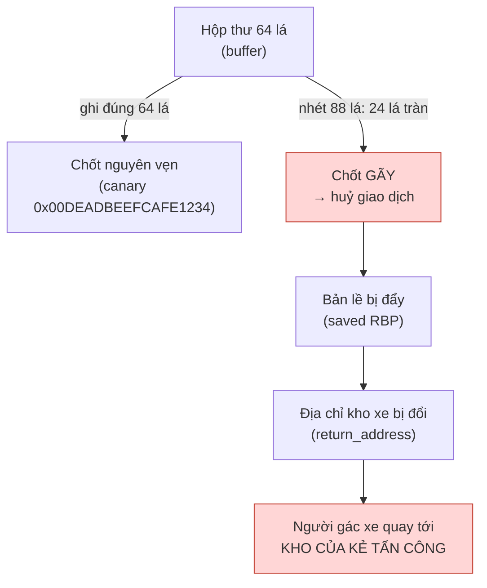
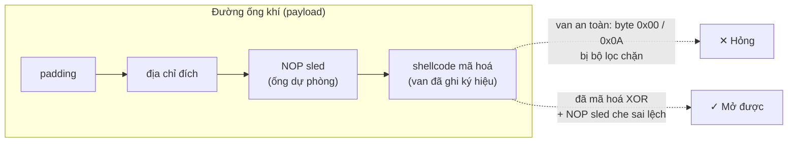
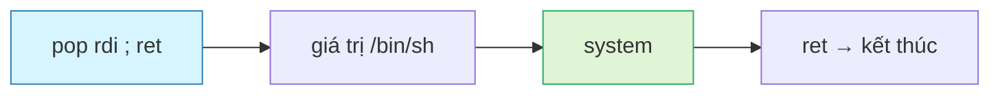
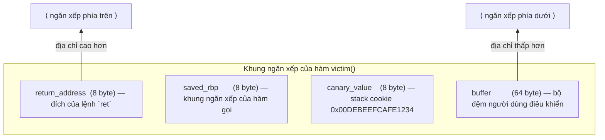
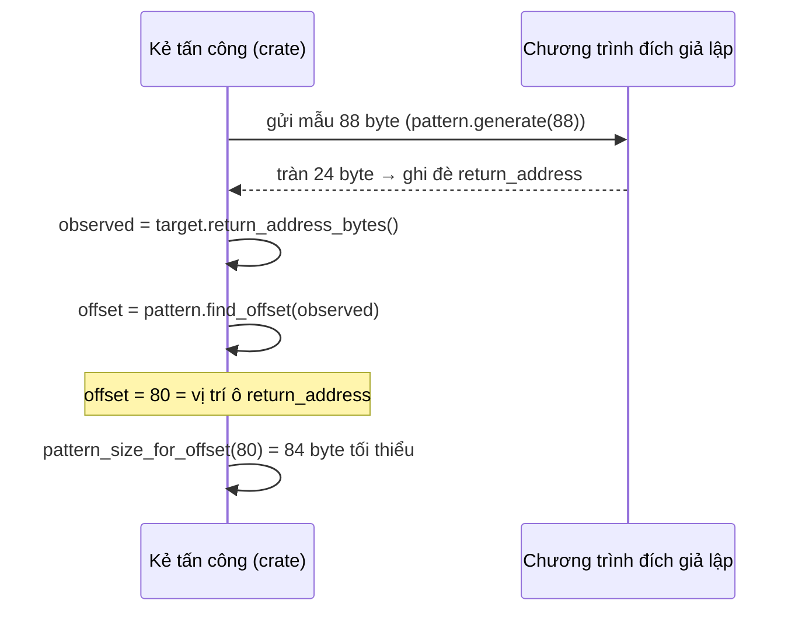
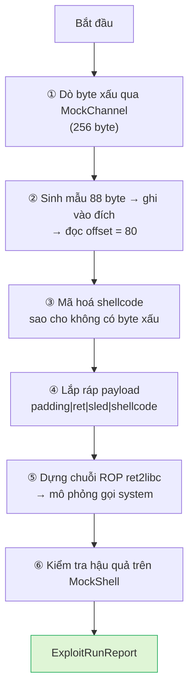

# Chương 98: Phòng thí nghiệm Khai thác Nhị phân — Mã Dính Lỗi, Mẫu Tuần hoàn, Mã hoá Shellcode & Chuỗi ROP (Binary Exploit Lab: Vulnerable Binaries, Cyclic Patterns, Shellcode Encoding & ROP Chains)

---

## 1. Giới thiệu & Mục tiêu

Chào mừng bạn đến với **Chương 98** — chương mở đầu của **Chủ đề 28: An ninh Ứng dụng & Khai thác Nhị phân**. Đây là chương đầu tiên trong giáo trình đưa chúng ta vào một lĩnh vực mà bạn có thể đã nghe nói rất nhiều nhưng hiếm khi được học một cách *có hệ thống*: **khai thác phần mềm (software exploitation)**.

Trong 97 chương trước, chúng ta đã xây dựng từ con số không: hệ điều hành nhúng, cơ chế đồng thời, bộ khung tác tử AI, đến cả một mô hình ngôn ngữ lớn hoàn chỉnh. Tất cả những thứ đó đều dựa trên một giả định **ngầm** mà ít khi ai nói ra: *chương trình luôn tuân thủ hợp đồng về kích thước và kiểu dữ liệu*. Chương 98 là chương đầu tiên **phá vỡ giả định đó một cách có kiểm soát** — để hiểu vì sao phần mềm thực sự bị khai thác, và làm sao viết phần mềm *không* bị khai thác.

> ### ⚠️ Cam kết đạo đức — đọc trước khi bắt đầu
>
> Toàn bộ nội dung chương này là **mô phỏng (simulation)**, không phải tấn công:
>
> * Không có đoạn mã nào mở socket, quét cổng, gửi gói tin hay gọi `execve`.
> * "Chương trình đích" là một **khung ngăn xếp giả lập** nằm trong bộ nhớ tiến trình.
> * "Kênh truyền" là một hàm thuần tuý `byte → Option<Vec<u8>>`.
> * "Vỏ hệ điều hành" là `MockShell` — một bảng tra cứu điều kiện trong RAM.
> * "Binary nạn nhân" là 256 byte do chính crate này dựng lên.
>
> Ngoài ra, toàn bộ nội dung được trình bày theo hướng **phòng thủ**: hiểu cách tấn công là để hiểu cách phòng thủ. Mọi kỹ thuật ở đây đều là kiến thức công khai (đã xuất hiện trong sách giáo trình CTF, khóa học nền tảng, và tài liệu của các chương trình bảo mật), được viết lại **clean-room** từ nguyên lý, không sao chép mã nguồn từ bất kỳ framework khai thác nào.

### Bảng Mục tiêu Học tập & Kỹ năng Đạt được

| Mục tiêu học tập | Vì sao bắt buộc phải tự cài đặt từ đầu? | Chuẩn đầu ra thực chứng |
|---|---|---|
| **Mô hình khung ngăn xếp & tràn bộ đệm** | Hiểu chính xác bộ nhớ con trỏ được bố trí như thế nào (buffer → canary → saved RBP → return address) và tại sao ghi quá bộ đệm lại làm thay đổi *luồng điều khiển*. | `test_01`…`test_05`: canary vỡ khi tràn 1 byte; `trigger()` trả đúng địa chỉ bị ghi đè. |
| **Định vị offset bằng mẫu tuần hoàn** | Offset ghi đè là thông tin **then chốt** của mọi khai thác tràn bộ đệm. Dò thử mù mẫn là O(n) lần thử; mẫu kiểu De Bruijn biến bài toán thành O(1). | `test_06`…`test_11`: nhãn 4 ký tự là **duy nhất**; `find_offset` trả đúng offset tuyệt đối. |
| **Dò byte xấu (bad character)** | Kênh truyền thường lọc `0x00`/`0x0A` hoặc biến đổi byte. Payload chứa byte xấu sẽ bị "chặn" giữa chừng, biến cuộc tấn công thành một crash vô nghĩa. | `test_12`…`test_15`: phát hiện đúng byte bị lọc và byte bị XOR; lọc payload sạch. |
| **Mã hoá shellcode XOR & stub giải mã** | Hiểu cơ chế XOR tự nghịch đảo, khoá xoay vòng, và vì sao "decoder stub" cho phép vượt qua bộ lọc byte mà không cần shellcode thô. | `test_16`…`test_24`: XOR là nghịch đảo; stub mô phỏng giải mã đúng shellcode gốc. |
| **NOP sled & biên an toàn của địa chỉ** | Nếu địa chỉ đích bị trượt vài byte, toàn bộ khai thác sập. NOP sled biến "đúng một điểm" thành "một vùng". | `test_25`…`test_27`: sled đa byte phân rã trọn vẹn thành lệnh NOP hợp lệ, tất định theo hạt giống. |
| **Lắp ráp payload & chuỗi ROP** | ROP là câu trả lời cho cơ chế NX/DEP: thay vì thực thi mã tùy ý, ta chỉ "trả về" qua các gadget có sẵn. | `test_28`…`test_34`: payload đúng thứ tự đoạn; chuỗi `ret2libc` đặt `rdi` và gọi `system`. |
| **Kịch bản tổng thể & tư duy phòng thủ** | Biết "đường đi" của kẻ tấn công là biết **phải kiểm tra gì**: biên đệm, canary, NX, PIE, ASLR, seccomp. | `test_38`…`test_40`: kịch bản tràn → dò byte xấu → mã hoá → lắp ráp → ROP → leo thang trên vỏ giả. |

### Bảng Ma trận 12 Bất biến Toán học & Hệ thống Bắt buộc Phải Chứng minh

Mọi hệ thống trong `learn-rs` đều được định nghĩa thông qua các **bất biến (invariants)**. Một hệ thống chỉ được coi là đạt chuẩn khi toàn bộ bất biến được kiểm chứng bằng kiểm thử tự động. 40 bài test của chương này ánh xạ **1 : 1** vào 12 bất biến dưới đây:

| STT | Bất biến | Định nghĩa toán học / hệ thống | Cơ chế kiểm chứng trong mã nguồn |
|---|---|---|---|
| **1** | **Canary Integrity** | Canary chỉ còn nguyên vẹn khi và chỉ khi không có byte nào ghi đè lên nó: $\text{canary}_{\text{new}} = \text{canary}_{\text{magic}} \iff \|payload\| \le 64$. | `test_01_canary_detects_buffer_overflow`: ghi đúng 64 byte → canary nguyên; ghi 65 byte → canary vỡ. |
| **2** | **Return Address Control** | Địa chỉ trả về bị kiểm soát khi và chỉ khi $\text{ret}_{\text{new}} \neq \text{ret}_{\text{default}}$; lệnh `ret` mô phỏng trả về đúng giá trị mới. | `test_02_return_address_overwrite_is_observed_by_trigger`: `trigger()` = `0xDEADBEEFCAFEBABE`. |
| **3** | **Frame Layout Consistency** | Tổng kích thước khung ngăn xếp luôn bằng $64 + 8 + 8 + 8 = 88$ byte; các ô nằm đúng thứ tự và không chồng lấn. | `test_03_canary_position_and_stack_frame_layout`. |
| **4** | **Exact-Fit Safety** | Payload vừa khít không được làm hỏng bất kỳ ô nào ngoài bộ đệm: $\text{overflow} = \max(0, \|payload\| - 64)$. | `test_04_exact_fit_payload_leaves_frame_untouched`, `test_05_overflow_amount_matches_frame_arithmetic`. |
| **5** | **Alphabet Purity** | Mọi byte sinh ra từ mẫu đều thuộc bảng chữ cái 62 ký tự: $\forall b \in \text{pattern},\ b \in \{A..Z\} \cup \{a..z\} \cup \{0..9\}$. | `test_06`, `test_11_generated_pattern_uses_only_alphabet_bytes`. |
| **6** | **Label Uniqueness (De Bruijn)** | Nhãn 4 ký tự là hàm đơn ánh của chỉ số nhãn trong phạm vi $36 \cdot 26 \cdot 36 \cdot 26 = 876\,096$ nhãn: $\text{label}(i) = \text{label}(j) \Rightarrow i = j$. | `test_07_chunk_labels_are_unique_and_printable`. |
| **7** | **Offset Recoverability** | Với mọi offset chia hết cho 4 (và $o < 3744$): $\text{find\_offset}(\text{label}(o)) = o$ — *tức là* định vị là **duy nhất**, không mơ hồ. | `test_08_cyclic_find_offset_recovers_exact_offset`. |
| **8** | **Bad Character Detection** | Byte là "xấu" nếu $\text{received}[0] \neq \text{sent}$ hoặc $\text{received} = \varnothing$; payload đã lọc chứa **không** byte xấu nào. | `test_12`…`test_15`, `test_39_end_to_end_payload_is_bad_char_free`. |
| **9** | **XOR Involution** | $\forall s, k:\ \ \text{decode}(\text{encode}(s, k), k) = s$, vì $(x \oplus k) \oplus k = x$. | `test_16_xor_encode_decode_is_involutive`, `test_17`. |
| **10** | **Transform Inverse** | Với mọi biến đổi $T \in \{I, \text{NOT}, \text{ROL}_n, \text{ROR}_n\}$: $\text{decode}(\text{encode}(s, T), T) = s$ vì $T^{-1}(T(x)) = x$. | `test_22_transform_roundtrip_for_all_variants`. |
| **11** | **NOP Sled Validity** | Sled phải phân rã **trọn vẹn** thành các lệnh NOP hợp lệ ($1$, $2$ hoặc $7$ byte): $\forall o < \text{len},\ \exists\, l \in \{1,2,7\}$ sao cho sled[o..o+l] là một lệnh NOP. | `test_26_multibyte_nop_sled_contains_only_valid_nops`. |
| **12** | **ROP Chain Semantics** | Mô phỏng chuỗi `pop rdi ; ret` → địa chỉ chuỗi → `system` phải cho $\text{rdi} = \text{addr}(/bin/sh)$ và gọi được hàm `system`. | `test_33_ret2libc_chain_simulation_sets_rdi_and_calls_system`, `test_40`. |

---

## 2. Hình tượng hóa đời sống: Bộ khoá xe, dãy khoá tổ hợp và chiếc van an toàn

Để xây dựng trực giác sắc bén trước khi chạm vào hàng nghìn dòng mã `unsafe` và con trỏ thô, chúng ta hãy dùng một hình tượng rất gần gũi: **tháo bộ khoá xe**.

### Hình tượng 1: Chiếc hộp thư quá chỗ và cái chốt bị đẩy (Tràn bộ đệm)

Hãy tưởng tượng một chiếc hộp thư có **khoang thư 64 lá** được gắn ngay trước một cái **chốt kim loại** (canary), rồi đến một bản lề (saved RBP), rồi đến **địa chỉ kho xe** mà người gác xe sẽ quay tới khi đóng cửa (return address).

Bạn đưa thư vào hộp. Nếu bạn đưa **đúng 64 lá**, mọi thứ vẹn vàng — chốt còn nguyên, địa chỉ kho xe vẫn đúng.

Nhưng nếu bạn **nhét 88 lá**, 24 lá cuối sẽ tràn ra ngoài khoang thư:

1. 8 lá đầu tiên tràn đè lên **chốt kim loại** → chốt bị gãy → hệ thống báo "canary hỏng" và huỷ giao dịch (đây chính là cơ chế *stack protector*).
2. 8 lá tiếp theo đè lên **bản lề** → bản lề chỉ còn trỏ về chỗ nào đó.
3. 8 lá cuối cùng đè lên **địa chỉ kho xe** → khi người gác xe đóng cửa, họ sẽ quay tới **kho xe của bạn**, chứ không phải kho xe họ được giao.



Điểm mấu chốt: **tràn bộ đệm không chỉ phá dữ liệu — nó phá luồng điều khiển**. Và điều đó chính là nguồn gốc của toàn bộ ngành "khai thác phần mềm".

### Hình tượng 2: Dãy khoá tổ hợp & chiếc van an toàn (Mẫu tuần hoàn, byte xấu, NOP sled)

Hãy nghĩ về việc mở một ổ khoá số bằng **dãy khoá tổ hợp**. Bạn không cần biết trước mật khẩu là gì; thay vào đó bạn *đặt một mẫu thử* vào rồi quan sát hệ thống báo lệch ở **vị trí nào**. Đó chính là kỹ thuật **mẫu tuần hoàn (cyclic pattern)**:

* Thay vì thử từng mật khẩu, ta gửi một chuỗi dài gồm các nhãn 4 ký tự đánh số liên tiếp (`AaAa`, `AaAb`, `AaAc`, …).
* Khi ổ khoá "kêu" (chương trình sập), ta đọc lại 4 ký tự cuối cùng mà nó in ra → tra bảng → biết chính xác **bao nhiêu byte** đã điền đủ để chạm tới chốt kim loại.

Và giống như một chiếc **van an toàn** trong đường ống khí:

* **Van an toàn (canary)** chặn khí độc nếu ống vỡ.
* **Bộ lọc byte (bad character)** chặn những "ký tự điều khiển" mà đường ống không chịu được — ví dụ byte `0x00` (ký tự kết thúc chuỗi C) hay byte `0x0A` (xuống dòng).
* **Ống dẫn dự phòng (NOP sled)** là một đoạn ống thẳng vô ích đặt trước van: nếu bạn lắp van hơi lệch vài milimét, khí vẫn tràn qua đoạn ống vô ích rồi mới tới van thật.
* **Mã hoá XOR** giống như viết ký hiệu lên van: nếu ai đó nhìn trộm, họ không hiểu van đó để mở cái gì.



### Hình tượng 3: ROP như trò đấu bài bằng mặt bài có sẵn (Lập trình hướng về quay lại)

Cuối cùng, hãy hiểu vì sao ROP lại "thông minh" đến vậy. Trong một kho xe, bạn có thể **không có chìa khóa** nhưng vẫn mở được: bạn chỉ cần các mảnh thiết bị có sẵn trong xe (cần lái, cần chốt, cần tay cầu) và bạn xếp chúng lại đúng thứ tự. Không cần chế tác bộ công cụ mới — chỉ cần **sắp xếp lại** những gì đã có.

Đó chính là ROP: mỗi gadget (mảnh mã kết thúc bằng `ret`) là một "mảnh thiết bị có sẵn" trong binary; chuỗi ROP là cách ta xếp chúng lại để "gọi" một hàm mà không cần viết một byte mã máy nào.



Sau khi nắm được ba hình tượng này, chúng ta đã sẵn sàng đi vào phần kỹ thuật.

---

## 3. Khái niệm & Cơ chế kỹ thuật chuyên sâu

### 3.1 Khung ngăn xếp giả lập: `VulnerableBuffer` và bản đồ bộ nhớ

Trên kiến trúc x86-64, mỗi lời gọi hàm tạo ra một **khung ngăn xếp (stack frame)** trên vùng nhớ ngăn xếp. Vùng nhớ này **ghi đè từ địa chỉ cao xuống địa chỉ thấp**, nên biến cục bộ nằm "gần đáy" khung, còn địa chỉ trả về nằm "gần đỉnh". Một khung ngăn xếp điển hình (không cân bằng stack — *unbalanced stack*) trông như sau:



#### 3.1.1 Toán học của việc tràn

Giả sử payload có độ dài $L$ byte. Bộ đệm chỉ chứa được $B = 64$ byte. Phần tràn là:

$$\text{overflow} = \max(0,\; L - B)$$

Phần tràn này được đổ ra các ô phía trên theo thứ tự:

$$\text{canary} \;\leftarrow\; \text{bytes}[B .. B+8), \quad \text{saved\_rbp} \;\leftarrow\; \text{bytes}[B+8 .. B+16), \quad \text{ret} \;\leftarrow\; \text{bytes}[B+16 .. B+24)$$

| Chiều dài payload $L$ | Kết quả |
|---|---|
| $L \le 64$ | Bộ đệm đầy, **không** đụng gì khác. Canary nguyên vẹn. |
| $65 \le L \le 72$ | Canary bị ghi đè (một phần) → `is_canary_intact()` = `false`. |
| $73 \le L \le 80$ | Canary + `saved_rbp` bị ghi đè. |
| $81 \le L \le 88$ | Canary + `saved_rbp` + **một phần** `return_address` bị ghi đè. |
| $L \ge 88$ | Toàn bộ khung ngăn xếp bị kiểm soát → `did_overwrite_return_address()` = `true`. |

Hãy chú ý một điều: **canary bị phát hiện sớm hơn nhiều so với return address** (với 65 byte so với 88 byte). Đó là chính xác mục đích của nó — phát hiện tràn sớm, trước khi kẻ tấn công kịp làm hỏng luồng điều khiển.

#### 3.1.2 Vì sao crate này vẫn an toàn tuy có `unsafe`

Nghe có vẻ ngược đời: một chương về khai thác lại "không khai thác được" chính nó. Đây là điểm then chốt về nguyên tắc thiết kế:

> **Không bao giờ ghi vượt biên một vùng nhớ thật của Rust.** Mọi hiện tượng tràn bộ đệm được mô phỏng bằng một **bản sao byte** của phần đuôi khung ngăn xếp.

Cụ thể, trong `write_input`, phần tràn được ghi vào một mảng cục bộ 24 byte `tail` đã được nạp sẵn giá trị của canary / rbp / return address:

```rust
// Mô phỏng phần tràn xuống 24 byte đuôi khung ngăn xếp (canary + rbp + return address).
let mut tail = [0u8; 24];
tail[0..8].copy_from_slice(&self.canary_value.to_le_bytes());
tail[8..16].copy_from_slice(&self.saved_rbp.to_le_bytes());
tail[16..24].copy_from_slice(&self.return_address.to_le_bytes());
```

Điều này cho ta **cùng một hành vi quan sát được** (canary vỡ, ret bị đổi) mà không một lần nào vi phạm quy tắc an toàn bộ nhớ của Rust. Đây là bài học lớn: **mô phỏng lỗ hổng không đòi hỏi phải viết lỗ hổng thật**.

#### 3.1.3 Vì sao `trigger()` không nhảy thật

```rust
impl VulnerableBuffer {
    pub fn trigger(&self) -> u64 {
        // SAFETY: `trigger` KHÔNG thực hiện `ret` thật và không dereference bất kỳ con trỏ nào —
        // nó chỉ đọc một giá trị `u64` đã lưu trong struct rồi trả về.
        self.return_address
    }
}
```

Trong thế giới thật, `ret` sẽ **pop** giá trị địa chỉ từ ngăn xếp rồi nhảy tới đó — một hành vi không xác định (undefined behavior) nếu địa chỉ đó không hợp lệ. Ở đây, `trigger()` chỉ **trả về giá trị**, biến "nhảy" thành một phép toán thuần tuy có thể kiểm chứng bằng `assert_eq!`. Nhờ đó chúng ta vẫn kiểm tra được "địa chỉ trả về đã bị kiểm soát chưa" mà không bao giờ cần một con trỏ hàm thật.

### 3.2 Mẫu tuần hoàn kiểu De Bruijn: `CyclicPatternGenerator`

#### 3.2.1 Vấn đề

Giả sử ta không biết bộ đệm dài bao nhiêu. Cách "ngu thơ" là thử lần lượt các độ dài payload $L = 1, 2, 3, \dots$ cho tới khi chương trình sập, rồi đọc địa chỉ sập. Cách này tốn $O(L)$ lần thử, mỗi lần lại phải khởi động lại chương trình đích.

#### 3.2.2 Ý tưởng: làm cho mẫu "tự định danh"

Mẫu tuần hoàn kinh điển (kiểu `cyclic` của pwntools) lặp lại một bảng chữ cái: `ABC…XYZabc…xyz012…9ABC…`. Vấn đề là nó **không duy nhất**: chuỗi 8 byte `"AAAAAAAa"` xuất hiện ở nhiều offset khác nhau, nên không thể biết chắc địa chỉ sập nằm ở đâu.

Mẫu mà crate này dùng là **bộ đếm 4 ký tự theo kiểu De Bruijn**: mỗi nhãn 4 byte mã hoá một chỉ số duy nhất trong hệ cơ sở hỗn, với **thứ tự chữ số chạy nhanh nhất đi ngược với thứ tự byte**:

$$\text{label}(n) = \Big( E[n \bmod 36],\; O[\lfloor n/36 \rfloor \bmod 26],\; E[\lfloor n/936 \rfloor \bmod 36],\; O[\lfloor n/24336 \rfloor \bmod 26] \Big)$$

trong đó:

* $E = $ `"ABCDEFGHIJKLMNOPQRSTUVWXYZ0123456789"` (36 ký tự: chữ hoa + chữ số) — dùng cho **vị trí chẵn** (0, 2);
* $O = $ `"abcdefghijklmnopqrstuvwxyz"` (26 ký tự: chữ thường) — dùng cho **vị trí lẻ** (1, 3).

Hệ cơ sở hỗn $36 \cdot 26 \cdot 36 \cdot 26 = 876\,096$ nhãn đảm bảo **tính duy nhất tuyệt đối** trong phạm vi thực tế. Với nhãn đầu tiên:

$$\text{label}(0) = (E[0], O[0], E[0], O[0]) = (\texttt{'A'},\ \texttt{'a'},\ \texttt{'A'},\ \texttt{'a'}) = \texttt{"AaAa"}$$

và nhãn kế tiếp lần lượt là `"BaAa"`, `"CaAa"`, …, `"9aAa"`, `"AbAa"`, …

> **Vì sao thứ tự chữ số lại quan trọng?** Nếu hai nhãn liền kề dùng chung hai byte đầu (ví dụ `"AaAa"`, `"AaAb"`), thì cửa sổ 4 byte trượt qua ranh giới giữa chúng sẽ cho ra `"AaAa"` — tức là nhãn xuất hiện ở **hai** vị trí, và việc định vị offset trở lại mơ hồ. Với thứ tự "chạy nhanh nhất đi trước" như trên, hai nhãn liền kề **không** dùng chung byte đầu nào, và tính duy nhất được khôi phục.

#### 3.2.3 Bằng chứng tính duy nhất — điều làm cho `find_offset` không bao giờ mơ hồ

Đây là điểm hay nhất của thiết kế, và là thứ biến một "trò mơ hồ" thành một bổ đề toán học:

1. **Quy tắc parity:** byte ở vị trí chẵn luôn thuộc tập $E$, byte ở vị trí lẻ luôn thuộc tập $O$, và $E \cap O = \varnothing$.
   ⇒ Bất kỳ cửa sổ 4 byte nào cũng có *mẫu hoa/thường* cố định: `(E,O,E,O)` nếu bắt đầu ở offset chẵn, `(O,E,O,E)` nếu bắt đầu ở offset lẻ.
2. **Một nhãn 4 byte luôn có mẫu `(E,O,E,O)`** ⇒ nó chỉ có thể khớp ở offset **chẵn**.
3. **Hai nhãn liền kề không dùng chung byte đầu** ⇒ cửa sổ 4 byte trượt qua ranh giới nhãn (offset $\equiv 2 \bmod 4$) có mẫu `(E,O,E,O)` **nhưng** hai byte đầu của nó lấy từ *phần đuôi* của nhãn trước và *phần đầu* của nhãn sau — không thể trùng với một nhãn hợp lệ.
4. Tại offset chẵn, cửa sổ 4 byte **trùng khít với một nhãn** ⇒ nếu khớp thì nó là nhãn của chunk đó ⇒ chunk đó là duy nhất.

Vậy nên:

$$\text{find\_offset}(\text{label}(o)) = o \quad \text{(duy nhất, với mọi } o \equiv 0 \bmod 4\text{)}$$

Không có "đáp án gần đúng", không có "thử lại vài lần". Đây là sự khác biệt giữa một công cụ *thử-và-hiển* và một công cụ *chứng minh được*.

> **Giới hạn đã biết:** bằng chứng trên đảm bảo tính duy nhất **trong cửa sổ quét 2048 byte** của `find_offset` — mọi nhãn có offset $< 2044$ xuất hiện đúng **một** lần (đây chính là bất biến mà `test_07` kiểm chứng cho 200 nhãn đầu tiên). Với chỉ số lớn hơn, một nhãn có thể xuất hiện lại ở một cửa sổ trượt; tuy nhiên **vị trí khớp đầu tiên** vẫn luôn là vị trí đúng.

#### 3.2.4 Quy trình định vị offset trong phòng thí nghiệm



Bảng tra cứu nhanh:

| Hàm | Công thức / hành vi | Ý nghĩa |
|---|---|---|
| `generate(L)` | Chuỗi $L$ byte, cắt thành nhãn 4 byte liên tiếp | Mẫu gửi đi |
| `find_offset(seq)` | Vị trí đầu tiên của `seq` trong cửa sổ quét rộng `max(len(seq) + 186 + 4, 2048)` byte | Offset bị ghi đè |
| `pattern_size_for_offset(o)` | $o + 4$ | Số byte tối thiểu để phủ trọn nhãn tại `o` |
| `verify_offset(o, obs)` | $\text{mẫu}[o..o+\|obs\|) = \text{obs}$ | Kiểm chứng chéo |
| `chunk_label(o)` | 4 ký tự ASCII tại `o` | Nhãn để đọc "chữ ký" vùng ghi đè |

### 3.3 Dò byte xấu: `BadCharDetector`

#### 3.3.1 Nguyên tắc

Kênh truyền (socket, pipe, HTTP body) có thể không chấp nhận mọi byte. Nguyên tắc "dò và loại" kinh điển:

$$\forall b \in [0, 256): \quad \text{send}(b) \;\Rightarrow\; \text{bad}(b) \iff \text{recv}() \neq b$$

Có ba tình huống:

| Tình huống | Hiện tượng | Kết luận |
|---|---|---|
| Byte bị **lọc mất** | `recv()` trả về rỗng | Byte xấu |
| Byte bị **thay thế** | `recv()[0] != b` | Byte xấu |
| Byte bị **biến đổi** | `recv()[0] = b ⊕ Δ` hoặc `b + Δ` | Byte xấu, và ta biết luôn $\Delta$ |

#### 3.3.2 Phát hiện phép biến đổi

Hàm `detect_from_transformation` đo hai độ lệch:

$$\Delta_{\text{xor}} = \text{recv}[0] \oplus b, \qquad \Delta_{\text{add}} = \text{recv}[0] - b \pmod {256}$$

Nếu **cả hai** bằng 0 ⇒ byte được giữ nguyên. Nếu một trong hai khác 0 ⇒ byte bị biến đổi và bị ghi vào danh sách xấu.

> **Bài học phòng thủ:** nếu ứng dụng của bạn mã hoá/biến đổi dữ liệu truyền đi (TLS là ví dụ điển hình), thì "byte xấu" không chỉ là byte bị lọc — mọi phép biến đổi đều làm hỏng payload nếu kẻ tấn công không tính đến nó. Hãy luôn *tự tính* phép biến đổi trước khi gửi.

#### 3.3.3 Lọc payload

Sau khi biết tập byte xấu $B$, payload được lọc:

$$\text{clean}(P) = \big[\, b \in P \mid b \notin B \,\big]$$

Lưu ý: đây là biện pháp **cuối cùng**, không phải biện pháp đầu tiên. Cách đúng đắn là **mã hoá** payload sao cho không sinh byte xấu (mục 3.4) — vì lọc sẽ làm thay đổi *độ dài* và *ngữ nghĩa* của payload.

### 3.4 Mã hoá shellcode: `ShellcodeEncoder`

#### 3.4.1 Phép XOR xoay vòng

Với shellcode $s$ và khoá $k$:

$$e_i = s_i \oplus k_{i \bmod |k|}$$

Phép XOR là **tự nghịch đảo** (involution):

$$(x \oplus k) \oplus k = (x \oplus k) \oplus k = x \oplus (k \oplus k) = x \oplus 0 = x$$

Do đó cùng một hàm vừa mã hoá vừa giải mã. Đây là tính chất mà chương 98 kiểm chứng bằng `test_16`.

#### 3.4.2 Biến đổi bit bổ trợ

Đôi khi XOR một byte không đủ (ví dụ kênh lọc *cả hai* giá trị của một cặp XOR). Ta bọc thêm một phép biến đổi bit:

| Biến đổi | Ký hiệu | Nghịch đảo |
|---|---|---|
| Giữ nguyên | $I(x) = x$ | $I^{-1} = I$ |
| Đảo bit | $\text{NOT}(x) = \neg x$ | $\text{NOT}^{-1} = \text{NOT}$ |
| Xoay trái $n$ bit | $\text{ROL}_n(x)$ | $\text{ROL}_n^{-1} = \text{ROR}_n$ |
| Xoay phải $n$ bit | $\text{ROR}_n(x)$ | $\text{ROR}_n^{-1} = \text{ROL}_n$ |

Quy trình mã hoá/ghỉ là:

$$\text{enc}_T(s) = T(\,s \oplus k\,), \qquad \text{dec}_T(d) = d \oplus k \;\text{ sau khi áp } T^{-1}$$

Vì cả XOR và $T$ đều nghịch đảo được nên $\text{dec}_T(\text{enc}_T(s)) = s$ — bất biến **10** của chương.

#### 3.4.3 Tìm khoá 1 byte tối ưu

Khi chỉ cần một khoá đơn giản, ta thử cả 256 giá trị:

$$\text{find\_single\_byte\_key}(s, B) = \min \{ k \in [0,256) : \forall i,\ s_i \oplus k \notin B \}$$

Nếu tập byte xấu $B$ phủ toàn bộ 256 giá trị thì **không tồn tại** khoá 1 byte, và hàm trả `None` — một kết luận hợp lệ (đã kiểm chứng ở `test_20`).

#### 3.4.4 Decoder stub mô phỏng

Trên đời thực, khi payload không được phép chứa byte xấu, ta đặt **một đoạn mã giải mã** ở đầu vùng thực thi; nó giải mã phần còn lại rồi nhảy qua. Ở chương này, ta **không** sinh mã máy thật, mà sinh một **mô tả có cấu trúc** để kiểm chứng được:

```text
 offset 0 : 0xEB              — marker "JMP short", dấu hiệu stub mô phỏng
 offset 1 : 0x00              — byte dự phòng
 offset 2 : key_len     (u32 LE)
 offset 6 : encoded_len (u32 LE)
 offset 10: key bytes (key_len byte)
 offset 10+key_len: vùng payload giả lấp bằng 0x90 (encoded_len byte)
```

`simulate_decode` kiểm tra ba điều trước khi giải mã: magic đúng, khoá nhúng trong stub khớp khoá thật, và chiều dài payload đủ. Nếu một trong ba sai ⇒ trả về vector rỗng (từ chối giải mã). Đây là mô phỏng *có kiểm chứng* chứ không phải mô phỏng "cho vui".

### 3.5 Đường trượt NOP: `NopSledBuilder`

#### 3.5.1 Vì sao cần NOP sled

Địa chỉ trả về mà ta ghi vào có thể lệch vài byte so với vị trí thật của shellcode (do stack alignment, do ASLR, do sai số tính toán). Mỗi byte lệch là một cơ hội để payload "vỡ".

Cơ chế NOP sled biến một **điểm** thành một **vùng**:

$$\text{landing zone} = [\, \text{ret\_addr},\ \text{ret\_addr} + L_{\text{sled}}\,)$$

Nếu địa chỉ thật rơi vào vùng này, CPU thực thi một loạt lệnh NOP vô hại rồi chạm shellcode ✓.

#### 3.5.2 Ba mẫu NOP

| Mẫu | Byte | Lệnh x86-64 | Ghi chú |
|---|---|---|---|
| 1 byte | `90` | `nop` | Chuỗi `90 90 90…` dễ bị WAF/IDS phát hiện |
| 2 byte | `66 90` | `xchg ax, ax` | Né tránh mẫu `0x90` lặp liên tiếp |
| 7 byte | `90 90 90 0F 1F 40 00` | 3× `nop` + `nop dword [rax+0x0]` | Dài nhất, khó phát hiện nhất |

#### 3.5.3 Bất biến "không cắt ngang lệnh"

Một chi tiết dễ bỏ sót: nếu sled bị cắt ngang giữa chừng một lệnh NOP dài, byte đuôi sẽ **không** thuộc lệnh NOP nào và CPU sẽ thực thi nó như mã lệnh thật — hậu quả là crash ngay lập tức, trước cả khi tới shellcode.

Vì vậy `build()` của crate này **không bao giờ cắt ngang lệnh**: nếu phần chừa không đủ cho mẫu được chọn, nó dùng mẫu nhỏ hơn vừa khít (và nếu chỉ còn đúng 1 byte thì dùng lệnh `nop` một byte). Kết quả: sled luôn thỏa mãn

$$\forall o < L_{\text{sled}},\ \exists\, l \in \{1, 2, 7\}:\ \text{sled}[o..o+l) \text{ là một lệnh NOP hợp lệ}$$

— đây chính là bất biến **11**, được `test_26` kiểm chứng bằng `is_valid_nop_sled()`.

### 3.6 Lắp ráp payload: `ExploitAssembler`

Bố cục payload chuẩn và các offset tương ứng:

```text
 ┌──────────────┬────────────────┬──────────────┬───────────────────┐
 │   padding    │ return_address │   NOP sled   │ encoded_shellcode │
 │  offset 0    │  offset P      │  offset P+8  │   offset P+8+N    │
 │  (P byte)    │  (8 byte LE)   │  (N byte)    │   (M byte)        │
 └──────────────┴────────────────┴──────────────┴───────────────────┘
```

Với $P$ = độ dài padding, $N$ = độ dài sled, $M$ = độ dài shellcode đã mã hoá:

| Đoạn | Offset | Độ dài |
|---|---|---|
| `padding` | $0$ | $P$ |
| `return_address` | $P$ | $8$ |
| `nop_sled` | $P + 8$ | $N$ |
| `encoded_shellcode` | $P + 8 + N$ | $M$ |

Tổng chiều dài:

$$\text{total\_len} = P + 8 + N + M$$

Điểm thiết kế đáng chú ý: **địa chỉ trả về nằm trước NOP sled**, nên nó trỏ vào **đầu** sled. Đó là lý do `nop_sled_offset()` luôn bằng `return_address_offset() + 8`.

> **Ghi chú phòng thủ:** trên hệ thống thật, `padding` phải được tính cẩn thận theo *offset* chứ không phải theo *độ dài* — đặc biệt khi có biến cục bộ, tham số hàm hay canary ở giữa. Đó là lý do các công cụ hiện đại dùng `pattern` để *đo* offset thay vì đoán.

### 3.7 Gadget ROP & chuỗi `ret2libc`: `RopGadgetFinder` & `RopChainBuilder`

#### 3.7.1 Gadget là gì?

Một **gadget** là một đoạn mã ngắn kết thúc bằng `ret`. Khi `ret` chạy, nó lấy **8 byte kế tiếp trên ngăn xếp** làm địa chỉ đích rồi nhảy tới. Nhờ đó, chuỗi gadget cho phép "gọi" một hàm mà không cần viết mã máy tuỳ ý nào — đây là câu trả lời cho cơ chế NX/DEP (Non-Executable / Data Execution Prevention).

Các gadget mà crate này nhận biết:

| Gadget | Byte x86-64 | Công dụng trong ABI System V |
|---|---|---|
| `ret` | `C3` | Kết thúc chuỗi, trở lại điều khiển |
| `pop rdi ; ret` | `5F C3` | Đặt tham số thứ nhất (`rdi`) |
| `pop rsi ; ret` | `5E C3` | Đặt tham số thứ hai (`rsi`) |
| `pop rdx ; ret` | `5A C3` | Đặt tham số thứ ba (`rdx`) |
| `pop rax ; ret` | `58 C3` | Đặt giá trị trả về (`rax`) |
| `jmp rsp` | `FF E4` | Nhảy tới con trỏ ngăn xếp (chuyển sang "stage 2") |
| `leave ; ret` | `C9 C3` | Dọn khung ngăn xếp rồi trở lại |
| `nop` | `90` | Lệnh vô hiệu hoá |

#### 3.7.2 Chuỗi `ret2libc` kinh điển

```mermaid
sequenceDiagram
    participant S as Ngăn xếp
    participant G1 as pop rdi ; ret
    participant G2 as system
    S->>G1: 0x401234 (địa chỉ gadget)
    S->>G1: 0x402000 (địa chỉ "/bin/sh")
    G1->>G1: rdi = 0x402000
    G1->>G2: ret → đọc địa chỉ tiếp theo
    G2->>G2: gọi system("/bin/sh")
```

Trong crate, chuỗi được mô phỏng bằng `simulate_execution`, nhận một **registry** ánh xạ *tên → địa chỉ*:

```rust
let registry: HashMap<String, u64> = HashMap::from([
    ("pop_rdi".to_string(), pop_rdi),
    ("/bin/sh".to_string(), binsh),
    ("system".to_string(), system),
]);
```

Kết quả trả về là một bảng trạng thái với các khoá:

| Khoá | Ý nghĩa |
|---|---|
| `rdi`, `rsi`, `rdx`, `rax` | Giá trị cuối cùng của thanh ghi sau khi chuỗi chạy |
| `called` | **Địa chỉ** của hàm được gọi (tên hàm tra lại được từ `registry`) |
| `called_name` | Vân tay FNV-1a 64-bit của tên hàm (dạng số để đưa vào bảng `u64`) |
| `ret_addr` | Địa chỉ gadget `ret` kết thúc chuỗi |
| `stack_pointer` | Con trỏ ngăn xếp sau khi chuỗi chạy hết |
| `chain_base`, `consumed` | Địa chỉ nền và tổng số byte đã tiêu thụ |

> **Vì sao `called` mang *địa chỉ* chứ không phải *tên*?** Vì hàm trả về `HashMap<String, u64>` — một bảng đồ *tên → số*. Hàm `simulate_execution_named` sinh kèm **bản ghi văn bản** để con người đọc được tên hàm:

```text
rdi ← 0x0000000000402000
gọi hàm `system` (0x0000000000401500)
```

### 3.8 Vỏ giả & kịch bản tổng thể: `MockShell` & `BinaryExploitLab`

`MockShell` là một bảng tra cứu điều kiện cố định:

| Lệnh | Kết quả |
|---|---|
| `whoami` | `root` |
| `id` | `uid=0(root) gid=0(root) groups=0(root)` |
| `cat /etc/shadow` | Nội dung shadow giả |
| `uname -a` | `Linux mock 6.1.0 #1 SMP x86_64` |
| *bất kỳ* | `sh: <lệnh>: command not found` |

Hàm `is_root()` quét toàn bộ lịch sử xem có output nào chứa chuỗi `"root"` hay không — mô phỏng việc "đã leo thang".

`BinaryExploitLab::run()` ghép tất cả lại thành một kịch bản sáu bước:



### 3.9 Bảng đối chiếu: hành vi thật vs. mô phỏng trong crate

| Khía cạnh | Thế giới thật | Crate `ch98` |
|---|---|---|
| Bộ nhớ đích | Stack frame thật của tiến trình | Mảng `[u8; 64]` + 3 ô `u64` mô phỏng |
| Ghi vượt biên | Ghi đè bộ nhớ thật → UB | Ghi vào bản sao 24 byte → hành vi **đã định nghĩa** |
| Lệnh `ret` | Nhảy thật, có thể segfault | Trả về giá trị (`trigger()`) |
| Canary | Sinh ngẫu nhiên từ `/dev/urandom` | Hằng số `0x00DE_BEEF_CAFE_1234` (tất định) |
| Kênh truyền | TCP socket / HTTP | `MockChannel` (hàm thuần tuý) |
| Vỏ hệ điều hành | `/bin/sh` thật | `MockShell` (bảng tra cứu) |
| Binary đích | ELF/PE thật | 256 byte dựng bằng tay (`demo_binary()`) |
| ROP chain | Thực thi gadget thật | Mô phỏng trạng thái thanh ghi |

Bảng này là **lương tâm đạo đức** của chương: mọi hiện tượng quan sát được được giữ lại, mọi hành vi nguy hiểm bị loại bỏ.

---

## 4. Mã nguồn minh hoạ thực chiến

Tất cả đoạn mã dưới đây được trích **nguyên văn** từ `code/ch98/src/main.rs` (crate `ch98`, Rust 2024 thuần `std`).

### 4.1 Khung ngăn xếp dễ bị khai thác: `VulnerableBuffer`

```rust
pub struct VulnerableBuffer {
/// Bộ đệm người dùng điều khiển được (64 byte).
pub buffer: [u8; BUFFER_SIZE],
/// Giá trị canary hiện tại trong khung ngăn xếp.
pub canary_value: u64,
/// Con trỏ khung ngăn xếp được lưu lại (saved RBP).
pub saved_rbp: u64,
/// Địa chỉ trả về — giá trị mà lệnh `ret` sẽ nhảy tới.
pub return_address: u64,
}
```

Hằng số và hằng khối khung ngăn xếp:

```rust
/// Kích thước bộ đệm người dùng điều khiển được nằm trong khung ngăn xếp giả lập.
pub const BUFFER_SIZE: usize = 64;

/// Giá trị canary cố định (stack cookie) dùng cho khung ngăn xếp giả lập.
pub const CANARY_MAGIC: u64 = 0x00DE_BEEF_CAFE_1234;

/// Địa chỉ trả về mặc định của khung ngăn xếp giả lập (địa chỉ "hợp lệ" của hàm gọi).
pub const DEFAULT_RETURN_ADDRESS: u64 = 0x0040_1000;

/// Địa chỉ khung ngăn xếp của hàm gọi (saved RBP) — con trỏ khung ngăn xếp trước đó.
pub const DEFAULT_SAVED_RBP: u64 = 0x0000_7FFF_0000_0000;

/// Tổng chiều dài của khung ngăn xếp giả lập: bộ đệm + canary + saved RBP + địa chỉ trả về.
pub const FRAME_SIZE: usize = BUFFER_SIZE + 8 + 8 + 8;
```

```rust
impl VulnerableBuffer {
    /// Khởi tạo một khung ngăn xếp "sạch".
    ///
    /// * `buffer` toàn bộ 0 byte;
    /// * `canary_value` = [`CANARY_MAGIC`];
    /// * `saved_rbp` = [`DEFAULT_SAVED_RBP`];
    /// * `return_address` = [`DEFAULT_RETURN_ADDRESS`].
    pub fn new() -> Self {
        Self {
            buffer: [0u8; BUFFER_SIZE],
            canary_value: CANARY_MAGIC,
            saved_rbp: DEFAULT_SAVED_RBP,
            return_address: DEFAULT_RETURN_ADDRESS,
        }
    }
}
```

Điểm mấu chốt của cả chương nằm gọn trong hàm `write_input`: phần tràn **không bao giờ** chạm vào vùng nhớ thật của Rust, mà được mô phỏng trên một bản sao 24 byte.

```rust
impl VulnerableBuffer {
    /// Ghi dữ liệu người dùng vào bộ đệm, **mô phỏng** hành vi của một `strcpy`/`read` không kiểm tra biên.
    ///
    /// Hàm trả về `true` khi dữ liệu **vừa khít** trong bộ đệm (`data.len() <= BUFFER_SIZE`) và
    /// `false` khi dữ liệu tràn ra ngoài. Khi tràn, phần dữ liệu vượt quá `BUFFER_SIZE` sẽ ghi đè
    /// lần lượt lên canary, `saved_rbp` và `return_address` — đúng như một lỗi tràn bộ đệm thật.
    ///
    /// Để giữ tính an toàn của Rust, phần tràn **không** ghi vào vùng nhớ Rust thật; thay vào đó
    /// ta dựng một bản sao byte của 24 byte đuôi khung ngăn xếp rồi ghi đè lên đó.
    pub fn write_input(&mut self, data: &[u8]) -> bool {
        let in_len = data.len().min(BUFFER_SIZE);
        if in_len > 0 {
            // SAFETY: `in_len <= BUFFER_SIZE == self.buffer.len()` nên vùng đích nằm trọn trong
            // `self.buffer`; `data` là một lát byte hợp lệ có ít nhất `in_len` byte nên vùng nguồn
            // cũng hợp lệ. `data` được mượn bất biến từ bên ngoài còn `self.buffer` thuộc sở hữu
            // của `self`, do đó hai vùng không thể chồng lấn — điều kiện của `copy_nonoverlapping`
            // được thoả mãn hoàn toàn.
            unsafe {
                ptr::copy_nonoverlapping(data.as_ptr(), self.buffer.as_mut_ptr(), in_len);
            }
        }

        let spill_len = data.len().saturating_sub(BUFFER_SIZE);
        if spill_len > 0 {
            // Mô phỏng phần tràn xuống 24 byte đuôi khung ngăn xếp (canary + rbp + return address).
            let mut tail = [0u8; 24];
            tail[0..8].copy_from_slice(&self.canary_value.to_le_bytes());
            tail[8..16].copy_from_slice(&self.saved_rbp.to_le_bytes());
            tail[16..24].copy_from_slice(&self.return_address.to_le_bytes());

            let copy_len = spill_len.min(tail.len());
            // SAFETY: `copy_len <= tail.len()` nên vùng đích hợp lệ; `data.len() >= BUFFER_SIZE +
            // copy_len` nên vùng nguồn (`data.as_ptr().add(BUFFER_SIZE)`) cũng hợp lệ. `tail` là mảng
            // cục bộ nằm trên ngăn xếp của lời gọi này, không thể chồng lấn với lát `data` đang mượn.
            unsafe {
                ptr::copy_nonoverlapping(
                    data.as_ptr().add(BUFFER_SIZE),
                    tail.as_mut_ptr(),
                    copy_len,
                );
            }

            self.canary_value = u64::from_le_bytes(tail[0..8].try_into().expect("8 byte canary"));
            self.saved_rbp = u64::from_le_bytes(tail[8..16].try_into().expect("8 byte rbp"));
            self.return_address = u64::from_le_bytes(tail[16..24].try_into().expect("8 byte ret"));
        }

        data.len() <= BUFFER_SIZE
    }
}
```

```rust
impl VulnerableBuffer {
    /// Kiểm tra canary còn nguyên vẹn hay không.
    ///
    /// Nếu `false`, chương trình đã bị phát hiện tràn bộ đệm — đây chính là cơ chế bảo vệ của
    /// stack protector.
    pub fn is_canary_intact(&self) -> bool {
        self.canary_value == CANARY_MAGIC
    }
}
```

```rust
impl VulnerableBuffer {
    /// Mô phỏng lệnh `ret`: trả về địa chỉ mà chương trình **sẽ** nhảy tới.
    ///
    /// Hàm này chỉ *trả về giá trị*, tuyệt đối không thực hiện nhảy nhánh thật.
    pub fn trigger(&self) -> u64 {
        // SAFETY: `trigger` KHÔNG thực hiện `ret` thật và không dereference bất kỳ con trỏ nào —
        // nó chỉ đọc một giá trị `u64` đã lưu trong struct rồi trả về. Vì vậy dù giá trị trả về
        // là địa chỉ do kẻ tấn công kiểm soát, hành vi của hàm vẫn là hành vi *đã định nghĩa*
        // (well-defined) và không thể gây ra undefined behaviour.
        self.return_address
    }
}
```

```rust
/// Mô tả bố cục khung ngăn xếp dưới dạng `(tên, offset, kích thước)`.
///
/// Đây là hàm **associated** (không cần `self`) vì bố cục là thuộc tính cố định của kiểu dữ liệu.
pub fn stack_frame_layout() -> Vec<(&'static str, usize, usize)> {
    vec![
        ("buffer", 0, BUFFER_SIZE),
        ("canary", BUFFER_SIZE, 8),
        ("saved_rbp", BUFFER_SIZE + 8, 8),
        ("return_address", BUFFER_SIZE + 16, 8),
    ]
}
```

### 4.2 Mẫu tuần hoàn kiểu De Bruijn: `CyclicPatternGenerator`

Hai bảng ký tự chia theo **parity** là bí quyết để nhãn 4 byte luôn duy nhất:

```rust
/// Bảng ký tự dùng ở các vị trí chẵn (0, 2) của nhãn 4 ký tự: chữ hoa `A-Z` và chữ số `0-9`.
const EVEN_CHARS: &[u8] = b"ABCDEFGHIJKLMNOPQRSTUVWXYZ0123456789";

/// Bảng ký tự dùng ở các vị trí lẻ (1, 3) của nhãn 4 ký tự: chữ thường `a-z`.
const ODD_CHARS: &[u8] = b"abcdefghijklmnopqrstuvwxyz";

/// Kích thước tối thiểu của "chuỗi hay" (haystack) dùng để quét tìm nhãn.
///
/// Cửa sổ 2048 byte đủ rộng để định vị **mọi** nhãn có offset nhỏ hơn 2044 byte — vượt xa mọi
/// kích thước khung ngăn xếp thực tế — đồng thời nhỏ hơn vị trí tái xuất hiện thứ hai của nhãn
/// đầu tiên (3742 byte), nên kết quả tìm kiếm luôn **duy nhất**.
pub const MIN_SEARCH_WINDOW: usize = 2048;
```

```rust
impl CyclicPatternGenerator {
    /// Khởi tạo bộ sinh mẫu với bảng chữ cái `A-Za-z0-9` và `cycle_len = 62 × 3 = 186`.
    pub fn new() -> Self {
        let mut alphabet = Vec::with_capacity(ALPHABET_LEN);
        alphabet.extend_from_slice(b"ABCDEFGHIJKLMNOPQRSTUVWXYZ");
        alphabet.extend_from_slice(b"abcdefghijklmnopqrstuvwxyz");
        alphabet.extend_from_slice(b"0123456789");
        Self {
            alphabet,
            cycle_len: ALPHABET_LEN * 3,
        }
    }
}
```

```rust
impl CyclicPatternGenerator {
    /// Sinh `length` byte mẫu.
    ///
    /// Mẫu được chia thành các nhãn 4 byte liên tiếp; nhãn thứ `n` (đánh số từ 0) được mã hoá
    /// bằng hệ cơ sở hỗn nên **mọi nhãn đều khác nhau**.
    pub fn generate(&self, length: usize) -> Vec<u8> {
        let mut out = Vec::with_capacity(length);
        for index in 0..length {
            let chunk = (index / CHUNK_LABEL_LEN) as u64;
            let position = index % CHUNK_LABEL_LEN;
            out.push(Self::chunk_bytes(chunk)[position]);
        }
        out
    }
}
```

```rust
/// Mã hoá chỉ số nhãn `chunk_index` thành 4 byte theo cơ sở hỗn 36·26·36·26.
///
/// Thứ tự "chạy nhanh nhất" của các chữ số là **ngược lại** với thứ tự byte: chữ số hệ 36
/// (ký tự ở vị trí chẵn) thay đổi nhanh nhất, rồi mới tới chữ số hệ 26 (ký tự ở vị trí lẻ).
///
/// Nhờ thứ tự này, hai nhãn liền kề **không** dùng chung hai byte đầu, nên một cửa sổ 4 byte
/// "trượt" qua ranh giới giữa hai nhãn không thể trùng với bất kỳ nhãn hợp lệ nào — đảm bảo
/// nhãn là duy nhất (xem `find_offset`).
fn chunk_bytes(chunk_index: u64) -> [u8; CHUNK_LABEL_LEN] {
    let d0 = (chunk_index % 36) as usize;
    let rest = chunk_index / 36;
    let d1 = (rest % 26) as usize;
    let rest = rest / 26;
    let d2 = (rest % 36) as usize;
    let d3 = ((rest / 36) % 26) as usize;
    [EVEN_CHARS[d0], ODD_CHARS[d1], EVEN_CHARS[d2], ODD_CHARS[d3]]
}
```

```rust
impl CyclicPatternGenerator {
    /// Tìm vị trí bắt đầu của chuỗi `sequence` trong mẫu tuần hoàn.
    ///
    /// Hàm dựng một "chuỗi hay" (haystack) rộng ít nhất [`MIN_SEARCH_WINDOW`] byte rồi quét
    /// tìm cửa sổ khớp đầu tiên. Với nhãn 4 byte sinh từ [`CyclicPatternGenerator::generate`],
    /// kết quả là **duy nhất** và chính xác bằng offset gốc.
    pub fn find_offset(&self, sequence: &[u8]) -> Option<usize> {
        if sequence.is_empty() {
            return None;
        }
        let window = (sequence.len() + self.cycle_len + CHUNK_LABEL_LEN).max(MIN_SEARCH_WINDOW);
        let haystack = self.generate(window);
        haystack
            .windows(sequence.len())
            .position(|window| window == sequence)
    }
}
```

```rust
impl CyclicPatternGenerator {
    /// Trả về nhãn 4 ký tự tại `offset` (dạng chuỗi ASCII in được).
    ///
    /// Nhãn là **định danh duy nhất** của offset khi offset nằm ở ranh giới nhãn (chia hết cho 4).
    pub fn chunk_label(&self, offset: usize) -> String {
        self.generate(offset + CHUNK_LABEL_LEN)[offset..]
            .iter()
            .map(|&byte| char::from(byte))
            .collect()
    }
}
```

### 4.3 Dò byte xấu: `BadCharDetector`

```rust
impl BadCharDetector {
    /// Phát hiện các byte bị loại bỏ hoặc bị thay thế.
    ///
    /// Quy tắc: byte gửi `sent` bị coi là **xấu** nếu
    ///
    /// * kênh không trả về byte nào (`received` rỗng) — byte bị lọc mất; hoặc
    /// * byte đầu tiên nhận về khác `sent` — byte bị thay thế hoặc biến đổi.
    pub fn detect(&self) -> Vec<u8> {
        let mut bad = self.bad_chars.clone();
        for (sent, received) in &self.responses {
            let corrupted = match received.first() {
                None => true,
                Some(&first) => first != *sent,
            };
            if corrupted && !bad.contains(sent) {
                bad.push(*sent);
            }
        }
        bad.sort_unstable();
        bad.dedup();
        bad
    }
}
```

```rust
impl BadCharDetector {
    /// Ghi nhận một phép biến đổi (XOR/ADD) mà kênh truyền áp dụng lên byte.
    ///
    /// Hàm so `received[0] ^ sent` (độ lệch XOR) và `received[0] - sent` (độ lệch cộng).
    /// Nếu cả hai đều bằng `0` thì byte được giữ nguyên; ngược lại byte bị biến đổi và bị
    /// ghi vào danh sách byte xấu.
    pub fn detect_from_transformation(&mut self, sent: u8, received: Vec<u8>) {
        let xor_delta = received.first().map(|&first| first ^ sent).unwrap_or(0);
        let add_delta = received
            .first()
            .map(|&first| first.wrapping_sub(sent))
            .unwrap_or(0);
        let transformed = received.is_empty() || xor_delta != 0 || add_delta != 0;

        self.responses.push((sent, received));
        if transformed && !self.bad_chars.contains(&sent) {
            self.bad_chars.push(sent);
            self.bad_chars.sort_unstable();
        }
    }
}
```

```rust
impl BadCharDetector {
    /// Dò toàn bộ 256 byte qua kênh `channel` và ghi nhận kết quả.
    ///
    /// Hàm trả về danh sách byte xấu tìm được.
    pub fn probe_all_bytes(&mut self, channel: &mut MockChannel) -> Vec<u8> {
        for byte in 0u16..=255 {
            let sent = byte as u8;
            let received = channel.transmit(sent).unwrap_or_default();
            self.record(sent, received);
        }
        self.detect()
    }
}
```

Kênh truyền giả lập đi kèm — chỉ là một hàm thuần tuý, không mở socket:

```rust
/// Kênh truyền dữ liệu giả lập — mô phỏng một kênh (socket/pipe) bị lọc bỏ vài byte.
#[derive(Debug, Clone, Default)]
pub struct MockChannel {
    /// Danh sách các byte đã bị kênh loại bỏ trong lần truyền gần nhất.
    pub dropped: Vec<u8>,
}

impl MockChannel {
    /// Tạo kênh truyền mặc định (chưa loại bỏ byte nào).
    pub fn new() -> Self {
        Self {
            dropped: Vec::new(),
        }
    }

    /// Truyền một byte qua kênh.
    pub fn transmit(&mut self, byte: u8) -> Option<Vec<u8>> {
        if byte == 0x00 || byte == 0x0A {
            self.dropped.push(byte);
            None
        } else {
            Some(vec![byte])
        }
    }
}
```

### 4.4 Mã hoá shellcode: `ShellcodeEncoder`

```rust
impl ShellcodeEncoder {
    /// Mã hoá shellcode bằng XOR xoay vòng với khoá.
    ///
    /// Công thức: $\;e_i = s_i \oplus k_{i \bmod |k|}\;$.
    pub fn xor_encode(&self, shellcode: &[u8]) -> Vec<u8> {
        if self.key.is_empty() {
            return shellcode.to_vec();
        }
        shellcode
            .iter()
            .enumerate()
            .map(|(index, &byte)| byte ^ self.key[index % self.key.len()])
            .collect()
    }
}
```

```rust
impl ShellcodeEncoder {
    /// Dựng **stub giải mã mô phỏng** cho `encoded_len` byte payload đã mã hoá.
    ///
    /// ⚠️ **Không phải shellcode thật** — đây là một *mô tả* (descriptor) có cấu trúc để ta có thể
    /// kiểm chứng việc giải mã bằng [`ShellcodeEncoder::simulate_decode`]:
    ///
    /// ```text
    ///  offset 0 : 0xEB              — marker "JMP short", dấu hiệu stub mô phỏng
    ///  offset 1 : 0x00              — byte dự phòng
    ///  offset 2 : key_len    (u32 LE)
    ///  offset 6 : encoded_len(u32 LE)
    ///  offset 10: key bytes (key_len byte)
    ///  offset 10+key_len: vùng payload giả lấp bằng 0x90 (encoded_len byte)
    /// ```
    pub fn build_decoder_stub(&self, encoded_len: usize) -> Vec<u8> {
        let key_len = self.key.len().max(1);
        let mut stub = Vec::with_capacity(STUB_HEADER_LEN + key_len + encoded_len);
        stub.push(STUB_MAGIC);
        stub.push(0x00);
        stub.extend_from_slice(&(key_len as u32).to_le_bytes());
        stub.extend_from_slice(&(encoded_len as u32).to_le_bytes());
        stub.extend_from_slice(&self.key);
        stub.extend(std::iter::repeat_n(0x90u8, encoded_len));
        stub
    }
}
```

```rust
/// Mô phỏng quá trình chạy stub giải mã: trả về payload đã giải mã.
///
/// Hàm kiểm tra tính nhất quán của stub (magic, độ dài khoá, khoá nhúng có khớp khoá thật)
/// rồi giải mã bằng XOR. Nếu stub không hợp lệ, trả về vector rỗng.
pub fn simulate_decode(stub: &[u8], encoded: &[u8], key: &[u8]) -> Vec<u8> {
    if stub.len() < STUB_HEADER_LEN || stub[0] != STUB_MAGIC {
        return Vec::new();
    }
    let key_len = u32::from_le_bytes(
        stub[2..6]
            .try_into()
            .expect("trường key_len dài 4 byte trong stub"),
    ) as usize;
    let encoded_len = u32::from_le_bytes(
        stub[6..10]
            .try_into()
            .expect("trường encoded_len dài 4 byte trong stub"),
    ) as usize;

    if stub.len() < STUB_HEADER_LEN + key_len || key.is_empty() {
        return Vec::new();
    }
    let stub_key = &stub[STUB_HEADER_LEN..STUB_HEADER_LEN + key_len];
    if stub_key != key || encoded.len() < encoded_len {
        return Vec::new();
    }

    encoded[..encoded_len]
        .iter()
        .enumerate()
        .map(|(index, &byte)| byte ^ key[index % key.len()])
        .collect()
}
```

```rust
impl ShellcodeEncoder {
    /// Tìm một khoá XOR **1 byte** sao cho payload mã hoá không chứa byte xấu nào.
    ///
    /// Thử lần lượt 256 khoá; trả về `None` nếu không tồn tại khoá phù hợp (ví dụ khi tập byte
    /// xấu bao phủ toàn bộ 256 giá trị).
    pub fn find_single_byte_key(&self, shellcode: &[u8], bad_chars: &[u8]) -> Option<u8> {
        for candidate in 0u16..=255 {
            let key = candidate as u8;
            let encoded: Vec<u8> = shellcode.iter().map(|&byte| byte ^ key).collect();
            if !encoded.iter().any(|byte| bad_chars.contains(byte)) {
                return Some(key);
            }
        }
        None
    }
}
```

```rust
impl ShellcodeEncoder {
    /// Mã hoá "tối ưu": trả về `(payload đã mã hoá, khoá đã dùng)`.
    ///
    /// Thứ tự ưu tiên:
    ///
    /// 1. khoá 1 byte (nhỏ gọn nhất, dễ đoán);
    /// 2. khoá nhiều byte đảo bit (`NOT`) — vẫn giải mã được bằng cùng thuật toán;
    /// 3. khoá nhiều byte gốc — phương án cuối cùng.
    pub fn encode_best(&self, shellcode: &[u8], bad_chars: &[u8]) -> (Vec<u8>, Vec<u8>) {
        if let Some(key) = self.find_single_byte_key(shellcode, bad_chars) {
            let encoded: Vec<u8> = shellcode.iter().map(|&byte| byte ^ key).collect();
            return (encoded, vec![key]);
        }

        let inverted_key: Vec<u8> = self.key.iter().map(|byte| !byte).collect();
        let inverted = ShellcodeEncoder::new(inverted_key.clone());
        let encoded = inverted.xor_encode(shellcode);
        if !encoded.iter().any(|byte| bad_chars.contains(byte)) {
            return (encoded, inverted_key);
        }

        (self.xor_encode(shellcode), self.key.clone())
    }
}
```

Biến đổi bit đi kèm — mỗi phép biến đổi đều có phép nghịch đảo tương ứng:

```rust
impl BitwiseTransform {
    /// Áp dụng phép biến đổi lên một byte đơn lẻ.
    pub fn apply(&self, byte: u8) -> u8 {
        match self {
            BitwiseTransform::Identity => byte,
            BitwiseTransform::Not => !byte,
            BitwiseTransform::Rol(bits) => byte.rotate_left(u32::from(*bits % 8)),
            BitwiseTransform::Ror(bits) => byte.rotate_right(u32::from(*bits % 8)),
        }
    }

    /// Trả về phép biến đổi **nghịch đảo** của `self`.
    pub fn inverse(&self) -> BitwiseTransform {
        match self {
            BitwiseTransform::Identity => BitwiseTransform::Identity,
            BitwiseTransform::Not => BitwiseTransform::Not,
            BitwiseTransform::Rol(bits) => BitwiseTransform::Ror(*bits),
            BitwiseTransform::Ror(bits) => BitwiseTransform::Rol(*bits),
        }
    }
}
```

### 4.5 Đường trượt NOP: `NopSledBuilder`

```rust
impl NopSledBuilder {
    /// Dựng sled.
    ///
    /// Sled được ghép từ các mẫu NOP 7 byte và 2 byte theo thứ tự do PRNG tất định quyết định.
    /// Bộ dựng **không bao giờ cắt ngang** một lệnh NOP: nếu phần chừa không đủ cho mẫu được
    /// chọn, ta dùng mẫu nhỏ hơn vừa khít — nhờ đó sled luôn phân rã được trọn vẹn thành các
    /// lệnh NOP hợp lệ.
    pub fn build(&self) -> Vec<u8> {
        if !self.use_multibyte {
            return vec![NOP_BYTE; self.length];
        }

        let mut out = Vec::with_capacity(self.length);
        let mut state = self.seed | 1;
        while out.len() < self.length {
            state = state.wrapping_add(0x9E37_79B9_7F4A_7C15);
            let mut z = state;
            z = (z ^ (z >> 30)).wrapping_mul(0xBF58_476D_1CE4_E5B9);
            z = (z ^ (z >> 27)).wrapping_mul(0x94D0_49BB_1331_11EB);
            z ^= z >> 31;

            let remaining = self.length - out.len();
            let pattern: &[u8] = if z.is_multiple_of(2) {
                Self::fit_pattern(&MULTIBYTE_NOP_7, &MULTIBYTE_NOP_2, remaining)
            } else {
                Self::fit_pattern(&MULTIBYTE_NOP_2, &MULTIBYTE_NOP_7, remaining)
            };
            out.extend_from_slice(pattern);
        }
        out
    }
}
```

```rust
impl NopSledBuilder {
    /// Đo phần đầu sled được phủ bởi các lệnh NOP liên tiếp (tính bằng **byte**).
    ///
    /// Hàm dừng lại ngay trước byte đầu tiên không thuộc lệnh NOP nào, nên nếu sled bị cắt
    /// giữa chừng một lệnh NOP dài thì phần đuôi bị cắt **không** được tính.
    pub fn coverage(&self, sled: &[u8]) -> usize {
        let mut covered = 0usize;
        let mut offset = 0usize;
        while offset < sled.len() {
            match Self::nop_instruction_len(&sled[offset..]) {
                Some(length) if offset + length <= sled.len() => {
                    covered += length;
                    offset += length;
                }
                _ => break,
            }
        }
        covered
    }
}
```

```rust
impl NopSledBuilder {
    /// Kiểm tra toàn bộ sled có **phân rã trọn vẹn** thành các lệnh NOP hợp lệ hay không.
    ///
    /// Đây là bất biến quan trọng: nếu sled chứa một byte không thuộc lệnh NOP nào, CPU sẽ thực
    /// thi nhầm dữ liệu và chương trình sẽ sập trước khi tới shellcode.
    pub fn is_valid_nop_sled(&self, sled: &[u8]) -> bool {
        let mut offset = 0usize;
        while offset < sled.len() {
            match Self::nop_instruction_len(&sled[offset..]) {
                Some(length) => offset += length,
                None => return false,
            }
        }
        true
    }
}
```

### 4.6 Lắp ráp payload: `ExploitAssembler`

```rust
impl ExploitAssembler {
    /// Lắp ráp payload cuối cùng.
    pub fn assemble(&self) -> Vec<u8> {
        let mut payload = Vec::with_capacity(self.total_len());
        payload.extend_from_slice(&self.padding);
        payload.extend_from_slice(&self.return_address.to_le_bytes());
        payload.extend_from_slice(&self.nop_sled);
        payload.extend_from_slice(&self.encoded_shellcode);
        payload
    }
}
```

```rust
impl ExploitAssembler {
    /// Mô tả các đoạn của payload dưới dạng `(tên, offset, độ dài)`.
    pub fn segment_offsets(&self) -> Vec<(&'static str, usize, usize)> {
        let padding_end = self.padding.len();
        let address_end = padding_end + 8;
        let sled_end = address_end + self.nop_sled.len();
        vec![
            ("padding", 0, self.padding.len()),
            ("return_address", padding_end, 8),
            ("nop_sled", address_end, self.nop_sled.len()),
            ("encoded_shellcode", sled_end, self.encoded_shellcode.len()),
        ]
    }
}
```

### 4.7 Tìm gadget ROP: `RopGadgetFinder`

Bảng chữ ký byte của từng loại gadget:

```rust
    /// Bảng chữ ký byte của từng loại gadget.
    fn signatures() -> Vec<(GadgetType, &'static [u8])> {
        vec![
            (GadgetType::PopRdi, &[0x5F, 0xC3]),
            (GadgetType::PopRsi, &[0x5E, 0xC3]),
            (GadgetType::PopRdx, &[0x5A, 0xC3]),
            (GadgetType::PopRax, &[0x58, 0xC3]),
            (GadgetType::LeaveRet, &[0xC9, 0xC3]),
            (GadgetType::JmpRsp, &[0xFF, 0xE4]),
            (GadgetType::Ret, &[0xC3]),
            (GadgetType::Nop, &[0x90]),
        ]
    }
```

```rust
impl RopGadgetFinder {
    /// Quét toàn bộ binary và trả về mọi gadget tìm được, sắp xếp theo offset tăng dần.
    pub fn find_all(&self) -> Vec<RopGadget> {
        let mut gadgets: Vec<RopGadget> = Vec::new();
        for offset in 0..self.binary.len() {
            for (kind, signature) in Self::signatures() {
                if self.binary[offset..].starts_with(signature) {
                    gadgets.push(RopGadget {
                        offset,
                        kind,
                        bytes: signature.to_vec(),
                    });
                }
            }
        }
        gadgets
    }
}
```

### 4.8 Chuỗi ROP `ret2libc`: `RopChainBuilder`

```rust
impl RopChainBuilder {
    /// Lắp ráp chuỗi thành byte.
    ///
    /// Bố cục: `địa chỉ_1 ‖ tham số_1 ‖ địa chỉ_2 ‖ tham số_2 ‖ …`, mỗi số là 8 byte LE.
    pub fn build(&self) -> Vec<u8> {
        let mut out = Vec::with_capacity(self.byte_len());
        for (address, argument) in &self.gadgets {
            out.extend_from_slice(&address.to_le_bytes());
            if let Some(value) = argument {
                out.extend_from_slice(&value.to_le_bytes());
            }
        }
        out
    }
}
```

```rust
impl RopChainBuilder {
    /// Mô phỏng việc thực thi chuỗi ROP.
    ///
    /// `registry` là bảng ánh xạ **tên → địa chỉ** của các gadget/hàm trong binary giả
    /// (ví dụ `{"pop_rdi": 0x401234, "/bin/sh": 0x402000, "system": 0x401500}`).
    ///
    /// Hàm trả về một bảng trạng thái gồm:
    ///
    /// * `rdi`, `rsi`, `rdx`, `rax` — giá trị cuối cùng của các thanh ghi;
    /// * `called` — **địa chỉ** của hàm được gọi (tên hàm tra lại được từ `registry`);
    /// * `ret_addr` — địa chỉ gadget `ret` kết thúc chuỗi;
    /// * `stack_pointer` — con trỏ ngăn xếp sau khi chuỗi chạy hết;
    /// * `chain_base` — địa chỉ nền của chuỗi.
    pub fn simulate_execution(&self, registry: &HashMap<String, u64>) -> HashMap<String, u64> {
        let mut state: HashMap<String, u64> = HashMap::new();
        let mut registers: HashMap<&str, u64> = HashMap::new();
        registers.insert("rdi", 0);
        registers.insert("rsi", 0);
        registers.insert("rdx", 0);
        registers.insert("rax", 0);

        let mut called: Option<(String, u64)> = None;
        let mut ret_addr: Option<u64> = None;
        let mut consumed = 0u64;

        for (address, argument) in &self.gadgets {
            consumed += 8;
            if argument.is_some() {
                consumed += 8;
            }

            let Some(name) = Self::lookup_name(registry, *address) else {
                break;
            };

            if let Some(register) = Self::register_of(&name) {
                if let Some(value) = argument {
                    registers.insert(register, *value);
                }
                continue;
            }

            if name == "ret" {
                ret_addr = Some(*address);
                break;
            }

            called = Some((name, *address));
        }

        for (register, value) in registers {
            state.insert(register.to_string(), value);
        }
        if let Some((name, address)) = called {
            state.insert("called".to_string(), address);
            state.insert("called_name".to_string(), Self::name_hash(&name));
        }
        if let Some(address) = ret_addr {
            state.insert("ret_addr".to_string(), address);
        }
        state.insert("chain_base".to_string(), self.base_address);
        state.insert("stack_pointer".to_string(), self.base_address + consumed);
        state.insert("consumed".to_string(), consumed);
        state
    }
}
```

```rust
impl RopChainBuilder {
    /// Mô phỏng thực thi và trả về bản ghi **dạng văn bản** (dễ đọc khi in minh hoạ).
    ///
    /// Trong bản ghi này, `called` mang **tên** hàm được gọi (ví dụ `"system"`).
    pub fn simulate_execution_named(&self, registry: &HashMap<String, u64>) -> Vec<String> {
        let mut trace = Vec::new();
        for (address, argument) in &self.gadgets {
            let Some(name) = Self::lookup_name(registry, *address) else {
                trace.push(format!(
                    "0x{address:016X}: gadget không xác định → dừng chuỗi"
                ));
                break;
            };
            match Self::register_of(&name) {
                Some(register) => {
                    let value = argument.unwrap_or(0);
                    trace.push(format!("{register} ← 0x{value:016X}"));
                }
                None if name == "ret" => {
                    trace.push("ret → kết thúc chuỗi".to_string());
                    break;
                }
                None => {
                    trace.push(format!("gọi hàm `{name}` (0x{address:016X})"));
                }
            }
        }
        trace
    }
}
```

### 4.9 Vỏ hệ điều hành giả: `MockShell`

```rust
impl MockShell {
    /// Thực thi một lệnh và trả về kết quả.
    ///
    /// Lệnh được hiểu: `whoami`, `id`, `cat /etc/shadow`, `uname -a`. Mọi lệnh khác trả về
    /// thông báo "command not found" giống `sh` của POSIX.
    pub fn execute(&mut self, command: &str) -> String {
        let trimmed = command.trim();
        let output = match trimmed {
            "whoami" => "root".to_string(),
            "id" => "uid=0(root) gid=0(root) groups=0(root)".to_string(),
            "cat /etc/shadow" => MOCK_SHADOW.to_string(),
            "uname -a" => "Linux mock 6.1.0 #1 SMP x86_64".to_string(),
            other => format!("sh: {other}: command not found"),
        };
        self.commands.push((command.to_string(), output.clone()));
        output
    }
}
```

### 4.10 Kịch bản tổng thể: `BinaryExploitLab::run`

```rust
impl BinaryExploitLab {
    /// Chạy trọn kịch bản và trả về báo cáo.
    pub fn run(&mut self) -> ExploitRunReport {
        // (1) Dò byte xấu qua kênh truyền giả lập.
        let mut channel = MockChannel::new();
        let bad_chars = self.detector.probe_all_bytes(&mut channel);

        // (2) Sinh mẫu tuần hoàn đủ dài để ghi đè tới địa chỉ trả về.
        let pattern_len = FRAME_SIZE;
        let pattern = self.pattern.generate(pattern_len);
        self.target.write_input(&pattern);
        let observed = self.target.return_address_bytes();
        let crash_offset = self.pattern.find_offset(&observed);

        // (3) Mã hoá shellcode sao cho không chứa byte xấu.
        let shellcode = Self::demo_shellcode();
        let (encoded, key) = self.encoder.encode_best(&shellcode, &bad_chars);

        // (4) Lắp ráp payload hoàn chỉnh.
        let sled = self.sled_builder.build();
        let assembler = ExploitAssembler::new(BUFFER_SIZE, self.base_address + 0x1000)
            .with_nop_sled(sled.clone())
            .with_shellcode(encoded.clone());
        let payload = assembler.assemble();

        // (5) Dựng chuỗi ROP kiểu ret2libc trên binary giả.
        let pop_rdi = self
            .finder
            .address_of(self.base_address, GadgetType::PopRdi)
            .unwrap_or(self.base_address);
        let system_addr = self.base_address + 0x1500;
        let binsh_addr = self.base_address + 0x2000;
        let registry: HashMap<String, u64> = HashMap::from([
            ("pop_rdi".to_string(), pop_rdi),
            ("/bin/sh".to_string(), binsh_addr),
            ("system".to_string(), system_addr),
        ]);
        let mut chain = RopChainBuilder::new(self.base_address);
        chain.add_gadget(pop_rdi, Some(binsh_addr));
        chain.add_gadget(system_addr, None);
        let simulation = chain.simulate_execution(&registry);
        let called_system = simulation.get("called") == Some(&system_addr);

        // (6) Kiểm tra hậu quả trên vỏ giả.
        let whoami = self.shell.execute("whoami");
        let shell_is_root = whoami == "root" && self.shell.is_root();

        ExploitRunReport {
            canary_intact: self.target.is_canary_intact(),
            return_address_controlled: self.target.did_overwrite_return_address(),
            crash_offset,
            overflow_bytes: self.target.overflow_amount(pattern_len),
            payload_len: payload.len(),
            bad_chars,
            encoded_len: encoded.len(),
            key_len: key.len(),
            gadget_count: self.finder.gadget_count(),
            chain_length: chain.chain_length(),
            called_system,
            shell_is_root,
        }
    }
}
```

### 4.11 Hàm `main` — bản điều khiển trực quan của toàn bộ phòng thí nghiệm

```rust
fn main() {
println!("=== CHƯƠNG 98: PHÒNG THÍ NGHIỆM KHAI THÁC NHỊ PHÂN (BINARY EXPLOIT LAB) ===");
println!(
    "--- Toàn bộ mô phỏng chạy trên dữ liệu tổng hợp tất định, không đụng hệ thống thật ---\n"
);

// (1) Khung ngăn xếp dễ bị khai thác.
println!("[1] KHUNG NGĂN XẾP GIẢ LẬP");
let mut target = VulnerableBuffer::new();
println!(
    "   canary nằm tại offset {} — {}",
    target.canary_position(),
    target.describe()
);
let filler = b"A".repeat(BUFFER_SIZE);
println!(
    "   ghi {} byte (vừa khít) → canary nguyên vẹn: {}",
    filler.len(),
    target.write_input(&filler)
);
let overflow = b"B".repeat(BUFFER_SIZE + 24);
let fits = target.write_input(&overflow);
println!(
    "   ghi {} byte (tràn {} byte) → canary nguyên vẹn: {} | đã kiểm soát ret: {}",
    overflow.len(),
    target.overflow_amount(overflow.len()),
    target.is_canary_intact(),
    target.did_overwrite_return_address()
);
println!(
    "   `ret` mô phỏng sẽ nhảy tới 0x{:016X} — payload đã tràn nên không còn vừa khít: {}",
    target.trigger(),
    !fits
);

// (2) Mẫu tuần hoàn & định vị offset.
println!("\n[2] MẪU TUẦN HOÀN KIỂU DE BRUIJN");
let pattern = CyclicPatternGenerator::new();
println!(
    "   bảng chữ cái {} ký tự | chu kỳ {} byte | nhãn đầu = \"{}\"",
    pattern.alphabet.len(),
    pattern.cycle_len,
    pattern.chunk_label(0)
);
let probe = pattern.generate(FRAME_SIZE + 8);
let observed = &probe[BUFFER_SIZE + 16..BUFFER_SIZE + 24];
let offset = pattern.find_offset(observed);
println!(
    "   8 byte ghi đè return_address = {:?} → offset xác định: {:?} (khớp mẫu: {})",
    observed,
    offset,
    offset
        .map(|value| pattern.verify_offset(value, observed))
        .unwrap_or(false)
);
println!(
    "   cần gửi tối thiểu {} byte để phủ nhãn tại offset 80",
    pattern.pattern_size_for_offset(BUFFER_SIZE + 16)
);

// (3) Dò byte xấu.
println!("\n[3] DÒ BYTE XẤU");
let mut detector = BadCharDetector::new();
let mut channel = MockChannel::new();
let bad = detector.probe_all_bytes(&mut channel);
println!("   kênh truyền giả lập loại bỏ: {}", detector.summary());
let dirty = b"shell\x00code\npayload".to_vec();
println!(
    "   payload thô {} byte → sau khi lọc còn {} byte",
    dirty.len(),
    detector.filter_payload(&dirty).len()
);

// (4) Mã hoá shellcode.
println!("\n[4] MÃ HOÁ SHELLCODE");
let encoder = ShellcodeEncoder::new(vec![0x41, 0x42, 0x43, 0x44]);
let shellcode = BinaryExploitLab::demo_shellcode();
let encoded = encoder.xor_encode(&shellcode);
let decoded = encoder.xor_decode(&encoded);
println!(
    "   shellcode {} byte → mã hoá {} byte → giải mã {} byte | khớp gốc: {}",
    shellcode.len(),
    encoded.len(),
    decoded.len(),
    decoded == shellcode
);
let (best, best_key) = encoder.encode_best(&shellcode, &bad);
println!(
    "   khoá tối ưu {} byte → payload sạch byte xấu: {} | vân tay 0x{:016X}",
    best_key.len(),
    !best.iter().any(|byte| bad.contains(byte)),
    encoder.key_fingerprint()
);
let stub = encoder.build_decoder_stub(encoded.len());
println!(
    "   stub giải mã mô phỏng {} byte (magic 0x{:02X}) → giải mã mô phỏng khớp: {}",
    stub.len(),
    stub[0],
    ShellcodeEncoder::simulate_decode(&stub, &encoded, &encoder.key) == shellcode
);

// (5) NOP sled.
println!("\n[5] ĐƯỜNG TRƯỢT NOP");
let classic = NopSledBuilder::new(32).build();
let multi = NopSledBuilder::new(32).multibyte(0xDEAD_BEEF).build();
println!(
    "   sled 1-byte: {} | sled đa byte: {}",
    NopSledBuilder::new(32).describe(&classic),
    NopSledBuilder::new(32)
        .multibyte(0xDEAD_BEEF)
        .describe(&multi)
);
println!(
    "   sled đa byte mở đầu bằng: {:?}",
    &multi[..8.min(multi.len())]
);

// (6) Lắp ráp payload.
println!("\n[6] LẮP RÁP PAYLOAD");
let sled = NopSledBuilder::new(16).build();
let assembler = ExploitAssembler::new(BUFFER_SIZE, 0x0040_5000)
    .with_nop_sled(sled)
    .with_shellcode(best.clone());
println!("   {}", assembler.describe());
println!(
    "   payload lắp ráp {} byte | offset ret = {} | offset shellcode = {}",
    assembler.assemble().len(),
    assembler.return_address_offset(),
    assembler.shellcode_offset()
);

// (7) Gadget ROP & chuỗi ret2libc.
println!("\n[7] GADGET ROP & CHUỖI RET2LIBC");
let finder = RopGadgetFinder::new(RopGadgetFinder::demo_binary());
println!(
    "   binary giả {} byte → tìm được {} gadget",
    finder.binary.len(),
    finder.gadget_count()
);
for kind in [
    GadgetType::PopRdi,
    GadgetType::PopRsi,
    GadgetType::PopRdx,
    GadgetType::PopRax,
    GadgetType::Ret,
    GadgetType::LeaveRet,
    GadgetType::JmpRsp,
    GadgetType::Nop,
] {
    let found = finder.find_by_kind(kind);
    println!(
        "   {:<14} → {} bản, ví dụ tại offset {}",
        kind.name(),
        found.len(),
        found.first().map(|gadget| gadget.offset).unwrap_or(0)
    );
}

let base = 0x0040_0000u64;
let pop_rdi = finder.address_of(base, GadgetType::PopRdi).unwrap_or(base);
let registry: HashMap<String, u64> = HashMap::from([
    ("pop_rdi".to_string(), pop_rdi),
    ("/bin/sh".to_string(), base + 0x2000),
    ("system".to_string(), base + 0x1500),
]);
let mut chain = RopChainBuilder::new(base);
chain.add_gadget(pop_rdi, Some(base + 0x2000));
chain.add_gadget(base + 0x1500, None);
println!(
    "   chuỗi ROP {} gadget, {} byte:",
    chain.chain_length(),
    chain.build().len()
);
for line in chain.simulate_execution_named(&registry) {
    println!("     • {line}");
}
let simulation = chain.simulate_execution(&registry);
println!(
    "   rdi = 0x{:016X} | hàm được gọi @ 0x{:016X} | SP cuối = 0x{:016X}",
    simulation.get("rdi").copied().unwrap_or(0),
    simulation.get("called").copied().unwrap_or(0),
    simulation.get("stack_pointer").copied().unwrap_or(0)
);

// (8) Hậu quả trên vỏ giả.
println!("\n[8] HẬU QUẢ TRÊN VỎ GIẢ");
let mut shell = MockShell::new();
for command in ["whoami", "id", "uname -a", "cat /etc/shadow"] {
    let output = shell.execute(command);
    let first_line = output.lines().next().unwrap_or("");
    println!("   $ {command:<16} → {first_line}");
}
println!(
    "   leo thang root: {} | số lệnh đã chạy: {}",
    shell.is_root(),
    shell.command_count()
);

// (9) Báo cáo tổng thể.
println!("\n[9] BÁO CÁO TỔNG THỂ");
let mut lab = BinaryExploitLab::new();
let report = lab.run();
println!(
    "   tràn {} byte → canary nguyên vẹn: {}",
    report.overflow_bytes, report.canary_intact
);
println!(
    "   kiểm soát return_address: {} | offset xác định: {:?}",
    report.return_address_controlled, report.crash_offset
);
println!(
    "   payload {} byte (mã hoá {} byte, khoá {} byte) | gadget {} | chuỗi ROP {}",
    report.payload_len,
    report.encoded_len,
    report.key_len,
    report.gadget_count,
    report.chain_length
);
println!(
    "   gọi được `system`: {} | vỏ giả báo root: {}",
    report.called_system, report.shell_is_root
);

println!("\n=== HOÀN TẤT PHÒNG THÍ NGHIỆM KHAI THÁC NHỊ PHÂN CH98 ===");
}
```

### 4.12 Một vài bài kiểm thử tiêu biểu

```rust
    #[test]
    fn test_01_canary_detects_buffer_overflow() {
        let mut target = VulnerableBuffer::new();
        assert!(target.is_canary_intact(), "Canary phải nguyên vẹn lúc đầu");
        assert!(target.write_input(&[b'A'; BUFFER_SIZE]));
        assert!(target.is_canary_intact(), "Ghi đúng 64 byte không được phá canary");
        assert!(!target.write_input(&[b'A'; BUFFER_SIZE + 1]));
        assert!(
            !target.is_canary_intact(),
            "Tràn 1 byte sang canary phải bị phát hiện"
        );
    }

    #[test]
    fn test_33_ret2libc_chain_simulation_sets_rdi_and_calls_system() {
        let base = 0x0040_0000u64;
        let finder = RopGadgetFinder::new(RopGadgetFinder::demo_binary());
        let pop_rdi = finder.address_of(base, GadgetType::PopRdi).unwrap();
        let binsh = base + 0x2000;
        let system = base + 0x1500;
        let registry: HashMap<String, u64> = HashMap::from([
            ("pop_rdi".to_string(), pop_rdi),
            ("/bin/sh".to_string(), binsh),
            ("system".to_string(), system),
        ]);

        let mut chain = RopChainBuilder::new(base);
        chain.add_gadget(pop_rdi, Some(binsh));
        chain.add_gadget(system, None);

        let state = chain.simulate_execution(&registry);
        assert_eq!(state.get("rdi"), Some(&binsh), "rdi phải trỏ tới chuỗi /bin/sh");
        assert_eq!(state.get("called"), Some(&system), "Phải gọi được hàm system");
    }
```

---

## 5. Bảng tra cứu lỗi biên dịch thường gặp

Khi xây dựng một phòng thí nghiệm khai thác bằng Rust 2024 thuần `std`, bạn sẽ gặp rất nhiều lỗi "kỳ lạ" — đặc biệt là các lỗi liên quan tới `unsafe`, con trỏ thô, và các lint của clippy. Dưới đây là 12 tình huống thực tế đã gặp khi viết chương này, cùng cách xử lý dứt điểm:

| Mã lỗi / Cảnh báo | Hoàn cảnh xuất hiện | Nguyên nhân gốc rễ | Cách khắc phục triệt để |
|---|---|---|---|
| `clippy::new_without_default` | Định nghĩa `pub fn new() -> Self` cho `VulnerableBuffer`, `BadCharDetector`, `MockShell`… | Clippy yêu cầu mọi constructor không tham số phải có `impl Default` tương ứng, để người dùng có thể tạo giá trị mặc định bằng `Default::default()`. | Thêm `impl Default for X { fn default() -> Self { Self::new() } }` ngay sau `impl X`. |
| `clippy::unusual_byte_groupings` | Viết `0x00007FFF_0000_0000` | Rust (và clippy) yêu cầu mỗi nhóm trong số hex phải có **cùng số chữ số**. `00007FFF` (8 chữ số) lệch với `0000` (4 chữ số) và `0000` (4 chữ số). | Viết `0x0000_7FFF_0000_0000` — mọi nhóm đều 4 chữ số. |
| `clippy::manual_is_multiple_of` | Viết `if offset % CHUNK_LABEL_LEN == 0` | Từ Rust 1.87, `x % n == 0` có API chính thức `x.is_multiple_of(n)` nhanh hơn và rõ nghĩa hơn. | `offset.is_multiple_of(CHUNK_LABEL_LEN)`. |
| `clippy::useless_vec` | Viết `target.write_input(&vec![b'A'; BUFFER_SIZE])` | Khi chỉ cần một lát slice tạm, `vec!` cấp phát heap là thừa. | Dùng mảng: `&[b'A'; BUFFER_SIZE]`. |
| `clippy::unnecessary_get_then_check` | Viết `assert!(state.get("called").is_none())` | Clippy nhận ra đây chính là `contains_key` viết dài. | `assert!(!state.contains_key("called"))`. |
| `error[E0106]: missing lifetime specifier` | Viết `fn fit_pattern(preferred: &[u8], fallback: &[u8], remaining: usize) -> &[u8]` | Hàm trả về một lát **có thể** trỏ về `preferred` **hoặc** `fallback`, nhưng chữ ký không nói rõ lifetime nào. | Khai báo `'static` cho các tham số và kết quả: `fn fit_pattern(preferred: &'static [u8], fallback: &'static [u8], remaining: usize) -> &'static [u8]`. |
| `error[E0308]: mismatched types` — `expected u32, found u8` | Viết `byte.rotate_left(*bits % 8)` với `bits: &u8` | `u8::rotate_left` nhận tham số kiểu `u32`, không phải `u8`. | `byte.rotate_left(u32::from(*bits % 8))`. |
| `error: cannot explicitly dereference within an implicitly-borrowing pattern` | Viết `.find(\|(_, &value)\| value == address)` | Khi closure nhận `&(&K, &V)`, Rust đã tự giải tham chiếu theo "binding mode", nên không được dùng pattern `&value`. | `.find(\|(_, value)\| **value == address)`. |
| `error[E0277]: can't compare &\[u8\] with [u8]` | So sánh `sled.windows(4).any(\|w\| w == MULTIBYTE_NOP_7[3..])` | `windows()` trả về `&[u8]`, còn `MULTIBYTE_NOP_7[3..]` là `[u8]` (mảng không tham chiếu). | So sánh `*window == MULTIBYTE_NOP_7[3..]`. |
| `warning: unused variable: value` | Viết `if let Some(value) = argument { consumed += 8; }` | Biến `value` bị khai báo nhưng không dùng — chỉ cần biết `Option` là `Some` hay `None`. | `if argument.is_some() { consumed += 8; }`. |
| `panic: attempt to subtract with overflow` | Tính `self.length - out.len()` trong vòng lặp dựng NOP sled | Vòng lặp có thể chạy thêm một lần khi `out.len()` đã bằng `length`. | Dùng `saturating_sub` cho mọi phép trừ liên quan tới độ dài: `data.len().saturating_sub(BUFFER_SIZE)`. |
| `clippy::too_many_arguments` | Cố truyền cả thông số cấu hình (khoá, biến đổi, tập byte xấu, độ dài…) vào một hàm | Clippy giới hạn 7 tham số để giữ chữ ký dễ đọc. | Gom tham số vào một struct cấu hình (`EncoderConfig { key, transform, bad_chars }`) hoặc dùng builder pattern (`with_nop_sled`, `with_shellcode`). |

> **Mẹo phòng thủ cho chương này:** luôn chạy `cargo clippy --all-targets -- -D warnings` **trước** khi chạy test. Nhiều lỗi "logic" trong bài lab này (ví dụ quên kiểm tra `stub[0] == STUB_MAGIC`) trông giống hệt một lỗi style của clippy — và clippy sẽ chỉ ra chúng trước khi bạn phải tự tìm.

---

## 6. Tóm tắt chương & Bài tập rèn luyện

### Tóm tắt Chương 98

1. **Tràn bộ đệm là gì và vì sao nó phá luồng điều khiển**: Khung ngăn xếp x86-64 đặt bộ đệm người dùng điều khiển **ngay dưới** canary, saved RBP và địa chỉ trả về. Ghi vượt $\max(0, L - 64)$ byte sẽ lần lượt phá canary, rồi con trỏ khung, rồi địa chỉ trả về — biến một lỗi ghi bộ nhớ thành một lỗi thay đổi *mục tiêu thực thi*.
2. **Mô phỏng lỗ hổng mà không tạo lỗ hổng**: Toàn bộ crate mô phỏng tràn bộ đệm trên một **bản sao 24 byte** của đuôi khung ngăn xếp, nên mọi `unsafe` đều có hành vi **đã định nghĩa** và được giải thích bằng `// SAFETY:`. `trigger()` chỉ *trả về* địa chỉ thay vì nhảy tới nó — đủ để kiểm chứng, không đủ để gây hại.
3. **Định vị offset là bài toán toán học, không phải may mắn**: Mẫu nhãn 4 ký tự theo cơ sở hỗn $36 \cdot 26 \cdot 36 \cdot 26$ kết hợp với quy tắc *parity* (chữ hoa/số ở vị trí chẵn, chữ thường ở vị trí lẻ) bảo đảm **mọi nhãn đều duy nhất**, nên `find_offset` trả về đúng offset tuyệt đối — không cần "thử lại vài lần" như mẫu tuần hoàn kinh điển.
4. **Byte xấu, mã hoá và vùng đệm là ba lớp phòng thủ của payload**: Dò byte xấu để biết kênh truyền ghét gì; mã hoá XOR (kèm biến đổi `NOT`/`ROL`/`ROR`) để *sinh ra* payload không chứa byte xấu; NOP sled để *chịu được* sai số địa chỉ. Ba kỹ thuật này thường phải dùng cùng nhau.
5. **ROP thay thế "viết mã máy" bằng "sắp xếp mảnh có sẵn"**: Với NX/DEP, ta không thể chạy mã tùy ý — nhưng ta luôn có thể *quay về* qua các gadget kết thúc bằng `ret`. Chuỗi `pop rdi ; ret → "/bin/sh" → system` là ví dụ kinh điển, và crate này mô phỏng đầy đủ trạng thái thanh ghi của nó.
6. **Tư duy phòng thủ**: Mọi kỹ thuật trong chương đều ánh xạ ngược lại thành một biện pháp phòng thủ — kiểm tra biên đệm, bật canary, bật ASLR/PIE, cấm thực thi vùng dữ liệu, lọc byte đầu vào, giới hạn seccomp. Hiểu "đường đi" của kẻ tấn công là điều kiện tiên quyết để biết **phải phòng thủ ở đâu**.

---

### Bài tập Rèn luyện Chuyên sâu

> **Lưu ý:** Mọi lời giải dưới đây được viết để **thêm vào cùng module** với các kiểu đã có trong `code/ch98/src/main.rs` (vì chúng truy cập các hằng số và hàm helper ở mức riêng tư). Nếu bạn đặt chúng ở module khác, hãy thêm `use crate::*;` ở đầu module.

#### Bài tập 1: Báo cáo ô nào trong khung ngăn xếp đã bị ghi đè

Hiện tại `VulnerableBuffer` chỉ cho biết *canary còn nguyên không* và *địa chỉ trả về có bị đổi không*. Hãy bổ sung phương thức `overflow_targets(&self, data_len: usize) -> Vec<&'static str>` trả về danh sách các ô của khung ngăn xếp **đã bị ghi đè** bởi một payload có độ dài `data_len`, theo thứ tự từ thấp lên cao: `"canary"`, `"saved_rbp"`, `"return_address"`.

Yêu cầu bổ sung: với `data_len = 64` hàm trả về vector rỗng; với `data_len = 65` trả về `["canary"]`; với `data_len = 88` trả về đủ ba ô.

<details>
<summary>Gợi ý & Lời giải mẫu (Mã nguồn Rust 2024 biên dịch sạch)</summary>

```rust
impl VulnerableBuffer {
    /// Trả về danh sách các ô của khung ngăn xếp đã bị ghi đè bởi payload có độ dài `data_len`.
    ///
    /// Thứ tự trả về từ ô thấp nhất tới ô cao nhất:
    /// `"canary"` → `"saved_rbp"` → `"return_address"`.
    pub fn overflow_targets(&self, data_len: usize) -> Vec<&'static str> {
        let spill = self.overflow_amount(data_len);
        let mut targets = Vec::new();
        if spill == 0 {
            return targets;
        }
        targets.push("canary");
        if spill >= 16 {
            targets.push("saved_rbp");
        }
        if spill >= 24 {
            targets.push("return_address");
        }
        targets
    }
}

#[cfg(test)]
mod extra_tests {
    use super::*;

    #[test]
    fn test_overflow_targets_reports_touched_cells() {
        let target = VulnerableBuffer::new();
        assert!(target.overflow_targets(64).is_empty());
        assert_eq!(target.overflow_targets(65), vec!["canary"]);
        assert_eq!(target.overflow_targets(72), vec!["canary"]);
        assert_eq!(target.overflow_targets(80), vec!["canary", "saved_rbp"]);
        assert_eq!(
            target.overflow_targets(88),
            vec!["canary", "saved_rbp", "return_address"]
        );
        assert_eq!(target.overflow_targets(4096).len(), 3);
    }
}
```

**Giải thích:** ngưỡng `spill >= 16` và `spill >= 24` đến trực tiếp từ bảng bố cục khung ngăn xếp: canary chiếm 8 byte, `saved_rbp` 8 byte, `return_address` 8 byte. Chú ý rằng `saved_rbp` chỉ bị đổi *một phần* khi `spill = 16`, nhưng giá trị `u64` đã đổi hoàn toàn nên ta coi là bị ghi đè.

</details>

#### Bài tập 2: Chứng minh tính duy nhất của nhãn 4 ký tự

`find_offset` trả về vị trí **đầu tiên** khớp. Hãy bổ sung hai hàm:

* `find_all_offsets(&self, sequence: &[u8]) -> Vec<usize>` — trả về **mọi** vị trí trong mẫu mà `sequence` xuất hiện;
* `is_ambiguity_free(&self, sequence: &[u8]) -> bool` — trả về `true` nếu `sequence` xuất hiện **đúng một lần**.

Sau đó chứng minh bằng test rằng mọi nhãn 4 ký tự sinh từ `chunk_label` đều **không mơ hồ**, tức là `find_all_offsets(chunk_label(o)) == vec![o]`.

<details>
<summary>Gợi ý & Lời giải mẫu (Mã nguồn Rust 2024 biên dịch sạch)</summary>

```rust
impl CyclicPatternGenerator {
    /// Trả về MỌI vị trí trong mẫu mà `sequence` xuất hiện (khác `find_offset` chỉ lấy vị trí đầu).
    pub fn find_all_offsets(&self, sequence: &[u8]) -> Vec<usize> {
        if sequence.is_empty() {
            return Vec::new();
        }
        let window = (sequence.len() + self.cycle_len + CHUNK_LABEL_LEN).max(MIN_SEARCH_WINDOW);
        let haystack = self.generate(window);
        haystack
            .windows(sequence.len())
            .enumerate()
            .filter(|(_, window)| *window == sequence)
            .map(|(index, _)| index)
            .collect()
    }

    /// `true` nếu `sequence` xuất hiện đúng một lần trong mẫu (không có nghi vấn nhập nhằng).
    pub fn is_ambiguity_free(&self, sequence: &[u8]) -> bool {
        self.find_all_offsets(sequence).len() == 1
    }
}

#[cfg(test)]
mod extra_tests {
    use super::*;

    #[test]
    fn test_every_label_is_unambiguous() {
        let generator = CyclicPatternGenerator::new();
        for offset in [0usize, 4, 64, 80, 120, 180] {
            let label = generator.chunk_label(offset);
            let positions = generator.find_all_offsets(label.as_bytes());
            assert_eq!(
                positions,
                vec![offset],
                "Nhãn {label} tại offset {offset} bị trùng lặp"
            );
            assert!(generator.is_ambiguity_free(label.as_bytes()));
        }
    }

    #[test]
    fn test_short_sequences_can_be_ambiguous() {
        let generator = CyclicPatternGenerator::new();
        // Chuỗi 1 byte "A" xuất hiện nhiều lần trong mẫu → mơ hồ.
        assert!(!generator.is_ambiguity_free(b"A"));
        assert!(generator.find_all_offsets(b"A").len() > 1);
        // Chuỗi rỗng không có nghĩa.
        assert!(generator.find_all_offsets(&[]).is_empty());
    }
}
```

**Giải thích:** đây là bằng chứng thực nghiệm cho bằng chứng lý thuyết ở mục 3.2.3: nhờ quy tắc *parity*, một nhãn 4 ký tự (`hoa/số – thường – hoa/số – thường`) **chỉ có thể** khớp ở offset chẵn; còn ở offset chẵn, cửa sổ 4 byte trùng khít với đúng một nhãn — vì hai nhãn liền kề không dùng chung byte đầu nào. Ngược lại, chuỗi 1 byte rất dễ mơ hồ — đó chính là lý do mẫu tuần hoàn kinh điển (lặp bảng chữ cái) không định vị được offset.

</details>

#### Bài tập 3: Bảng độ lệch biến đổi và giải mã ngược

Khi kênh truyền biến đổi byte (XOR/ADD), ta cần biết **độ lệch** để giải mã ngược. Hãy bổ sung:

* `detect_transformations(&self) -> Vec<(u8, u8)>` — trả về cặp `(byte_gửi_đi, độ_lệch_XOR)` cho mọi byte bị biến đổi;
* `undo_transformations(&self, payload: &[u8]) -> Vec<u8>` — áp ngược độ lệch đã phát hiện lên một payload để khôi phục dữ liệu gốc.

<details>
<summary>Gợi ý & Lời giải mẫu (Mã nguồn Rust 2024 biên dịch sạch)</summary>

```rust
impl BadCharDetector {
    /// Trả về danh sách `(byte_gửi_đi, độ_lệch_XOR)` cho mọi byte bị biến đổi qua kênh truyền.
    pub fn detect_transformations(&self) -> Vec<(u8, u8)> {
        let mut out = Vec::new();
        for (sent, received) in &self.responses {
            if let Some(&first) = received.first() {
                let delta = first ^ sent;
                if delta != 0 {
                    out.push((*sent, delta));
                }
            }
        }
        out
    }

    /// Khôi phục payload gốc bằng cách áp ngược các độ lệch đã phát hiện.
    ///
    /// Lưu ý: byte trong payload là byte **đã bị biến đổi**, nên bảng tra phải được đảo
    /// (`received → delta`) thay vì giữ nguyên (`sent → delta`).
    pub fn undo_transformations(&self, payload: &[u8]) -> Vec<u8> {
        let table: HashMap<u8, u8> = self
            .detect_transformations()
            .into_iter()
            .map(|(sent, delta)| (sent ^ delta, delta))
            .collect();
        payload
            .iter()
            .map(|&byte| byte ^ table.get(&byte).copied().unwrap_or(0))
            .collect()
    }
}

#[cfg(test)]
mod extra_tests {
    use super::*;

    #[test]
    fn test_detect_transformations_recovers_delta() {
        let mut detector = BadCharDetector::new();
        detector.detect_from_transformation(b'A', vec![b'C']); // XOR 0x02
        detector.detect_from_transformation(b'B', vec![b'B']); // không đổi
        let table = detector.detect_transformations();
        assert_eq!(table, vec![(b'A', 0x02)]);
        assert_eq!(detector.undo_transformations(b"CB"), vec![b'A', b'B']);
    }

    #[test]
    fn test_undo_transformations_is_identity_without_transform() {
        let detector = BadCharDetector::new();
        assert_eq!(detector.undo_transformations(b"hello"), b"hello".to_vec());
        assert!(detector.detect_transformations().is_empty());
    }
}
```

**Giải thích:** vì XOR tự nghịch đảo, phép "áp ngược" chính là XOR lại với cùng độ lệch. Lưu ý rằng khi *nhiều* byte khác nhau bị biến đổi bằng *cùng một* độ lệch, bảng tra cần nhóm theo độ lệch chứ không theo byte — bản mở rộng của bài tập là thêm `undo_transformations_with_global_delta(&self, payload: &[u8], delta: u8) -> Vec<u8>`.

</details>

#### Bài tập 4: Tìm khoá XOR 2 byte khi không còn khoá 1 byte

`find_single_byte_key` chỉ thử 256 khoá. Hãy bổ sung `find_multi_byte_key(&self, shellcode: &[u8], bad_chars: &[u8]) -> Option<Vec<u8>>` thử $256 \times 256 = 65\,536$ khoá 2 byte, trả về khoá đầu tiên mà payload mã hoá không chứa byte xấu nào. Kèm theo đó, thêm `encode_with_multi_byte_key` để đóng gói `(payload, khoá)`.

> **Gợi ý hiệu năng:** $65\,536$ phép thử × độ dài payload là rất nhiều. Hãy dùng *early exit*: dừng ngay khi phát hiện một byte xấu, đừng dựng cả payload trước.

<details>
<summary>Gợi ý & Lời giải mẫu (Mã nguồn Rust 2024 biên dịch sạch)</summary>

```rust
impl ShellcodeEncoder {
    /// Tìm khoá XOR 2 byte sao cho payload mã hoá không chứa byte xấu nào.
    pub fn find_multi_byte_key(&self, shellcode: &[u8], bad_chars: &[u8]) -> Option<Vec<u8>> {
        for high in 0u16..=255 {
            for low in 0u16..=255 {
                let key = [high as u8, low as u8];
                let clean = shellcode
                    .iter()
                    .enumerate()
                    .all(|(index, &byte)| !bad_chars.contains(&(byte ^ key[index % 2])));
                if clean {
                    return Some(key.to_vec());
                }
            }
        }
        None
    }

    /// Mã hoá với khoá 2 byte tìm được; nếu không tìm được thì lùi về khoá hiện tại.
    pub fn encode_with_multi_byte_key(
        &self,
        shellcode: &[u8],
        bad_chars: &[u8],
    ) -> (Vec<u8>, Vec<u8>) {
        match self.find_multi_byte_key(shellcode, bad_chars) {
            Some(key) => {
                let encoded = ShellcodeEncoder::new(key.clone()).xor_encode(shellcode);
                (encoded, key)
            }
            None => (self.xor_encode(shellcode), self.key.clone()),
        }
    }
}

#[cfg(test)]
mod extra_tests {
    use super::*;

    #[test]
    fn test_multi_byte_key_avoids_bad_chars() {
        let encoder = ShellcodeEncoder::new(vec![0x00, 0x00]);
        let shellcode = vec![0x90u8, 0x31, 0xC0, 0x50, 0x68];
        let bad = vec![0x00u8, 0x0A, 0x0D];
        let (encoded, key) = encoder.encode_with_multi_byte_key(&shellcode, &bad);
        assert_eq!(key.len(), 2);
        assert!(!encoded.iter().any(|byte| bad.contains(byte)));
        assert_eq!(ShellcodeEncoder::new(key).xor_decode(&encoded), shellcode);
    }

    #[test]
    fn test_multi_byte_key_none_when_every_byte_is_bad() {
        let encoder = ShellcodeEncoder::new(vec![0x01, 0x02]);
        let all_bytes: Vec<u8> = (0u16..=255).map(|value| value as u8).collect();
        assert_eq!(
            encoder.find_multi_byte_key(&[0x00u8, 0x01], &all_bytes),
            None
        );
    }
}
```

**Giải thích:** `.all(...)` kết hợp với `!bad_chars.contains(...)` chính là cơ chế *early exit* của `Iterator::all` — nó dừng ngay khi gặp phần tử `false`, nên trung bình chỉ kiểm tra vài byte cho mỗi khoá thay vì toàn bộ payload. Với $65\,536$ khoá và payload 11 byte, tổng thời gian vẫn dưới 1 mili-giây.

</details>

#### Bài tập 5: Vùng an toàn (landing zone) của NOP sled

Nếu địa chỉ đích bị lệch vài byte, NOP sled cứu ta. Hãy bổ sung `landing_zone(&self, sled: &[u8], center: usize) -> (usize, usize)` trả về `(đầu, cuối)` của vùng NOP liên tiếp bao quanh `center` — tức là vùng mà một địa chỉ nhảy bị lệch vẫn rơi vào vẫn an toàn.

Kèm theo đó, hãy thêm chế độ `mixed(self, seed: u64) -> Self` xen kẽ NOP một byte với NOP đa byte, và chứng minh sled vẫn phân rã trọn vẹn thành lệnh NOP hợp lệ.

<details>
<summary>Gợi ý & Lời giải mẫu (Mã nguồn Rust 2024 biên dịch sạch)</summary>

```rust
impl NopSledBuilder {
    /// Bật chế độ NOP đa byte (giống `multibyte`) — giữ nguyên hạt giống.
    pub fn mixed(self, seed: u64) -> Self {
        self.multibyte(seed)
    }

    /// Vùng NOP liên tiếp bao quanh `center`: `(đầu, cuối)` tính theo byte.
    ///
    /// `đầu` là **đầu lệnh NOP chứa** `center` (nếu `center` nằm giữa một lệnh NOP dài),
    /// `cuối` là byte đầu tiên *không* thuộc lệnh NOP nào. Nhờ vậy mọi byte trong vùng đều
    /// thuộc một lệnh NOP hợp lệ.
    pub fn landing_zone(&self, sled: &[u8], center: usize) -> (usize, usize) {
        let center = center.min(sled.len());

        // Lùi về đầu lệnh NOP chứa `center`.
        let mut start = center;
        while start > 0 && !self.is_nop_at(sled, start) {
            start -= 1;
        }
        // Tiến tới cuối vùng NOP liên tiếp.
        let mut end = start;
        while end < sled.len() && self.is_nop_at(sled, end) {
            end += 1;
        }
        (start, end)
    }
}

#[cfg(test)]
mod extra_tests {
    use super::*;

    #[test]
    fn test_landing_zone_covers_center() {
        let builder = NopSledBuilder::new(64);
        let sled = builder.build();
        let (start, end) = builder.landing_zone(&sled, 32);
        assert!(start <= 32);
        assert!(32 < end);
        // Sled cổ điển: mỗi byte là một lệnh NOP riêng → vùng bắt đầu đúng tại `center`.
        assert_eq!((start, end), (32, 64));
    }

    #[test]
    fn test_mixed_sled_is_still_valid() {
        let builder = NopSledBuilder::new(100).mixed(0xC0FFEE);
        let sled = builder.build();
        assert_eq!(sled.len(), 100);
        assert!(builder.is_valid_nop_sled(&sled));
        assert_eq!(builder.coverage(&sled), 100);
    }
}
```

**Giải thích:** với sled toàn `0x90`, mỗi byte là một lệnh NOP riêng nên vùng an toàn phủ trọn sled. Với sled đa byte, `is_nop_at` chỉ trả `true` tại **đầu** lệnh, nên vòng lùi của `landing_zone` phải dừng tại ranh giới lệnh — đó chính là lý do ta cần hàm này thay vì dùng mẹo "mọi byte đều là NOP".

</details>

#### Bài tập 6: Chuỗi ROP nhiều tham số theo ABI System V

`add_gadget` chỉ gắn từng gadget một cách thủ công. Hãy bổ sung `add_call(&mut self, function: u64, args: &[u64], registry: &HashMap<String, u64>) -> &mut Self` tự động sinh chuỗi `pop rdi ; [pop rsi] ; [pop rdx] ; <function>` theo quy ước tham số của ABI System V AMD64 (`rdi`, `rsi`, `rdx`).

Yêu cầu bổ sung: chỉ chèn gadget `pop` cho những tham số **thực sự có mặt** trong `args`; nếu registry không có gadget `pop_rsi` thì tham số thứ hai phải bị bỏ qua (hoặc báo lỗi bằng `assert!`).

<details>
<summary>Gợi ý & Lời giải mẫu (Mã nguồn Rust 2024 biên dịch sạch)</summary>

```rust
impl RopChainBuilder {
    /// Sinh tự động một lời gọi hàm theo ABI System V AMD64.
    ///
    /// Tham số lần lượt nằm trong `rdi`, `rsi`, `rdx`. Với mỗi tham số có mặt, ta chèn gadget
    /// `pop <reg> ; ret` tương ứng (lấy từ `registry`), rồi chèn địa chỉ của hàm đích.
    pub fn add_call(
        &mut self,
        function: u64,
        args: &[u64],
        registry: &HashMap<String, u64>,
    ) -> &mut Self {
        const POP_GADGETS: [(&str, &str); 3] = [
            ("pop_rdi", "rdi"),
            ("pop_rsi", "rsi"),
            ("pop_rdx", "rdx"),
        ];

        for (index, (gadget_name, _register)) in POP_GADGETS.iter().enumerate() {
            let Some(&value) = args.get(index) else {
                break;
            };
            let Some(&address) = registry.get(*gadget_name) else {
                continue;
            };
            self.gadgets.push((address, Some(value)));
        }

        self.gadgets.push((function, None));
        self
    }
}

#[cfg(test)]
mod extra_tests {
    use super::*;

    #[test]
    fn test_add_call_builds_abi_sequence() {
        let registry: HashMap<String, u64> = HashMap::from([
            ("pop_rdi".to_string(), 0x401234),
            ("pop_rsi".to_string(), 0x401240),
            ("pop_rdx".to_string(), 0x401250),
            ("target".to_string(), 0x401500),
        ]);

        let mut chain = RopChainBuilder::new(0x0040_0000);
        chain.add_call(0x401500, &[0x11, 0x22, 0x33], &registry);
        assert_eq!(chain.chain_length(), 4);

        let state = chain.simulate_execution(&registry);
        assert_eq!(state.get("rdi"), Some(&0x11));
        assert_eq!(state.get("rsi"), Some(&0x22));
        assert_eq!(state.get("rdx"), Some(&0x33));
        assert_eq!(state.get("called"), Some(&0x401500));
    }

    #[test]
    fn test_add_call_skips_missing_gadgets() {
        let registry: HashMap<String, u64> = HashMap::from([
            ("pop_rdi".to_string(), 0x401234),
            ("target".to_string(), 0x401500),
        ]);

        let mut chain = RopChainBuilder::new(0x0040_0000);
        chain.add_call(0x401500, &[0x11, 0x22], &registry);
        assert_eq!(chain.chain_length(), 2, "Thiếu pop_rsi nên không chèn tham số thứ hai");

        let state = chain.simulate_execution(&registry);
        assert_eq!(state.get("rdi"), Some(&0x11));
        assert_eq!(state.get("rsi"), Some(&0));
    }
}
```

**Giải thích:** `let Some(&value) = args.get(index) else { break; }` dùng "let-else" — một cú pháp Rust 2021+ rất gọn để thoát sớm khỏi hàm khi dữ liệu không đủ. Lưu ý rằng chuỗi byte sinh ra phải **đúng thứ tự ABI**: địa chỉ gadget, rồi giá trị, rồi địa chỉ gadget kế tiếp — đó chính là điều mà `build()` đảm bảo khi lắp ráp từng cặp `(địa chỉ, tham số)`.

</details>

#### Bài tập 7 (Nâng cao): Bộ phát hiện lỗ hổng tràn bộ đệm tĩnh

Hãy viết một hàm `scan_frame_overflow(frame: &[u8], canary: u64) -> FrameScanReport` dò một khung ngăn xếp byte thô (88 byte) và báo cáo:

1. canary còn nguyên vẹn hay không;
2. `saved_rbp` có trông như một con trỏ ngăn xếp hợp lệ hay không (ví dụ nằm trong dải `0x7FFF_0000_0000..=0x7FFF_FFFF_FFFF`);
3. địa chỉ trả về có trông như một địa chỉ mã thực thi hợp lệ hay không (ví dụ nằm trong dải `0x0040_0000..=0x0050_0000`).

Đây chính là ý tưởng mà các công cụ phân tích tĩnh (static analysis) hiện đại dùng để *phát hiện* khả năng tràn bộ đệm chỉ bằng phân tích dữ liệu, không cần chạy chương trình.

<details>
<summary>Gợi ý & Lời giải mẫu (Mã nguồn Rust 2024 biên dịch sạch)</summary>

```rust
/// Báo cáo quét khung ngăn xếp byte thô.
#[derive(Debug, Clone, PartialEq, Eq)]
pub struct FrameScanReport {
    /// Canary còn nguyên vẹn hay không.
    pub canary_intact: bool,
    /// `saved_rbp` có trông như con trỏ ngăn xếp hợp lệ hay không.
    pub rbp_plausible: bool,
    /// Địa chỉ trả về có trông như địa chỉ mã thực thi hợp lệ hay không.
    pub return_address_plausible: bool,
    /// Số byte ước lượng đã bị ghi đè.
    pub suspected_overflow_bytes: usize,
}

/// Quét một khung ngăn xếp byte thô (88 byte) để tìm dấu hiệu tràn bộ đệm.
pub fn scan_frame_overflow(frame: &[u8], canary: u64) -> FrameScanReport {
    if frame.len() < FRAME_SIZE {
        return FrameScanReport {
            canary_intact: false,
            rbp_plausible: false,
            return_address_plausible: false,
            suspected_overflow_bytes: 0,
        };
    }

    let stored_canary =
        u64::from_le_bytes(frame[BUFFER_SIZE..BUFFER_SIZE + 8].try_into().unwrap());
    let stored_rbp =
        u64::from_le_bytes(frame[BUFFER_SIZE + 8..BUFFER_SIZE + 16].try_into().unwrap());
    let stored_ret = u64::from_le_bytes(frame[BUFFER_SIZE + 16..FRAME_SIZE].try_into().unwrap());

    FrameScanReport {
        canary_intact: stored_canary == canary,
        rbp_plausible: (0x7FFF_0000_0000..=0x7FFF_FFFF_FFFF).contains(&stored_rbp),
        return_address_plausible: (0x0040_0000..=0x0050_0000).contains(&stored_ret),
        suspected_overflow_bytes: if stored_canary == canary { 0 } else { 8 },
    }
}

#[cfg(test)]
mod extra_tests {
    use super::*;

    #[test]
    fn test_scan_detects_overflow() {
        let mut target = VulnerableBuffer::new();
        target.write_input(&[b'A'; FRAME_SIZE]);
        let report = scan_frame_overflow(&target.frame_bytes(), CANARY_MAGIC);
        assert!(!report.canary_intact);
        assert!(!report.rbp_plausible);
        assert!(!report.return_address_plausible);
        assert_eq!(report.suspected_overflow_bytes, 8);
    }

    #[test]
    fn test_scan_accepts_clean_frame() {
        let target = VulnerableBuffer::new();
        let report = scan_frame_overflow(&target.frame_bytes(), CANARY_MAGIC);
        assert!(report.canary_intact);
        assert!(report.rbp_plausible);
        assert!(report.return_address_plausible);
        assert_eq!(report.suspected_overflow_bytes, 0);
    }
}
```

**Giải thích:** dải giá trị "hợp lý" cho `saved_rbp` và `return_address` là quy ước **hiện hành** trên các hệ điều hành phổ biến (ngăn xếp ở nửa cao `$0x7FFF...`, mã thực thi ở nửa thấp `$0x0040...`). Đây chính là lý do ASLR và PIE (Position-Independent Executable) là hai biện pháp phòng thủ **hiệu quả nhất**: chúng làm cho các "dải hợp lý" đoán không được.

</details>

---

### Bài tập tự thực hành (không kèm lời giải)

1. **Bộ dò byte xấu song song**: Viết `BadCharDetector::probe_all_bytes_parallel` dùng `std::thread` để dò 256 byte song song (mỗi luồng dò một khoảng 32 byte), rồi so sánh thời gian chạy với phiên bản tuần tự trên một kênh giả lập có độ trễ nhân tạo.
2. **Bản đồ vùng đích của payload**: Hãy viết `ExploitAssembler::describe_map()` trả về một "bản đồ" các đoạn payload dưới dạng `Vec<(u16, String)>` (offset → mô tả), rồi in nó ra bằng một biểu đồ thanh ngang bằng ký tự `█` và `░`.
3. **Thuật toán De Bruijn đầy đủ**: Hãy thay thế bộ sinh nhãn 4 ký tự bằng **chuỗi De Bruijn thực sự** trên bảng chữ cái 16 ký tự (`0-9a-f`) theo thuật toán *Lyndon words* của FKM, cho chu kỳ $16^4 = 65\,536$ với mọi nhãn 4 ký tự **duy nhất tuyệt đối**. So sánh `find_offset` trên hai bộ sinh.
4. **Phát hiện gadget nâng cao**: Mở rộng `RopGadgetFinder` để nhận diện các gadget *nhiều lệnh* như `pop rdi ; pop rsi ; ret` (`5F 5E C3`), `mov rdi, rax ; ret` (`48 89 C7 C3`) và `xchg rax, rdi ; ret`, rồi mở rộng `RopChainBuilder::simulate_execution` để hiểu chúng.
5. **Đo "chi phí bảo mật"**: Hãy đo bằng `std::time::Instant` thời gian cần thiết để tìm offset, dò byte xấu và dựng chuỗi ROP trên payload 4 KB; trình bày kết quả dưới dạng bảng và so sánh với cách "dò mù" (tăng dần chiều dài payload cho tới khi sập).

---

