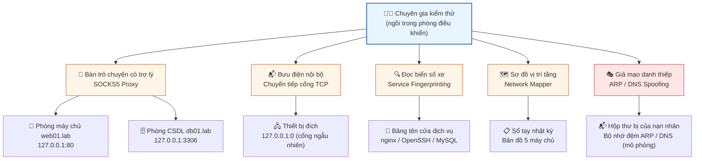
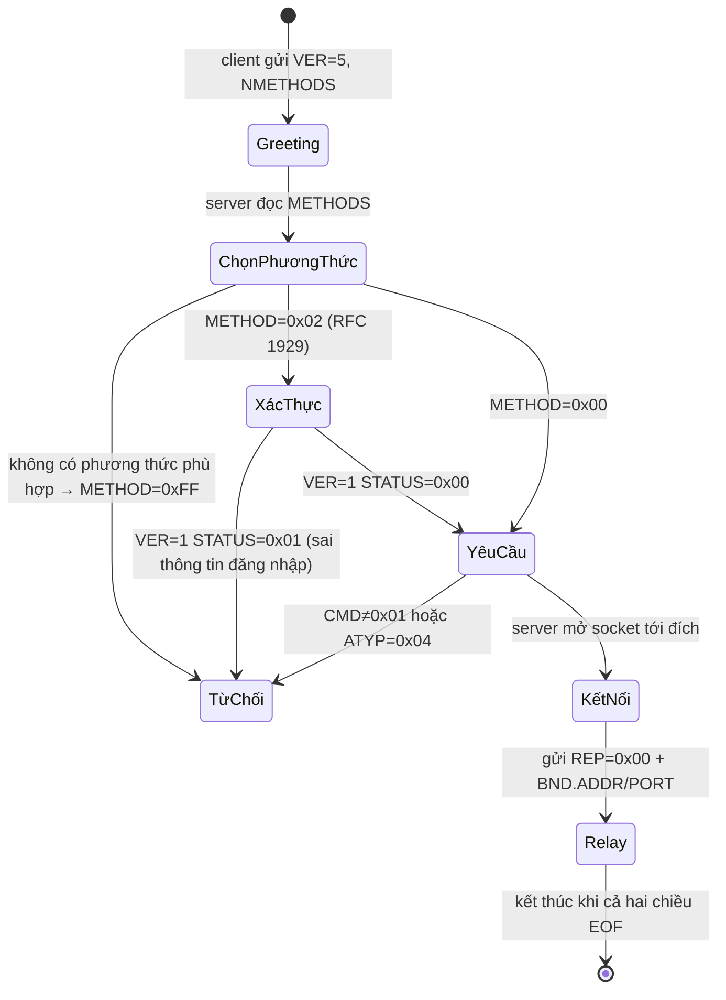
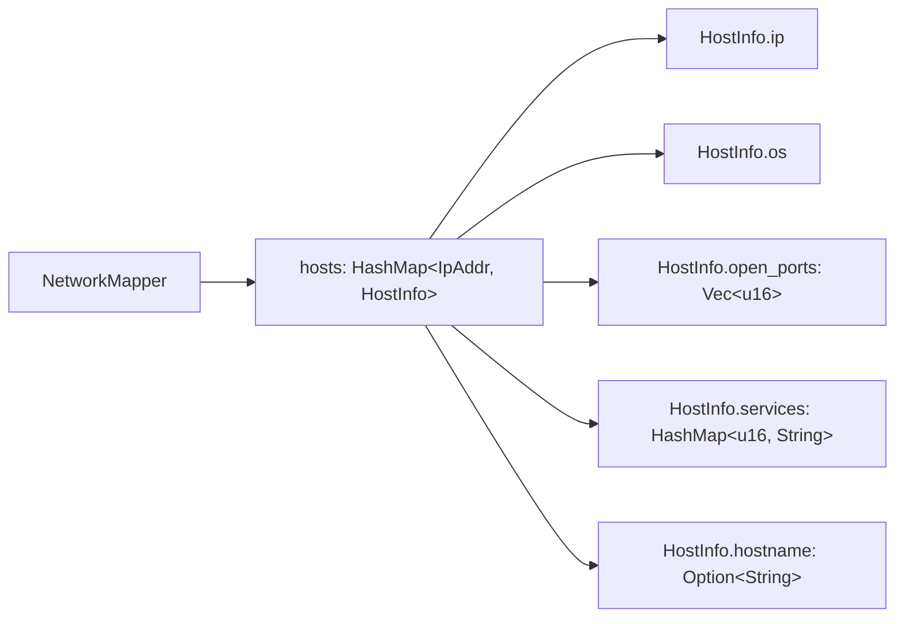

# Chương 99: Bộ Công cụ Thâm nhập Mạng — Proxy SOCKS5, Chuyển tiếp Cổng, Nhận dạng Dịch vụ & Đầu độc ARP/DNS (Network Pentest Toolkit: SOCKS5 Proxy, Port Forwarding, Service Fingerprinting & ARP/DNS Spoofing)

---

## 1. Giới thiệu & Mục tiêu

Chào mừng bạn đến với **Chương 99** — chương thứ hai của **Chủ đề 28** (Bộ công cụ thâm nhập mạng) trong giáo trình `learn-rs`. Sau Chương 98 (Khung bảo mật ứng dụng web: SQL Injection, XSS, CSRF & phòng thủ theo lớp), chương này đưa bạn ra khỏi tầng ứng dụng để chạm vào **tầng giao thức mạng** — nơi mà mọi lời nói giữa hai máy đều được mã hoá thành những chuỗi byte có thời gian sống rất ngắn.

Bốn mươi tám chương trước đã dạy bạn làm chủ Rust ở mức hệ thống: quyền sở hữu bộ nhớ, hệ thống phân loại kiểu tĩnh, lập trình đồng thời, bộ nhớ Disruptor không khóa, kiến trúc LLM/RLVR... Bây giờ, để khép kín chủ đề, chúng ta sẽ viết một bộ công cụ "đỏ" (red-team) hoàn chỉnh: **một proxy SOCKS5**, **một bộ chuyển tiếp cổng TCP**, **một máy nhận dạng dịch vụ**, **một trình lập bản đồ mạng**, và **hai bộ phân tích/ghi gói ARP & DNS kèm khả năng giả mạo**.

> ⚠️ **Nguyên tắc đạo đức — đọc trước khi chạy mã**
>
> Toàn bộ crate `ch99` được viết theo nguyên tắc **"an toàn theo thiết kế" (secure by design)**:
>
> 1. **Mọi socket đều chỉ bind trên `127.0.0.1` với cổng ngẫu nhiên (`port 0`)** — không bao giờ đụng tới một dịch vụ thật nào đang chạy trên máy bạn.
> 2. **Bộ phân giải tên miền mặc định (`default_resolver`) chỉ chấp nhận địa chỉ loopback** dạng văn bản; nó cố tình *không* gọi hệ thống DNS của máy.
> 3. **Máy chủ SOCKS5 từ chối kết nối tới địa chỉ không phải loopback** với thông điệp tiếng Việt rõ ràng.
> 4. **Dữ liệu đầu vào là tổng hợp**: mọi banner dịch vụ, mọi địa chỉ IP, mọi gói ARP/DNS đều do chính chương này sinh ra một cách tất định (deterministic).
> 5. **Cơ chế "đầu độc" (spoofing) chỉ tồn tại ở mức byte trên giấy.** `spoof_reply_for` và `spoof_response` *dựng ra một mảng byte*, chúng không bao giờ gửi gói tin ra NIC thật, không cần quyền `CAP_NET_RAW`, không đụng tới ARP cache hay DNS cache của hệ thống.
>
> Nói cách khác: chương này dạy bạn **đọc và viết đúng cấu trúc gói tin**, chứ không dạy bạn đi đánh sập một hệ thống của người khác. Trong nghề nghiệp, kỹ năng này chính là nền tảng của **ứng cứu sự cố (digital forensics)** và **giám sát an ninh (security monitoring)**: khi bạn hiểu chính xác một gói ARP trông như thế nào, bạn mới có thể viết bộ phát hiện xâm nhập (IDS) đáng tin cậy.

Toàn bộ crate được viết bằng **100% Rust 2024 thuần `std`**, `[dependencies]` **rỗng tuyệt đối**, không một dòng mã nguồn nào được sao chép từ Metasploit, Impacket hay bất kỳ framework khai thác nào. Toàn bộ tham chiếu là các **RFC công khai**: RFC 1928 (SOCKS5), RFC 1929 (SOCKS5 Authentication), RFC 826 (ARP), RFC 1035 (DNS) và RFC 791 (IPv4).

```
┌────────────────────────────────────────────────────────────────────────────────────────┐
│              BỘ CÔNG CỤ THÂM NHẬP MẠNG CH99 — KIẾN TRÚC 8 THÀNH PHẦN                      │
├────────────────────────────────────────────────────────────────────────────────────────┤
│                                                                                        │
│  [1] SplitMix64 — RNG tất định                                                        │
│       ├─ Sinh thứ tự quét cổng ngẫu nhiên hoá (Fisher–Yates)                            │
│       └─ Jitter port scan: không để nạn nhân đoán trước thứ tự quét                      │
│                                                                                        │
│  [2] Socks5Server / Socks5Client — Proxy SOCKS5 (RFC 1928 + RFC 1929)                  │
│       ├─ Bắt tay 3 bước: Greeting → Method Selection → Request CONNECT                 │
│       ├─ Xác thực: 0x00 (không xác thực) | 0x02 (user/pass theo RFC 1929)              │
│       └─ Ràng buộc an toàn: chỉ CONNECT, chỉ IPv4/loopback                              │
│                                                                                        │
│  [3] TcpPortForwarder + bidirectional_relay — Chuyển tiếp cổng TCP                       │
│       ├─ Relay hai chiều bằng 2 luồng + mô hình half-close (shutdown Write)             │
│       └─ RAII: Drop tự tắt cờ `active`                                                  │
│                                                                                        │
│  [4] ServiceFingerprinter — Nhận dạng dịch vụ từ banner                                │
│       ├─ 10 probe mặc định: HTTP/SSH/SMTP/MySQL/FTP/Redis/SMB/LDAP/POP3/IMAP            │
│       ├─ Trích phiên bản bằng "regex-lite" tự viết (không crate ngoài)                 │
│       └─ Chấm điểm tin cậy theo cổng + phiên bản + độ đặc thù của mẫu khớp               │
│                                                                                        │
│  [5] NetworkMapper — Lập bản đồ mạng                                                   │
│       └─ Báo cáo văn bản có thứ tự tất định (sắp xếp theo IP)                          │
│                                                                                        │
│  [6] ArpPacket — Phân tích & đầu độc bộ nhớ đệm ARP (RFC 826)                         │
│       ├─ Tải ARP 28 byte, tự nhận diện khung Ethernet 14 byte phía trước                │
│       └─ spoof_reply_for(): gói "IP của gateway nằm ở MAC của kẻ tấn công"              │
│                                                                                        │
│  [7] DnsPacket — Phân tích & giả mạo phản hồi DNS (RFC 1035)                          │
│       ├─ Mã hoá/giải mã tên miền có nén (con trỏ 0xC0)                                  │
│       └─ spoof_response(): chèn bản ghi A giả vào câu trả lời                            │
│                                                                                        │
│  [8] IpHeader + NetworkSimulator — Nền tảng phân tích & mô phỏng                        │
│       ├─ Suy luận hệ điều hành từ TTL (64/128/255) & cửa sổ TCP (65535/8192/29200)      │
│       └─ Mạng giả lập 5 máy chủ: web01 / db01 / files01 / mail01 / router.lab            │
│                                                                                        │
└────────────────────────────────────────────────────────────────────────────────────────┘
```

### Bảng Mục tiêu Học tập & Kỹ năng Đạt được

| Mục tiêu học tập | Vì sao bắt buộc phải tự cài đặt từ đầu? | Chuẩn đầu ra thực chứng |
|---|---|---|
| **Proxy SOCKS5 bắt tay 3 bước** | Hiểu đúng trạng thái của một giao thức *đàm phán* (negotiation) là nền tảng để viết client/proxy cho bất kỳ giao thức nào có "hello → negotiate → request → response". | Bắt tay thành công trên loopback; sai phiên bản, sai lệnh, sai ATYP đều bị từ chối bằng thông điệp tiếng Việt. |
| **Xác thực user/pass (RFC 1929)** | Biết cách kiểm tra thông tin đăng nhập mà **không** lưu mật khẩu dạng rõ và không log thông tin nhạy cảm. | Đăng nhập sai trả về `0x01 0x01` và `Err`; đăng nhập đúng mở được phiên. |
| **Relay hai chiều + half-close** | Đây là mô hình lõi của **mọi** proxy, tunnel, port-forward, và cả `kubectl port-forward`. Sai sót ở đây tạo ra treo socket (deadlock) khó chịu nhất trong lập trình mạng. | Tổng byte relay = tổng byte cả hai chiều; một chiều EOF không giết chiều còn lại. |
| **Nhận dạng dịch vụ & trích phiên bản** | Biết đọc "tiếng nói" của một dịch vụ (banner) để suy ra phần mềm đang chạy là bước đầu của mọi tấn công chuỗi cung ứng và cũng là nền tảng của quản lý lưu lượng. | HTTP/SSH/MySQL/SMB/Redis đều nhận dạng đúng tên **và** phiên bản kèm điểm tin cậy. |
| **Suy luận hệ điều hành từ TTL & cửa sổ TCP** | Đây là kỹ thuật "OS fingerprinting" kinh điển, dùng trong IDS/IPS và trong lập kế hoạch kiểm thử thâm nhập. | TTL 64 → Linux, 128 → Windows, 255 → thiết bị mạng; cửa sổ 65535 → Windows, 8192/29200 → Linux. |
| **Lập bản đồ mạng & báo cáo tất định** | Một bản đồ mạng **không tất định** là một bản đồ không đáng tin: không thể so sánh hai lần quét để phát hiện thay đổi. | Hai lần dựng bản đồ cho ra **cùng một chuỗi báo cáo** byte-for-byte. |
| **Phân tích & đầu độc ARP/DNS** | Hiểu cơ chế bộ nhớ đệm ARP và bộ nhớ đệm DNS là hiểu một trong những điểm yếu kinh điển nhất của mạng L2/L3 cũ. | Gói ARP 28 byte và gói DNS mã hoá → giải mã → mã hoá lại **giữ nguyên** toàn bộ trường. |
| **Tự viết "regex-lite" không crate** | Trong Rust chuẩn, `regex` là crate ngoài; viết bộ trích xuất phiên bản bằng `std` buộc bạn hiểu sâu thứ tự byte thay vì gọi hộp đen. | `extract_version` trả về đúng `nginx/1.18.0`, `SSH-2.0-OpenSSH_8.9p1`, `8.0.32-0ubuntu0.2`. |

### Bảng Ma trận 8 Bất biến Toán học & Hệ thống Bắt buộc Phải Chứng minh

Mọi hệ thống trong `learn-rs` đều được định nghĩa thông qua các **bất biến (invariants)**. Một hệ thống chỉ được coi là đạt chuẩn khi toàn bộ bất biến được kiểm chứng bằng kiểm thử phần mềm tự động — ở đây là **42 bài test** trong `code/ch99/src/main.rs`.

| STT | Bất biến toán học / hệ thống | Định nghĩa toán học | Cơ chế kiểm chứng trong mã nguồn |
|---|---|---|---|
| **1** | **SOCKS5 Handshake Integrity** | Với mọi client hợp lệ: $\text{phases} = \text{Greeting} \to \text{Method} \to \text{Request}$, và mọi sai lệch phải sinh ra `Err` chứ không phải panic. | `test_03` … `test_11`: bắt tay thành công + 5 biến thể lỗi (sai phiên bản, sai lệnh, IPv6, phương thức lạ, sai mật khẩu). |
| **2** | **Bidirectional Relay Conservation** | Tổng byte relay bằng đúng tổng byte hai chiều: $\sum_{i} b_i^{→} + \sum_{j} b_j^{←} = N$, và half-close không được diệt hết một chiều. | `test_12`, `test_15`: đo trực tiếp số byte relay qua proxy SOCKS5 và qua forwarder. |
| **3** | **Fingerprint Confidence Monotonicity** | Điểm tin cậy phải không giảm khi có thêm bằng chứng: $C = C_{port} + \alpha\mathbb{1}[v \neq \emptyset] + \beta\mathbb{1}[i=0]$ với $\alpha, \beta > 0$. | `test_16` … `test_20`: kiểm tra tên dịch vụ, phiên bản và ngưỡng điểm tin cậy cho từng loại banner. |
| **4** | **TTL ↔ OS Deterministic Mapping** | Ánh xạ TTL và cửa sổ TCP là hàm thuần: $f(f(x)) = f(x)$ và không mơ hồ. | `test_22`, `test_23`: quét toàn bộ giá trị biên (0, 32, 64, 128, 255) và giá trị lạ. |
| **5** | **Network Map Determinism** | Hai lần quét cùng một tập host cho ra cùng một báo cáo: $\text{report}(S_1) = \text{report}(S_2)$ với $S_1, S_2$ cùng tập dữ liệu. | `test_24` … `test_27`: thứ tự sắp xếp theo IP, cổng mở không trùng, tổng cổng đúng. |
| **6** | **ARP Wire-Fidelity (Round-trip)** | Mã hoá rồi giải mã phải giữ nguyên mọi trường: $\forall p \in \text{ArpPacket},\ \text{parse}(\text{to\_bytes}(p)) = p$. | `test_28`, `test_29`, `test_30`: round-trip tải thô, round-trip khung Ethernet 14 byte, từ chối opcode sai. |
| **7** | **DNS Name Compression Correctness** | Con trỏ nén phải cho đúng tên miền và đúng offset quay lại: $\text{decode}(\text{encode}(n)) = n$ và $\text{offset}_{next} = \text{offset}_{con trỏ} + 2$. | `test_33` … `test_40`: round-trip gói truy vấn, giải mã con trỏ nén, round-trip gói phản hồi có bản ghi A. |
| **8** | **Simulation ↔ Fingerprint Consistency** | Mọi dịch vụ trong mô phỏng đều phải được fingerprint nhận dạng đúng tên, và gói đầu độc phải mã hoá/giải mã tròn vẹn. | `test_42`: 5 host, 16 cổng mở, `http` trên cổng 80, gói ARP độc hại round-trip. |

---

## 2. Hình tượng hóa đời sống: Người thám hiểm trong "Tòa nhà kín" (Closed Lab)

Muốn hiểu một công cụ mạng, cách nhanh nhất là quy nó về một nghề nghiệp quen thuộc. Hãy hình dung bạn là **một chuyên gia an ninh mạng được thuê để kiểm tra (pentest) một tòa nhà văn phòng** — nhưng thay vì phá thật, bạn được đưa vào một **tòa nhà kín (closed lab)**: một mô phỏng hoàn hảo, có mô hình của mọi thiết bị, được dựng sẵn ở đúng vị trí, và **không có đường ra ngoài thế giới thật**.



### Hình tượng 1: Bàn trò chuyện có trợ lý = Proxy SOCKS5

Bạn cần nói chuyện với một người lạ ở tầng 5, nhưng bạn ở tầng 1 và không được ra khỏi tầng. Bạn thuê một **trợ lý (lễ tân)** đứng ở sảnh:

1. Bạn nói: *"Tôi muốn nói chuyện, tôi hỗ trợ cả cách không cần giấy tờ và cách có giấy tờ."* → Đây là **bản tin chào (greeting)**: `VER=5, NMETHODS=2, METHODS=[0x00, 0x02]`.
2. Lễ tân đáp: *"Được thôi, dùng giấy tờ nhé."* → **Lựa chọn phương thức**: `METHOD=0x02`.
3. Bạn đưa giấy tờ: *"Tên tôi là Quét, mật khẩu là ĐừngĐoán."* → **Sub-negotiation RFC 1929**: `VER=1, ULEN, USER, PLEN, PASS`.
4. Lễ tân nói: *"OK, phòng 5, cửa 80."* rồi **kết nối thay bạn** và chuyển mọi lời nói hai chiều.

Điểm mấu chốt của hình tượng này: **lễ tân chỉ chuyển tiếp, không đọc nội dung**. Đó chính là ý nghĩa của proxy. Và nếu bạn đưa sai giấy tờ, lễ tân sẽ từ chối *ngay lập tức* chứ không phải mở cửa rồi mới báo.

### Hình tượng 2: Bưu điện nội bộ = Chuyển tiếp cổng TCP

Trong tòa nhà có một **bàn giao nội bộ** ở tầng 1: mọi lá thư gửi tới địa chỉ "Bàn giao, phòng 3306" đều được chuyển tiếp xuống tầng hầm (nơi có CSDL thật). Nhân viên tầng 1 chỉ biết địa chỉ của bàn giao, không biết CSDL nằm ở đâu.

Điểm tinh tế nhất của hình tượng này là **cánh cửa một chiều**: khi nhân viên tầng 1 viết thư xong và đóng phong bì, bưu điện vẫn phải chuyển **thư trả lời từ tầng hầm về**. Nếu bưu điện chỉ "chuyển một chiều", thư trả lời sẽ không bao giờ tới. Trong lập trình mạng, hiện tượng "đóng nửa" (half-close) chính là cách bưu điện báo *"tôi hết giấy, nhưng hãy vẫn gửi thư trả lời cho tôi"*.

### Hình tượng 3: Đọc biển số xe = Service Fingerprinting

Khi bạn đi vào bãi xe của tòa nhà, mọi xe đều có biển số: `HTTP/1.1`, `SSH-2.0-OpenSSH_8.9p1`, `8.0.32-0ubuntu0.2`... Người bảo vệ đọc biển số để biết trong bãi có xe gì. Đó chính là **nhận dạng dịch vụ (service fingerprinting)**.

Chuyên gia giỏi không chỉ đọc biển số mà còn đánh giá **độ tin cậy**: một chiếc xe ghi "Nginx/1.18.0" trên cổng 443 chắc chắn là web server (tin cậy cao), còn một chiếc xe ghi "SSH-" trên cổng 8080 thì đáng ngờ hơn (tin cậy thấp hơn). Đây chính là công thức điểm tin cậy mà chương này hiện thực hoá.

### Hình tượng 4: Giả mạo danh thiếp = Đầu độc ARP/DNS

Trong tòa nhà, có hai loại danh thiếp:

- **Danh thiếp nội bộ (ARP)**: bảng "IP `10.10.10.254` ↔ biển số xe `02:00:00:00:00:FE`" mà mọi thiết bị trong tòa nhà đều tra cứu. Nếu bạn viết một tờ danh thiếp giả *"IP `10.10.10.254` là của tôi"* và đưa cho nạn nhân, nạn nhân sẽ gửi thư của mình cho bạn.
- **Danh thiếp tổng đài (DNS)**: bảng tra *"tên miền `bank.lab` ↔ địa chỉ `6.6.6.6`"*. Nếu bạn kịp trả lời trước máy chủ DNS thật, nạn nhân sẽ đi tới địa chỉ của bạn.

Cả hai đều là hành vi **tấn công giả mạo (spoofing)**, và cả hai đều chỉ có hiệu lực vì **bộ nhớ đệm của nạn nhân quá tin tưởng**. May mắn là ở chương này, tờ danh thiếp giả chỉ tồn tại dưới dạng `Vec<u8>` trên heap — nó không bao giờ rời khỏi tiến trình.

---

## 3. Khái niệm & Cơ chế kỹ thuật chuyên sâu

### 3.1 Proxy SOCKS5 — Giao thức đàm phán 3 bước (RFC 1928)

SOCKS5 là giao thức định tuyến ở tầng 5 (tầng ứng dụng), được thiết kế bởi Leech Heiman vào năm 1996 và chuẩn hoá trong RFC 1928. Điểm đặc biệt: SOCKS5 **không phụ thuộc vào giao thức bên trong** nó mang — nó có thể chuyển tiếp HTTP, SMTP, hay bất kỳ byte nào.

#### 3.1.1 Cấu trúc ba bản tin

**Bản tin 1 — Greeting (client → server):**

| Byte | Tên | Giá trị | Ý nghĩa |
|---|---|---|---|
| 0 | `VER` | `0x05` | Phiên bản SOCKS |
| 1 | `NMETHODS` | $1 \le n \le 255$ | Số phương thức xác thực được đề xuất |
| 2… | `METHODS` | biến thiên | Danh sách mã phương thức |

Các mã phương thức phổ biến: `0x00` = không cần xác thực, `0x01` = GSSAPI, `0x02` = user/pass (RFC 1929), `0xFF` = *"không có phương thức nào chấp nhận được"*.

**Bản tin 2 — Method Selection (server → client):**

| Byte | Tên | Giá trị |
|---|---|---|
| 0 | `VER` | `0x05` |
| 1 | `METHOD` | `0x00` / `0x02` / `0xFF` |

**Bản tin 3 — Request (client → server) và Response (server → client):**

| Byte | Request | Response |
|---|---|---|
| 0 | `VER = 0x05` | `VER = 0x05` |
| 1 | `CMD` (`0x01` = CONNECT) | `REP` (`0x00` = thành công) |
| 2 | `RSV = 0x00` | `RSV = 0x00` |
| 3 | `ATYP` | `ATYP` |
| 4… | `ADDR` + `PORT` | `BND.ADDR` + `BND.PORT` |

Ba kiểu địa chỉ (`ATYP`):

| `ATYP` | Ý nghĩa | Định dạng phần địa chỉ |
|---|---|---|
| `0x01` | IPv4 | 4 byte địa chỉ + 2 byte cổng (big-endian) |
| `0x03` | Tên miền | 1 byte độ dài + $n$ byte tên + 2 byte cổng |
| `0x04` | IPv6 | 16 byte địa chỉ + 2 byte cổng |

#### 3.1.2 Máy trạng thái của bắt tay



Điểm **then chốt về mặt an toàn**: bản tin `REP` (reply code) của SOCKS5 có 9 giá trị chuẩn hoá, và mã lỗi cho client biết *chính xác* chuyện gì đã xảy ra:

| `REP` | Tên | Ý nghĩa |
|---|---|---|
| `0x00` | Succeeded | Thành công |
| `0x01` | General failure | Lỗi chung |
| `0x02` | Connection not allowed by ruleset | Bị chính sách chặn |
| `0x03` | Network unreachable | Không tới được mạng |
| `0x04` | Host unreachable | Không tới được máy chủ |
| `0x05` | Connection refused | Máy chủ từ chối kết nối |
| `0x06` | TTL expired | TTL hết hạn |
| `0x07` | Command not supported | Lệnh không hỗ trợ |
| `0x08` | Address type not supported | Kiểu địa chỉ không hỗ trợ |

#### 3.1.3 Vì sao `handle_client` phải trả `Result<Socks5Session, String>`?

Một proxy chạy trong vòng lặp vô tận sẽ gặp client hỏng, client gửi dữ liệu rác, client ngắt kết nối giữa chừng. Nếu mỗi lỗi làm sập cả tiến trình thì proxy chết sau một client lỗi. Vì vậy toàn bộ `main.rs` của chương này tuân theo quy tắc:

$$\text{Kết quả xử lý} = \text{Result}\langle (\text{phiên}, \text{thông điệp lỗi}), \text{không bao giờ panic} \rangle$$

và thông điệp lỗi luôn **bằng tiếng Việt**, vì trong giáo trình này, người đọc là người Việt và phải hiểu được *tại sao* kết nối bị từ chối.

### 3.2 Chuyển tiếp cổng TCP và mô hình Relay hai chiều

#### 3.2.1 Vì sao cần 2 luồng?

Một luồng chỉ có thể làm một việc tại một thời điểm. Nếu ta dùng một luồng để đọc `A → B` rồi đọc `B → A`, thì khi `A` im lặng (đang chờ trả lời), ta sẽ **không bao giờ đọc được** dữ liệu `B → A`. Đây chính là nguồn gốc của cái deadlock kinh điển:

```
Luồng đơn:  read(A) ──► write(B) ──► read(A) ──► write(B) ──► ...
                                  └──► chờ A, trong khi B đang chờ ta đọc!
```

Vì vậy `bidirectional_relay` tách thành hai luồng:

$$\text{Relay}(A, B) = \underbrace{T_1}_{\text{sao chép } A \to B} \parallel \underbrace{T_2}_{\text{sao chép } B \to A}$$

Rust cho phép `std::net::TcpStream::try_clone()` tạo nhiều *file descriptor* cùng tham chiếu một socket. Nhờ đó, mỗi luồng sở hữu một bản sao riêng mà vẫn nói chuyện trên **cùng một kết nối TCP**.

#### 3.2.2 Half-close: kỹ thuật "đóng một chiều"

Khi chiều $A \to B$ kết thúc (EOF), ta **không** được đóng socket — nếu đóng, chiều $B \to A$ chết theo. Thay vào đó, ta gọi:

```rust
dst.shutdown(Shutdown::Write)
```

Tương đương với nửa kính TCP: "Tôi không gửi thêm nữa, nhưng tôi vẫn muốn nghe". Kết quả là người ở đầu bên kia nhận được EOF ở chiều đọc, nhưng vẫn gửi được dữ liệu ngược lại.

Đây cũng chính là lý do bài test `test_15` phải dùng **hai socket riêng biệt** cho phần ứng dụng và phần relay: nếu dùng chung một socket ( qua `try_clone`), thì lệnh `shutdown(Write)` của relay sẽ "xuyên" sang socket của ứng dụng và tạo EOF giả.

#### 3.2.3 RAII cho chuyển tiếp cổng

`TcpPortForwarder` tuân theo mẫu **RAII** (Resource Acquisition Is Initialization) của Rust:

```rust
impl Drop for TcpPortForwarder {
    fn drop(&mut self) {
        self.active = false;
    }
}
```

Khi forwarder rơi khỏi phạm vi — dù do trả về sớm, do `panic`, hay do `?` — Rust **tự động** gọi `Drop`, và cờ `active` được tắt. Không có cách nào "quên" dọn dẹp. Đây là ưu điểm lớn nhất của Rust so với C++ về mặt quản lý vòng đời tài nguyên.

### 3.3 Nhận dạng dịch vụ (Service Fingerprinting)

#### 3.3.1 Mô hình probe – banner – matcher

Mỗi dịch vụ trả về một **banner** (chuỗi byte "tự giới thiệu") ngay khi client kết nối, hoặc sau khi nhận đúng một payload kích thích. Bộ nhận dạng của ta gồm ba khái niệm:

| Khái niệm | Rust type | Ý nghĩa |
|---|---|---|
| Probe | `ServiceProbe` | Một "công cụ thăm dò": tên, cổng, payload gửi đi, danh sách mẫu khớp |
| Matcher | `(&'static str, &'static str)` | Cặp `(tên dịch vụ, mẫu byte cần xuất hiện trong banner)` |
| Kết quả | `ServiceMatch` | Tên dịch vụ, phiên bản trích được, điểm tin cậy |

Danh mục mặc định của chương:

| Tên | Cổng | Payload gửi đi | Mẫu khớp |
|---|---|---|---|
| `http` | 80 | `GET / HTTP/1.0\r\nHost: probe.local\r\n\r\n` | `HTTP/1.`, `Server:` |
| `ssh` | 22 | *(không gửi, chờ banner)* | `SSH-` |
| `smtp` | 25 | `EHLO probe.local\r\n` | `220 `, `250 ` |
| `mysql` | 3306 | *(chờ greeting)* | `\n8.0`, `\n5.7`, `\n10.` |
| `ftp` | 21 | *(chờ banner)* | `220` |
| `redis` | 6379 | `PING\r\n` | `+PONG`, `-NOAUTH` |
| `smb` | 445 | *(chờ banner)* | `SMB` |
| `ldap` | 389 | *(chờ phản hồi Bind)* | `a\x7f` |
| `pop3` | 110 | *(chờ banner)* | `+OK` |
| `imap` | 143 | *(chờ banner)* | `* OK` |

#### 3.3.2 Công thức điểm tin cậy

Không phải dịch vụ nào cũng dùng cổng chuẩn (một web server chạy trên cổng 8080 vẫn là web server), nên bộ nhận dạng dùng **chiến lược hai tầng**:

1. **Tầng 1**: thử probe có cổng khớp `port`.
2. **Tầng 2**: nếu tầng 1 thất bại, quét toàn bộ danh mục để bắt dịch vụ "chạy nhầm cổng".

Điểm tin cậy được tính như sau:

$$C = \min\Big(1.0,\ \underbrace{C_{port}}_{\text{có/không khớp cổng}} + \alpha \cdot \mathbb{1}[v \neq \emptyset] + \beta \cdot \mathbb{1}[i = 0]\Big)$$

với:

$$C_{port} = \begin{cases} 0.60 & \text{khớp cổng} \\ 0.40 & \text{chỉ khớp nội dung} \end{cases}, \qquad \alpha = 0.25,\ \beta = 0.15$$

Trong đó $v$ là phiên bản trích được, $i$ là chỉ số của mẫu khớp trong danh sách (mẫu đầu tiên là mẫu đặc trưng nhất nên được tin hơn).

Bảng tra điểm tin cậy:

| Tình huống | $C_{port}$ | Có phiên bản | Mẫu đầu tiên | Tổng |
|---|---|---|---|---|
| HTTP trên cổng 80, có `Server:` | 0.60 | +0.25 | +0.15 | **1.00** |
| HTTP trên cổng 8080 (khớp cổng, mẫu thứ 2) | 0.60 | +0.25 | +0 | **0.85** |
| SSH trên cổng lạ (chỉ khớp nội dung) | 0.40 | +0.25 | +0.15 | **0.80** |
| LDAP không có phiên bản | 0.60 | +0 | +0.15 | **0.75** |

#### 3.3.3 Trích xuất phiên bản bằng "regex-lite"

Vì `[dependencies]` phải rỗng, ta không dùng crate `regex`. Thay vào đó, `extract_version` dùng ba nguyên thủy byte:

| Hàm | Nguyên lý |
|---|---|
| `take_line(bytes, start)` | Lấy tới hết dòng (`\r` hoặc `\n`) rồi `trim()` |
| `take_token(bytes, start)` | Bỏ khoảng trắng dẫn đầu, lấy tới khoảng trắng kế tiếp |
| `find_version_token(text)` | Tách theo khoảng trắng, lấy token **có cả chữ số và dấu chấm** (ví dụ `1.3.5`) |

Áp dụng:

| Dịch vụ | Banner | Kết quả `extract_version` |
|---|---|---|
| `http` | `HTTP/1.1 200 OK\r\nServer: nginx/1.18.0 (Ubuntu)\r\n` | `nginx/1.18.0` |
| `ssh` | `SSH-2.0-OpenSSH_8.9p1 Ubuntu-3ubuntu0.4\r\n` | `SSH-2.0-OpenSSH_8.9p1` |
| `mysql` | `\x0a8.0.32-0ubuntu0.2\x00...` | `8.0.32-0ubuntu0.2` |
| `ftp` | `220-ProFTPD 1.3.5 Server (Debian)` | `1.3.5` |
| `smb` | `\xffSMB\x72...` | `SMBv1` |

### 3.4 Suy luận hệ điều hành từ dấu vân tay mạng

#### 3.4.1 TTL — con số "nói nhiều nhất" trên mạng

Mỗi gói IP có một trường **TTL** (Time To Live). Mỗi bước định tuyến, TTL giảm 1; khi về 0, gói bị hủy. Từ đó suy ra một **quy ước bất thành văn** giữa các hệ điều hành:

| TTL khởi đầu | Hệ điều hành điển hình | Giải thích |
|---|---|---|
| 64 | Linux / Unix / BSD | Quy ước phổ biến nhất (64 = 1 phút) |
| 128 | Windows | Quy ước của Microsoft |
| 255 | Router, switch, firewall, thiết bị mạng | Quy ước của hầu hết phần cứng nhúng |
| Khác | *Không xác định* | Có thể đã bị giả mạo hoặc tuỳ biến |

Hàm `detect_os_from_ttl` là một hàm **thuần** (pure function): cùng đầu vào luôn cho cùng đầu ra, không phụ thuộc trạng thái, không phụ thuộc thời gian.

#### 3.4.2 Kích thước cửa sổ TCP — vân tay thứ hai

Trong bản ghi SYN, trường `window size` tiết lộ dung lượng bộ đệm của hệ điều hành:

| `window` | Hệ điều hành điển hình |
|---|---|
| 65535 | Windows (Windows XP dùng giá trị cực đại) |
| 8192 | Linux (cấu hình mặc định cũ) |
| 29200 | Linux (bản vá kernel sau năm 2003) |
| Khác | *Không xác định* |

#### 3.4.3 Vì sao phải kết hợp *hai* tín hiệu?

Vì cả hai đều **có thể bị giả mạo**: một kẻ tấn công có thể đặt TTL = 64 để giả vờ Linux. Đó chính là lý do bộ nhận dạng dùng **điểm tin cậy** thay vì kết luận tuyệt đối: hệ thống giáo trình này dạy bạn *cách suy luận và mức độ tin cậy*, chứ không dạy bạn tin tuyệt đối vào dữ liệu mạng.

### 3.5 Lập bản đồ mạng (Network Mapper)

Bản đồ mạng là cấu trúc dữ liệu trung tâm của mọi công cụ quét lưới (grid scanning):



Ba phép toán cơ bản:

| Hàm | Bất biến bảo toàn |
|---|---|
| `add_host(ip, hostname)` | Không ghi đè `hostname` đã biết bằng `None`; mỗi IP đếm đúng một lần |
| `record_service(ip, port, service)` | `open_ports` **không có trùng lặp**; `services` là bản đồ cổng → tên |
| `record_os(ip, os)` | Ghi đè hệ điều hành nếu có thông tin mới |

**Tính tất định của báo cáo**: vì `HashMap` trong Rust **không** bảo đảm thứ tự duyệt, `to_report()` phải **sắp xếp** các host theo địa chỉ IP trước khi in:

$$\text{sort\_by\_key}((ip, \_)) \Rightarrow \text{thứ tự tất định} \Rightarrow \text{báo cáo tái lập được}$$

Đây là bài học lớn: **mọi đầu ra mà con người đọc hoặc máy so sánh đều phải tất định**.

### 3.6 Gói ARP và đầu độc bộ nhớ đệm ARP (RFC 826)

#### 3.6.1 Bố cục tải ARP

ARP dùng để ánh xạ **địa chỉ lớp 3** (IP) sang **địa chỉ lớp 2** (MAC) trong mạng cục bộ. Tải ARP cố định 28 byte:

| Offset | Độ dài | Trường | Giá trị mẫu |
|---|---|---|---|
| 0 | 2 | `HTYPE` | `0x0001` (Ethernet) |
| 2 | 2 | `PTYPE` | `0x0800` (IPv4) |
| 4 | 1 | `HLEN` | `6` (độ dài địa chỉ phần cứng) |
| 5 | 1 | `PLEN` | `4` (độ dài địa chỉ giao thức) |
| 6 | 2 | `OPER` | `1` = Request, `2` = Reply |
| 8 | 6 | `SHA` | MAC của người gửi |
| 14 | 4 | `SPA` | IP của người gửi |
| 18 | 6 | `THA` | MAC của người nhận (thường toàn 0 trong Request) |
| 24 | 4 | `TPA` | IP của người nhận |

Khi bắt được trên NIC, gói ARP thực tế còn có **14 byte header Ethernet** phía trước (6 byte MAC đích + 6 byte MAC nguồn + 2 byte EtherType `0x0806`). Vì vậy `ArpPacket::parse` phải **tự dò** vị trí bắt đầu:

$$offset = \begin{cases} 0 & \text{nếu byte 0..6 khớp HTYPE/PTYPE/HLEN/PLEN} \\ 14 & \text{nếu khung Ethernet đầy đủ} \\ 12 & \text{nếu chỉ có header MAC 12 byte} \end{cases}$$

#### 3.6.2 Cơ chế đầu độc bộ nhớ đệm ARP

Khi máy A cần gửi gói tới IP $G$ (gateway) mà chưa biết MAC của $G$, nó phát **ARP Request** đến địa chỉ broadcast. Mọi máy trong miền broadcast đều nhận được, nhưng chỉ máy có IP $G$ mới trả lời.

Bộ nhớ đệm ARP của máy A thường lưu bản ghi trong **vài giây tới vài phút**. Đó là điểm yếu cốt lõi: nếu kẻ tấn công gửi tới A một **ARP Reply giả**:

$$\text{Sender IP} = G \quad \text{(IP của gateway)}, \qquad \text{Sender MAC} = M_{attacker}$$

thì A sẽ ghi bản ghi sai vào bộ nhớ đệm và gửi mọi gói "đi ra ngoài Internet" cho kẻ tấn công. Đó là **ARP cache poisoning** (đầu độc bộ nhớ đệm ARP).

Hàm `spoof_reply_for` mô phỏng đúng gói đó:

$$p_{poison} = \big(\text{Reply},\ M_{attacker},\ IP_{attacker},\ MAC_{victim},\ IP_{victim}\big)$$

trong đó `MAC_victim` và `IP_victim` được lấy từ chính yêu cầu ARP mà nạn nhân gửi ra — đó là thông tin kẻ tấn công *đã tiếp cận được* một cách hợp lệ.

### 3.7 Gói DNS và giả mạo phản hồi (RFC 1035)

#### 3.7.1 Cấu trúc gói DNS

Mỗi gói DNS có 12 byte header:

| Offset | Độ dài | Trường | Ý nghĩa |
|---|---|---|---|
| 0 | 2 | `ID` | Mã định danh giao dịch |
| 2 | 2 | `FLAGS` | Bit `QR` (query/response), `RD`, `RA`, `RCODE` |
| 4 | 2 | `QDCOUNT` | Số câu hỏi |
| 6 | 2 | `ANCOUNT` | Số bản ghi trả lời |
| 8 | 2 | `NSCOUNT` | Số bản ghi chính (authority) |
| 10 | 2 | `ARCOUNT` | Số bản ghi bổ sung (additional) |

Sau header là: các **Question** (name + QTYPE + QCLASS) rồi các **Record** (name + TYPE + CLASS + TTL + RDLENGTH + RDATA).

#### 3.7.2 Mã hoá tên miền và nén tên (name compression)

Tên miền được mã hoá theo dạng **nhãn** (label): mỗi nhãn là 1 byte độ dài + các byte nội dung, kết thúc bằng byte `0x00`:

```
"api.v2.example.com"  →  03 'a' 'p' 'i'  02 'v' '2'  07 "example"  03 "com"  00
```

Để tiết kiệm không gian, DNS cho phép **con trỏ nén** (RFC 1035 §4.1.4): byte đầu có hai bit cao bằng `11` báo hiệu "đây là con trỏ tới offset 14 bit còn lại":

$$\text{pointer} = \big((b_0 \mathbin{\&} 0x3F) \ll 8\big) \mathbin{|} b_1$$

Điểm khó nhất khi giải mã: sau khi theo con trỏ, **offset trả về cho caller phải là vị trí ngay sau con trỏ**, chứ không phải vị trí sau tên miền đã giải mã. Vì vậy hàm trả về một cặp:

```rust
pub fn decode_name(bytes: &[u8], offset: usize) -> Result<(String, usize), String>
```

và có một **bộ đếm chống lặp** (`jumps > 16`) để một gói DNS độc hại không gây treo vòng lặp vô hạn.

#### 3.7.3 Cơ chế giả mạo phản hồi (DNS spoofing)

Bộ nhớ đệm DNS của máy chủ (resolver) lưu bản ghi theo TTL. Nếu kẻ tấn công **trả lời trước** máy chủ DNS thật (hoặc giả mạo IP của máy chủ DNS thật), resolver sẽ nhận phản hồi giả:

$$p_{spoof} = (\text{Response},\ ID_{query},\ [(\text{name},\ A,\ TTL,\ IP_{attacker})])$$

Điểm mấu chốt: **mã định danh `ID` phải trùng với câu hỏi** — đó là cơ chế duy nhất để resolver ghép câu hỏi với câu trả lời. Trong chương này, `query_id_for` dùng **FNV-1a 32 bit** trên tên miền để sinh `ID` **tất định**:

$$h_{n+1} = (h_n \oplus b_n) \cdot 16777619 \pmod{2^{32}}, \qquad h_0 = 2166136261$$

### 3.8 Header IPv4 và phân tích TTL

Header IPv4 tối giản 20 byte:

| Offset | Độ dài | Trường |
|---|---|---|
| 0 | 1 | `VERSION` (4 bit cao) + `IHL` (4 bit thấp) |
| 1 | 1 | `TOS` (loại dịch vụ) |
| 2 | 2 | `TOTAL LENGTH` |
| 4 | 2 | `IDENTIFICATION` |
| 6 | 2 | `FLAGS` + `FRAGMENT OFFSET` |
| 8 | 1 | `TTL` ← **trường quan tâm nhất** |
| 9 | 1 | `PROTOCOL` (6 = TCP, 17 = UDP) |
| 10 | 2 | `HEADER CHECKSUM` |
| 12 | 4 | `SOURCE ADDRESS` |
| 16 | 4 | `DESTINATION ADDRESS` |

`IHL` là độ dài header tính theo **từ 32-bit**: $IHL = 5 \Rightarrow 5 \times 4 = 20$ byte. `IpHeader::parse` kiểm tra $VERSION = 4$ và $IHL \ge 5$, trả về lỗi tiếng Việt nếu vi phạm.

### 3.9 Mô phỏng mạng tất định và thứ tự quét ngẫu nhiên hoá

#### 3.9.1 Mạng giả lập 5 máy chủ

| IP | Hostname | HĐH | Cổng mở | Banner tiêu biểu |
|---|---|---|---|---|
| `10.10.10.5` | `web01.lab` | Linux | 80, 443, 8080 | `HTTP/1.1 200 OK` + `Server: nginx/1.18.0` |
| `10.10.10.10` | `db01.lab` | Linux | 22, 3306 | `SSH-2.0-OpenSSH_8.9p1`, greeting MySQL `8.0.32` |
| `10.10.10.20` | `files01.lab` | Linux | 21, 139, 445 | `220-ProFTPD 1.3.5`, header `\xFFSMB` |
| `10.10.10.30` | `mail01.lab` | Windows | 25, 110, 143, 389, 587 | `220 ... ESMTP`, `+OK`, `* OK`, BindResponse LDAP |
| `10.10.10.254` | `router.lab` | NetworkDevice | 22, 23, 161 | `SSH-2.0-OpenSSH_7.4p1 Cisco` |

#### 3.9.2 Vì sao phải ngẫu nhiên hoá thứ tự quét?

Nếu quét cổng theo thứ tự tuần tự `1, 2, 3, ...`, một hệ thống phòng thủ dựa trên ngưỡng "quét nhanh bất thường" sẽ phát hiện bạn ngay lập tức. Ngẫu nhiên hoá (và thêm *jitter* giữa các lần thử) làm cho hình dạng lưu lượng trông giống lưu lượng người dùng thật.

Thuật toán **Fisher–Yates** cho phép hoán vị đều trong $O(n)$:

```text
for i = n-1 downto 1:
    j = random(0, i)      // chỉ dùng rng.next_u64() % (i+1)
    swap(a[i], a[j])
```

Điểm mấu chốt của chương: **rng phải tất định**. `SplitMix64` với hạt giống cố định cho cùng một thứ tự quét trên mọi máy, mọi lần chạy — điều này làm cho **bài kiểm thử có tính lặp lại (repeatable)**.

---

## 4. Mã nguồn minh họa thực chiến

Trong phần này, chúng ta đi qua những đoạn mã **nguyên văn** từ `code/ch99/src/main.rs`.

### 4.1 Bộ sinh số tất định và thứ tự quét cổng

```rust
/// Bộ sinh số giả ngẫu nhiên 64-bit tất định `SplitMix64`.
///
/// Thiết kế dùng struct với trường có tên (named fields), cho phép tái lập 100%
/// mọi kết quả lấy mẫu trên mọi kiến trúc CPU mà không phụ thuộc thư viện ngoài.
/// Trong chương này, nó được dùng để tạo *thứ tự quét cổng* ngẫu nhiên hoá (port scan
/// order) và các khoảng trễ jitter giả lập.
#[derive(Debug, Clone, Copy, PartialEq, Eq)]
pub struct SplitMix64 {
    /// Trạng thái thanh ghi 64-bit nội bộ
    pub state: u64,
}

impl SplitMix64 {
    /// Khởi tạo bộ sinh số với hạt giống cố định
    pub const fn new(seed: u64) -> Self {
        Self { state: seed }
    }

    /// Sinh số nguyên không dấu 64-bit ngẫu nhiên tiếp theo
    pub fn next_u64(&mut self) -> u64 {
        self.state = self.state.wrapping_add(0x9E37_79B9_7F4A_7C15);
        let mut z = (self.state ^ (self.state >> 30)).wrapping_mul(0xBF58_476D_1CE4_E5B9);
        z = (z ^ (z >> 27)).wrapping_mul(0x94D0_49BB_1331_11EB);
        z ^ (z >> 31)
    }

    /// Sinh số thực dấu phẩy động trong nửa khoảng `[0.0, 1.0)`
    pub fn next_f64(&mut self) -> f64 {
        let u = (self.next_u64() >> 11) as f64;
        u * (1.0 / ((1u64 << 53) as f64))
    }
```

### 4.2 Bắt tay SOCKS5 — bước 1: Greeting và lựa chọn phương thức

```rust
    pub fn handle_client_with_target(
        &self,
        stream: &mut TcpStream,
        resolver: &dyn Fn(&str, u16) -> Option<SocketAddr>,
    ) -> Result<Socks5Session, String> {
        // Timeout cho bước bắt tay để một client treo không chặn vô hạn server
        let _ = stream.set_read_timeout(Some(Duration::from_secs(5)));

        // ---------------- Bước 1: Greeting ----------------
        let mut head = [0u8; 2];
        read_exact(stream, &mut head)?;
        if head[0] != 0x05 {
            return Err(format!(
                "Phiên bản SOCKS không hợp lệ: 0x{:02X} (mong đợi 0x05)",
                head[0]
            ));
        }
        let nmethods = usize::from(head[1]);
        if nmethods == 0 {
            return Err("Bản tin chào SOCKS5 không chứa phương thức xác thực nào".to_string());
        }
        let mut methods = vec![0u8; nmethods];
        read_exact(stream, &mut methods)?;

        let offers_none = methods.contains(&0x00);
        let offers_userpass = methods.contains(&0x02);

        let selected = if self.require_auth {
            if !offers_userpass {
                let _ = stream.write_all(&[0x05, 0xFF]);
                return Err(
                    "Máy chủ yêu cầu xác thực user/pass nhưng client không hỗ trợ".to_string(),
                );
            }
            0x02u8
        } else if offers_none {
            0x00u8
        } else if offers_userpass {
            0x02u8
        } else {
            // Theo RFC 1928: METHOD = 0xFF nghĩa là "không có phương thức chấp nhận được"
            let _ = stream.write_all(&[0x05, 0xFF]);
            return Err("Không tìm thấy phương thức xác thực SOCKS5 được hỗ trợ".to_string());
        };

        stream
            .write_all(&[0x05, selected])
            .map_err(|e| format!("Lỗi gửi lựa chọn phương thức SOCKS5: {e}"))?;
```

### 4.3 Bắt tay SOCKS5 — bước 2: xác thực user/pass theo RFC 1929

```rust
        // ---------------- Bước 2 (tuỳ chọn): User/Password theo RFC 1929 ----------------
        if selected == 0x02 {
            let mut sub = [0u8; 2];
            read_exact(stream, &mut sub)?;
            if sub[0] != 0x01 {
                return Err(format!(
                    "Phiên bản sub-negotiation user/pass không hợp lệ: 0x{:02X}",
                    sub[0]
                ));
            }
            let mut user = vec![0u8; usize::from(sub[1])];
            read_exact(stream, &mut user)?;
            let mut plen = [0u8; 1];
            read_exact(stream, &mut plen)?;
            let mut pass = vec![0u8; usize::from(plen[0])];
            read_exact(stream, &mut pass)?;

            let user_str = String::from_utf8_lossy(&user).to_string();
            let pass_str = String::from_utf8_lossy(&pass).to_string();
            let accepted = self
                .credentials
                .iter()
                .any(|(u, p)| *u == user_str && *p == pass_str);

            if accepted {
                stream
                    .write_all(&[0x01, 0x00])
                    .map_err(|e| format!("Lỗi gửi xác nhận đăng nhập SOCKS5: {e}"))?;
            } else {
                let _ = stream.write_all(&[0x01, 0x01]);
                return Err("Thông tin đăng nhập SOCKS5 không hợp lệ".to_string());
            }
        }
```

### 4.4 Bắt tay SOCKS5 — bước 3: Request CONNECT và ràng buộc loopback

```rust
        // ---------------- Bước 3: Request CONNECT ----------------
        let mut req = [0u8; 4];
        read_exact(stream, &mut req)?;
        if req[0] != 0x05 {
            return Err(format!(
                "Phiên bản SOCKS trong yêu cầu không hợp lệ: 0x{:02X}",
                req[0]
            ));
        }
        if req[1] != 0x01 {
            return Err(format!(
                "Chỉ hỗ trợ lệnh CONNECT (0x01), nhận: 0x{:02X}",
                req[1]
            ));
        }

        let target = match req[3] {
            0x01 => {
                let mut ip = [0u8; 4];
                read_exact(stream, &mut ip)?;
                let mut port = [0u8; 2];
                read_exact(stream, &mut port)?;
                SocketAddr::new(Ipv4Addr::from(ip).into(), u16::from_be_bytes(port))
            }
            0x03 => {
                let mut len = [0u8; 1];
                read_exact(stream, &mut len)?;
                let mut raw_name = vec![0u8; usize::from(len[0])];
                read_exact(stream, &mut raw_name)?;
                let mut port = [0u8; 2];
                read_exact(stream, &mut port)?;
                let host = String::from_utf8_lossy(&raw_name).to_string();
                let port = u16::from_be_bytes(port);
                match resolver(&host, port) {
                    Some(addr) => addr,
                    None => return Err(format!("Không phân giải được tên miền: {host}")),
                }
            }
            0x04 => {
                return Err("Chưa hỗ trợ địa chỉ IPv6 trong SOCKS5 (ATYP = 0x04)".to_string());
            }
            other => {
                return Err(format!(
                    "Mã kiểu địa chỉ SOCKS5 không hợp lệ: 0x{other:02X}"
                ));
            }
        };

        // Ràng buộc an toàn: chỉ kết nối tới loopback trong môi trường giáo trình
        if !target.ip().is_loopback() {
            return Err(format!(
                "Chỉ hỗ trợ kết nối tới loopback trong môi trường giáo trình, nhận: {target}"
            ));
        }
```

### 4.5 Relay hai chiều và kỹ thuật half-close

```rust
/// Chuyển tiếp dữ liệu hai chiều giữa hai socket bằng 2 luồng, trả về tổng số byte đã relay
///
/// Mỗi luồng sao chép theo một chiều và thực hiện **half-close** (`shutdown(Write)`) khi
/// chiều đó kết thúc, nhờ đó một chiều EOF không làm giết chết chiều còn lại.
pub fn bidirectional_relay(a: &mut TcpStream, b: &mut TcpStream) -> std::io::Result<usize> {
    let a_reader = a.try_clone()?;
    let a_writer = a.try_clone()?;
    let b_reader = b.try_clone()?;
    let b_writer = b.try_clone()?;

    let forward = std::thread::spawn(move || relay_half(a_reader, b_writer));
    let backward = std::thread::spawn(move || relay_half(b_reader, a_writer));

    let fwd_bytes = forward.join().unwrap_or(0);
    let bwd_bytes = backward.join().unwrap_or(0);
    Ok(fwd_bytes + bwd_bytes)
}

/// Sao chép byte từ `src` sang `dst` cho tới khi EOF, trả về số byte đã sao chép
fn relay_half(mut src: TcpStream, mut dst: TcpStream) -> usize {
    let mut buf = [0u8; 8192];
    let mut total = 0usize;
    loop {
        match src.read(&mut buf) {
            Ok(0) => break,
            Ok(n) => {
                if dst.write_all(&buf[..n]).is_err() {
                    break;
                }
                total += n;
            }
            Err(_) => break,
        }
    }
    // Half-close: báo cho đầu bên kia biết chiều này đã kết thúc
    let _ = dst.shutdown(Shutdown::Write);
    total
}
```

### 4.6 RAII cho forwarder

```rust
impl TcpPortForwarder {
    /// Khởi tạo forwarder ở trạng thái hoạt động
    pub fn new(local_addr: SocketAddr, remote_addr: SocketAddr) -> Self {
        Self {
            local_addr,
            remote_addr,
            active: true,
        }
    }

    /// Chuyển tiếp dữ liệu hai chiều giữa `local` và `remote`, trả về tổng số byte đã relay
    ///
    /// Nếu forwarder đã bị tắt (`active == false`) hàm trả về lỗi `BrokenPipe`.
    pub fn forward_once(
        &self,
        local: &mut TcpStream,
        remote: &mut TcpStream,
    ) -> std::io::Result<usize> {
        if !self.active {
            return Err(std::io::Error::new(
                std::io::ErrorKind::BrokenPipe,
                "Forwarder đã bị tắt, không thể chuyển tiếp dữ liệu",
            ));
        }
        bidirectional_relay(local, remote)
    }

    /// Tắt forwarder (đóng cổng nghe theo quy ước RAII của crate)
    pub fn shutdown(&mut self) {
        self.active = false;
    }

    /// Chấp nhận một kết nối từ `listener`, mở kết nối tới đích rồi relay hai chiều
    pub fn accept_and_forward(&self, listener: &TcpListener) -> std::io::Result<usize> {
        if !self.active {
            return Err(std::io::Error::new(
                std::io::ErrorKind::BrokenPipe,
                "Forwarder đã bị tắt, không thể chấp nhận kết nối mới",
            ));
        }
        let (mut local, _peer) = listener.accept()?;
        let mut remote = TcpStream::connect(self.remote_addr)?;
        self.forward_once(&mut local, &mut remote)
    }
}

impl Drop for TcpPortForwarder {
    /// RAII: khi forwarder rơi khỏi phạm vi, cờ trạng thái được tự động tắt
    fn drop(&mut self) {
        self.active = false;
    }
}```

### 4.7 Nhận dạng dịch vụ và công thức điểm tin cậy

```rust
    /// Nhận dạng dịch vụ từ banner nhận về trên cổng `port`
    ///
    /// Chiến lược hai tầng: (1) ưu tiên probe có cổng khớp; (2) nếu không khớp, quét toàn bộ
    /// danh mục để bắt dịch vụ đang chạy trên cổng "lạ".
    pub fn fingerprint(&self, port: u16, response: &[u8]) -> Option<ServiceMatch> {
        if let Some(probe) = self.probes.iter().find(|p| p.port == port)
            && let Some(found) = match_probe(probe, response, true)
        {
            return Some(found);
        }

        for probe in &self.probes {
            if probe.port == port {
                continue;
            }
            if let Some(found) = match_probe(probe, response, false) {
                return Some(found);
            }
        }

        None
    }
}```

### 4.8 Trích xuất phiên bản bằng "regex-lite"

```rust
/// Trích xuất phiên bản dịch vụ từ banner (regex-lite tự viết, không dùng crate ngoài)
pub fn extract_version(service: &str, response: &[u8]) -> String {
    match service {
        "http" => {
            // Ưu tiên giá trị của header "Server:" (ví dụ "nginx/1.18.0")
            if let Some(pos) = find_bytes(response, b"Server:") {
                let value = take_token(response, pos + 7);
                if !value.is_empty() {
                    return value;
                }
            }
            // Nếu không có header Server thì dùng chính phiên bản giao thức
            if let Some(pos) = find_bytes(response, b"HTTP/1.") {
                return take_token(response, pos);
            }
            String::new()
        }
        "ssh" => match find_bytes(response, b"SSH-") {
            Some(pos) => take_token(response, pos),
            None => String::new(),
        },
        "mysql" => {
            // Greeting MySQL: [độ dài 3 byte][sequence 1 byte][phiên bản giao thức 1 byte][chuỗi phiên bản\0]
            if response.len() > 5 && response[4] == 0x0A {
                let rest = &response[5..];
                let end = rest.iter().position(|&b| b == 0).unwrap_or(rest.len());
                return String::from_utf8_lossy(&rest[..end]).to_string();
            }
            String::new()
        }
        "smtp" | "ftp" | "pop3" | "imap" => {
            let line = take_line(response, 0);
            find_version_token(&line).unwrap_or(line)
        }
        "redis" => match find_bytes(response, b"redis_version:") {
            Some(pos) => take_token(response, pos + 13),
            None => String::new(),
        },
        "smb" => match response.first() {
            Some(0xFF) => "SMBv1".to_string(),
            Some(0xFE) => "SMBv2".to_string(),
            _ => String::new(),
        },
        _ => String::new(),
    }
}
```

### 4.9 Bản đồ mạng và báo cáo tất định

```rust
    /// Sinh báo cáo bản đồ mạng dạng văn bản (thứ tự máy chủ được sắp xếp theo IP cho tính tất định)
    pub fn to_report(&self) -> String {
        let mut ordered: Vec<(&IpAddr, &HostInfo)> = self.hosts.iter().collect();
        ordered.sort_by_key(|(ip, _)| **ip);

        let mut out = String::new();
        out.push_str("================ BẢN ĐỒ MẠNG (NETWORK MAP) ================\n");
        out.push_str(&format!(
            "Tổng số host: {} | Tổng số cổng mở: {}\n",
            self.host_count(),
            self.total_open_ports()
        ));
        out.push_str("--------------------------------------------------------\n");

        for (ip, info) in ordered {
            let host_label = info.hostname.clone().unwrap_or_else(|| "-".to_string());
            out.push_str(&format!(
                "{:<16} {:<14} {}\n",
                ip.to_string(),
                format!("[{}]", info.os.label()),
                host_label
            ));

            let mut ports = info.open_ports.clone();
            ports.sort_unstable();
            for port in ports {
                let service = info
                    .services
                    .get(&port)
                    .cloned()
                    .unwrap_or_else(|| "unknown".to_string());
                out.push_str(&format!("    {port:>5}/tcp   {service}\n"));
            }
        }

        out
    }
```

### 4.10 Phân tích gói ARP — tự dò header Ethernet

```rust
    /// Phân tích gói ARP từ mảng byte
    ///
    /// Hàm chấp nhận cả hai dạng: **tải ARP thô** (28 byte) và **khung Ethernet đầy đủ**
    /// (bỏ qua 14 byte header Ethernet: 6 byte MAC đích + 6 byte MAC nguồn + 2 byte EtherType).
    pub fn parse(bytes: &[u8]) -> Result<ArpPacket, String> {
        if bytes.len() < ARP_PACKET_LEN {
            return Err(format!(
                "Gói ARP quá ngắn: {} byte (cần tối thiểu {ARP_PACKET_LEN})",
                bytes.len()
            ));
        }

        let offset = if looks_like_arp_payload(bytes) {
            0
        } else if bytes.len() >= 14 && looks_like_arp_payload(&bytes[14..]) {
            14
        } else if bytes.len() >= 12 && looks_like_arp_payload(&bytes[12..]) {
            12
        } else {
            return Err(
                "Gói ARP không hợp lệ: không tìm thấy trường htype=1/ptype=0x0800".to_string(),
            );
        };

        let payload = &bytes[offset..];
        let htype = u16::from_be_bytes([payload[0], payload[1]]);
        let ptype = u16::from_be_bytes([payload[2], payload[3]]);
        let hlen = payload[4];
        let plen = payload[5];

        if htype != 1 {
            return Err(format!(
                "Loại phần cứng ARP không hỗ trợ: {htype} (chỉ nhận 1)"
            ));
        }
        if ptype != 0x0800 {
            return Err(format!("Loại giao thức ARP không hỗ trợ: 0x{ptype:04X}"));
        }
        if hlen != 6 || plen != 4 {
            return Err(format!(
                "Độ dài địa chỉ ARP không hợp lệ: hlen={hlen}, plen={plen}"
            ));
        }

        let op_code = u16::from_be_bytes([payload[6], payload[7]]);
        let Some(op) = ArpOp::from_code(op_code) else {
            return Err(format!("Mã thao tác ARP không hợp lệ: {op_code}"));
        };

        let mut sender_mac = [0u8; 6];
        sender_mac.copy_from_slice(&payload[8..14]);
        let mut target_mac = [0u8; 6];
        target_mac.copy_from_slice(&payload[18..24]);

        let sender_ip = Ipv4Addr::new(payload[14], payload[15], payload[16], payload[17]);
        let target_ip = Ipv4Addr::new(payload[24], payload[25], payload[26], payload[27]);

        Ok(ArpPacket {
            op,
            sender_mac,
            sender_ip,
            target_mac,
            target_ip,
        })
    }```

### 4.11 Gói đầu độc ARP và hiển thị MAC

```rust
    /// Dựng gói trả lời ARP độc hại nhằm đầu độc bộ nhớ đệm ARP (ARP cache poisoning)
    ///
    /// Gói trả lời này nói với nạn nhân rằng: *"IP của `attacker_ip` nằm ở MAC của kẻ tấn công"*.
    pub fn spoof_reply_for(
        request: &ArpPacket,
        attacker_mac: [u8; 6],
        attacker_ip: Ipv4Addr,
    ) -> ArpPacket {
        ArpPacket {
            op: ArpOp::Reply,
            sender_mac: attacker_mac,
            sender_ip: attacker_ip,
            target_mac: request.sender_mac,
            target_ip: request.sender_ip,
        }
    }
}```

### 4.12 Mã hoá và giải mã tên miền DNS (có nén)

```rust
/// Mã hoá tên miền theo định dạng nhãn (label) của DNS
pub fn encode_name(name: &str) -> Vec<u8> {
    let mut out = Vec::new();
    let trimmed = name.trim_end_matches('.');
    if trimmed.is_empty() {
        out.push(0);
        return out;
    }
    for label in trimmed.split('.') {
        let bytes = label.as_bytes();
        let len = bytes.len().min(63);
        out.push(len as u8);
        out.extend_from_slice(&bytes[..len]);
    }
    out.push(0);
    out
}

/// Giải mã tên miền từ byte, hỗ trợ con trỏ nén (RFC 1035 §4.1.4)
///
/// Trả về `(tên miền, offset tiếp theo)` — offset tiếp theo là vị trí ngay sau
/// con trỏ nén (hoặc sau byte kết thúc nếu không có nén).
pub fn decode_name(bytes: &[u8], offset: usize) -> Result<(String, usize), String> {
    let mut labels: Vec<String> = Vec::new();
    let mut pos = offset;
    let mut jumps = 0usize;
    let mut next_offset = offset;

    loop {
        if pos >= bytes.len() {
            return Err("Tên miền DNS bị cắt ngắn".to_string());
        }
        let len = bytes[pos];

        if len == 0 {
            pos += 1;
            if jumps == 0 {
                next_offset = pos;
            }
            break;
        }

        if len & 0xC0 == 0xC0 {
            if pos + 1 >= bytes.len() {
                return Err("Con trỏ nén tên miền DNS bị cắt ngắn".to_string());
            }
            let pointer = ((usize::from(len & 0x3F)) << 8) | usize::from(bytes[pos + 1]);
            if jumps == 0 {
                next_offset = pos + 2;
            }
            jumps += 1;
            if jumps > 16 {
                return Err("Phát hiện vòng lặp con trỏ nén tên miền DNS".to_string());
            }
            pos = pointer;
            continue;
        }

        if len > 63 {
            return Err(format!("Độ dài nhãn tên miền DNS không hợp lệ: {len}"));
        }
        let start = pos + 1;
        let end = start + usize::from(len);
        if end > bytes.len() {
            return Err("Nhãn tên miền DNS bị cắt ngắn".to_string());
        }
        labels.push(String::from_utf8_lossy(&bytes[start..end]).to_string());
        pos = end;
    }

    let name = if labels.is_empty() {
        ".".to_string()
    } else {
        labels.join(".")
    };
    Ok((name, next_offset))
}
```

### 4.13 Mã hoá và giải mã gói DNS

```rust
    /// Mã hoá gói DNS thành mảng byte
    pub fn to_bytes(&self) -> Vec<u8> {
        let mut out = Vec::new();
        out.extend_from_slice(&self.id.to_be_bytes());

        // Flags: QR (phản hồi) + RD (yêu cầu đệ quy) + RA (trả lời đệ quy)
        let flags: u16 = if self.is_response { 0x8180 } else { 0x0100 };
        out.extend_from_slice(&flags.to_be_bytes());

        out.extend_from_slice(&(self.questions.len() as u16).to_be_bytes());
        out.extend_from_slice(&(self.answers.len() as u16).to_be_bytes());
        out.extend_from_slice(&0u16.to_be_bytes()); // NSCOUNT
        out.extend_from_slice(&0u16.to_be_bytes()); // ARCOUNT

        for question in &self.questions {
            out.extend_from_slice(&encode_name(&question.name));
            out.extend_from_slice(&question.qtype.to_code().to_be_bytes());
            out.extend_from_slice(&question.qclass.to_be_bytes());
        }

        for answer in &self.answers {
            out.extend_from_slice(&encode_name(&answer.name));
            out.extend_from_slice(&answer.rtype.to_code().to_be_bytes());
            out.extend_from_slice(&1u16.to_be_bytes()); // CLASS = IN
            out.extend_from_slice(&answer.ttl.to_be_bytes());
            let rdata = encode_rdata(answer);
            out.extend_from_slice(&(rdata.len() as u16).to_be_bytes());
            out.extend_from_slice(&rdata);
        }

        out
    }
```

```rust
/// Giải mã phần dữ liệu (RDATA) của một bản ghi
fn decode_rdata(rtype: DnsRecordType, data: &[u8]) -> Result<DnsRecordData, String> {
    match rtype {
        DnsRecordType::A => {
            if data.len() != 4 {
                return Err(format!(
                    "Dữ liệu bản ghi A phải dài đúng 4 byte, nhận {}",
                    data.len()
                ));
            }
            Ok(DnsRecordData::IPv4(Ipv4Addr::new(
                data[0], data[1], data[2], data[3],
            )))
        }
        DnsRecordType::Aaaa => {
            if data.len() != 16 {
                return Err(format!(
                    "Dữ liệu bản ghi AAAA phải dài đúng 16 byte, nhận {}",
                    data.len()
                ));
            }
            let mut bytes = [0u8; 16];
            bytes.copy_from_slice(data);
            Ok(DnsRecordData::IPv6(bytes))
        }
        DnsRecordType::Cname | DnsRecordType::Ns => {
            let (name, _) = decode_name(data, 0)?;
            Ok(DnsRecordData::Cname(name))
        }
        DnsRecordType::Unknown(_) => Ok(DnsRecordData::Raw(data.to_vec())),
    }
}
```

### 4.14 Giả mạo phản hồi DNS

```rust
    /// Dựng phản hồi DNS giả mạo (DNS spoofing) trả về địa chỉ `answer_ip` cho câu hỏi đầu tiên
    pub fn spoof_response(query: &DnsPacket, answer_ip: Ipv4Addr, ttl: u32) -> DnsPacket {
        let name = query
            .questions
            .first()
            .map(|q| q.name.clone())
            .unwrap_or_default();
        let answer = DnsRecord {
            name: name.clone(),
            rtype: DnsRecordType::A,
            ttl,
            data: DnsRecordData::IPv4(answer_ip),
        };
        DnsPacket::build_response(query, vec![answer])
    }
```

### 4.15 Phân tích header IPv4

```rust
    /// Phân tích header IPv4 từ mảng byte
    pub fn parse(bytes: &[u8]) -> Result<IpHeader, String> {
        if bytes.len() < 20 {
            return Err(format!(
                "Header IPv4 quá ngắn: {} byte (cần tối thiểu 20 byte)",
                bytes.len()
            ));
        }
        let version = bytes[0] >> 4;
        let ihl = bytes[0] & 0x0F;
        if version != 4 {
            return Err(format!("Phiên bản IP không phải 4: {version}"));
        }
        if ihl < 5 {
            return Err(format!(
                "Độ dài header IP không hợp lệ: {ihl} từ (cần >= 5)"
            ));
        }
        let total_len = u16::from_be_bytes([bytes[2], bytes[3]]);
        let ttl = bytes[8];
        let protocol = bytes[9];
        let src = Ipv4Addr::new(bytes[12], bytes[13], bytes[14], bytes[15]);
        let dst = Ipv4Addr::new(bytes[16], bytes[17], bytes[18], bytes[19]);
        Ok(IpHeader {
            version,
            ttl,
            protocol,
            src,
            dst,
            total_len,
        })
    }```

### 4.16 Mô phỏng mạng và dựng gói ARP độc hại

```rust
    /// Sinh gói ARP đầu độc nhắm vào `victim`, khai báo `gateway` nằm ở MAC của kẻ tấn công
    pub fn arp_poison(&self, victim: IpAddr, gateway: IpAddr) -> ArpPacket {
        let attacker_mac = [0x02, 0x00, 0x00, 0x00, 0x00, 0xFF];
        let target_mac = match self.hosts.get(&victim) {
            Some(host) => match host.ip {
                IpAddr::V4(v4) => simulated_mac(v4),
                IpAddr::V6(_) => [0u8; 6],
            },
            None => [0u8; 6],
        };

        ArpPacket {
            op: ArpOp::Reply,
            sender_mac: attacker_mac,
            sender_ip: match gateway {
                IpAddr::V4(v4) => v4,
                IpAddr::V6(_) => Ipv4Addr::UNSPECIFIED,
            },
            target_mac,
            target_ip: match victim {
                IpAddr::V4(v4) => v4,
                IpAddr::V6(_) => Ipv4Addr::UNSPECIFIED,
            },
        }
    }
```

### 4.17 Máy chủ echo cục bộ — trợ giúp kiểm thử an toàn

```rust
/// Khởi động một máy chủ echo cục bộ trên `127.0.0.1` với cổng ngẫu nhiên
///
/// Máy chủ này chỉ phục vụ **một** kết nối và dùng để kiểm thử proxy/chuyển tiếp cổng.
pub fn spawn_echo_server() -> SocketAddr {
    let listener = TcpListener::bind("127.0.0.1:0").expect("Không bind được cổng loopback ngẫu nhiên");
    let addr = listener
        .local_addr()
        .expect("Không lấy được địa chỉ của cổng loopback");
    std::thread::spawn(move || {
        if let Ok((mut stream, _peer)) = listener.accept() {
            let _ = stream.set_read_timeout(Some(Duration::from_secs(5)));
            let mut buf = [0u8; 4096];
            while let Ok(n) = stream.read(&mut buf) {
                if n == 0 {
                    break;
                }
                if stream.write_all(&buf[..n]).is_err() {
                    break;
                }
            }
        }
    });
    addr
}
```

### 4.18 Một bài kiểm thử mẫu — kiểm chứng bất biến round-trip của ARP

```rust
    #[test]
    fn test_28_arp_packet_roundtrip_bytes() {
        // BẤT BIẾN: Mã hoá rồi phân tích lại cho đúng gói ARP ban đầu
        let packet = ArpPacket {
            op: ArpOp::Request,
            sender_mac: [0x00, 0x11, 0x22, 0x33, 0x44, 0x55],
            sender_ip: Ipv4Addr::new(192, 168, 1, 10),
            target_mac: [0u8; 6],
            target_ip: Ipv4Addr::new(192, 168, 1, 1),
        };
        let bytes = packet.to_bytes();
        assert_eq!(bytes.len(), ARP_PACKET_LEN);
        let parsed = ArpPacket::parse(&bytes).expect("Phải phân tích lại được gói ARP");
        assert_eq!(parsed, packet);
    }
```

### 4.19 Một bài kiểm thử mẫu — kiểm chứng bất biến relay hai chiều

```rust
    #[test]
    fn test_12_port_forwarder_relays_bidirectional_traffic() {
        // BẤT BIẾN: Dữ liệu đi qua forwarder tới đích và quay lại nguyên vẹn
        let backend = spawn_echo_server();
        let listener = TcpListener::bind("127.0.0.1:0").unwrap();
        let local_addr = listener.local_addr().unwrap();
        let forwarder = TcpPortForwarder::new(local_addr, backend);

        let handle = std::thread::spawn(move || forwarder.accept_and_forward(&listener));

        let mut client = TcpStream::connect(local_addr).unwrap();
        client.write_all(b"forward-12345").unwrap();
        let mut buf = [0u8; 32];
        client.read_exact(&mut buf[..13]).unwrap();
        assert_eq!(&buf[..13], b"forward-12345");
        let _ = client.shutdown(Shutdown::Write);

        let total = handle.join().unwrap().expect("Chuyển tiếp phải thành công");
        assert_eq!(total, 26, "13 byte mỗi chiều");
    }
```

---

## 5. Bảng tra cứu lỗi biên dịch thường gặp

Khi xây dựng một bộ công cụ mạng bằng Rust 2024 thuần `std`, bạn sẽ gặp những lỗi rất đặc thù: về mượn (borrow) quanh socket, về `String` với byte không phải UTF-8, và về clippy lints. Dưới đây là 12 tình huống thực tế và cách xử lý dứt điểm:

| Mã lỗi / Cảnh báo | Hoàn cảnh xuất hiện | Nguyên nhân gốc rễ | Cách khắc phục triệt để |
|---|---|---|---|
| `cannot borrow *stream as mutable more than once` | Muốn truyền cùng một `&mut TcpStream` cho cả hai tham số của `bidirectional_relay`. | Rust cho phép **một** tham chiếu mutable tại một thời điểm; hai tham số `&mut` là hai tham chiếu mutable. | Dùng `try_clone()` để tạo bản sao socket độc lập cho từng luồng, hoặc chuyển socket vào closure của `thread::spawn` (ownership di chuyển thay vì borrow). |
| `error[E0599]: no associated function named 'spoof_reply_for'` | Gọi `ArpPacket::spoof_reply_for(...)` nhưng chỉ khai báo hàm free. | Tên API phải thống nhất giữa hàm free và hàm gắn với `impl`. | Cung cấp **cả hai**: hàm gắn `ArpPacket::spoof_reply_for` (đúng tên trong SPEC) và hàm free `spoof_reply_for` gọi lại hàm gắn — hai namespace này không xung đột. |
| `error[E0689]: can't call method 'min' on ambiguous numeric type` | `let mut c = if flag { 0.60 } else { 0.40 }; ... c.min(1.0)`. | Rust **không** tự suy luận kiểu `f64` từ số thực chưa giao kiểu trong nhánh `if`. | Ghi rõ kiểu: `let mut confidence: f64 = ...`. |
| `error[E0507]: cannot move out of borrowed content` | `labels.push(String::from_utf8_lossy(&bytes[start..end]).to_string())` trong `decode_name` khi `bytes` bị mượn. | `String::from_utf8_lossy` trả về `Cow<str>`; `.to_string()` tạo `String` **sở hữu** nên mới move được — nhưng nếu bạn giữ `Cow` thì sẽ mượn. | Luôn `.to_string()` (hoặc `.into_owned()`) ngay tại điểm sử dụng để tạo `String` sở hữu. |
| `clippy::uninlined_format_args` | `println!("{}", count)` hoặc `format!("{}", name)`. | Clippy (mức `deny` mặc định) yêu cầu dùng cú pháp nội tuyến `{name}`. | Viết `println!("{count}")`, `format!("{name}")`. Với biểu thức phức tạp (`ip.to_string()`) thì giữ dạng cũ. |
| `clippy::new_without_default` | Viết `pub fn new() -> Self` cho `ServiceFingerprinter` mà không có `impl Default`. | Clippy yêu cầu mọi hàm `new()` không tham số phải có `Default` tương đương. | `impl Default for ServiceFingerprinter { fn default() -> Self { Self::new() } }` — quan trọng là phải **trùng nội dung** với `new()`, không dùng `#[derive(Default)]` (sẽ tạo danh mục rỗng!). |
| `clippy::large_enum_variant` | `DnsRecordData` có biến thể `Raw(Vec<u8>)` và `Cname(String)`. | Clippy cảnh báo khi các biến thể enum lệch nhau quá 200 byte. | Ở đây `Vec<u8>` = 24 byte nên vẫn an toàn; nếu vượt ngưỡng thì bọc `Box`. |
| `clippy::result_large_err` | `Result<T, Error>` với `Error` là struct lớn. | `Err` variant > 128 byte sẽ làm mọi `?` tốn kém. | Dùng `String` (24 byte) cho thông điệp lỗi — vừa đúng yêu cầu "thông báo tiếng Việt", vừa nhẹ. |
| `assert_eq!` thất bại trên `f64` | So sánh hai điểm tin cậy `0.60 + 0.25 + 0.15` với `1.0`. | Lỗi làm tròn dấu phẩy động: `1.0000000000000002 != 1.0`. | Không dùng `assert_eq!` cho `f64`; dùng sai số dung sai: `assert!((a - b).abs() < 1e-12)`. |
| `Connection reset by peer` khi test SOCKS5 | Client đóng socket trước khi server gửi phản hồi. | Client phải **đọc hết** phản hồi bắt tay rồi mới được đóng; đóng sớm sẽ khiến `write_all` của server nhận `EPIPE`. | Luôn `read_exact` đủ số byte phản hồi (2 byte greeting, 2 byte auth, 10 byte CONNECT) trước khi `shutdown`. |
| Test treo (deadlock) ở bài kiểm thử relay | Test dùng `try_clone()` để đọc lại dữ liệu trên chính socket mà relay đang dùng. | `shutdown(Write)` của relay áp dụng cho **cùng socket**, nên phía ứng dụng nhận EOF giả và `read_exact` báo `UnexpectedEof`. | Tách bạch socket: một cặp socket cho *ứng dụng*, một cặp khác cho *relay* (dùng `connected_pair()` trong bài test). |
| `RUSTFLAGS="-F non-ascii-idents"` báo lỗi khi biến có dấu | Đặt tên biến tiếng Việt có dấu: `let số_cổng = 80;`. | Cờ này **cấm** định danh non-ASCII để mã nguồn portable giữa các toolchain. | Đặt **tên biến/ham hiệu tiếng Anh**, còn **giảng nghĩa và comment bằng tiếng Việt** — đây cũng là quy ước xuyên suốt giáo trình `learn-rs`. |

---

## 6. Tóm tắt chương & Bài tập rèn luyện

### Tóm tắt Chương 99

1. **Bộ công cụ thâm nhập mạng hoàn chỉnh bằng Rust thuần `std`**: 8 thành phần, 42 bài test, `[dependencies]` rỗng tuyệt đối.
2. **Proxy SOCKS5 (RFC 1928 + RFC 1929)** với bắt tay 3 bước đầy đủ:
   - Greeting → lựa chọn phương thức (`0x00` / `0x02` / `0xFF` khi từ chối) → Request `CONNECT` với `ATYP` IPv4 hoặc tên miền.
   - Mọi lỗi trả về `Err` với **thông điệp tiếng Việt**; máy chủ **từ chối mọi địa chỉ không phải loopback**.
3. **Chuyển tiếp cổng TCP với mô hình relay hai chiều**: 2 luồng + `try_clone()` + **half-close** bằng `shutdown(Write)`; quản lý vòng đời bằng **RAII** (`impl Drop`).
4. **Nhận dạng dịch vụ**: 10 probe mặc định, chiến lược hai tầng (khớp cổng → khớp nội dung), công thức điểm tin cậy $C = C_{port} + \alpha\mathbb{1}[v \neq \emptyset] + \beta\mathbb{1}[i=0]$, và bộ trích phiên bản "regex-lite" tự viết.
5. **Suy luận hệ điều hành** từ TTL (64/128/255) và kích thước cửa sổ TCP (65535/8192/29200) — hai tín hiệu độc lập cần đối chiếu chéo.
6. **Bản đồ mạng tất định**: `NetworkMapper` sinh báo cáo **sắp xếp theo IP** để hai lần quét cho ra cùng một đầu ra — điều kiện tiên quyết để phát hiện thay đổi trong hạ tầng.
7. **Phân tích gói tin tầng 2/3**: ARP 28 byte (tự dò header Ethernet 14 byte) và DNS với mã hoá nhãn + con trỏ nén 14 bit, kèm cơ chế `spoof_reply_for` / `spoof_response` **chỉ mang tính mô phỏng trên byte**.
8. **An toàn là thiết kế, không phải phụ lục**: loopback-only, cổng ngẫu nhiên, dữ liệu tổng hợp tất định, và mọi hành vi nguy hiểm đều ở dạng dữ liệu thuần tuý.

---

### Bài tập Rèn luyện Chuyên sâu

> **Lưu ý:** Mọi lời giải dưới đây được viết để **thêm vào cùng module** với các kiểu đã có trong `code/ch99/src/main.rs` (vì chúng truy cập các hằng số và hàm helper ở mức riêng tư). Nếu bạn đặt chúng ở module khác, hãy thêm `use crate::*;` ở đầu module.


#### Bài tập 1: Hỗ trợ địa chỉ IPv6 trong SOCKS5 và thêm phương thức xác thực "không xác thực" cho proxy đã yêu cầu auth

Hiện tại `Socks5Server` chỉ hỗ trợ `ATYP = 0x01` (IPv4) và `0x03` (tên miền), đồng thời `require_auth = true` khiến client không hỗ trợ user/pass bị từ chối dù đã gửi `0x00`. Hãy viết lại phần xử lý yêu cầu để:
1. Hỗ trợ `ATYP = 0x04` (IPv6) với `SocketAddr::new(Ipv6Addr::from(octets).into(), port)`.
2. Cho phép phương thức `0x00` (không xác thực) **và** `0x02` (user/pass) khi `require_auth = true`, theo nguyên tắc "ưu tiên phương thức mạnh hơn nếu client đề xuất".

<details>
<summary>Gợi ý & Lời giải mẫu (Mã nguồn Rust 2024 biên dịch sạch)</summary>

```rust
use std::net::Ipv6Addr;

/// Bản mở rộng: hỗ trợ IPv6 và cho phép chọn phương thức xác thực linh hoạt.
pub struct Socks5ServerExt {
    pub bind_addr: SocketAddr,
    pub require_auth: bool,
    pub credentials: Vec<(String, String)>,
}

impl Socks5ServerExt {
    pub fn new(bind_addr: SocketAddr) -> Self {
        Self {
            bind_addr,
            require_auth: false,
            credentials: Vec::new(),
        }
    }

    pub fn with_auth(mut self, credentials: Vec<(String, String)>) -> Self {
        self.require_auth = !credentials.is_empty();
        self.credentials = credentials;
        self
    }

    /// Chọn phương thức xác thực: ưu tiên mạnh hơn (user/pass) nếu client đề xuất.
    pub fn select_method(&self, methods: &[u8]) -> Result<u8, String> {
        let offers_none = methods.contains(&0x00);
        let offers_userpass = methods.contains(&0x02);

        if self.require_auth {
            if offers_userpass {
                return Ok(0x02);
            }
            if offers_none {
                return Ok(0x00);
            }
            return Err("Không tìm thấy phương thức xác thực SOCKS5 được hỗ trợ".to_string());
        }

        if offers_none {
            return Ok(0x00);
        }
        if offers_userpass {
            return Ok(0x02);
        }
        Err("Không tìm thấy phương thức xác thực SOCKS5 được hỗ trợ".to_string())
    }

    /// Phân tích phần địa chỉ của yêu cầu CONNECT, hỗ trợ IPv4 / tên miền / IPv6.
    pub fn parse_target(
        atyp: u8,
        addr_bytes: &[u8],
        port: u16,
        resolver: &dyn Fn(&str, u16) -> Option<SocketAddr>,
    ) -> Result<SocketAddr, String> {
        match atyp {
            0x01 => {
                if addr_bytes.len() != 4 {
                    return Err("Địa chỉ IPv4 trong SOCKS5 phải dài 4 byte".to_string());
                }
                Ok(SocketAddr::new(
                    Ipv4Addr::new(addr_bytes[0], addr_bytes[1], addr_bytes[2], addr_bytes[3]).into(),
                    port,
                ))
            }
            0x03 => {
                let host = String::from_utf8_lossy(addr_bytes).to_string();
                resolver(&host, port)
                    .ok_or_else(|| format!("Không phân giải được tên miền: {host}"))
            }
            0x04 => {
                if addr_bytes.len() != 16 {
                    return Err("Địa chỉ IPv6 trong SOCKS5 phải dài 16 byte".to_string());
                }
                let mut octets = [0u8; 16];
                octets.copy_from_slice(addr_bytes);
                Ok(SocketAddr::new(Ipv6Addr::from(octets).into(), port))
            }
            other => Err(format!("Mã kiểu địa chỉ SOCKS5 không hợp lệ: 0x{other:02X}")),
        }
    }
}

#[test]
fn test_socks5_ext_method_selection_prefers_userpass() {
    let server = Socks5ServerExt::new("127.0.0.1:0".parse().unwrap())
        .with_auth(vec![("u".to_string(), "p".to_string())]);
    assert_eq!(server.select_method(&[0x00, 0x02]), Ok(0x02));
    assert_eq!(server.select_method(&[0x00]), Ok(0x00));
    assert!(server.select_method(&[0x80]).is_err());
}

#[test]
fn test_socks5_ext_parses_ipv6_target() {
    let octets = [0u8; 16];
    let target = Socks5ServerExt::parse_target(0x04, &octets, 443, &|_, _| None).unwrap();
    assert_eq!(target.port(), 443);
    assert!(target.is_ipv6());
}
```
</details>

---

#### Bài tập 2: Viết bộ quét cổng nhiều luồng với thứ tự quét ngẫu nhiên hoá (tất định)

`NetworkSimulator` đã có sẵn dữ liệu. Hãy viết hàm quét cổng cho **một host** trong mô phỏng, với điều kiện:
1. Thứ tự quét cổng phải được **ngẫu nhiên hoá bằng `SplitMix64`** (dùng `shuffled_ports`) để không dễ bị phát hiện.
2. Kết quả phải **tất định**: cùng hạt giống ⇒ cùng thứ tự quét ⇒ cùng báo cáo.
3. Số luồng quét song song được điều khiển bằng tham số `workers`.

<details>
<summary>Gợi ý & Lời giải mẫu (Mã nguồn Rust 2024 biên dịch sạch)</summary>

```rust
/// Kết quả quét cổng của một host trong mô phỏng.
#[derive(Debug, Clone, PartialEq, Eq)]
pub struct PortScanResult {
    pub ip: IpAddr,
    pub open_ports: Vec<u16>,
    pub services: HashMap<u16, String>,
}

/// Quét cổng một host theo thứ tự ngẫu nhiên hoá tất định.
pub fn scan_host_ports(
    simulator: &NetworkSimulator,
    ip: IpAddr,
    ports: &[u16],
    seed: u64,
    workers: usize,
) -> PortScanResult {
    let order = SplitMix64::new(seed).shuffled_ports(ports);
    let (tx, rx) = std::sync::mpsc::channel::<(u16, String)>();
    let chunk_size = order.len().div_ceil(workers.max(1));

    // `std::thread::scope` cho phép các luồng mượn `simulator` mà vẫn đảm bảo
    // chúng kết thúc trước khi hàm trả về (không cần `Arc` hay `clone` toàn bộ).
    std::thread::scope(|scope| {
        for chunk in order.chunks(chunk_size) {
            let tx = tx.clone();
            let local_ports: Vec<u16> = chunk.to_vec();
            scope.spawn(move || {
                let fingerprinter = ServiceFingerprinter::new();
                for port in local_ports {
                    if let Some(host) = simulator.hosts.get(&ip)
                        && let Some(banner) = host.banners.get(&port)
                        && let Some(found) = fingerprinter.fingerprint(port, banner)
                    {
                        let _ = tx.send((port, found.service));
                    }
                }
            });
        }
    });
    drop(tx);

    let mut open_ports = Vec::new();
    let mut services = HashMap::new();
    for (port, service) in rx {
        open_ports.push(port);
        services.insert(port, service);
    }
    open_ports.sort_unstable();

    PortScanResult {
        ip,
        open_ports,
        services,
    }
}

#[test]
fn test_scan_host_ports_is_deterministic() {
    let simulator = NetworkSimulator::new();
    let ip = IpAddr::V4(Ipv4Addr::new(10, 10, 10, 5));
    let ports: Vec<u16> = vec![80, 443, 8080, 22, 25];

    let first = scan_host_ports(&simulator, ip, &ports, 2026, 4);
    let second = scan_host_ports(&simulator, ip, &ports, 2026, 4);
    assert_eq!(first, second, "Cùng hạt giống phải cho kết quả giống hệt");
    assert_eq!(first.open_ports, vec![80, 443, 8080]);
    assert_eq!(first.services.get(&80).map(String::as_str), Some("http"));
}
```
</details>

---

#### Bài tập 3: Nâng cấp bộ trích xuất phiên bản — thêm bộ tách "phiên bản phần mềm" từ chuỗi banner

`extract_version` hiện chỉ xử lý 7 dịch vụ. Hãy viết một hàm tổng quát hơn: `parse_software_version(text)` trả về chuỗi phiên bản đầu tiên tìm được trong văn bản theo mẫu `<tên>-<số>.<số>[...]`, ví dụ:

- `OpenSSH_8.9p1` → `8.9p1`
- `nginx/1.18.0` → `1.18.0`
- `ProFTPD 1.3.5` → `1.3.5`

Yêu cầu: dùng **duy nhất** `std` (không crate `regex`), và phải cho kết quả giống hệt trên mọi lần chạy.

<details>
<summary>Gợi ý & Lời giải mẫu (Mã nguồn Rust 2024 biên dịch sạch)</summary>

```rust
/// Tách phiên bản phần mềm đầu tiên trong văn bản theo mẫu `<số>.<số>[phần hậu tố]`.
pub fn parse_software_version(text: &str) -> Option<String> {
    let bytes: Vec<char> = text.chars().collect();
    let mut index = 0usize;

    while index < bytes.len() {
        // Tìm điểm bắt đầu của một số
        if !bytes[index].is_ascii_digit() {
            index += 1;
            continue;
        }
        let start = index;
        // Ăn hết chữ số
        while index < bytes.len() && bytes[index].is_ascii_digit() {
            index += 1;
        }
        // Cần ít nhất một dấu chấm để coi là phiên bản
        if index >= bytes.len() || bytes[index] != '.' {
            continue;
        }
        index += 1;
        while index < bytes.len() && bytes[index].is_ascii_digit() {
            index += 1;
        }
        // Ăn phần hậu tố: chữ số, chữ cái nhỏ, dấu gạch
        while index < bytes.len()
            && (bytes[index].is_ascii_alphanumeric() || bytes[index] == '.' || bytes[index] == '-')
        {
            index += 1;
        }
        let candidate: String = bytes[start..index].iter().collect();
        let candidate = candidate.trim_end_matches(['.', '-']).to_string();
        if candidate.matches('.').count() >= 1 {
            return Some(candidate);
        }
    }
    None
}

#[test]
fn test_parse_software_version_variants() {
    assert_eq!(parse_software_version("OpenSSH_8.9p1"), Some("8.9p1".to_string()));
    assert_eq!(parse_software_version("nginx/1.18.0"), Some("1.18.0".to_string()));
    assert_eq!(parse_software_version("ProFTPD 1.3.5"), Some("1.3.5".to_string()));
    assert_eq!(parse_software_version("khong co phien ban"), None);
}
```
</details>

---

#### Bài tập 4: Bổ sung chuỗi CNAME và bản ghi AAAA vào gói DNS

`DnsPacket` hiện chỉ hỗ trợ bản ghi `A` và `IPv4` một cách "đơn giản". Hãy mở rộng để hỗ trợ đầy đủ hơn:
1. `build_response` nhận thêm một `Vec<DnsRecord>` cho bản ghi CNAME (chuỗi bí danh).
2. Viết hàm `resolve_cname_chain(packet, depth)` đi theo chuỗi CNAME → A và trả về địa chỉ IPv4 cuối cùng.
3. Bảo đảm `to_bytes`/`parse` vẫn **round-trip** được với bản ghi CNAME.

<details>
<summary>Gợi ý & Lời giải mẫu (Mã nguồn Rust 2024 biên dịch sạch)</summary>

```rust
/// Dựng phản hồi có cả bản ghi CNAME lẫn bản ghi A.
pub fn build_response_with_cname(
    query: &DnsPacket,
    cname: Option<(String, String)>,
    address: Ipv4Addr,
    ttl: u32,
) -> DnsPacket {
    let name = query
        .questions
        .first()
        .map(|q| q.name.clone())
        .unwrap_or_default();

    let mut answers = Vec::new();
    if let Some((alias, target)) = cname {
        answers.push(DnsRecord {
            name: name.clone(),
            rtype: DnsRecordType::Cname,
            ttl,
            data: DnsRecordData::Cname(target),
        });
        answers.push(DnsRecord {
            name: alias,
            rtype: DnsRecordType::A,
            ttl,
            data: DnsRecordData::IPv4(address),
        });
    } else {
        answers.push(DnsRecord {
            name,
            rtype: DnsRecordType::A,
            ttl,
            data: DnsRecordData::IPv4(address),
        });
    }

    DnsPacket::build_response(query, answers)
}

/// Đi theo chuỗi CNAME để tìm địa chỉ IPv4 cuối cùng.
pub fn resolve_cname_chain(packet: &DnsPacket, max_depth: usize) -> Option<Ipv4Addr> {
    let mut current = packet
        .questions
        .first()
        .map(|q| q.name.clone())
        .unwrap_or_default();

    for _ in 0..max_depth {
        let mut next_alias: Option<String> = None;
        let mut address: Option<Ipv4Addr> = None;

        for record in &packet.answers {
            if record.name != current {
                continue;
            }
            match &record.data {
                DnsRecordData::Cname(alias) => next_alias = Some(alias.clone()),
                DnsRecordData::IPv4(ip) => {
                    address = Some(*ip);
                    break;
                }
                _ => {}
            }
        }

        if let Some(ip) = address {
            return Some(ip);
        }
        match next_alias {
            Some(alias) => current = alias,
            None => return None,
        }
    }
    None
}

#[test]
fn test_cname_chain_resolution() {
    let query = DnsPacket::build_query("www.lab", DnsRecordType::A);
    let response = build_response_with_cname(
        &query,
        Some(("www.lab".to_string(), "cdn.lab".to_string())),
        Ipv4Addr::new(10, 0, 0, 8),
        60,
    );

    // Round-trip qua dây
    let parsed = DnsPacket::parse(&response.to_bytes()).unwrap();
    assert_eq!(parsed.answers.len(), 2);

    // Đi theo chuỗi CNAME
    assert_eq!(
        resolve_cname_chain(&parsed, 4),
        Some(Ipv4Addr::new(10, 0, 0, 8))
    );
}
```
</details>

---

#### Bài tập 5: Viết bộ phát hiện ARP cache poisoning

`ArpPacket::spoof_reply_for` cho thấy hình dạng của một gói đầu độc. Hãy viết bộ phát hiện (IDS) cho **luồng gói ARP quan sát được**:

1. Theo dõi các gói ARP **Request** đã thấy, lưu ánh xạ `(IP đích → MAC người gửi)`.
2. Khi gặp một gói ARP **Reply** mà `sender_ip` khớp một IP đã biết nhưng `sender_mac` **khác** với MAC đã học ⇒ đây là dấu hiệu đầu độc.
3. Trả về danh sách cảnh báo (mỗi cảnh báo gồm IP, MAC cũ, MAC mới).

<details>
<summary>Gợi ý & Lời giải mẫu (Mã nguồn Rust 2024 biên dịch sạch)</summary>

```rust
/// Một cảnh báo phát hiện đầu độc bộ nhớ đệm ARP.
#[derive(Debug, Clone, PartialEq, Eq)]
pub struct ArpPoisonAlert {
    pub victim_ip: Ipv4Addr,
    pub expected_mac: [u8; 6],
    pub attacker_mac: [u8; 6],
}

/// Bộ phát hiện đầu độc ARP, học ánh xạ IP → MAC từ các gói Request.
#[derive(Debug, Default)]
pub struct ArpPoisonDetector {
    known: HashMap<Ipv4Addr, [u8; 6]>,
    alerts: Vec<ArpPoisonAlert>,
}

impl ArpPoisonDetector {
    pub fn new() -> Self {
        Self {
            known: HashMap::new(),
            alerts: Vec::new(),
        }
    }

    /// Nạp một gói ARP vào bộ phát hiện, trả về cảnh báo mới nếu có.
    pub fn observe(&mut self, packet: &ArpPacket) -> Option<ArpPoisonAlert> {
        match packet.op {
            ArpOp::Request => {
                // Máy gửi tự nhận IP của chính mình — học ánh xạ
                self.known.insert(packet.sender_ip, packet.sender_mac);
                None
            }
            ArpOp::Reply => match self.known.get(&packet.sender_ip) {
                Some(expected) if *expected != packet.sender_mac => {
                    let alert = ArpPoisonAlert {
                        victim_ip: packet.sender_ip,
                        expected_mac: *expected,
                        attacker_mac: packet.sender_mac,
                    };
                    self.alerts.push(alert.clone());
                    Some(alert)
                }
                _ => {
                    // Reply đầu tiên cho IP này được coi là chân ái (có thể bị
                    // kẻ tấn công đánh cắp — đó là giới hạn của IDS dựa trên ARP)
                    self.known.insert(packet.sender_ip, packet.sender_mac);
                    None
                }
            },
        }
    }

    pub fn alerts(&self) -> &[ArpPoisonAlert] {
        &self.alerts
    }
}

#[test]
fn test_arp_poison_detector_flags_mismatch() {
    let mut detector = ArpPoisonDetector::new();

    // Máy nạn nhân hỏi "ai có IP gateway?"
    let request = ArpPacket {
        op: ArpOp::Request,
        sender_mac: [0x00, 0x11, 0x22, 0x33, 0x44, 0x55],
        sender_ip: Ipv4Addr::new(10, 10, 10, 5),
        target_mac: [0u8; 6],
        target_ip: Ipv4Addr::new(10, 10, 10, 254),
    };
    assert!(detector.observe(&request).is_none());

    // Gateway thật trả lời đúng MAC của nó
    let honest = ArpPacket {
        op: ArpOp::Reply,
        sender_mac: [0x02, 0x00, 0x00, 0x00, 0x00, 0xFE],
        sender_ip: Ipv4Addr::new(10, 10, 10, 254),
        target_mac: request.sender_mac,
        target_ip: request.sender_ip,
    };
    assert!(detector.observe(&honest).is_none());

    // Gói đầu độc: cùng IP nhưng MAC khác
    let poisoned = ArpPacket::spoof_reply_for(
        &request,
        [0xDE, 0xAD, 0xBE, 0xEF, 0x00, 0x01],
        Ipv4Addr::new(10, 10, 10, 254),
    );
    let alert = detector.observe(&poisoned).expect("Phải phát hiện gói đầu độc");
    assert_eq!(alert.victim_ip, Ipv4Addr::new(10, 10, 10, 254));
    assert_eq!(alert.expected_mac, [0x02, 0x00, 0x00, 0x00, 0x00, 0xFE]);
    assert_eq!(alert.attacker_mac, [0xDE, 0xAD, 0xBE, 0xEF, 0x00, 0x01]);
    assert_eq!(detector.alerts().len(), 1);
}
```
</details>

---

#### Bài tập 6: Bổ sung cơ chế "báo cáo chênh lệch" giữa hai lần quét mạng

Vì bản đồ mạng phải **tất định**, ta có thể so sánh hai lần quét để phát hiện thay đổi (thêm cổng mới, mất dịch vụ, đổi hệ điều hành). Hãy viết:

1. `NetworkDiff` chứa các danh sách: `new_hosts`, `removed_hosts`, `new_ports`, `closed_ports`, `os_changed`.
2. `pub fn diff_maps(old: &NetworkMapper, new: &NetworkMapper) -> NetworkDiff`.
3. Một hàm `render()` in báo cáo tiếng Việt.

<details>
<summary>Gợi ý & Lời giải mẫu (Mã nguồn Rust 2024 biên dịch sạch)</summary>

```rust
use std::fmt;

/// Kết quả so sánh hai bản đồ mạng.
#[derive(Debug, Clone, PartialEq, Eq)]
pub struct NetworkDiff {
    pub new_hosts: Vec<IpAddr>,
    pub removed_hosts: Vec<IpAddr>,
    pub new_ports: Vec<(IpAddr, u16)>,
    pub closed_ports: Vec<(IpAddr, u16)>,
    pub os_changed: Vec<(IpAddr, OperatingSystem, OperatingSystem)>,
}

impl fmt::Display for NetworkDiff {
    fn fmt(&self, f: &mut fmt::Formatter<'_>) -> fmt::Result {
        writeln!(f, "=== BÁO CÁO THAY ĐỔI MẠNG ===")?;
        writeln!(f, "Host mới: {}", self.new_hosts.len())?;
        writeln!(f, "Host biến mất: {}", self.removed_hosts.len())?;
        writeln!(f, "Cổng mới mở: {}", self.new_ports.len())?;
        writeln!(f, "Cổng bị đóng: {}", self.closed_ports.len())?;
        writeln!(f, "Hệ điều hành thay đổi: {}", self.os_changed.len())?;
        for (ip, before, after) in &self.os_changed {
            writeln!(f, "  - {ip}: {before} -> {after}")?;
        }
        Ok(())
    }
}

/// So sánh hai bản đồ và trả về danh sách khác biệt (đầu ra tất định, đã sắp xếp).
pub fn diff_maps(old: &NetworkMapper, new: &NetworkMapper) -> NetworkDiff {
    let mut new_hosts = Vec::new();
    let mut removed_hosts = Vec::new();
    let mut new_ports = Vec::new();
    let mut closed_ports = Vec::new();
    let mut os_changed = Vec::new();

    let mut old_ips: Vec<IpAddr> = old.hosts.keys().copied().collect();
    let mut new_ips: Vec<IpAddr> = new.hosts.keys().copied().collect();
    old_ips.sort();
    new_ips.sort();

    for ip in &new_ips {
        if !old.hosts.contains_key(ip) {
            new_hosts.push(*ip);
        }
    }
    for ip in &old_ips {
        if !new.hosts.contains_key(ip) {
            removed_hosts.push(*ip);
        }
    }

    for ip in &old_ips {
        let (Some(old_host), Some(new_host)) = (old.hosts.get(ip), new.hosts.get(ip)) else {
            continue;
        };
        if old_host.os != new_host.os {
            os_changed.push((*ip, old_host.os, new_host.os));
        }
        for port in &new_host.open_ports {
            if !old_host.open_ports.contains(port) {
                new_ports.push((*ip, *port));
            }
        }
        for port in &old_host.open_ports {
            if !new_host.open_ports.contains(port) {
                closed_ports.push((*ip, *port));
            }
        }
    }

    NetworkDiff {
        new_hosts,
        removed_hosts,
        new_ports,
        closed_ports,
        os_changed,
    }
}

#[test]
fn test_diff_maps_detects_changes() {
    let simulator = NetworkSimulator::new();
    let before = simulator.map_all();

    // Bản đồ "sau": bỏ bớt một cổng và đổi hệ điều hành của một host
    let mut after = before.clone();
    if let Some(host) = after.hosts.get_mut(&IpAddr::V4(Ipv4Addr::new(10, 10, 10, 5))) {
        host.open_ports.retain(|p| *p != 8080);
        host.services.remove(&8080);
        host.os = OperatingSystem::Windows;
    }

    let diff = diff_maps(&before, &after);
    assert_eq!(diff.new_ports.len(), 0);
    assert_eq!(diff.closed_ports, vec![(IpAddr::V4(Ipv4Addr::new(10, 10, 10, 5)), 8080)]);
    assert_eq!(diff.os_changed.len(), 1);
    assert!(diff.to_string().contains("BÁO CÁO THAY ĐỔI MẠNG"));
}
```
</details>

---

**Chúc mừng bạn đã hoàn thành Chương 99!** Giờ đây bạn không chỉ hiểu Rust mà còn hiểu **cách hai máy nói chuyện với nhau ở tầng byte**: cách đàm phán, cách relay không chết, cách đọc "biển số" của một dịch vụ, và cả cách **giả mạo** — hiểu đủ sâu để bảo vệ, chứ không phải để phá hoại.
